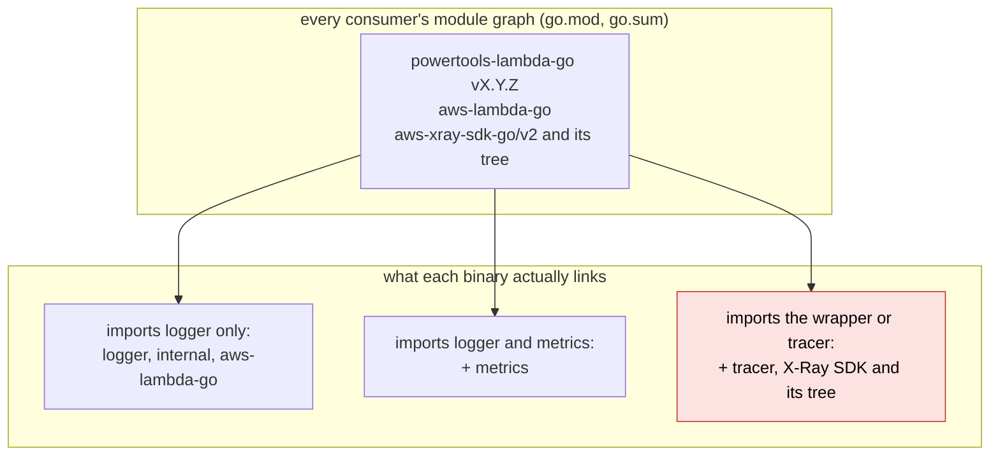
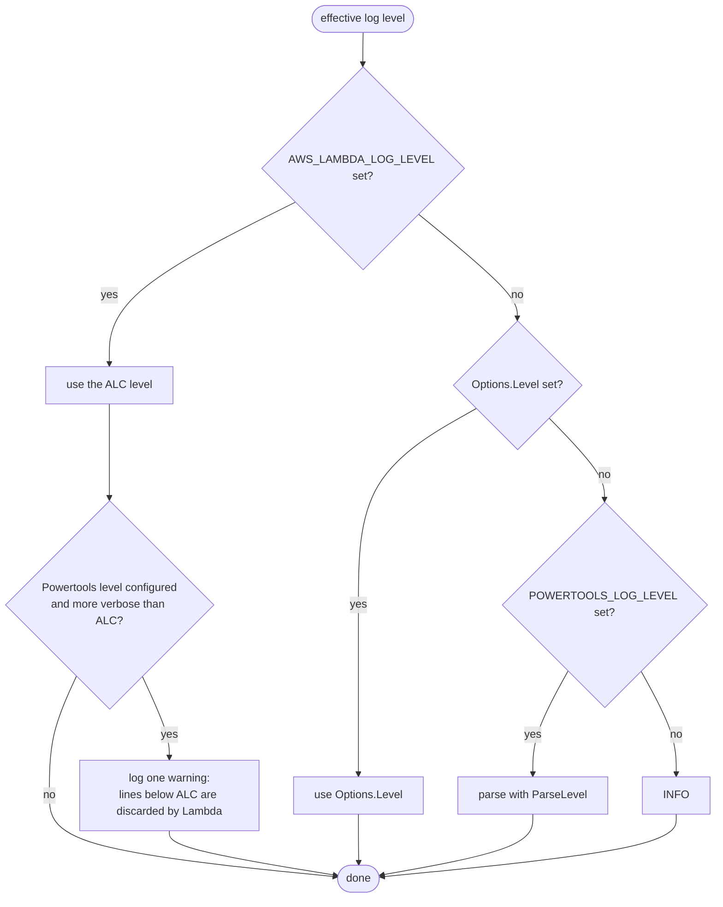
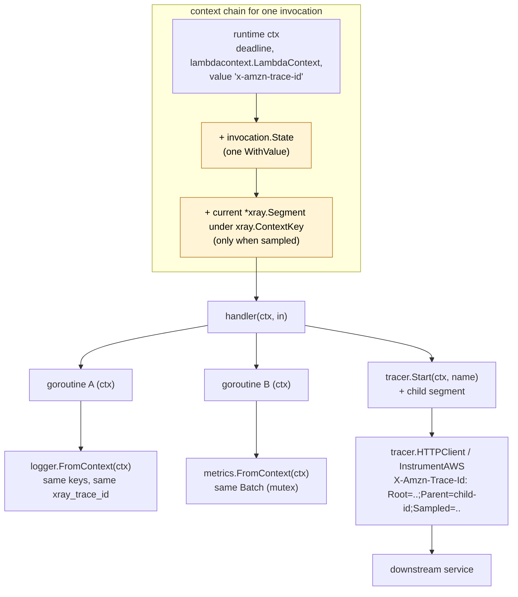
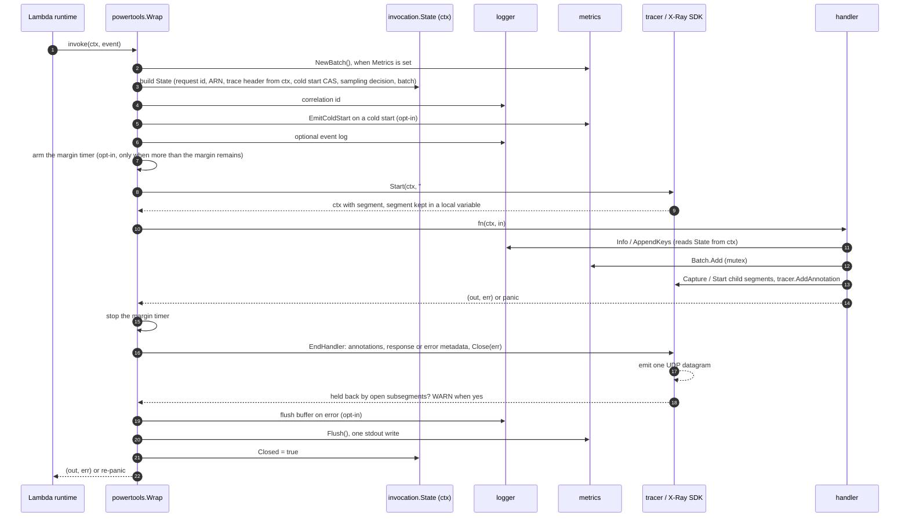
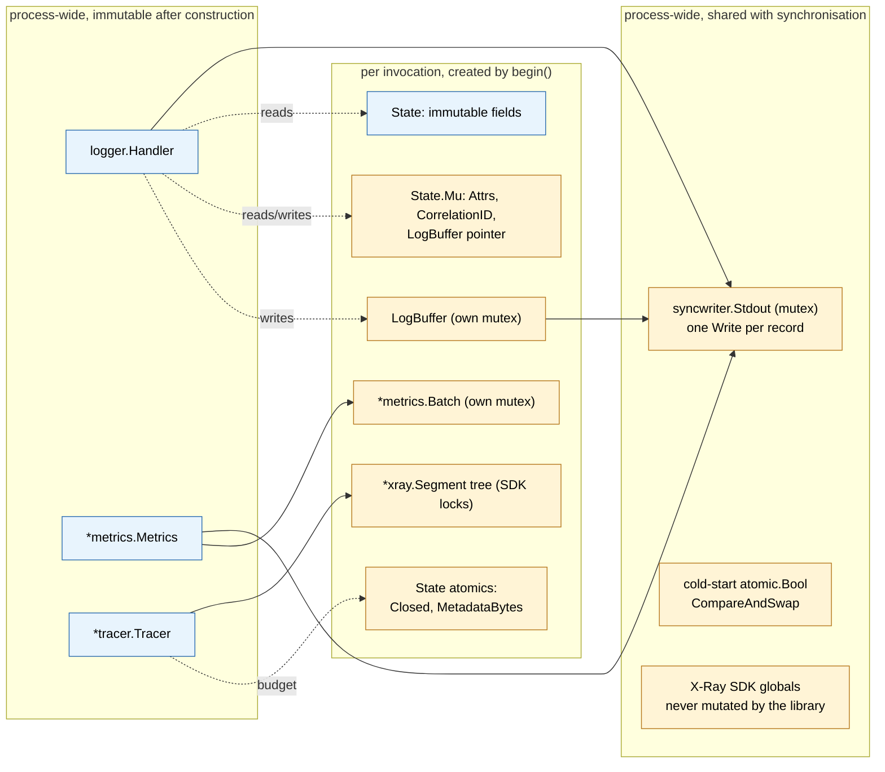
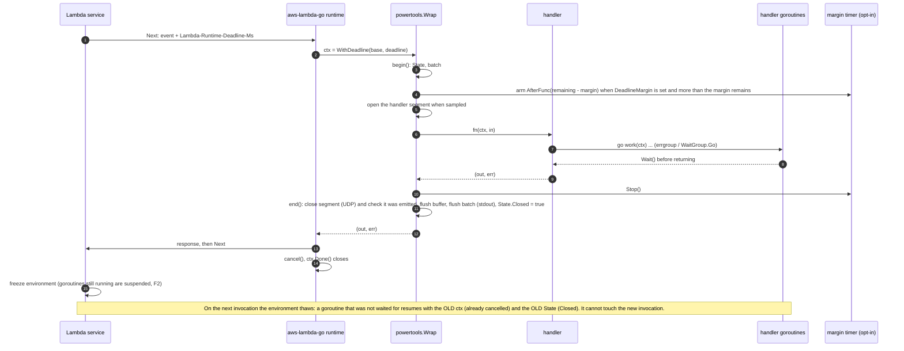
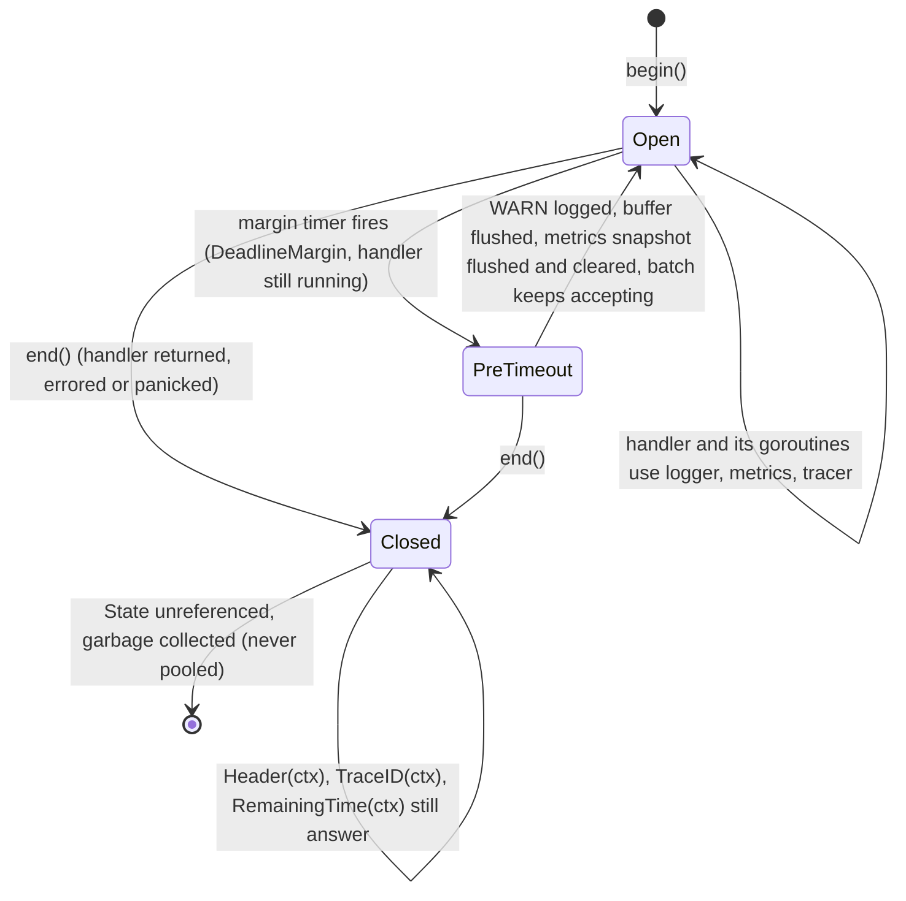
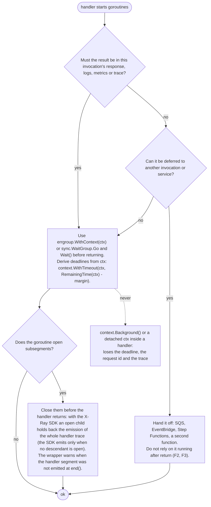
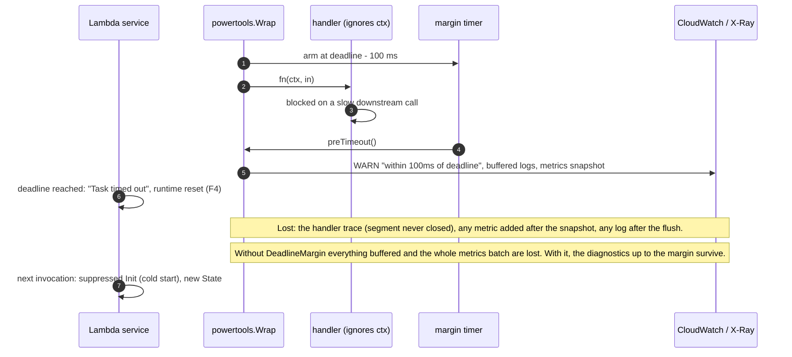

# 01. Architecture

This file fixes the rules every package follows: the runtime facts the design depends
on (§1), how the module is laid out and what it may import (§2), how configuration is
resolved (§3), how one invocation's state travels through `context.Context` and how the
wrapper drives the utilities (§4), the concurrency model (§5), the error and panic policy
(§6), and what happens at deadlines, freeze and shutdown (§7). Rules are numbered (R1 to
R11, F1 to F6, D1 to D7) so the other files and the tests can cite them; decision numbers refer to
the decision log ([09](09-open-questions.md)). Every Go snippet is an illustrative
example of the intended API, not code to copy.

## 1. Runtime facts that constrain the design

Each rule below is a hard constraint on the code. The source is the document or file
that establishes it.

| # | Rule | Source |
| --- | --- | --- |
| R1 | Go Lambdas run on `provided.al2023`, an OS-only runtime. `AWS_EXECUTION_ENV` and `_X_AMZN_TRACE_ID` are **not defined** by the runtime for the `provided` family. "Am I in Lambda" is decided from `AWS_LAMBDA_FUNCTION_NAME` alone (set and non-empty), never from `AWS_EXECUTION_ENV`. | Lambda "Defined runtime environment variables" |
| R2 | `aws-lambda-go` puts the trace header in the invocation context under the plain string key `"x-amzn-trace-id"` on every invoke, possibly as `""`. It also calls `os.Setenv("_X_AMZN_TRACE_ID", …)` with the same value, but only when `lambdacontext.MaxConcurrency() == 1`. The X-Ray SDK reads only the context value. The context value is therefore the **only** source of the trace header: there is no `_X_AMZN_TRACE_ID` fallback and no `os.Getenv` per invocation, and a missing or empty value means "no trace" for the logger and the tracer alike. The key is a built-in string type, which staticcheck flags (SA1029); tests set it through one shared helper that carries the single lint exemption. | `lambda/invoke_loop.go` v1.55.1, `xray/lambda.go` v2.0.4 |
| R3 | `lambdacontext.FromContext(ctx)` yields `AwsRequestID`, `InvokedFunctionArn`, `TenantID`; `lambdacontext.FunctionName`, `MemoryLimitInMB`, `FunctionVersion`, `LogGroupName`, `LogStreamName` are package variables filled from `AWS_LAMBDA_*` at init. | `lambdacontext/context.go` |
| R4 | Under Lambda Managed Instances, `AWS_LAMBDA_MAX_CONCURRENCY > 1` and several invocations run concurrently in one process, sharing stdout and all globals. Any per-invocation state in a package variable is a bug. The first N invocations may all be "first". | Lambda env vars page, `lambdacontext.MaxConcurrency`, R2 |
| R5 | Lambda Advanced Logging Controls (ALC) filter JSON logs by the `level` key with values `TRACE, DEBUG, INFO, WARN, ERROR, FATAL`. "If the `level` value field is invalid or missing, Lambda assigns the log output the level INFO." The `timestamp` must be RFC 3339 or Lambda assigns its own and treats the line as INFO. ALC sets `AWS_LAMBDA_LOG_LEVEL` and `AWS_LAMBDA_LOG_FORMAT`. | Lambda "Log-level filtering" |
| R6 | `AWS_LAMBDA_INITIALIZATION_TYPE` is `on-demand`, `provisioned-concurrency`, `snap-start` or `lambda-managed-instances`. Powertools Python treats `provisioned-concurrency` as "never a cold start". `lambda-managed-instances` is treated like `on-demand`: the first invocation to win the `CompareAndSwap` is the cold start, which is what keeps concurrent first invocations correct. | Lambda env vars page, `tracing/tracer.py` |
| R7 | `aws-lambda-go` recovers handler panics in `callBytesHandlerFunc` and reports them to the Runtime API with a stack. A wrapper that recovers must re-panic so this behaviour is preserved. | `lambda/invoke_loop.go` |
| R8 | `aws-lambda-go` accepts twelve handler shapes: `func()`, `func(In)`, `func() error`, `func(In) error`, `func() (Out, error)`, `func(In) (Out, error)`, and the same six with a leading `context.Context`; plus any value implementing `lambda.Handler` (`Invoke(ctx, []byte) ([]byte, error)`). `lambda.NewHandler(fn)` turns a function into a `lambda.Handler`, but its `Invoke` returns bytes from a pooled buffer that it has already put back in the pool. A caller that reads them while another invocation runs in the same process (R4) races with that invocation's writes, and `bytes.Clone` right after `Invoke` does not fix it. `lambda.Start(fn)` is safe: the runtime sends the buffer before releasing it. | `lambda/entry.go`, `lambda/handler.go` v1.55.1 |
| R9 | X-Ray in Lambda: the service creates the function segment (the "facade"); user code may only send **subsegments** with `type: "subsegment"` and `parent_id` equal to the `Parent` field of the trace header, over UDP to `AWS_XRAY_DAEMON_ADDRESS` prefixed by `{"format": "json", "version": 1}\n`. Documents are capped at 64 kB. Segment names are at most 200 characters. The SDK sends each document as one datagram (about 65 507 bytes on Linux): a larger document fails to send and the whole handler trace is lost. The SDK streams completed children separately only above 20 subsegments, a count, not a size. | X-Ray "Sending trace data", "Segment documents", `xray/lambda.go`, `xray/segment.go`, `xray/default_emitter.go`, `xray/default_streaming_strategy.go` |
| R10 | EMF: at most 100 metric definitions per log event, at most 30 dimension keys per set (Powertools uses 29), at most 100 values per metric array, `Timestamp` in epoch milliseconds within 14 days past / 2 hours future, numeric values within ±2^360, namespace and names 1 to 255 printable ASCII. | EMF specification, Powertools `cloudwatch.py` constants |
| R11 | `aws-xray-sdk-go/v2` requires Go 1.26 and depends on `grpc`, `protobuf`, `fasthttp`, `aws-sdk-go-v2`, `route53`. The tracer wraps it (decision 3). Go links only imported packages, so a binary that imports neither `tracer` nor the root wrapper does not contain any of this; the SDK does appear in every consumer's module graph because the library is one module (decision 25). Only `tracer` imports the SDK **directly** in production code. The root wrapper reaches it transitively through `tracer` and never names an SDK type. Test files (`_test.go`) may import the SDK, because they are never linked into consumer binaries. CI checks both rules (06 §5). | `aws-xray-sdk-go` `go.mod` v2.0.4 |

What follows from the rules, and why:

- **R1** (decision 35): one variable decides "in Lambda". Requiring a second one (such
  as `LAMBDA_TASK_ROOT`) adds nothing and makes the condition harder to reproduce in
  tests.
- **R2** (decision 30): the X-Ray SDK never reads `_X_AMZN_TRACE_ID`, so reading it as a
  fallback could make the logger print a trace ID that the tracer does not use. One
  source, one answer, and it is correct at any concurrency.
- **R8** (decision 29): because of the pooled-buffer race, `WrapHandler` takes only
  hand-written handlers that own their returned bytes, and `lambda/handlertrace` (which
  would expose typed values from inside `lambda.NewHandler`) is not used (§4.2).
- **R9** shapes the tracer's per-invocation metadata budget (04 §5): the limit is the
  size of one datagram, and response or error metadata is what makes a document large.
- **R11** shapes the import checks (06 §5): a direct-import rule alone would miss a
  utility that reaches the SDK through another package.

## 2. Module and package layout

Decision 25: the library is **one Go module with one version**. A single tag `vX.Y.Z`
versions every package; there is one `go.mod`, no `go.work`, no per-utility tags and no
release script that rewrites `require` lines. Consumers import the packages they need
(`.../logger`, `.../metrics`, `.../tracer`, or the root `powertools` wrapper) from the
same module version.

| Package | Imports | Linked into a binary when |
| --- | --- | --- |
| `powertools` (root) | `internal/...`, `logger`, `metrics`, `tracer`, `aws-lambda-go`; production code never imports the X-Ray SDK directly (its tracer wrapper tests may) | the wrapper is used (all three utilities come with it, and the X-Ray SDK through `tracer`, even when tracing is off) |
| `logger` | `internal/...`, standard library | imported |
| `metrics` | `internal/...`, standard library | imported |
| `tracer` | `internal/...`, `aws-xray-sdk-go/v2` (including `instrumentation/awsv2`), `smithy-go/middleware` | imported; the only package whose production code imports the X-Ray SDK |
| `internal/...` | standard library, `aws-lambda-go`; never the X-Ray SDK or a utility package, not even transitively | any of the above |
| `examples/...` | everything, plus SAM and AWS service clients | never: a separate, untagged module with a `replace` to the parent, so its dependencies stay out of the library |

Test-only dependencies: `github.com/google/go-cmp` (explicitly allowed by the Google
style guide) and a JSON schema validator for the EMF tests (decision 13). No assertion
libraries.

### Why one module

- **One version.** The root wrapper, `logger`, `metrics` and `tracer` share the
  `internal/invocation.State` contract. In one module there is nothing to mismatch: a
  consumer at `v0.3.0` has the `v0.3.0` of every package. Powertools Python ships the
  same way.
- **It absorbs change.** The root wrapper and the three utilities change together
  whenever the shared `State` contract moves, during the API freeze and during the API
  review. In one module such a change is one commit and one release, with no version
  juggling between packages.
- **Standard mechanics only.** Tagging is `git tag vX.Y.Z`, done by a release tool from
  conventional commits (06 §6, decisions 27 and 34): v0 minor releases while the API
  settles, one v1 after the API review (08 §3), and after v1 a breaking change needs a
  `/v2` module path (decision 40). `go get …/powertools-lambda-go@vX.Y.Z` brings every
  package; `internal/` is the ordinary Go visibility rule, nothing clever.
- **The accepted cost.** The X-Ray SDK is a requirement of the module, so it appears in
  every consumer's module graph (`go.sum` entries, Dependabot alerts for logger-only
  users). It does **not** reach their binaries unless they import `tracer` or the
  wrapper: Go links only imported packages, and only `tracer` imports the SDK. The rule
  covers production code only: `_test.go` files are never linked into consumer
  binaries, so they may import the SDK. The `deps` CI job (06 §5) checks it in two
  parts: (a) no package except `tracer` lists the SDK in `go list`'s `.Imports`
  (`.TestImports` and `.XTestImports` are not checked); (b) `go list -deps` of the
  production code of `logger`, `metrics` and `internal/...` reaches neither the SDK nor
  a utility package other than itself (`logger` does not reach `metrics` or `tracer`,
  `internal/...` reaches no utility). `govulncheck` reports only reachable
  vulnerabilities, so logger-only users are not paged for SDK-only findings.
- **Reversible.** If a later need appears (separate owners, a utility with a heavy
  dependency that must stay optional), a package can be split into its own module at a
  major version boundary. The decision log records why it is not done now.

### Binary size targets and the size gate

Lambda binaries are built with `CGO_ENABLED=0 go build -tags lambda.norpc -trimpath
-ldflags='-s -w'` for `provided.al2023`. Against a bare binary that only calls
`lambda.Start`, expect these orders of magnitude:

| Binary | Expected addition over the bare binary | Why |
| --- | --- | --- |
| `logger` and `metrics`, no wrapper | on the order of a hundred KiB | standard library code already linked by `aws-lambda-go`, plus the two packages |
| `Wrap` with all three utilities | several MiB (around 5) | the X-Ray SDK and its tree, linked through `tracer` even when tracing is off |
| the above plus the AWS SDK for Go v2 and one service client | several MiB more | the AWS SDK itself, a consumer choice |

A size-sensitive function therefore uses `logger` and `metrics` without the wrapper.
The CI size job keeps that property true (decision 37): it builds `examples/bare` and
`examples/hello` (logger and metrics, no wrapper) in the same run, with the same flags
and toolchain, and fails when the difference exceeds 1 MiB or when `go version -m`
lists the X-Ray SDK in the `hello` binary. Comparing two binaries of one run makes the
gate independent of the toolchain and the runner; an absolute size threshold would not
be.

What each kind of binary links, against what every consumer's module graph contains:



### Dependency pitfalls to plan for

Decision 35. Adding the X-Ray SDK to `go.mod` has two consequences that belong in the
same change:

- **`github.com/aws/smithy-go` becomes a direct requirement.** `tracer.InstrumentAWS`
  takes `*[]func(*middleware.Stack) error`, the type of `aws.Config.APIOptions`, so
  `tracer` imports `smithy-go/middleware`. The module is already in the SDK's graph, so
  the graph gains nothing, but `go mod tidy` moves it to the direct block.
- **The SDK's pinned transitive dependencies can fail `govulncheck`.** The
  `golang.org/x/net` version an SDK release requires may carry HTTP/2 advisories that
  `govulncheck` reports as reachable through the library's own packages, and a blocking
  `govulncheck` job then fails on the commit that adds the SDK. The remedy is an
  explicit higher `golang.org/x/net` requirement in the library's `go.mod` (which may
  also move `x/sys` and `x/text`), removed again once an SDK release requires a fixed
  version. Run `govulncheck` in the change that adds the SDK, not after it.

Two more rules keep the module graph calm (decision 37): `govulncheck` covers the
library module only, and the untagged `examples/` module is left to Dependabot, so an
AWS SDK advisory in an example never blocks an unrelated library change.

### Test layout and build tags

Decisions 26, 28, 37 and 38. Where tests live and how they are selected:

- **Every unit test file carries `//go:build unit`**, and every tool is told about it
  (`go test -tags=unit`, `go vet -tags=unit`, `go fix -tags=unit`, the linter's
  `build-tags`). Pitfall: a tool that is not told silently sees no tests and reports
  success.
- **Two exceptions.** The deployed-example harness carries `//go:build integration` and
  must skip cleanly, with a message, when its environment variables are unset; a test
  proves it. The `example_test.go` files carry **no** tag, because `go doc -ex` does not
  list examples from tagged files and has no `-tags` flag. A plain, untagged `go vet`
  over the public packages then proves the examples compile on their own, so an example
  never depends on a helper defined in a tagged test file.
- **Allocation budget tests additionally carry `!race`** (`//go:build unit && !race`):
  the race detector makes `sync.Pool` drop items, so allocation counts are only
  meaningful in a separate non-race run (05 §6).
- **The root package's wrapper tests are split per utility** (one test file each for the
  logger, metrics and tracer interaction, all in the external test package), so the
  three utility phases never edit the same file and can merge in parallel (07). The
  tracer wrapper test may import the SDK, for example to point `xray.ContextWithConfig`
  at a per-test UDP listener, because the import rule covers production code only (R11).
- **Shared test helpers** (the SA1029 trace-header helper of R2, fixtures) live in
  `internal/testsupport`, which only test files import, so every lint exemption exists
  exactly once.

### Go version floor

Decision 1: the module declares `go 1.27.0` (and so does `examples/go.mod`).
`encoding/json/v2` and `encoding/json/jsontext` (GA in 1.27) back `internal/jsonenc`:
`jsontext.AppendQuote` for strings, `json.MarshalWrite` for arbitrary values, with no
hand-rolled escaping.

- Pin the patch toolchain with a `toolchain go1.27.N` line, and let required CI jobs
  read `go-version-file: go.mod`, so local builds and CI use the same compiler. Go tip is
  not a CI job (decision 1): the dependency-update pull request that bumps the toolchain
  line runs every gate on the new compiler.
- `go test` runs the `stdversion` vet check: a standard library symbol newer than the
  `go` directive fails the tests. This is the guard that keeps the floor honest.
- Go tools (linters, `betteralign`, `govulncheck`) built with an older Go fail on 1.27
  sources: re-install them after every toolchain bump.

### JSON policy (decision 23)

`encoding/json/v2` and `encoding/json/jsontext` are the **only** JSON APIs used in
library and test code. The v1 `encoding/json` package is never imported by this
repository. Consequences:

- Raw JSON payloads (the payload and response bytes in `WrapHandler`, pre-marshalled
  metadata) are typed `jsontext.Value`, the v2 counterpart of `json.RawMessage`.
- Logger: `KindAny` and nested values are marshalled with `json.MarshalWrite` into a
  scratch region of the pooled buffer, with `jsontext.AllowInvalidUTF8(true)`. On error
  the region is truncated and the string `"!ERROR:<err>"` is written, as
  `slog.JSONHandler` does; a line is never dropped (02 §5).
- Metrics: each metadata value is marshalled with `json.Marshal` and then written with
  `enc.WriteValue`, never with `MarshalWrite` into the encoder's buffer. A value that
  fails to marshal is dropped with one `WARN` per batch, and `Flush` still succeeds
  (03 §5).
- Options. Encoding uses `jsontext.AllowInvalidUTF8(true)` for consumer values,
  `jsontext.WithIndent` for `POWERTOOLS_DEV`, and `json.Deterministic(true)` where output
  order matters in tests. Log lines may carry duplicate keys, as slog's do, so every
  decoder (golden and `slogtest` tests, the dev pretty-printer) passes
  `jsontext.AllowDuplicateNames(true)` and `jsontext.AllowInvalidUTF8(true)`.
- Third-party code keeps its own choice: `aws-lambda-go` decodes events with v1 and the
  X-Ray SDK marshals segments with v1. A `jsontext.Value` handed to the SDK as metadata
  is embedded as raw JSON, but v1 re-validates, compacts and HTML-escapes it (`<`, `>`
  and `&` grow to 6 bytes each). `json.RawMessage` behaves the same; it is equivalent,
  not a fallback. An invalid value makes the SDK drop the whole document, so `IsValid`
  is mandatory before any value reaches `AddMetadataToNamespace`, and the tracer's
  metadata budget counts the escaped size (04 §5). Tracer golden tests compare decoded
  values, not bytes.
- `GOEXPERIMENT=nojsonv2` builds are unsupported and the CI matrix does not include them.

Pitfall: do not assume raw JSON reaches the X-Ray SDK verbatim. Size every metadata
value as the SDK will write it (escaped), because the document must fit one datagram
(R9). Acceptance: a tracer test records a segment whose metadata contains `<`, `>` and
`&`, and checks both the decoded value and the budget arithmetic (04 §5).

### Package responsibilities (single responsibility per package)

| Package | Responsibility | Exports |
| --- | --- | --- |
| `powertools` (root) | Handler wrapper, invocation lifecycle, cold-start detection, deadline helpers, context accessors | `Wrap`, `WrapHandler`, `Options`, `ColdStart(ctx)`, `RequestID(ctx)`, `FunctionARN(ctx)`, `RemainingTime(ctx)`, `Deadline(ctx)` |
| `internal/invocation` | The per-invocation `State` struct, its context key and the `LogBuffer` type. Shared by root and the three utilities. Imports only the standard library. The mutable part of `State` changes only through its locked, nil-safe methods. | `State` (methods such as `AppendAttrs`, `RemoveAttrs`, `ResetAttrs`, `AttrsSnapshot`, `SetCorrelationID`, `EnsureLogBuffer`), `TraceHeader`, `LogBuffer`, `NewContext`, `FromContext` |
| `internal/lambdaenv` | The only package that reads the environment: typed getters and truthy parsing, in-Lambda (R1) and SAM local detection, function metadata (aws-lambda-go's `lambdacontext` variables), the cold-start eligibility rule for `AWS_LAMBDA_INITIALIZATION_TYPE`, and zero-alloc trace header parsing (R2, §4.1). There is no init-time snapshot (§3). It holds its own `"x-amzn-trace-id"` key constant, because only `tracer` may import the SDK's `xray.LambdaTraceHeaderKey`. | `String`, `Bool`, `BoolOr`, `Float`, `ServiceName`, `InLambda`, `SAMLocal`, `ColdStartEligible`, `ParseTraceHeader`, `TraceHeaderFromContext`, `Function` |
| `internal/jsonenc` | Two tiers. Hot tier for the logger record path: append-style helpers over `jsontext.AppendQuote` and `strconv` (`AppendString`, `AppendValue` for `slog.Value`, `AppendAttr` for one `slog.Attr`, `AppendAny` with the `"!ERROR:<err>"` fallback). Cold tier for EMF blobs and metadata: a pooled `jsontext.Encoder` driven with `WriteToken`/`WriteValue`, which enforces balanced structure (11 §3 A). Both tiers copy `jsontext.Value` verbatim after `IsValid`, which is what makes raw-event logging and raw metadata zero re-encode in our own output. NaN and the infinities are written as the strings `"NaN"`, `"+Inf"` and `"-Inf"`. | `AppendString`, `AppendValue`, `AppendAttr`, `AppendAny`, `Encoder` (pooled) |
| `internal/jsonpath` | Dot path with optional double-quoted segments (`headers."x-amzn-trace-id"`), parsed once at wrap time and evaluated on raw `jsontext.Value` bytes for `CorrelationIDPath` (02 §8). Strings, numbers and booleans are accepted as IDs, always returned as an owned copy. | `Parse`, `Path`, `ScalarString`, `ErrInvalidPath` |
| `internal/bufpool` | `sync.Pool` of `[]byte` with size cap to avoid pinning huge buffers | `Get`, `Put` |
| `internal/syncwriter` | `io.Writer` wrapper: mutex, one `Write` per record, never partial. `Stdout` is the one process-wide instance over `os.Stdout`, used by every utility whose `Writer` is nil, so logger and metrics share one mutex. A writer supplied by the consumer is wrapped in a `syncwriter` owned by that utility instance and is not shared with other utilities. | `New(w io.Writer) *Writer`, `Stdout` |
| `internal/benchutil` | Benchmark fixtures shared by every package: a realistic invocation context and events (05 §5). Never imports the X-Ray SDK. | see 05 §5 |
| `internal/testsupport` | Test helpers imported only by test files, including the one helper that puts a trace header into `ctx` under the string key with the SA1029 exemption (R2). | see 06 §1 |
| `logger` | `slog.Handler` with Powertools output, six ALC levels, package-level `Trace…Fatal(ctx, …)`, sampling, buffering, invocation keys, correlation ID | see 02 |
| `metrics` | EMF batching, validation, serialization, cold-start metric (`EmitColdStart`) and single metrics | see 03 |
| `tracer` | Powertools semantics over `aws-xray-sdk-go/v2`: enable rules, handler segment and its end-of-handler helper, `Capture` helpers, nil-safe context helpers (`AddAnnotation`, `AddMetadata`), `HTTPClient` and `InstrumentAWS`, the per-invocation metadata budget | see 04 |

Two layout rules with their reasons (decision 33): exactly one package,
`internal/lambdaenv`, reads the environment, so precedence and truthy parsing are
written and tested once; and `internal/invocation` exposes locked methods instead of
letting the logger take `State.Mu` itself, so the lock order of §5 lives in one place.

## 3. Configuration model

### Option structs, not functional options

Every constructor takes a value option struct whose zero value is usable:

```go
l := logger.New(logger.Options{})          // service from env or "service_undefined"
m, err := metrics.New(metrics.Options{})   // namespace from env, else ErrNamespaceMissing at Flush
t := tracer.New(tracer.Options{})          // enable rules from env (R1, AWS_SAM_LOCAL, switches)
```

Reasons (Google best practices): callers almost always set a few fields, the literal is
self-documenting, new fields never break call sites, and `context.Context` is never part
of an option struct. Functional options are not used anywhere. Tri-state fields are
`*bool` and are set with Go 1.26's `new(expr)`: `tracer.Options{CaptureResponse: new(false)}`.

Rules that keep the zero value usable (decisions 33, 42):

- **A boolean whose default is `true` is a `*bool`** (nil means true), for example
  `logger.BufferOptions.FlushOnErrorLog`. A plain `bool` would make the zero value mean
  "off" for a feature that should be on.
- **A boolean backed by an environment variable is a `*bool`**, so the caller can switch
  the variable off as well as on: nil defers to the variable, `new(true)` and
  `new(false)` win over it. `powertools.Options.LogEvent`, `metrics.Options.Disabled`,
  `tracer.Options.Enabled`, `CaptureResponse` and `CaptureError`, and
  `logger.Options.Pretty` follow it. A plain `bool` could only switch a feature on.
- **Other "unset" values are the type's nil or zero**: `logger.Options.Level` and
  `logger.BufferOptions.BufferAtLevel` are `slog.Leveler`s whose nil means "from the
  environment" and DEBUG respectively; a numeric option at 0 or less means its default.
- **Options are copied by the constructor.** Changing an Options value afterwards has no
  effect on an instance already built.

`metrics.New` is the only constructor that returns an error: an invalid namespace,
service or default dimension would make every later blob invalid, so it fails early,
whereas the logger falls back to its defaults with one warning and the tracer has
nothing that can fail (decisions 36, 44). A namespace that is merely absent is not an
error at `New`, because a function may emit only `Single` metrics that carry their own
namespace (`WithNamespace`); every batch `Flush` then reports `ErrNamespaceMissing`
(03 §2). A present but invalid namespace is a code bug and fails at `New`.

Illustrative use of the intended API:

```go
lg := logger.New(logger.Options{
    Service:    "payment",
    Level:      slog.LevelDebug,                        // ignored when AWS_LAMBDA_LOG_LEVEL is set
    SampleRate: 0.1,                                    // per-invocation DEBUG sampling, needs the wrapper
    Buffer:     logger.BufferOptions{Enabled: true},    // FlushOnErrorLog nil means true
})
met, err := metrics.New(metrics.Options{
    Namespace:         "ServerlessAirline",
    Service:           "payment",                       // "service" is the first dimension of every blob
    DefaultDimensions: map[string]string{"environment": "prod"},
})
if err != nil {
    log.Fatal(err) // invalid namespace, service or dimension
}
trc := tracer.New(tracer.Options{Service: "payment", CaptureResponse: new(false)})
```

### Precedence

For every setting: **explicit option field > environment variable > default**, with one
exception mandated by ALC (R5):

```text
log level = AWS_LAMBDA_LOG_LEVEL  >  Options.Level  >  POWERTOOLS_LOG_LEVEL  >  INFO
```



If `AWS_LAMBDA_LOG_LEVEL` is set and is stricter than the Powertools level, the handler
logs one warning at construction ("current log level is lower than ALC, lines below X
will be discarded") exactly as the Python and TypeScript editions do. When ALC is set, a
`*slog.LevelVar` passed as `Options.Level` is ignored as well.

Environment is read **once, in the constructors** (`logger.NewHandler`, `metrics.New`,
`tracer.New`, `powertools.Wrap` and `WrapHandler`), which cache what they need. Nothing
reads `os.Getenv` per invocation; the trace header comes only from the invocation
context (R2). `tracer.HTTPClient` and `tracer.InstrumentAWS` are constructors in this
sense too: they evaluate the enable rules when called, at init.

There is **no environment snapshot at package init** (decision 35). The getters of
`internal/lambdaenv` read the environment when called, and only constructors call them.
Reason: an init-time snapshot makes tests order-dependent, because `t.Setenv` runs after
package init, so a test could not change what the library sees. Consequences:

- Tests set variables with `t.Setenv` **before** constructing.
- A value read at construction never changes for that instance; two instances built
  under different environments behave differently, as intended.
- The only process-wide copy of environment values is aws-lambda-go's own
  `lambdacontext` variables (R3), which the library reads but never caches again.
- Acceptance: a test constructs each utility twice under different `t.Setenv` values and
  checks that each instance follows the environment of its construction.

### Environment variables honoured

| Variable | Utility | Default | Notes |
| --- | --- | --- | --- |
| `POWERTOOLS_SERVICE_NAME` | all | `service_undefined` | `service` key, `service` dimension (the first dimension of every blob), `Service` annotation; each utility falls back to `service_undefined` independently |
| `POWERTOOLS_LOG_LEVEL` | logger | `INFO` | `TRACE DEBUG INFO WARN ERROR FATAL`, plus `WARNING`, `CRITICAL`, `SILENT` as aliases, case-insensitive |
| `AWS_LAMBDA_LOG_LEVEL` | logger | unset | ALC; wins over everything (R5) |
| `AWS_LAMBDA_LOG_FORMAT` | logger | unset | informational; output is always JSON |
| `POWERTOOLS_LOGGER_SAMPLE_RATE` | logger | `0` | `0.0` to `1.0`, clamped; the per-invocation decision is made by the wrapper, so sampling requires it |
| `POWERTOOLS_LOGGER_LOG_EVENT` | wrapper | `false` | used when `Options.LogEvent` is nil (truthy turns event logging on); `new(true)` or `new(false)` wins, so `new(false)` switches a truthy variable off |
| `POWERTOOLS_DEV` | logger, metrics | `false` | pretty-print logs, never inside Lambda (an indented line becomes several CloudWatch events); silence metrics unless `POWERTOOLS_METRICS_DISABLED=false` |
| `POWERTOOLS_METRICS_NAMESPACE` | metrics | unset | required by `Flush` |
| `POWERTOOLS_METRICS_FUNCTION_NAME` | metrics | unset | `function_name` dimension of `ColdStart`: `metrics.Options.FunctionName`, then this variable, then the argument of `EmitColdStart` |
| `POWERTOOLS_METRICS_DISABLED` | metrics | `false` | no output at all; arguments are still validated |
| `POWERTOOLS_TRACE_DISABLED` | tracer | `false` | Python name; also makes `tracer.HTTPClient` return an untraced client and `tracer.InstrumentAWS` a no-op. `xray.Client` and `awsv2` used directly ignore it |
| `POWERTOOLS_TRACE_ENABLED` | tracer | `true` | TypeScript name; both honoured, disabled wins |
| `POWERTOOLS_TRACER_CAPTURE_RESPONSE` | tracer | `true` | |
| `POWERTOOLS_TRACER_CAPTURE_ERROR` | tracer | `true` | |
| `POWERTOOLS_TRACER_CAPTURE_HTTPS_REQUESTS` | tracer | `true` | honoured by `tracer.HTTPClient` |
| `AWS_XRAY_DAEMON_ADDRESS` | tracer (SDK) | `127.0.0.1:2000` | read by the X-Ray SDK at init |
| `AWS_XRAY_CONTEXT_MISSING` | tracer (SDK) | `LOG_ERROR` in Lambda | read by the X-Ray SDK |
| `AWS_XRAY_SDK_DISABLED` | tracer | `false` | compared case-insensitively, as the SDK does; checked by the tracer and by the SDK; the only switch that also stops `xray.Client` and `awsv2` used directly |
| `AWS_SAM_LOCAL` | tracer | unset | disables tracing |
| `AWS_LAMBDA_FUNCTION_NAME`, `AWS_LAMBDA_FUNCTION_MEMORY_SIZE`, `AWS_LAMBDA_FUNCTION_VERSION` | all | | via `lambdacontext`; `AWS_LAMBDA_FUNCTION_NAME` also decides "in Lambda" (R1) |
| `AWS_LAMBDA_INITIALIZATION_TYPE` | wrapper | `on-demand` | cold-start rule (R6) |
| `AWS_LAMBDA_MAX_CONCURRENCY` | none | `1` | informational: read by aws-lambda-go only (R2, R4); the library never consults it, because it is correct at any concurrency |
| `_X_AMZN_TRACE_ID` | none | | never read: the trace header comes only from `ctx` (R2) |
| `TZ` | logger | `:UTC` | timestamps are UTC unless `Options.Location` is set |

Truthy values are parsed in one place (`internal/lambdaenv`) with the same rule for
every boolean variable (`AWS_XRAY_SDK_DISABLED` excepted, compared as the SDK compares
it). A variable that is set but unparseable is treated as unset, and so is a NaN or
infinite number, so the default applies; it never fails a constructor. The parser
reports "unset" separately from "false", which the `POWERTOOLS_DEV` rule of metrics
needs (an explicit `POWERTOOLS_METRICS_DISABLED=false` wins over dev mode). When this table changes, the
environment-variable lists in 02, 03 and 04 and the package docs change with it.

## 4. Invocation lifecycle and context propagation

This is the backbone of the library. One struct per invocation, created by the wrapper,
stored once in the context, read by every utility.

### 4.1 The per-invocation state

```go
package invocation // internal; imported by root, logger, metrics and tracer

// State is the per-invocation record. Fields are exported because the owning
// packages live outside this one; the comments say who writes what. The package
// must not import logger, metrics or tracer (they import it), so the slots those
// packages own are typed any and type-asserted by their owner (a pointer type
// assertion allocates nothing). No field holds an X-Ray SDK type: the handler
// segment is a local variable of the root wrapper (§4.2) and the DeadlineMargin
// timer lives in an unexported root struct. Fields are shown here in logical order;
// the final order is decided by betteralign (05 §4) to minimise padding and GC scan
// bytes. Contract rule: within a major version fields are only ever added, never
// renamed, retyped or removed, because three packages read this struct (11 §2).
type State struct {
    // Immutable after begin(). Safe to read from any goroutine without locking.
    RequestID    string
    FunctionARN  string
    ColdStart    bool
    Trace        TraceHeader   // parsed once from ctx.Value("x-amzn-trace-id"); zero value = no trace
    DebugSampled bool          // this invocation emits DEBUG regardless of level
    HandlerName  string        // "## main.handle"
    Started      time.Time
    Deadline     time.Time     // from ctx.Deadline(); zero when absent (local runs)
    Logger       *slog.Logger  // Options.Logger; nil means logger.FromContext returns slog.Default()
    Tracer       any           // *tracer.Tracer, for the package-level tracer.Start and Capture
    Metrics      any           // *metrics.Batch created by the wrapper, for metrics.FromContext

    // Mutable. Guarded by Mu, changed only through locked State methods
    // (AppendAttrs, RemoveAttrs, ResetAttrs, SetCorrelationID, EnsureLogBuffer).
    Mu            sync.Mutex
    CorrelationID string
    Attrs         []slog.Attr   // AppendKeys / RemoveKeys / ResetKeys
    AttrsVersion  uint32        // bumped on change; the logger caches its rendering by version
    AttrsJSON     []byte        // cached rendering of Attrs (written by the logger under Mu)
    LambdaJSON    []byte        // cached rendering of the Lambda context keys (written once by the logger)
    LogBuffer     *LogBuffer    // set once, lazily, by the first logger Handler that buffers a record;
                                // its contents are guarded by its own mutex, never by Mu (02 §9)

    // Atomics: read and written from any goroutine without Mu.
    Closed        atomic.Bool   // set by end(); late calls degrade as defined in 01 §7.4
    MetadataBytes atomic.Int64  // escaped X-Ray metadata bytes added so far by the handler segment
                                // and its Capture children; the tracer enforces the budget (04 §5)
}

type TraceHeader struct {
    Root    string // "1-5759e988-bd862e3fe1be46a994272793"
    Parent  string // "53995c3f42cd8ad8"
    Sampled bool   // true only for "Sampled=1"
    Rest    string // trailing contiguous run of other fields, e.g. "Lineage=a87bd80c:0";
                   // a substring (zero-alloc), forwarded by tracer.Header
}

func NewContext(parent context.Context, s *State) context.Context
func FromContext(ctx context.Context) *State   // nil when the wrapper is not in use
```

**Trace header parsing rule.** `ParseTraceHeader` agrees with the SDK's
`header.FromString` on `Root`, `Parent` and `Sampled`: each is recognised in any
position, a later duplicate wins, `Sampled` is true only for `Sampled=1`, and `Self=` and
fields without `=` are skipped. `Rest` is one substring over the *trailing contiguous
run* of other fields, so it costs no allocation. An unknown field placed *before* a later
known field is therefore not forwarded, whereas the SDK keeps it and `Header.String()`
would forward it. This is an accepted divergence, because Lambda appends extra fields
such as `Lineage` last; a table test in `tracer` runs the same inputs through both
parsers and checks that they agree on the three known fields.

What `State` deliberately does **not** hold, and why (decisions 30, 31, 33, 35):

- **No segment.** The handler segment is a local variable of the wrapper's closure, so
  the root package never names an SDK type (R11) and `internal/invocation` stays free of
  the SDK. The current segment travels only under the SDK's own context key.
- **No open-subsegment counter.** The SDK already records whether a segment was emitted;
  a counter in `State` would see only children opened through `tracer`, not those of
  `xray.Client`, `awsv2` or direct SDK calls (§7 D7).
- **No timer.** The `DeadlineMargin` timer lives in a root-local struct, so nothing in a
  shared struct can outlive `end()` by accident.

And why two fields exist: `MetadataBytes` carries the per-invocation metadata budget
across the handler segment and every `Capture` child (04 §5); `TraceHeader.Rest` lets
`tracer.Header` forward fields such as `Lineage` without re-parsing. The `LogBuffer` has
its own mutex because a flush writes many records and must not hold `State.Mu` while
doing so (§5 lock order).

Acceptance for the parser: a table test feeds `ParseTraceHeader` and the SDK's
`header.FromString` the same inputs (fields in any order, duplicates, `Self=`, fields
without `=`, empty and whitespace-only values, `Sampled=?` and `Sampled=0`) and checks
that both agree on `Root`, `Parent` and `Sampled`; an allocation test pins the parser at
0 allocations.

Design notes:

- **One `context.WithValue` per invocation.** The three utilities each do one
  `ctx.Value` lookup for `State`, not three different keys. The current segment is
  carried only under the SDK's `xray.ContextKey`, in the `ctx` that the SDK returns
  when a subsegment begins, so `xray.Client`, `awsv2` and direct SDK calls see the same
  parent as the tracer.
- **Render caches are handler-independent.** `ReplaceAttr` applies only to record attrs
  and `With` attrs; it never sees built-in keys, Lambda keys or `AppendKeys` attrs
  (decision 33). `AttrsJSON` and `LambdaJSON` are therefore valid for every handler that
  logs in the invocation, including composed ones.
- **No pooling of `State`.** A goroutine started by the handler may outlive the
  invocation and still hold the context. Reusing the struct would be a data race.
  One allocation per invocation is the price; buffers inside it are pooled.
- **Goroutine inheritance.** Any `go func() { … }(ctx)` in the handler logs with the
  same keys, adds to the same metric batch, and opens subsegments under the current
  segment, because all of that is reachable from `ctx`. Work that finishes after the
  handler returns is not part of the invocation any more; what happens to it, and what
  consumers must do with their goroutines, is specified in §7.
- **Everything is reached through `ctx`, so `ctx` must be passed.** `slog.Logger.Info`
  without `Context` hands `context.Background()` to the handler, and that line carries
  no Lambda keys, no correlation ID and no `AppendKeys` attrs, and is never buffered.
  Docs and examples use the `...Context` methods, `LogAttrs` or the package functions
  (`logger.Info(ctx, …)`), and the same holds for metrics and tracer helpers (02 §14).
- **Without the wrapper** (`FromContext` returns nil) every utility degrades: the logger
  omits Lambda keys, and `logger.FromContext` returns `slog.Default()` (also when
  `State.Logger` is nil); `metrics.FromContext` returns a nil `*Batch` whose methods are
  no-ops; sampling is off, because it requires the wrapper. `tracer.FromContext` returns
  nil when there is no segment, and **`*xray.Segment` methods are not nil-safe**
  (`AddAnnotation`, `AddMetadataToNamespace`, `AddError` and `DownstreamHeader` panic on
  nil; only `Close` checks). Handler code therefore uses the nil-safe helpers
  `tracer.AddAnnotation(ctx, …)` and `tracer.AddMetadata(ctx, …)`, which return nil
  without a segment, or checks for nil itself. Package-level `tracer.Capture` and
  `CaptureResult` use the SDK when a segment or a sampled trace header is present in
  `ctx` and run `fn` untraced otherwise. This keeps unit tests of handler code free of
  ceremony.

Pitfall (decision 31): do not assume a nil `*xray.Segment` behaves as a no-op. It does
not, and an API that hands it to handler code would turn every untraced invocation into
a panic. The nil-safe helpers are the answer for consumers; inside the library, the
tracer nil-checks the segment before every SDK call. Acceptance: every exported tracer
function and method is called in a test with no segment in `ctx` and with a nil
`*Tracer`, and none panics.

Illustrative handler code that is safe with and without the wrapper:

```go
func handle(ctx context.Context, in Order) (Receipt, error) {
    logger.AppendKeys(ctx, slog.String("order_id", in.ID))  // no-op without the wrapper
    logger.Info(ctx, "processing order")                     // falls back to slog.Default()

    _ = metrics.FromContext(ctx).Add("Orders", metrics.Count, 1) // nil *Batch: no-op, nil error
    _ = tracer.AddAnnotation(ctx, "order_id", in.ID)              // no segment: no-op, nil error

    // Never: tracer.FromContext(ctx).AddAnnotation(...) — nil when not traced, and it panics.
    return Receipt{OrderID: in.ID}, nil
}

func TestHandle(t *testing.T) {
    got, err := handle(t.Context(), Order{ID: "o-1"}) // no wrapper, no Lambda context
    if err != nil {
        t.Fatalf("handle() error = %v", err)
    }
    if got.OrderID != "o-1" {
        t.Errorf("handle().OrderID = %q, want %q", got.OrderID, "o-1")
    }
}
```



Reading the diagram: everything below the chain inherits the same `State`, so a log line
from goroutine B carries the same `function_request_id` and `xray_trace_id` as one from
the handler, and a child segment opened inside goroutine A hangs off the handler
segment. Outbound calls carry the current segment id as `Parent`.

### 4.2 The wrapper

```go
package powertools

type Options struct {
    Logger  *slog.Logger      // from logger.New; nil means the wrapper's own lines and logger.FromContext use slog.Default()
    Metrics *metrics.Metrics  // may be nil
    Tracer  *tracer.Tracer    // may be nil

    LogEvent                   *bool  // log the incoming event at INFO ("Lambda invocation event"); nil means
                                      // POWERTOOLS_LOGGER_LOG_EVENT, else off; new(false) switches it off
    CorrelationIDPath          string // dot path on the raw payload (WrapHandler) or on the marshalled typed event (Wrap)
    CorrelationIDFunc          func(ctx context.Context, event any) string // wins over the path; event is In under Wrap,
                                                                           // the raw payload as jsontext.Value under WrapHandler
    FlushBufferOnUncaughtError bool
    CaptureColdStartMetric     bool
    CaptureResponse            *bool  // nil = tracer default
    CaptureError               *bool
    HandlerName                string // replaces the derived name; the segment is always named "## " + name
    PprofLabels                bool   // run the handler under pprof.Do with function_request_id and function_name labels (§6)
    DeadlineMargin             time.Duration // > 0 arms a pre-timeout flush of logs and metrics this long before the deadline (01 §7, D6)
}

// Wrap adapts a typed handler. In and Out are inferred.
func Wrap[In, Out any](fn func(context.Context, In) (Out, error), opts Options) func(context.Context, In) (Out, error)

// WrapHandler adapts a hand-written lambda.Handler that owns the bytes it returns.
// It does not support lambda.NewHandler(fn), whose Invoke returns bytes from a pooled
// buffer it has already released (R8). Payload and response are seen as raw JSON.
func WrapHandler(h lambda.Handler, opts Options) lambda.Handler
```

Options is read once, when `Wrap` or `WrapHandler` is called, together with the
environment variables it depends on (`POWERTOOLS_LOGGER_LOG_EVENT`,
`POWERTOOLS_LOGGER_SAMPLE_RATE`, `AWS_LAMBDA_INITIALIZATION_TYPE`). Changing an Options
value afterwards has no effect on a wrapper already built, and one Options value may
configure several wrappers. With every utility nil, the wrapped handler behaves exactly
like the unwrapped one plus the per-invocation state in its context.

Two Powertools options are deliberately absent from `powertools.Options`. There is no
`ResetKeys`: `State` is per invocation, so clearing the keys at the end of an
invocation would change nothing (decision 33; `logger.ResetKeys(ctx)` still exists for
handler code). `RaiseOnEmptyMetrics` lives in `metrics.Options`, because `Flush` is what
reads it and consumers who flush without the wrapper need it too (decision 32).

`Wrap` is the recommended form: no reflection, no re-encoding, generic type inference
gives the caller `lambda.Start(powertools.Wrap(handle, opts))`. The other handler shapes
of R8 use `Wrap` with a one-line closure adapter; v1 has no extra adapter API
(decision 29). Illustrative:

```go
// func(context.Context, Event) error, adapted once in main
lambda.Start(powertools.Wrap(func(ctx context.Context, e Event) (any, error) {
    return nil, process(ctx, e)
}, opts))

// a hand-written lambda.Handler, for example a router that owns its response bytes
type router struct{ /* routes */ }

func (r *router) Invoke(ctx context.Context, payload []byte) ([]byte, error) { /* … */ }

lambda.Start(powertools.WrapHandler(&router{}, powertools.Options{
    Logger:            lg,
    CorrelationIDPath: logger.CorrelationPathAPIGatewayHTTP, // evaluated on the raw payload
}))
```

`WrapHandler` exists for hand-written `lambda.Handler` implementations, such as
middleware chains, that own the bytes they return. It works on the raw payload (the
`Invoke` argument) and the raw response bytes: it passes them as `jsontext.Value` to
`CorrelationIDPath`, `CorrelationIDFunc` and `LogEvent`, and to the tracer for response
metadata. It never decodes the payload and never observes typed values. The payload
passed to `CorrelationIDFunc` is valid only until the call returns (`bytes.Clone` it to
keep it).

Both entry points share one unexported lifecycle in the root package. The handler
segment is a local variable of the per-invocation closure, captured by the deferred end:
root never names its type (that would be a direct SDK import, R11) and never stores it
in `State`. The tracer's exported end-of-handler helper does everything that touches the
segment. The margin timer sits in an unexported root struct local to `begin` and `end`.
A sketch of the shape, not of the code:

```go
return func(ctx context.Context, in In) (out Out, err error) {
    ctx, s, c := o.begin(ctx, in)                     // steps 1 to 9 of §4.3
    ctx, seg := o.tracer.Start(ctx, s.HandlerName)    // step 10; nil-safe on a nil *Tracer; nil unless sampled
    defer func() {
        p := recover()
        c.stopTimer()                                 // step 13
        held := o.tracer.EndHandler(ctx, seg, tracer.HandlerEnd{ /* name, cold start, out, err or panic */ })
        if e := o.end(ctx, s, held, err, p); err == nil && e != nil {
            err = e                                   // the Flush error, only when the handler succeeded
        }                                             // end re-panics when p != nil
    }()
    return fn(ctx, in)                                // inside pprof.Do when PprofLabels is set
}
```

The tracer side of that contract is exported, documented as wrapper plumbing that
consumers of `Wrap` never call; it cannot live in `internal/`, because `internal/...`
must never reach the SDK (decision 44):

```go
// HandlerEnd carries what the wrapper knows when the handler returns.
type HandlerEnd struct {
    Name            string         // handler name without the "## " prefix
    ColdStart       bool           // "ColdStart" annotation
    Response        any            // Wrap: the typed response, marshalled once with encoding/json/v2
    RawResponse     jsontext.Value // WrapHandler: the response bytes, used after IsValid
    Err             error          // the handler error, or the panic as an error
    CaptureResponse *bool          // wrapper overrides; nil = tracer default
    CaptureError    *bool
}

// EndHandler annotates, adds metadata within the invocation budget and closes seg.
// It reports whether the SDK held back the handler document because a descendant is
// still open. Safe on a nil *Tracer and a nil seg.
func (t *Tracer) EndHandler(ctx context.Context, seg *xray.Segment, e HandlerEnd) (heldBack bool)
```

The handler subsegment name defaults to `"## " + runtime.FuncForPC(reflect.ValueOf(fn).Pointer()).Name()`
under `Wrap`, computed **once at wrap time** (for example `## main.handle`), mirroring
Python's `## lambda_handler`. Under `WrapHandler` the derived name is the dynamic type of
`h`, `reflect.TypeOf(h).String()` (for example `## *main.router`), and `""` for a nil `h`
(guarded, so `WrapHandler(nil, …)` does not panic at wrap time; the nil handler panics at
invocation like any handler panic). `_HANDLER` is not used because on `provided.al2023`
it is the executable name. `Options.HandlerName` replaces the derived name; the `"## "`
prefix is always added. The `WrapHandler` rule uses the type because `runtime.FuncForPC`
has no function to look at for an interface value.

Derived names a consumer should expect, and when to set `HandlerName`:

| Handler passed to `Wrap` | Derived name | Advice |
| --- | --- | --- |
| a top-level function `handle` | `main.handle` | none |
| a closure written in `main` | `main.main.func1` | set `HandlerName` |
| a method value `a.handle` | `main.(*app).handle-fm` | set `HandlerName`, for example `"main.handle"` |
| a nil function | `""` (`runtime.FuncForPC(0)` returns a nil `*Func`, whose `Name` is `""`) | the nil handler panics at invocation, re-raised like any panic |

Dashboards and integration tests key on the segment name, so a function whose handler
is a closure or a method sets `HandlerName` once, in the Options it shares with its
tests.

`begin` and `end` take only what they need (decisions 29, 31, 35), and the segment never
crosses the root package boundary.

### 4.3 Sequence per invocation

```text
lambda runtime ──▶ Wrap(fn)(ctx, in)
  begin (every immutable State field is computed before NewContext, §5):
    1. lc, ok := lambdacontext.FromContext(ctx)               (request id, ARN; both "" without a Lambda context)
    2. hdr := ParseTraceHeader(ctx.Value("x-amzn-trace-id"))  (only source; "" means no trace; no os.Getenv, R2)
    3. cold := started.CompareAndSwap(false, true) && coldEligible
                                                              (inverted flag: its zero value needs no init; the CAS always
                                                               runs; coldEligible = initType != "provisioned-concurrency",
                                                               resolved at wrap time)
    4. logger:  sampled := rate > 0 && rand.Float64() < rate  (rate resolved at wrap time: (*logger.Handler).SampleRate()
                                                               when opts.Logger.Handler() is ours, else from env)
       metrics: b := m.NewBatch() when opts.Metrics != nil
    5. s := &State{…, Metrics: b}; ctx = invocation.NewContext(ctx, s)   (no typed nil in an any slot)
    6. event bytes, at most once: the raw payload under WrapHandler; under Wrap, json.Marshal(in) only when
       LogEvent is on or a path is set without CorrelationIDFunc
       logger:  s.CorrelationID = CorrelationIDFunc(ctx, event) or the path lookup on the event bytes
    7. metrics: if cold && opts.CaptureColdStartMetric { m.EmitColdStart(lambdacontext.FunctionName) }
                                                              (separate EMF blob; an error is a WARN, never an invocation error)
    8. logger:  if logEvent { log "Lambda invocation event" with the event }
    9. if opts.DeadlineMargin > 0, a deadline exists and more than the margin remains {
           arm time.AfterFunc(remaining - margin, preTimeout) }                        (D6)
  call:
   10. tracer:  ctx, seg := t.Start(ctx, s.HandlerName)       ((ctx, nil) unless enabled and hdr.Sampled; the SDK builds the
                                                               facade from the ctx header, parent_id = hdr.Parent; seg stays local)
   11. defer end(...) with recover()
   12. out, err := fn(ctx, in)                                (WrapHandler: out, err := h.Invoke(ctx, payload))
  end:
   13. stop the margin timer                                  (D6; a callback already running is harmless)
   14. tracer:  held := t.EndHandler(ctx, seg, …): annotate ColdStart and Service; response or error metadata
                within the budget; seg.Close(err), so the SDK sets fault and cause and emits (one UDP write);
                held = the SDK did not emit the segment           →  if held { WARN }   (D7)
   15. logger:  on err or panic && FlushBufferOnUncaughtError, logger.FlushBuffer(ctx)
   16. metrics: s.Metrics.Flush(), one stdout write; empty batch: WARN, or ErrEmptyMetrics with RaiseOnEmptyMetrics.
                Any Flush error becomes the invocation error only when the handler succeeded; otherwise the
                handler's error (or panic) wins and the Flush error is logged at WARN
   17. s.Closed.Store(true)                                   (D4)
   18. if panicked { log ERROR with debug.Stack(); panic(panicVal) }     (R7)
   19. return out, err
```

Wrapper diagnostics are fixed strings, written through `logger.FromContext(ctx)`, so
`Options.Logger`, else `slog.Default()`; they are never dropped:

| Level | Message | Attributes |
| --- | --- | --- |
| INFO | `Lambda invocation event` | `event` |
| WARN | `invocation within <margin> of its deadline` | `remaining_ms` |
| WARN | `handler trace held back by open subsegments` | |
| WARN | `metrics flush failed` | `error` |
| WARN | `metrics snapshot flush failed` | `error` |
| WARN | `cold start metric not emitted` | `error` |
| WARN | `invalid CorrelationIDPath, correlation ID extraction disabled` | `path`, `error` (once, at wrap time) |
| ERROR | `handler panicked` | `panic`, `stack` |

**Edge cases, decided.** Each one has a test in the root package.

- A malformed `CorrelationIDPath` is reported once at `WARN` when the wrapper is built
  and disables the extraction; it never fails an invocation.
- A panic in `CorrelationIDFunc` (consumer code that runs in `begin`, before the
  handler) is **not** recovered; it propagates like a handler panic.
- A panic in the event's own `MarshalJSON` method, raised while the wrapper marshals the
  event for `LogEvent` or the path, **is** recovered: the event is logged as
  `"!ERROR:panic: <value>"` and no correlation ID is extracted. A plain marshal error
  logs `"!ERROR:<err>"`. The wrapper must not crash on a value the handler never asked it
  to encode.
- `In` is boxed into an `any` only when an option needs the event, and the event is
  marshalled at most once, so a wrapper with no event option adds no allocation for it.



The wrapper drives the utilities only through their exported API
(`(*Metrics).NewBatch`, `(*Metrics).EmitColdStart`, `(*Batch).Flush`,
`(*Batch).FlushSnapshot`, `(*Tracer).Start`, `(*Tracer).EndHandler`,
`(*logger.Handler).SampleRate`, `logger.FlushBuffer`, `logger.FromContext`), which is
the same API consumers use when they do not use the wrapper. There is no privileged back
door, and no SDK type is named in the root package.

Ordering rationale: `xray_trace_id` comes from `State.Trace` (step 2), so every line
carries it from `begin` on, independent of the segment; the handler segment is opened
right before the call, so its duration is the handler's; the timer is stopped first in
`end` so a late `preTimeout` has as little to race with as possible; the trace is closed
before the stdout writes; the log buffer is flushed before metrics so an error's
diagnostic lines precede the EMF line; metrics flush last so a `ColdStart` blob and the
batch appear in a stable order.

Ordering pitfalls this sequence avoids (decisions 30 to 35):

- **Do not open the segment first to obtain the trace ID.** That couples logging to
  sampling (an unsampled invocation would log no `xray_trace_id`) and stretches the
  segment over the wrapper's own work. The trace ID comes from the parsed header.
- **Do not mutate `State` after `NewContext`.** The batch, the sampling decision and
  every other immutable field are computed first, so no goroutine can observe a
  half-built `State` and the immutable fields need no lock.
- **Do not count open subsegments yourself.** Read the SDK's own `Emitted` flag (D7).
- **Apply the `Flush` error rule to every `Flush` error**, not only to
  `ErrEmptyMetrics`: the handler's own error or panic always wins.

**Overhead budgets** (05 §3). Budget tests run outside Lambda with every utility writing to
`io.Discard`, so the numbers are the wrapper's own work:

| Configuration | Allocation budget per invocation | Expected with this design |
| --- | --- | --- |
| `Wrap`, logger, metrics and tracer configured, no I/O | ≤ 12 | 3 or 4 |
| `Options.PprofLabels`, extra | ≤ 3 | 3 |
| `Options.DeadlineMargin`, extra (arm and stop) | ≤ 2 | 2 (the timer and its callback) |
| `Wrap`, every utility nil | not gated separately | about 2 (`State`, one `WithValue`) |
| `WrapHandler`, all three utilities | not gated separately | about 12 (raw payload and response handling) |

The latency target for `Wrap` with all three utilities is under 20 µs per invocation,
`end()` included; expect a correct implementation to need well under one microsecond.
Allocation counts do not depend on the machine and are gated exactly; times do, so they
are tracked by the A/B benchmark gate rather than by an absolute threshold (05 §6).

### 4.4 Outbound propagation

| Direction | Mechanism |
| --- | --- |
| Logs ← trace | `xray_trace_id` (Root) on every line; `function_request_id` on every line |
| Metrics ← invocation | `function_name` dimension on `ColdStart`; consumers may `AddMetadata("request_id", powertools.RequestID(ctx))` |
| Traces ← logs | `correlation_id` can be annotated by the consumer: `tracer.AddAnnotation(ctx, "correlation_id", logger.CorrelationID(ctx))`, nil-safe, returns nil when there is no segment |
| HTTP → downstream | `tracer.HTTPClient` (honours the Powertools env switches) or `xray.Client` / `xray.RoundTripper` from the SDK sets `X-Amzn-Trace-Id` from `seg.DownstreamHeader()` and records a `remote` subsegment; with `Sampled=0` the header is still forwarded so downstream services do not start orphan traces. The SDK drops extra header fields such as `Lineage` (SDK behaviour, documented) |
| AWS SDK v2 → downstream | `tracer.InstrumentAWS(&cfg.APIOptions)`: no-op when tracing is disabled, otherwise `awsv2.AWSV2Instrumentor` from the X-Ray SDK (`namespace: "aws"`, `aws.operation / region / request_id`). Calling `awsv2` directly ignores `POWERTOOLS_TRACE_DISABLED` |
| Manual | `tracer.Header(ctx) string` returns the outbound header for any other client, always when a trace header exists (`Sampled=0` included, 04 §7), with the trailing other fields of the incoming header (`TraceHeader.Rest`, for example `Lineage`) appended; `tracer.TraceID(ctx)` returns the root ID for user-facing error messages |

Illustrative instrumentation, done once at init and reused by every invocation:

```go
func main() {
    cfg, err := config.LoadDefaultConfig(context.Background())
    if err != nil {
        log.Fatal(err)
    }
    tracer.InstrumentAWS(&cfg.APIOptions)          // before building service clients; no-op when tracing is off
    ddb := dynamodb.NewFromConfig(cfg)             // every call records an "aws" subsegment
    httpClient := tracer.HTTPClient(&http.Client{Timeout: 5 * time.Second}) // "remote" subsegments

    // ... build lg, met, trc, then lambda.Start(powertools.Wrap(...))
}

// Any other client: forward the header yourself.
req.Header.Set("X-Amzn-Trace-Id", tracer.Header(ctx)) // "" when there is no trace header
```

Why the helpers exist (decisions 22, 30, 31): `tracer.InstrumentAWS` mirrors
`tracer.HTTPClient` so that the Powertools switches reach the AWS SDK as well. Calling
`xray.Client` or `awsv2` directly is still possible, but only `AWS_XRAY_SDK_DISABLED`
stops them, so the examples and docs always use the helpers. `Header` forwards `Rest`,
which the SDK's own clients drop. Pitfall: `InstrumentAWS` must run before the service
clients are built, because each client copies `APIOptions` when it is created.

## 5. Concurrency model

| State | Classification | Protection |
| --- | --- | --- |
| `logger.Handler`, `*metrics.Metrics`, `*tracer.Tracer` | immutable after construction | none needed; documented as safe for concurrent use |
| stdout writer | shared across invocations and utilities | `syncwriter.Stdout`, one process-wide instance used when a utility's `Writer` is nil: mutex + single `Write` per record (R4). A writer supplied by the consumer is wrapped in a `syncwriter` owned by that utility instance and not shared with other utilities |
| X-Ray SDK global config and UDP emitter | shared, owned by the SDK | never mutated by the library; `xray.SetLogger(tracer.NewXRayLogger(lg))` (not goroutine-safe per the SDK) is the consumer's call from `main`; `xray.ContextWithConfig` is never called by the library, and consumers call it once at init, never per invocation |
| cold-start flag | process-wide | `atomic.Bool.CompareAndSwap(false, true)` on an inverted `started` flag; exactly one invocation wins even when N first invocations run concurrently under Managed Instances |
| `State` immutable fields | per invocation | written only in `begin` before `NewContext` |
| `State.Attrs`, `CorrelationID`, the `LogBuffer` pointer | per invocation, mutable | `State.Mu`, through locked `State` methods |
| `LogBuffer` contents | per invocation, mutable | the buffer's own `sync.Mutex` (02 §9), never `State.Mu` |
| `*metrics.Batch` | per invocation | its own `sync.Mutex`; a handler fanning out goroutines may add metrics concurrently; warnings are logged after the mutex is released |
| `*xray.Segment` tree | per invocation | the SDK's own `sync.RWMutex` per segment; only `tracer` calls SDK methods, and it reads `Emitted` under `RLock`; root never touches a segment |
| margin timer (`DeadlineMargin`, opt-in) | per invocation | `time.AfterFunc` held in a root-local struct, never in `State`; stopped first in `end()`; the only goroutine the library can create (01 §7 D6); `preTimeout` uses the same mutex-protected paths as the handler |
| `State.Closed`, `State.MetadataBytes` | per invocation | atomics, read and written from any goroutine |

**Lock order.** `LogBuffer` mutex, then `State.Mu`, then the `syncwriter` mutex.
`State.Mu` is never held across a `LogBuffer` call, and a buffer flush writes its
optional "dropped N records" notice and then every record while holding only the buffer
mutex, so concurrent flushes (the handler's error path and a `preTimeout` callback)
never interleave or duplicate records.



Package-level variables are limited to: the cold-start `atomic.Bool` (inverted, so its
zero value needs no init; root tests reset it through an `export_test.go` hook),
`syncwriter.Stdout` (the shared stdout writer), and `sync.Pool`s. There is no env
snapshot (§3) and no default instance of any utility (decision 7).

Why `syncwriter.Stdout` is on the list (decisions 33, 35): without one shared default
writer, a logger and a metrics instance would each own a mutex over the same
`os.Stdout`, and a log line could interleave with an EMF blob under multi-concurrency.
Any new package-level variable must be added to this list with its reason, in the same
change.

**Acceptance tests for the concurrency model.** All run under `-race`:

- Several invocations of one wrapped handler run in parallel goroutines, each with its
  own Lambda context (request ID) and trace header, and each adds keys, metrics and
  subsegments. One test per utility checks that every log line, EMF blob and segment
  belongs to exactly one invocation: no line carries another invocation's request ID,
  no blob holds another invocation's metric, no segment has another invocation's
  parent.
- N concurrent first invocations produce exactly one cold start (one `ColdStart`
  annotation, one `ColdStart` metric, and only that invocation's log lines carry
  `cold_start: true`).
- The same parallel test for `WrapHandler`.
- A handler that fans out goroutines adding to one `Batch` loses no value and emits each
  metric once.
- Every line written concurrently to the shared writer decodes as one JSON document:
  no torn or interleaved lines.

## 6. Error and panic policy

- Library functions **return** errors; nothing in the library panics on bad input.
  `metrics.Batch.Add` returns `error` for an invalid unit, name, value or dimension
  budget; annotation validation is the SDK's (`(*xray.Segment).AddAnnotation` returns
  `error`; `tracer.AddAnnotation` passes it through and returns nil when there is no
  segment).
- Sentinel errors for programmatic checks (`errors.Is`): `metrics.ErrNamespaceMissing`,
  `metrics.ErrEmptyMetrics`, `metrics.ErrTooManyDimensions`, `metrics.ErrInvalidUnit`,
  `metrics.ErrInvalidValue`, `metrics.ErrInvalidName`, `metrics.ErrInvalidDimension`,
  `metrics.ErrBatchFlushed`, `logger.ErrInvalidLevel`. Annotation validation errors are
  the SDK's own.
- Wrapped errors use `%w` only where the wrapped error is part of the contract and that
  is documented. Typed errors are matched with `errors.AsType[T]` (Go 1.26) in docs and
  tests. No error type is ever wrapped through a pointer to it; Go 1.27's `go vet`
  reports that pattern.
- Values that `encoding/json/v2` cannot marshal never fail a call: the logger writes
  `"!ERROR:<err>"` in their place, metrics drops the metadata value with one `WARN` per
  batch, and the tracer skips metadata that is invalid or over the budget with a `WARN`
  (§2 JSON policy, 04 §5).
- I/O failures of the stdout writer never fail the invocation; they are logged once at
  `DEBUG` through `logger.FromContext(ctx)`. The wrapper's own diagnostics (§4.3) follow
  the same rule: `Options.Logger`, else `slog.Default()`; they are never dropped.
- UDP emission failures are handled by the SDK and logged through the SDK's logger.
  Consumers call `xray.SetLogger(tracer.NewXRayLogger(lg))` in `main`; without it the
  SDK's default logger writes plain-text lines to stdout, which ALC then treats as INFO.
  The library never calls `xray.SetLogger` itself.
- Handler panics: the wrapper recovers, performs steps 13 to 17 (the tracer closes the
  handler segment with the panic as its error), logs the panic value and
  `runtime/debug.Stack()` at `ERROR`, then re-panics with the original value so
  `aws-lambda-go` still reports a `Runtime.ExitError`-style failure with a stack (R7).
  Because the deferred function runs before unwinding, the runtime's own stack capture
  still contains the original frames.
- With `Options.PprofLabels`, the handler runs inside `pprof.Do(ctx, pprof.Labels(
  "function_name", name, "function_request_id", id), fn)`. The labels identify the
  invocation in CPU and goroutine profiles, in `SIGQUIT` dumps taken while the handler
  runs, and in crash tracebacks of goroutines started by the handler: they inherit the
  labels, and since Go 1.27 the goroutine header of a traceback prints them, so a crash
  in a multi-concurrency environment can be tied to one invocation (an unrecovered panic
  in such a goroutine crashes the whole process, every concurrent invocation included).
  A panic in the handler itself carries **no** labels: `pprof.Do` restores the parent
  labels in its own defer before the wrapper's deferred recover runs, and aws-lambda-go
  recovers every handler panic and reports it through the Runtime API without a Go
  traceback, so the documentation must not promise labels there. Budget: at most 3
  extra allocations per invocation (§4.3); off by default.
- `Flush` on an empty batch is a warning, not an error, unless
  `metrics.Options.RaiseOnEmptyMetrics` is set (03 §7). `Flush` returns only sentinels
  (`ErrEmptyMetrics`, `ErrNamespaceMissing`), never an I/O error, and the wrapper returns
  any `Flush` error as the handler error only when the handler succeeded. When the
  handler returned an error or panicked, that error wins and the `Flush` error is logged
  at `WARN`. A batch counts as empty only if it never held a metric value during the
  invocation, so a `DeadlineMargin` snapshot or an auto-flush that already wrote every
  value does not make the final `Flush` warn or return `ErrEmptyMetrics`; this is a
  deliberate, documented difference from Python. `FlushSnapshot` on an empty batch writes
  nothing and warns nothing.

Why `Flush` never surfaces I/O errors (decisions 32, 35): a full disk or a closed pipe
must not turn a successful business result into a failed invocation, and the consumer
can do nothing about stdout from inside a handler. Only configuration errors (sentinels)
reach the caller, and only when the handler itself succeeded.

Acceptance for this section: a table test over {handler returns nil, returns an error,
panics} × {`Flush` returns nil, `ErrEmptyMetrics`, `ErrNamespaceMissing`} checks the
invocation result, the re-panic value and the `WARN` lines; a writer that always fails
checks that no invocation fails because of it.

## 7. Deadlines, cancellation, freeze and shutdown

Lambda is not a long-running service: every invocation has a deadline, the environment
is frozen between invocations, a timeout resets the runtime process, and shutdown gives
at most two seconds. This section states the facts, the rules the library follows, and
what consumers must do with their own goroutines.

### 7.1 Facts

| # | Fact | Source |
| --- | --- | --- |
| F1 | The runtime learns the deadline per invocation (`Lambda-Runtime-Deadline-Ms`). `aws-lambda-go` wraps the handler context with `context.WithDeadline(base, deadline)` and `defer cancel()`, so `ctx.Done()` closes at the deadline **or** as soon as the invocation finishes (after the response is posted), whichever comes first. | `lambda/invoke_loop.go` v1.55.1 |
| F2 | "Lambda freezes the execution environment when the runtime and each extension have completed and there are no pending events." Goroutines still running are suspended, not killed. | Lambda execution environment lifecycle |
| F3 | "Background processes or callbacks that were initiated by your Lambda function and did not complete when the function ended resume if Lambda reuses the execution environment. Make sure that any background processes or callbacks in your code are complete before the code exits." | same |
| F4 | On a timeout or crash during Invoke, "the Lambda service performs a reset. The reset behaves like a `Shutdown` event. First, Lambda shuts down the runtime". The next invocation re-runs Init (a suppressed init). Memory is gone: anything not flushed before the deadline is lost. | same |
| F5 | Shutdown duration limit: 0 ms with no extensions, 500 ms with a registered internal extension, 2000 ms with an external extension; then `SIGKILL`. `lambda.WithEnableSIGTERM` registers an internal extension so the process receives `SIGTERM` with about 500 ms to act. | same; `lambda/handler.go` |
| F6 | Under Managed Instances several invocations run concurrently in one process, each with its own context and deadline (R4). | 01 §1 |

### 7.2 Rules the library follows

| # | Rule |
| --- | --- |
| D1 | **End-of-invocation work never waits on `ctx`.** `end()` runs deferred, also when the handler returned `ctx.Err()`, and its I/O is local and synchronous: one `write(2)` to stdout for the EMF blob, one for the buffered log lines, one UDP datagram for the trace. None of it consults `ctx.Done()`, because a cancelled context must not prevent the flush that explains the cancellation. Its cost is bounded (05 §3). |
| D2 | **Nothing is pending between invocations.** Metrics, buffered logs and the handler segment are flushed synchronously in `end()`. The library therefore needs no shutdown hook and loses nothing at freeze (F2) or at `SIGTERM` (F5). |
| D3 | **The library creates no goroutine on its own**, with one opt-in exception, D6. Nothing of ours can be left running when the environment freezes. |
| D4 | **A finished invocation is closed, not recycled.** `end()` sets `State.Closed`. Objects reachable from a late goroutine (`State`, the metrics `Batch`, the `LogBuffer`) are **never pooled**, so a goroutine that outlives the handler (F3) can only ever touch its own invocation's data, never the next one's. Late calls degrade in a defined way (7.4). |
| D5 | **Helpers for deadline-aware code.** `powertools.RemainingTime(ctx) time.Duration` (the Go form of `getRemainingTimeInMillis`) and `powertools.Deadline(ctx) (time.Time, bool)`. Both read `ctx.Deadline()`; they exist so handler code does not need to know how the runtime encodes it. `RemainingTime` is clamped at 0 once the deadline has passed, and without a deadline (local runs, unit tests) it returns `time.Duration(math.MaxInt64)`, meaning no limit, so the 7.5 pattern `context.WithTimeout(ctx, RemainingTime(ctx) - margin)` keeps working there. |
| D6 | **Opt-in pre-timeout flush** (`Options.DeadlineMargin`, default 0 = off). With a margin of, say, 100 ms, `begin()` arms `time.AfterFunc(remaining - margin, preTimeout)` when the context has a deadline and more than the margin remains; otherwise the timer is not armed, because a timer that fires at once would only race the handler. The timer lives in an unexported root-package struct local to `begin` and `end`, never in `State`. If the handler is still running when it fires, `preTimeout` writes a `WARN` line (`"invocation within <margin> of its deadline"` with `remaining_ms`), flushes the log buffer and flushes a **snapshot** of the metrics batch: `FlushSnapshot` writes the values recorded so far and then clears them, keeping dimensions, metadata and the open state, exactly like the 100-metric auto-flush (03 §3). The batch keeps accepting and `end()` flushes the rest. The trace is not touched: closing the handler segment early would misreport the invocation. `end()` stops the timer first. This is the only timer and the only goroutine the library can create; its lifetime ends at `end()`, except for a callback that has already started, which finishes on its own. Race with `end()`, defined: `preTimeout` first checks `State.Closed` and returns if set; `end()` calls `Stop()` and does not wait for a callback that already started, which is safe because every path the callback uses is mutex-protected and idempotent (`FlushSnapshot` on an empty or flushed batch writes nothing, a buffer flush writes under the buffer's mutex and on an empty buffer writes nothing, and the `WARN` goes through the same `syncwriter.Stdout`). The worst case is one extra `WARN` line and one extra EMF blob containing only metrics added between the snapshot and `Flush`, never a lost or duplicated metric value, because the snapshot clears what it wrote. Reason: after a timeout the runtime is reset (F4), so diagnostics that were not written before the deadline never reach CloudWatch. |
| D7 | **Leaks become visible.** After closing the handler segment, the tracer's end-of-handler helper checks whether the SDK emitted it (`seg.RLock(); held := !seg.Emitted; seg.RUnlock()`). The SDK emits a closed segment only when none of its descendants is open, so `held` means a child opened by `tracer.Start`, `Capture`, `xray.Client`, `awsv2` or a direct SDK call is still open, and the wrapper logs one `WARN` ("handler trace held back by open subsegments"); such a child delays or loses the whole handler trace (7.5). |

Reasons behind three of the rules (decisions 24, 31, 33, 35, 44):

- **D5:** returning 0 without a deadline would make
  `context.WithTimeout(ctx, RemainingTime(ctx) - margin)` expire at once in every unit
  test and local run; returning the maximum duration keeps the same handler code working
  everywhere. Subtracting a margin from it cannot overflow.
- **D6:** the literal `AfterFunc(remaining - margin)` fires immediately when less than
  the margin remains, which is why the timer is not armed then. `FlushSnapshot` clears
  what it wrote, which is what makes the race with `end()` free of duplicates.
- **D7:** a counter kept by the library could only see children opened through
  `tracer`, not those of `xray.Client`, `awsv2` or direct SDK calls. The SDK's own
  `Emitted` flag sees all of them and needs no bookkeeping.

**Acceptance tests for this section.**

- **No leaked goroutine or timer.** The leak test combines three checks, because none is
  sufficient alone: the Go 1.27 `goroutineleak` profile (count 0 and no stack mentioning
  the module), which finds goroutines blocked forever; a scan of the full goroutine
  profile for frames of this module, which finds goroutines that are still running; and
  a `testing/synctest` test that proves a stopped margin timer never fires. A pending
  `time.AfterFunc` is not a goroutine, so the profiles alone cannot show it.
- **Deterministic deadlines.** Every deadline test runs inside a `synctest` bubble: fake
  time advances only when every goroutine in the bubble is blocked, so "fires at
  deadline minus margin", "not armed when less than the margin remains" and "stopped
  timer never fires" are asserted exactly, without sleeps or flaky tolerances.
- **The `preTimeout` race.** Under `synctest` and `-race`, `end()` and a firing callback
  run in both orders; the output holds every metric value exactly once and at most one
  extra `WARN` line.
- **Cancelled context.** A handler that returns `ctx.Err()` after its context was
  cancelled still produces the full end-of-invocation output (D1).
- **Late calls.** A goroutine that outlives the handler logs, adds a metric and opens a
  subsegment after `end()`; the results match 7.4, and the next invocation's output is
  untouched.

### 7.3 Timeline of an invocation



### 7.4 What a late call does after `State.Closed`



The rules are chosen so that a late goroutine is **observable** (its log lines still carry
`function_request_id` of the invocation that started it) but can never **corrupt**
another invocation: there is no object reuse to corrupt.

The `Closed` guard covers `tracer.Start` and `Capture` only. `xray.Client`, `awsv2` and
direct SDK calls in a late goroutine still open a subsegment under the already emitted
handler segment, and the SDK re-emits the handler document when that child closes.
Waiting for goroutines before returning (7.5) is the only cure.

**Streaming responses.** The lifecycle ends when `fn` returns. When `Out` is an
`io.Reader` (for example a function URL streaming response), aws-lambda-go reads the body
only after that: the margin timer is already stopped, the metrics batch flushed, the
handler segment closed and `State.Closed` set while the body is produced. Telemetry the
body producer writes later is late in the sense of this section, and `DeadlineMargin`
does not cover the streaming phase. The wrapper returns the reader untouched and never
reads it; response capture skips it (04 §5). Response streaming stays unsupported in v1
(decision 17).

Both limits are documented rather than engineered away (decision 31): the late-call
guard covers what the tracer controls, and for a streamed body the answer is "late
telemetry"; saying so is cheaper and more honest than half-supporting it in v1.

### 7.5 What consumers must do with their goroutines



Concretely, the pattern the examples use (illustrative):

```go
func handle(ctx context.Context, in Order) (Receipt, error) {
    ctx, cancel := context.WithTimeout(ctx, powertools.RemainingTime(ctx)-200*time.Millisecond)
    defer cancel()                      // leave 200 ms for end() and the runtime; also works without a deadline (D5)

    g, gctx := errgroup.WithContext(ctx)
    g.Go(func() error { return tracer.Capture(gctx, "inventory", func(ctx context.Context) error { return reserve(ctx, in) }) })
    g.Go(func() error { return tracer.Capture(gctx, "payment",   func(ctx context.Context) error { return charge(ctx, in) }) })
    if err := g.Wait(); err != nil {    // all goroutines and their subsegments are done here
        return Receipt{}, err
    }
    return receipt(in), nil
}
```

`errgroup` is `golang.org/x/sync`, a consumer choice; the standard library alternative is
`sync.WaitGroup.Go` (Go 1.25) with a shared error variable. `context.AfterFunc(ctx, cleanup)`
(Go 1.21) is the way to react to cancellation without a goroutine of your own.

### 7.6 Timeout scenario, with and without the margin



### 7.7 Shutdown

The library keeps nothing between invocations (D2), so it registers no shutdown hook.
Consumers who hold resources (connections, local caches to persist) use the runtime's
own mechanism, which composes with the wrapper:

```go
lambda.StartWithOptions(
    powertools.Wrap(handle, opts),
    lambda.WithEnableSIGTERM(func() { db.Close() }),   // ~500 ms before SIGKILL (F5)
)
```

Under Managed Instances (F6) the same rules hold per invocation; the margin timer, when
enabled, is one per invocation, and `end()` of one invocation never touches another.
