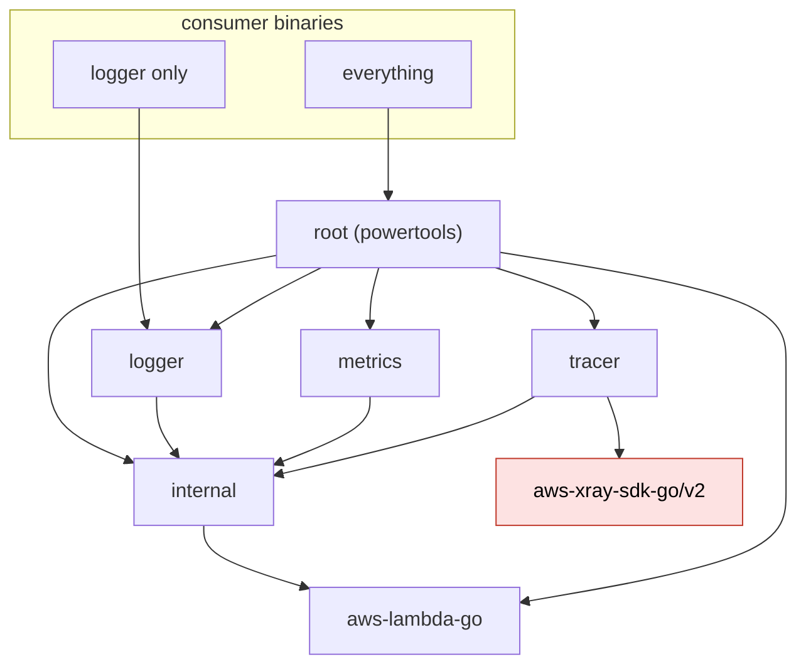
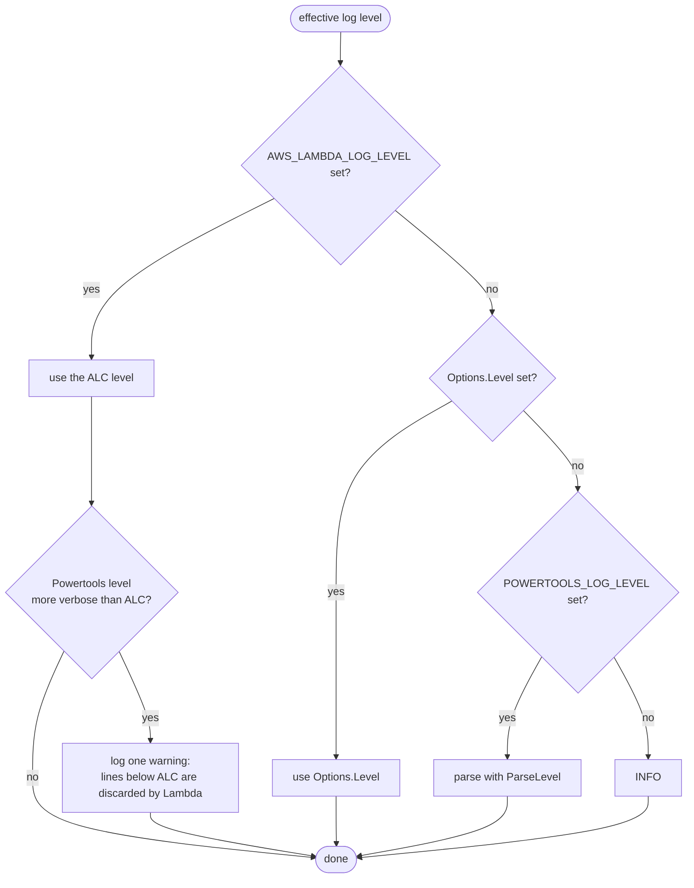
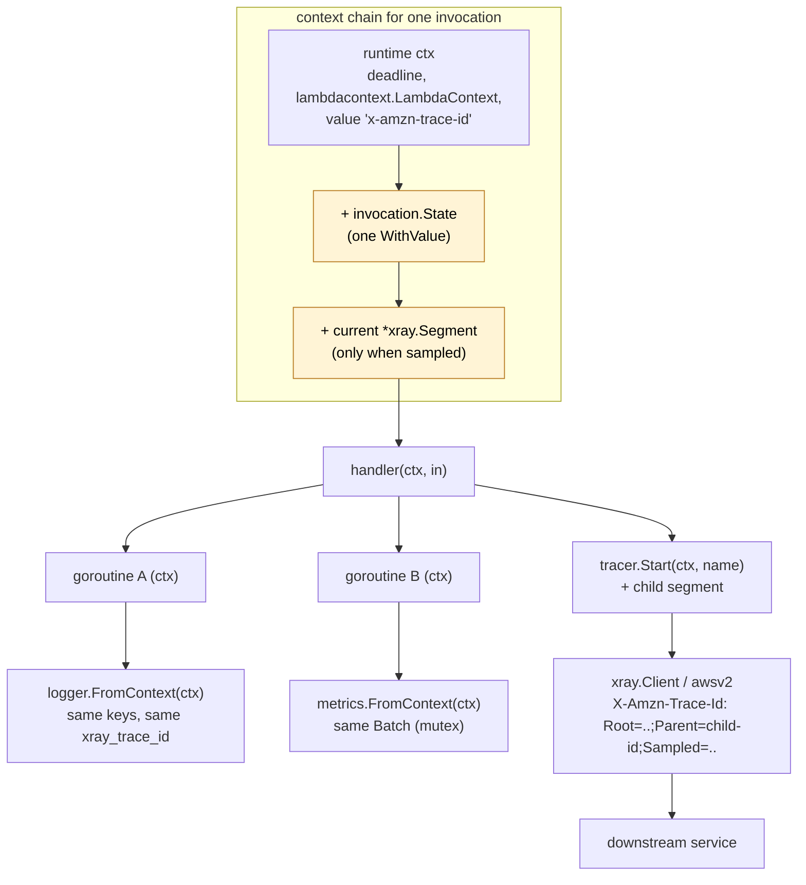
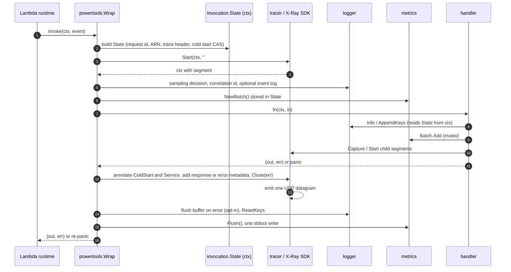
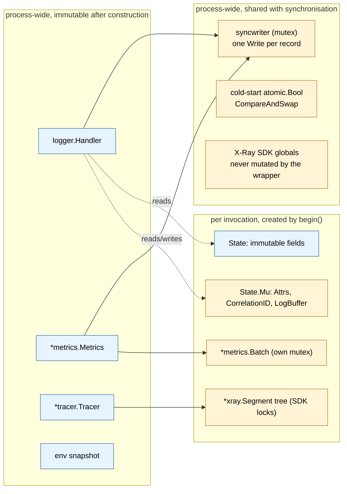
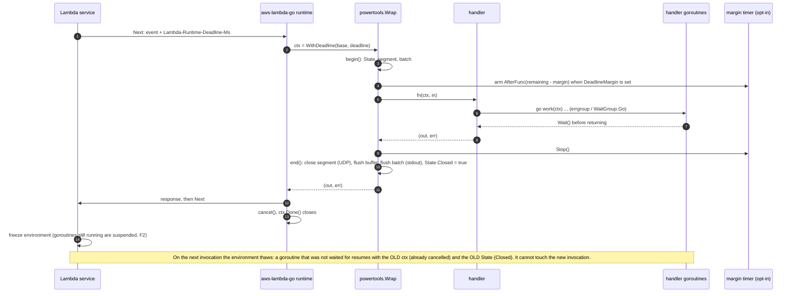
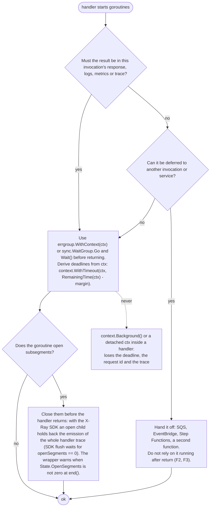
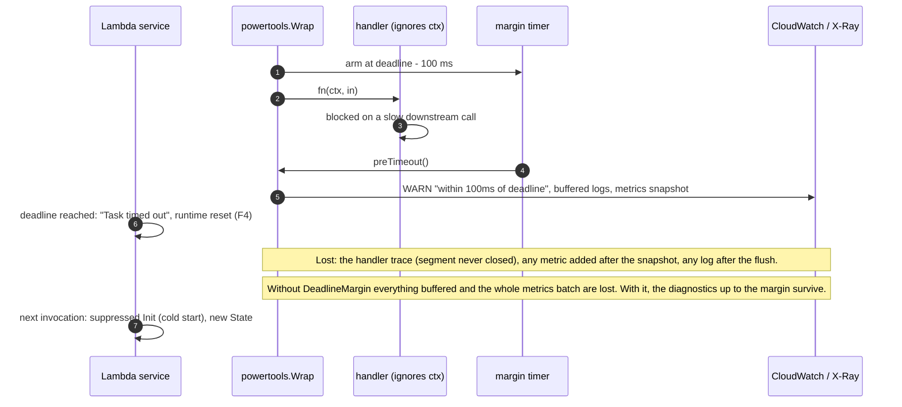

# 01. Architecture

## 1. Runtime facts that constrain the design

Each rule below is a hard constraint on the code. The source is the document or file
that establishes it.

| # | Rule | Source |
| --- | --- | --- |
| R1 | Go Lambdas run on `provided.al2023`, an OS-only runtime. `AWS_EXECUTION_ENV` and `_X_AMZN_TRACE_ID` are **not defined** by the runtime for the `provided` family. "Am I in Lambda" must be decided from `AWS_LAMBDA_FUNCTION_NAME` (plus `LAMBDA_TASK_ROOT`), never from `AWS_EXECUTION_ENV`. | Lambda "Defined runtime environment variables" |
| R2 | `aws-lambda-go` puts the trace header in the invocation context under the plain string key `"x-amzn-trace-id"` on every invoke, and only calls `os.Setenv("_X_AMZN_TRACE_ID", …)` when `lambdacontext.MaxConcurrency() == 1`. The context value is the primary source of the trace header; the environment variable is a fallback that is ignored when max concurrency is greater than one. | `lambda/invoke_loop.go` v1.55.1 |
| R3 | `lambdacontext.FromContext(ctx)` yields `AwsRequestID`, `InvokedFunctionArn`, `TenantID`; `lambdacontext.FunctionName`, `MemoryLimitInMB`, `FunctionVersion`, `LogGroupName`, `LogStreamName` are package variables filled from `AWS_LAMBDA_*` at init. | `lambdacontext/context.go` |
| R4 | Under Lambda Managed Instances, `AWS_LAMBDA_MAX_CONCURRENCY > 1` and several invocations run concurrently in one process, sharing stdout and all globals. Any per-invocation state in a package variable is a bug. The first N invocations may all be "first". | Lambda env vars page, `lambdacontext.MaxConcurrency`, R2 |
| R5 | Lambda Advanced Logging Controls (ALC) filter JSON logs by the `level` key with values `TRACE, DEBUG, INFO, WARN, ERROR, FATAL`. "If the `level` value field is invalid or missing, Lambda assigns the log output the level INFO." The `timestamp` must be RFC 3339 or Lambda assigns its own and treats the line as INFO. ALC sets `AWS_LAMBDA_LOG_LEVEL` and `AWS_LAMBDA_LOG_FORMAT`. | Lambda "Log-level filtering" |
| R6 | `AWS_LAMBDA_INITIALIZATION_TYPE` is `on-demand`, `provisioned-concurrency`, `snap-start` or `lambda-managed-instances`. Powertools Python treats `provisioned-concurrency` as "never a cold start". `lambda-managed-instances` is treated like `on-demand`: the first invocation to win the `CompareAndSwap` is the cold start, which is what keeps concurrent first invocations correct. | Lambda env vars page, `tracing/tracer.py` |
| R7 | `aws-lambda-go` recovers handler panics in `callBytesHandlerFunc` and reports them to the Runtime API with a stack. A wrapper that recovers must re-panic so this behaviour is preserved. | `lambda/invoke_loop.go` |
| R8 | Valid handler shapes are `func()`, `func() error`, `func() (T, error)`, `func(In) error`, `func(In) (T, error)`, `func(ctx) error`, `func(ctx) (T, error)`, `func(ctx, In) error`, `func(ctx, In) (T, error)`, plus any value implementing `lambda.Handler` (`Invoke(ctx, []byte) ([]byte, error)`). `lambda.NewHandler` wraps a function into a `lambda.Handler` and exposes decoded request and response through `handlertrace`. | Lambda Go handler docs, `lambda/handler.go`, `lambda/handlertrace/trace.go` |
| R9 | X-Ray in Lambda: the service creates the function segment (the "facade"); user code may only send **subsegments** with `type: "subsegment"` and `parent_id` equal to the `Parent` field of the trace header, over UDP to `AWS_XRAY_DAEMON_ADDRESS` prefixed by `{"format": "json", "version": 1}\n`. Documents are capped at 64 kB. Segment names are at most 200 characters. | X-Ray "Sending trace data", "Segment documents", `xray/lambda.go`, `xray/segment.go` |
| R10 | EMF: at most 100 metric definitions per log event, at most 30 dimension keys per set (Powertools uses 29), at most 100 values per metric array, `Timestamp` in epoch milliseconds within 14 days past / 2 hours future, numeric values within ±2^360, namespace and names 1 to 255 printable ASCII. | EMF specification, Powertools `cloudwatch.py` constants |
| R11 | `aws-xray-sdk-go/v2` requires Go 1.26 and depends on `grpc`, `protobuf`, `fasthttp`, `aws-sdk-go-v2`, `route53`. The tracer wraps it (decision 3), so the tracer must be a separate module: logger-only or metrics-only consumers must never link these dependencies. | `aws-xray-sdk-go` `go.mod` v2.0.4 |

## 2. Module and package layout

Decision 4: the utilities are **independent Go modules**. A consumer who wants only
structured logging runs `go get github.com/aizon-shared/powertools-lambda-go/logger`
and links the logger, the small shared `internal` module and `aws-lambda-go`; nothing
from the X-Ray SDK is downloaded or compiled. A consumer who wants everything imports
the root module, whose only package is the handler wrapper.

| Module path | Package(s) | Requires |
| --- | --- | --- |
| `github.com/aizon-shared/powertools-lambda-go` (root) | `powertools` (wrapper) | `internal`, `logger`, `metrics`, `tracer`, `aws-lambda-go` |
| `github.com/aizon-shared/powertools-lambda-go/internal` | `invocation`, `lambdaenv`, `jsonenc`, `bufpool`, `syncwriter` | standard library, `aws-lambda-go` |
| `github.com/aizon-shared/powertools-lambda-go/logger` | `logger` | `internal` |
| `github.com/aizon-shared/powertools-lambda-go/metrics` | `metrics` | `internal` |
| `github.com/aizon-shared/powertools-lambda-go/tracer` | `tracer` | `internal`, `aws-xray-sdk-go/v2` |
| `github.com/aizon-shared/powertools-lambda-go/examples` | sample functions | all of the above, SAM |

Test-only dependency in every module: `github.com/google/go-cmp` (explicitly allowed by
the Google style guide). The metrics module also allows a test-only JSON schema
validator (decision 13). No assertion libraries.

### Why a shared module named `internal`

The Go toolchain forbids importing a package whose path contains `internal` from code
outside the tree rooted at the parent of that `internal` element. The rule is
path-based, not module-based, so a module at
`github.com/aizon-shared/powertools-lambda-go/internal` can be imported by
`…/powertools-lambda-go/logger` (a different module) but not by any consumer.
OpenTelemetry-Go uses the same layout (`go.opentelemetry.io/otel/sdk` imports
`go.opentelemetry.io/otel/internal/global`). This gives true independence between
utilities, one shared implementation of the invocation state and JSON helpers, and no
cycle in the module graph:

```
internal  ◀── logger
internal  ◀── metrics
internal  ◀── tracer   ◀── aws-xray-sdk-go/v2
internal, logger, metrics, tracer  ◀── root (powertools)
```



What independence buys: smaller binaries and faster cold starts for partial use, no
X-Ray SDK for logger/metrics users, separate semantic versions when a module needs a
breaking change. What it costs: six `go.mod` files, a `go.work` for development,
lockstep tagging on release (06 §6, decision 21), and the rule that `internal`
never imports a utility. Decision 18 confirms this layout.

### Go version floor

Decision 1: every module declares `go 1.27.0`. `encoding/json/v2` and
`encoding/json/jsontext` (GA in 1.27) back `internal/jsonenc`: `jsontext.AppendQuote`
for strings, `json.MarshalWrite` for arbitrary values, with no hand-rolled escaping.

### JSON policy (decision 23)

`encoding/json/v2` and `encoding/json/jsontext` are the **only** JSON APIs used in
library and test code. The v1 `encoding/json` package is never imported by this
repository. Consequences:

- Raw JSON payloads (the Lambda event in `WrapHandler`, pre-marshalled metadata, the
  captured response) are typed `jsontext.Value`, the v2 counterpart of `json.RawMessage`.
- Arbitrary values are encoded with `json.MarshalWrite` / `json.MarshalEncode` into the
  pooled buffer, and decoded in tests with `json.Unmarshal` from v2.
- v2 rejects invalid UTF-8 and duplicate object names, and its `Options` replace v1's
  encoder knobs; the only options used are `jsontext.WithIndent` for `POWERTOOLS_DEV`
  and `json.Deterministic(true)` where output order matters in tests.
- Third-party code keeps its own choice: `aws-lambda-go` decodes events with v1 and the
  X-Ray SDK marshals segments with v1. On Go 1.27 the v1 package is backed by the v2
  implementation, so a `jsontext.Value` handed to the SDK as metadata is embedded
  verbatim; Phase 4 verifies this with a recorded segment, with `json.RawMessage` as
  the fallback if the SDK's marshal does not honour it.
- `GOEXPERIMENT=nojsonv2` builds are unsupported and the CI matrix does not include them.

### Package responsibilities (single responsibility per package)

| Package | Responsibility | Exports |
| --- | --- | --- |
| `powertools` (root) | Handler wrapper, invocation lifecycle, cold-start detection, deadline helpers, context accessors | `Wrap`, `WrapHandler`, `Options`, `ColdStart(ctx)`, `RequestID(ctx)`, `FunctionARN(ctx)`, `RemainingTime(ctx)`, `Deadline(ctx)` |
| `internal/invocation` | The per-invocation `State` struct and its context key. Shared by root and the three utilities. | `State`, `NewContext`, `FromContext`, `LogBuffer` |
| `internal/lambdaenv` | In-Lambda detection, SAM local detection, trace header parsing, function metadata snapshot, truthy env parsing | `InLambda()`, `ParseTraceHeader`, `Function`, `Bool`, `Float` |
| `internal/jsonenc` | Two tiers. Hot tier for the logger record path: append-style helpers over `jsontext.AppendQuote` and `strconv` (`AppendString`, `AppendValue` for `slog.Value`, `AppendAny`). Cold tier for EMF blobs and metadata: a pooled `jsontext.Encoder` driven with `WriteToken`/`WriteValue`, which enforces balanced structure (11 §3 A). Both tiers copy `jsontext.Value` verbatim after `IsValid`, which is what makes raw-event logging and raw metadata zero re-encode. | `AppendString`, `AppendValue`, `AppendAny`, `Encoder` (pooled) |
| `internal/bufpool` | `sync.Pool` of `[]byte` with size cap to avoid pinning huge buffers | `Get`, `Put` |
| `internal/syncwriter` | `io.Writer` wrapper: mutex, one `Write` per record, never partial | `New(w io.Writer) *Writer` |
| `logger` | `slog.Handler` with Powertools output, six ALC levels, package-level `Trace…Fatal(ctx, …)`, sampling, buffering, invocation keys, correlation ID | see 02 |
| `metrics` | EMF batching, validation, serialization, cold-start and single metrics | see 03 |
| `tracer` | Powertools semantics over `aws-xray-sdk-go/v2`: enable rules, handler segment, `Capture` helpers, context helpers, metadata guards | see 04 |

## 3. Configuration model

### Option structs, not functional options

Every constructor takes a value option struct whose zero value is usable:

```go
l := logger.New(logger.Options{})          // service from env or "service_undefined"
m, err := metrics.New(metrics.Options{})   // namespace from env, else error at Flush
t := tracer.New(tracer.Options{})
```

Reasons (Google best practices): callers almost always set a few fields, the literal is
self-documenting, new fields never break call sites, and `context.Context` is never part
of an option struct. Functional options are not used anywhere. Tri-state fields are
`*bool` and are set with Go 1.26's `new(expr)`: `tracer.Options{CaptureResponse: new(false)}`.

### Precedence

For every setting: **explicit option field > environment variable > default**, with one
exception mandated by ALC (R5):

```
log level = AWS_LAMBDA_LOG_LEVEL  >  Options.Level  >  POWERTOOLS_LOG_LEVEL  >  INFO
```



If `AWS_LAMBDA_LOG_LEVEL` is set and is stricter than the Powertools level, the handler
logs one warning at construction ("current log level is lower than ALC, lines below X
will be discarded") exactly as the Python and TypeScript editions do.

Environment is read **once, in the constructor**. Nothing reads `os.Getenv` per
invocation except the `_X_AMZN_TRACE_ID` fallback described in R2.

### Environment variables honoured

| Variable | Utility | Default | Notes |
| --- | --- | --- | --- |
| `POWERTOOLS_SERVICE_NAME` | all | `service_undefined` | `service` key, `service` dimension, `Service` annotation |
| `POWERTOOLS_LOG_LEVEL` | logger | `INFO` | `TRACE DEBUG INFO WARN ERROR FATAL`, plus `WARNING`, `CRITICAL`, `SILENT` as aliases, case-insensitive |
| `AWS_LAMBDA_LOG_LEVEL` | logger | unset | ALC; wins over everything (R5) |
| `AWS_LAMBDA_LOG_FORMAT` | logger | unset | informational; output is always JSON |
| `POWERTOOLS_LOGGER_SAMPLE_RATE` | logger | `0` | `0.0` to `1.0` |
| `POWERTOOLS_LOGGER_LOG_EVENT` | wrapper | `false` | `Options.LogEvent` overrides |
| `POWERTOOLS_DEV` | logger, metrics | `false` | pretty-print logs; silence metrics unless `POWERTOOLS_METRICS_DISABLED=false` |
| `POWERTOOLS_METRICS_NAMESPACE` | metrics | unset | required by `Flush` |
| `POWERTOOLS_METRICS_FUNCTION_NAME` | metrics | unset | `function_name` dimension of `ColdStart` |
| `POWERTOOLS_METRICS_DISABLED` | metrics | `false` | no output at all |
| `POWERTOOLS_TRACE_DISABLED` | tracer | `false` | Python name |
| `POWERTOOLS_TRACE_ENABLED` | tracer | `true` | TypeScript name; both honoured, disabled wins |
| `POWERTOOLS_TRACER_CAPTURE_RESPONSE` | tracer | `true` | |
| `POWERTOOLS_TRACER_CAPTURE_ERROR` | tracer | `true` | |
| `POWERTOOLS_TRACER_CAPTURE_HTTPS_REQUESTS` | tracer | `true` | honoured by `tracer.HTTPClient` |
| `AWS_XRAY_DAEMON_ADDRESS` | tracer (SDK) | `127.0.0.1:2000` | read by the X-Ray SDK at init |
| `AWS_XRAY_CONTEXT_MISSING` | tracer (SDK) | `LOG_ERROR` in Lambda | read by the X-Ray SDK |
| `AWS_XRAY_SDK_DISABLED` | tracer | `false` | checked by the wrapper and by the SDK |
| `AWS_SAM_LOCAL` | tracer | unset | disables tracing |
| `AWS_LAMBDA_FUNCTION_NAME`, `AWS_LAMBDA_FUNCTION_MEMORY_SIZE`, `AWS_LAMBDA_FUNCTION_VERSION` | all | | via `lambdacontext` |
| `AWS_LAMBDA_INITIALIZATION_TYPE` | wrapper | `on-demand` | cold-start rule (R6) |
| `AWS_LAMBDA_MAX_CONCURRENCY` | wrapper | `1` | via `lambdacontext.MaxConcurrency()` (R2, R4) |
| `_X_AMZN_TRACE_ID` | tracer, logger | unset | fallback only (R2) |
| `TZ` | logger | `:UTC` | timestamps are UTC unless `Options.Location` is set |

## 4. Invocation lifecycle and context propagation

This is the backbone of the library. One struct per invocation, created by the wrapper,
stored once in the context, read by every utility.

### 4.1 The per-invocation state

```go
package invocation // internal; imported by root, logger, metrics and tracer

// State is the per-invocation record. Fields are exported because the owning
// packages live outside this one; the comments say who writes what. The package
// must not import logger, metrics or tracer (they import it), so the slots those
// packages own are typed any and type-asserted by their owner (a pointer type
// assertion allocates nothing). Fields are shown here in logical order; the final
// order is decided by betteralign (05 §4) to minimise padding and GC scan bytes.
// Contract rule: within a major version fields are only ever added, never renamed,
// retyped or removed, because three modules read this struct (11 §2).
type State struct {
    // Immutable after begin(). Safe to read from any goroutine without locking.
    RequestID    string
    FunctionARN  string
    ColdStart    bool
    Trace        TraceHeader   // Root, Parent, Sampled parsed once; zero value = no trace
    DebugSampled bool          // this invocation emits DEBUG regardless of level
    HandlerName  string        // "## main.handle"
    Started      time.Time
    Deadline     time.Time     // from ctx.Deadline(); zero when absent (local runs)
    Logger       *slog.Logger  // configured logger, for logger.FromContext
    Tracer       any           // *tracer.Tracer, for the package-level tracer.Start
    Metrics      any           // *metrics.Batch created by the wrapper, for metrics.FromContext
    Segment      any           // *xray.Segment: the "## handler" subsegment opened through the SDK

    // Mutable. Guarded by Mu. Writers are the exported helpers in logger that take ctx.
    Mu            sync.Mutex
    CorrelationID string
    Attrs         []slog.Attr   // AppendKeys / RemoveKeys / ResetKeys
    AttrsVersion  uint32        // bumped on change; the logger caches its rendering by version
    AttrsJSON     []byte        // cached rendering of Attrs (written by the logger under Mu)
    LambdaJSON    []byte        // cached rendering of the Lambda context keys (written once by the logger)
    LogBuffer     *LogBuffer    // lazily allocated when buffering is enabled; defined in this package

    // Lifecycle (01 §7). Atomics: read from any goroutine without Mu.
    Closed       atomic.Bool   // set by end(); late calls degrade as defined in 01 §7.4
    OpenSegments atomic.Int32  // child segments opened through tracer.Start/Capture and not yet closed
    marginTimer  *time.Timer   // DeadlineMargin timer, stopped by end(); nil when the option is off
}

type TraceHeader struct {
    Root    string // "1-5759e988-bd862e3fe1be46a994272793"
    Parent  string // "53995c3f42cd8ad8"
    Sampled bool
}

func NewContext(parent context.Context, s *State) context.Context
func FromContext(ctx context.Context) *State   // nil when the wrapper is not in use
```

Design notes:

- **One `context.WithValue` per invocation.** The three utilities each do one
  `ctx.Value` lookup, not three different keys. The tracer additionally stores the
  *current* segment under its own key because that changes with nesting.
- **No pooling of `State`.** A goroutine started by the handler may outlive the
  invocation and still hold the context. Reusing the struct would be a data race.
  One allocation per invocation is the price; buffers inside it are pooled.
- **Goroutine inheritance.** Any `go func() { … }(ctx)` in the handler logs with the
  same keys, adds to the same metric batch, and opens subsegments under the current
  segment, because all of that is reachable from `ctx`. Work that finishes after the handler returns is not part of
  the invocation any more; what happens to it, and what consumers must do with their
  goroutines, is specified in §7.
- **Without the wrapper** (`FromContext` returns nil) every utility degrades: the logger
  omits Lambda keys, `metrics.FromContext` returns a nil `*Batch` whose methods are
  no-ops, `tracer.FromContext` returns a nil `*Segment` whose methods are no-ops. This
  keeps unit tests of handler code free of ceremony.



Reading the diagram: everything below the chain inherits the same `State`, so a log line
from goroutine B carries the same `function_request_id` and `xray_trace_id` as one from
the handler, and a child segment opened inside goroutine A hangs off the handler
segment. Outbound calls carry the current segment id as `Parent`.

### 4.2 The wrapper

```go
package powertools

type Options struct {
    Logger  *slog.Logger      // from logger.New; may be nil
    Metrics *metrics.Metrics  // may be nil
    Tracer  *tracer.Tracer    // may be nil

    LogEvent                   bool   // log the incoming event at INFO ("Lambda invocation event")
    CorrelationIDPath          string // dot path evaluated on the raw event (WrapHandler) or on the marshalled typed event
    CorrelationIDFunc          func(ctx context.Context, event any) string // typed alternative; wins over the path
    ResetKeys                  bool   // clear AppendKeys state at the end (always true in practice; kept for parity)
    FlushBufferOnUncaughtError bool
    CaptureColdStartMetric     bool
    RaiseOnEmptyMetrics        bool   // Flush returns an error when nothing was recorded
    CaptureResponse            *bool  // nil = tracer default
    CaptureError               *bool
    HandlerName                string // overrides "## <func name>"
    PprofLabels                bool   // run the handler under pprof.Do with function_request_id and function_name
                                      // labels; Go 1.27 prints them in panic tracebacks and SIGQUIT dumps (off by default)
    DeadlineMargin             time.Duration // > 0 arms a pre-timeout flush of logs and metrics this long before the deadline (01 §7, D6)
}

// Wrap adapts a typed handler. In and Out are inferred.
func Wrap[In, Out any](fn func(context.Context, In) (Out, error), opts Options) func(context.Context, In) (Out, error)

// WrapHandler adapts any lambda.Handler, including lambda.NewHandler(fn) for the other
// eight handler shapes. Event and response are seen as raw JSON bytes.
func WrapHandler(h lambda.Handler, opts Options) lambda.Handler
```

Both entry points share one unexported lifecycle:

```go
func (o *Options) begin(ctx context.Context, rawEvent []byte, typedEvent any) (context.Context, *invocation.State)
func (o *Options) end(ctx context.Context, s *invocation.State, resp any, rawResp []byte, err error, panicVal any)
```

`Wrap` is the recommended form: no reflection, no re-encoding, generic type inference
gives the caller `lambda.Start(powertools.Wrap(handle, opts))`. `WrapHandler` exists for
handlers that do not fit `func(ctx, In) (Out, error)` and for middleware chains built on
`lambda.Handler`; it uses `handlertrace.NewContext` to observe the decoded event and
response for correlation-ID extraction without decoding the JSON twice.

The handler subsegment name defaults to `"## " + runtime.FuncForPC(reflect.ValueOf(fn).Pointer()).Name()`
computed **once at wrap time** (for example `## main.handle`), mirroring Python's
`## lambda_handler`. `_HANDLER` is not used because on `provided.al2023` it is the
executable name. Override with `Options.HandlerName`.

### 4.3 Sequence per invocation

```
lambda runtime ──▶ Wrap(fn)(ctx, in)
  begin:
    1. lc := lambdacontext.FromContext(ctx)                  (request id, ARN)
    2. hdr := ctx.Value("x-amzn-trace-id"); if empty && MaxConcurrency()==1 { hdr = os.Getenv("_X_AMZN_TRACE_ID") }
    3. cold := coldStart.CompareAndSwap(true, false) && initType != "provisioned-concurrency"
    4. s := &State{…}; ctx = invocation.NewContext(ctx, s)
    5. tracer:  if enabled && hdr.Sampled { ctx, seg = t.Start(ctx, s.HandlerName); s.Segment = seg }   (SDK builds the facade from the ctx header; parent_id = hdr.Parent)
    6. logger:  s.DebugSampled = rate > 0 && rand.Float64() < rate   (rate from (*logger.Handler).SampleRate() when opts.Logger.Handler() is ours, else from env)
    7. logger:  s.CorrelationID = extract(opts, event)
    8. metrics: b := m.NewBatch(); s.Metrics = b   (pooled slices)
    9. metrics: if cold && opts.CaptureColdStartMetric { m.emitColdStart(functionName) }   (separate EMF blob)
   10. logger:  if opts.LogEvent { log.LogAttrs(ctx, INFO, "Lambda invocation event", slog.Any("event", rawOrTyped)) }
  call:
   10b. if opts.DeadlineMargin > 0 && deadline known { s.marginTimer = time.AfterFunc(remaining-margin, preTimeout) }   (D6)
   11. defer end(...) with recover()
   12. out, err := fn(ctx, in)
  end:
   13. tracer:  annotate ColdStart, Service; metadata "<name> response" or "<name> error"; seg.Close(err) ⇒ SDK sets fault+cause and emits (one UDP write)
   14. logger:  on err/panic && FlushBufferOnUncaughtError ⇒ flush; ResetKeys ⇒ clear attrs
   15. metrics: s.Metrics.Flush() ⇒ one stdout write; warn when empty (or error if RaiseOnEmptyMetrics)
   15b. s.marginTimer.Stop(); if s.OpenSegments.Load() > 0 { log WARN "N subsegments still open" }; s.Closed.Store(true)   (D4, D7)
   16. if panicked { log ERROR with debug.Stack(); panic(panicVal) }     (R7)
   17. return out, err
```



The wrapper drives the utilities only through their exported lifecycle API
(`(*Metrics).NewBatch`, `(*Batch).Flush`, `(*Tracer).Start`, `(*xray.Segment).Close`,
`logger.FlushBuffer`, `logger.ResetKeys`), which is the same API consumers use when they
do not use the wrapper. There is no privileged back door.

Ordering rationale: the segment is opened before anything that might log so that
`xray_trace_id` is available; metrics flush last so a `ColdStart` blob and the batch
appear in a stable order; the log buffer is flushed before metrics so an error's
diagnostic lines precede the EMF line.

### 4.4 Outbound propagation

| Direction | Mechanism |
| --- | --- |
| Logs ← trace | `xray_trace_id` (Root) on every line; `function_request_id` on every line |
| Metrics ← invocation | `function_name` dimension on `ColdStart`; consumers may `AddMetadata("request_id", powertools.RequestID(ctx))` |
| Traces ← logs | `correlation_id` can be annotated by the consumer: `tracer.FromContext(ctx).AddAnnotation("correlation_id", logger.CorrelationID(ctx))` |
| HTTP → downstream | `xray.Client` / `xray.RoundTripper` from the SDK (or `tracer.HTTPClient`, which honours the Powertools env switch) sets `X-Amzn-Trace-Id` from `seg.DownstreamHeader()` and records a `remote` subsegment; with `Sampled=0` the header is still forwarded so downstream services do not start orphan traces |
| AWS SDK v2 → downstream | `awsv2.AWSV2Instrumentor(&cfg.APIOptions)` from the X-Ray SDK: `namespace: "aws"`, `aws.operation / region / request_id` |
| Manual | `tracer.Header(ctx) string` returns the outbound header for any other client, always when a trace header exists (`Sampled=0` included, 04 §7); `tracer.TraceID(ctx)` returns the root ID for user-facing error messages |

## 5. Concurrency model

| State | Classification | Protection |
| --- | --- | --- |
| `logger.Handler`, `*metrics.Metrics`, `*tracer.Tracer` | immutable after construction | none needed; documented as safe for concurrent use |
| stdout writer | shared across invocations | `internal/syncwriter`: mutex + single `Write` per record (R4) |
| X-Ray SDK global config and UDP emitter | shared, owned by the SDK | never mutated by the wrapper after init; `xray.SetLogger` (not goroutine-safe per the SDK) is the consumer's call from `main` |
| cold-start flag | process-wide | `atomic.Bool.CompareAndSwap`; exactly one invocation observes `true` even when N first invocations run concurrently under Managed Instances |
| `State` immutable fields | per invocation | written only in `begin` before `NewContext` |
| `State.Attrs`, `CorrelationID`, `LogBuffer` | per invocation, mutable | `State.Mu` |
| `*metrics.Batch` | per invocation | its own `sync.Mutex`; a handler fanning out goroutines may add metrics concurrently |
| `*xray.Segment` tree | per invocation | the SDK's own `sync.RWMutex` per segment; the wrapper only calls SDK methods and never touches fields directly |
| margin timer (`DeadlineMargin`, opt-in) | per invocation | `time.AfterFunc`; stopped in `end()`; the only goroutine the library can create (01 §7 D6); `preTimeout` uses the same mutex-protected paths as the handler |
| `State.Closed`, `State.OpenSegments` | per invocation | atomics, read from any goroutine |



Package-level variables are limited to: the cold-start `atomic.Bool`, the env snapshot
taken at init in `internal/lambdaenv` (constant for the process lifetime), and
`sync.Pool`s. There is no default instance of any utility (decision 7).

## 6. Error and panic policy

- Library functions **return** errors; nothing in the library panics on bad input.
  `metrics.Batch.Add` returns `error` for an invalid unit, name, value or dimension
  budget; annotation validation is the SDK's (`(*xray.Segment).AddAnnotation` returns `error`).
- Sentinel errors for programmatic checks (`errors.Is`): `metrics.ErrNamespaceMissing`,
  `metrics.ErrEmptyMetrics`, `metrics.ErrTooManyDimensions`, `metrics.ErrInvalidUnit`,
  `metrics.ErrInvalidValue`, `metrics.ErrInvalidName`, `metrics.ErrInvalidDimension`,
  `metrics.ErrBatchFlushed`, `logger.ErrInvalidLevel`. Annotation validation errors are the SDK's own.
- Wrapped errors use `%w` only where the wrapped error is part of the contract and that
  is documented. Typed errors are matched with `errors.AsType[T]` (Go 1.26) in docs and
  tests. No error type is ever wrapped through a pointer to it; Go 1.27's `go vet`
  reports that pattern.
- I/O failures of the stdout writer never fail the invocation; they are logged once at
  `DEBUG` through the configured logger (or dropped if there is none). UDP emission
  failures are handled by the SDK, which logs them through `xray.SetLogger`.
- Handler panics: the wrapper recovers, performs steps 13 to 15, logs the panic value and
  `runtime/debug.Stack()` at `ERROR`, then re-panics with the original value so
  `aws-lambda-go` still reports a `Runtime.ExitError`-style failure with a stack (R7).
  Because the deferred function runs before unwinding, the runtime's own stack capture
  still contains the original frames.
- With `Options.PprofLabels`, the handler runs inside `pprof.Do(ctx, pprof.Labels(
  "function_request_id", id, "function_name", name), fn)`. Since Go 1.27 those labels
  appear in the goroutine header of panic tracebacks and `SIGQUIT` dumps, so a crash in
  a multi-concurrency environment can be tied to one invocation. Cost: one labelled
  context per invocation, measured in 05 §3; off by default.
- `Flush` on an empty batch is a warning, not an error, unless `RaiseOnEmptyMetrics`.

## 7. Deadlines, cancellation, freeze and shutdown

Lambda is not a long-running service: every invocation has a deadline, the environment
is frozen between invocations, a timeout resets the runtime process, and shutdown gives
at most two seconds. This section states the facts, the rules the library follows, and
what consumers must do with their own goroutines.

### 7.1 Facts

| # | Fact | Source |
| --- | --- | --- |
| F1 | The runtime learns the deadline per invocation (`Lambda-Runtime-Deadline-Ms`). `aws-lambda-go` wraps the handler context with `context.WithDeadline(base, deadline)` and `defer cancel()`, so `ctx.Done()` closes at the deadline **or** as soon as the invocation finishes (after the response is posted), whichever comes first. | `lambda/invoke_loop.go` v1.55.1 |
| F2 | "Lambda freezes the execution environment when the runtime and each extension have completed and there are no pending events." Goroutines still running are suspended, not killed. | Lambda execution environment lifecycle |
| F3 | "Background processes or callbacks that were initiated by your Lambda function and did not complete when the function ended resume if Lambda reuses the execution environment. Make sure that any background processes or callbacks in your code are complete before the code exits." | same |
| F4 | On a timeout or crash during Invoke, "the Lambda service performs a reset. The reset behaves like a `Shutdown` event. First, Lambda shuts down the runtime". The next invocation re-runs Init (a suppressed init). Memory is gone: anything not flushed before the deadline is lost. | same |
| F5 | Shutdown duration limit: 0 ms with no extensions, 500 ms with a registered internal extension, 2000 ms with an external extension; then `SIGKILL`. `lambda.WithEnableSIGTERM` registers an internal extension so the process receives `SIGTERM` with about 500 ms to act. | same; `lambda/handler.go` |
| F6 | Under Managed Instances several invocations run concurrently in one process, each with its own context and deadline (R4). | 01 §1 |

### 7.2 Rules the library follows

| # | Rule |
| --- | --- |
| D1 | **End-of-invocation work never waits on `ctx`.** `end()` runs deferred, also when the handler returned `ctx.Err()`, and its I/O is local and synchronous: one `write(2)` to stdout for the EMF blob, one for the buffered log lines, one UDP datagram for the trace. None of it consults `ctx.Done()`, because a cancelled context must not prevent the flush that explains the cancellation. Its cost is bounded (05 §3). |
| D2 | **Nothing is pending between invocations.** Metrics, buffered logs and the handler segment are flushed synchronously in `end()`. The library therefore needs no shutdown hook and loses nothing at freeze (F2) or at `SIGTERM` (F5). |
| D3 | **The library creates no goroutine on its own**, with one opt-in exception, D6. Nothing of ours can be left running when the environment freezes. |
| D4 | **A finished invocation is closed, not recycled.** `end()` sets `State.Closed`. Objects reachable from a late goroutine (`State`, the metrics `Batch`, the `LogBuffer`) are **never pooled**, so a goroutine that outlives the handler (F3) can only ever touch its own invocation's data, never the next one's. Late calls degrade in a defined way (7.4). |
| D5 | **Helpers for deadline-aware code.** `powertools.RemainingTime(ctx) time.Duration` (the Go form of `getRemainingTimeInMillis`) and `powertools.Deadline(ctx) (time.Time, bool)`. Both read `ctx.Deadline()`; they exist so handler code does not need to know how the runtime encodes it. |
| D6 | **Opt-in pre-timeout flush** (`Options.DeadlineMargin`, default 0 = off). With a margin of, say, 100 ms, `begin()` arms `time.AfterFunc(remaining - margin, preTimeout)`. If the handler is still running when it fires, `preTimeout` writes a `WARN` line (`"invocation within <margin> of its deadline"` with `remaining_ms`), flushes the log buffer and flushes a **snapshot** of the metrics batch (the batch keeps accepting; `end()` flushes the remainder). The trace is not touched: closing the handler segment early would misreport the invocation. `end()` stops the timer. This is the only timer and the only goroutine the library can create; its lifetime ends at `end()`. Reason: after a timeout the runtime is reset (F4), so diagnostics that were not written before the deadline never reach CloudWatch. |
| D7 | **Goroutine leaks become visible.** `State.OpenSegments` counts child segments opened through `tracer.Start`/`Capture` and not yet closed. If it is non-zero in `end()`, a `WARN` names the count, because with the X-Ray SDK an open child delays emission of the whole handler trace (7.5). The `goroutineleak` profile test (06 §1) proves the library itself leaks nothing. |

### 7.3 Timeline of an invocation



### 7.4 What a late call does after `State.Closed`

```mermaid
stateDiagram-v2
  [*] --> Open: begin()
  Open --> Open: handler and its goroutines use logger, metrics, tracer
  Open --> PreTimeout: margin timer fires (DeadlineMargin, handler still running)
  PreTimeout --> Open: WARN logged, buffer flushed, metrics snapshot flushed; batch keeps accepting
  Open --> Closed: end() (handler returned, errored or panicked)
  PreTimeout --> Closed: end()
  Closed --> Closed: late logger call is written immediately with the old invocation's keys (never buffered)
  Closed --> Closed: late Batch.Add returns ErrBatchFlushed, value dropped, one WARN per invocation
  Closed --> Closed: late tracer.Start or Capture returns (ctx, nil), fn runs untraced, one WARN
  Closed --> Closed: Header(ctx), TraceID(ctx), RemainingTime(ctx) still answer
  Closed --> [*]: State unreferenced, garbage collected (never pooled)
```



The rules are chosen so that a late goroutine is **observable** (its log lines still carry
`function_request_id` of the invocation that started it) but can never **corrupt**
another invocation: there is no object reuse to corrupt.

### 7.5 What consumers must do with their goroutines



Concretely, the pattern the examples use:

```go
func handle(ctx context.Context, in Order) (Receipt, error) {
    ctx, cancel := context.WithTimeout(ctx, powertools.RemainingTime(ctx)-200*time.Millisecond)
    defer cancel()                      // leave 200 ms for end() and the runtime

    g, gctx := errgroup.WithContext(ctx)
    g.Go(func() error { return tracer.Capture(gctx, "inventory", func(ctx context.Context) error { return reserve(ctx, in) }) })
    g.Go(func() error { return tracer.Capture(gctx, "payment",   func(ctx context.Context) error { return charge(ctx, in) }) })
    if err := g.Wait(); err != nil {    // all goroutines and their subsegments are done here
        return Receipt{}, err
    }
    return receipt(in), nil
}
```

`errgroup` is `golang.org/x/sync`, a consumer choice; the standard library alternative is
`sync.WaitGroup.Go` (Go 1.25) with a shared error variable. `context.AfterFunc(ctx, cleanup)`
(Go 1.21) is the way to react to cancellation without a goroutine of your own.

### 7.6 Timeout scenario, with and without the margin



### 7.7 Shutdown

The library keeps nothing between invocations (D2), so it registers no shutdown hook.
Consumers who hold resources (connections, local caches to persist) use the runtime's
own mechanism, which composes with the wrapper:

```go
lambda.StartWithOptions(
    powertools.Wrap(handle, opts),
    lambda.WithEnableSIGTERM(func() { db.Close() }),   // ~500 ms before SIGKILL (F5)
)
```

Under Managed Instances (F6) the same rules hold per invocation; the margin timer, when
enabled, is one per invocation, and `end()` of one invocation never touches another.
