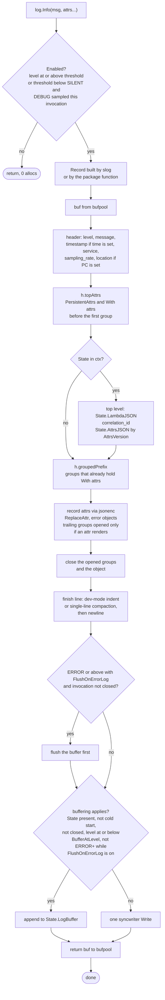
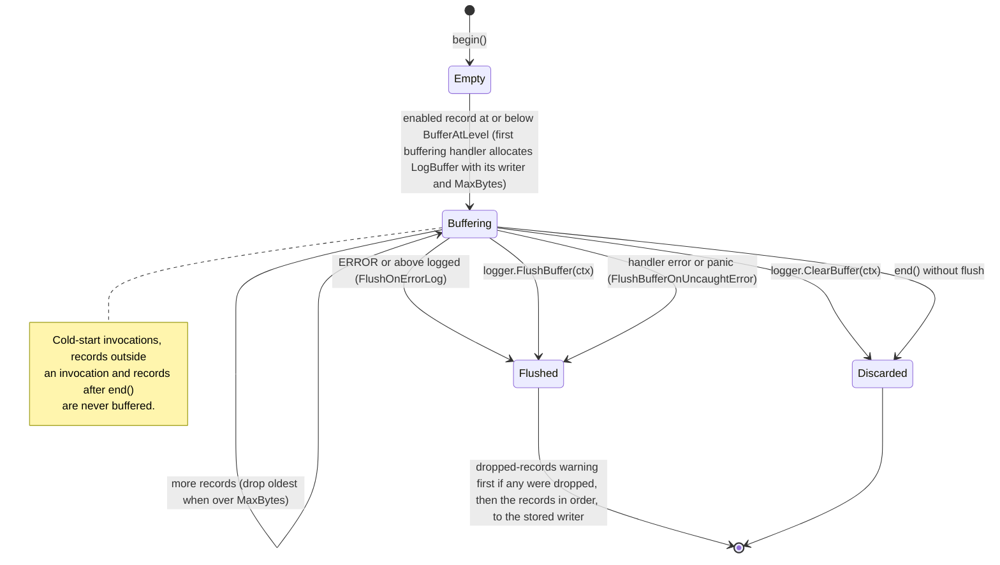

# 02. Logger

A `log/slog` handler that writes Powertools-shaped JSON lines. Consumers use the standard
`*slog.Logger` API; the only Powertools-specific calls are for invocation-scoped keys,
correlation IDs and the buffer. §14 shows how callers use the API and §15 lists the
acceptance checks of the package.

Design goals, in priority order:

1. Every line is one valid JSON object on one physical line, with `level` and `timestamp`
   in the form Lambda Advanced Logging Controls (ALC) recognise (R5), so Lambda never
   re-levels, re-stamps or splits a line.
2. `testing/slogtest` conformance: the handler behaves like any other `slog.Handler`, so
   consumers can compose it, wrap it and swap it.
3. Zero allocations per record on the hot path (`LogAttrs` with up to five scalar attrs),
   enabled or disabled, with or without the wrapper (§12).
4. Output parity with the Python and TypeScript editions wherever goals 1 to 3 allow; every
   deliberate difference is listed in §13.

## 1. Output format

One JSON object per line, written with a single `Write`. Key order is fixed for the
standard keys (cosmetic, but it matches upstream and makes log tailing readable). The
table lists the keys in the order they are emitted (§5 gives the algorithm).

| Key | Type | When | Source |
| --- | --- | --- | --- |
| `level` | string | always | one of `TRACE DEBUG INFO WARN ERROR FATAL` (see §2) |
| `message` | string | always | `slog.Record.Message` |
| `timestamp` | string | `r.Time` is non-zero | RFC 3339 with milliseconds, UTC: `2026-10-15T14:48:00.000Z` |
| `service` | string | always | `Options.Service` / `POWERTOOLS_SERVICE_NAME` / `service_undefined` |
| `sampling_rate` | number | when rate > 0 | `Options.SampleRate` |
| `location` | string | `Options.AddSource` and `r.PC != 0` | `main.handle:42`: the import-path-qualified function name (`github.com/acme/app/orders.reserve` outside `main`), `:`, the line; mirrors Python's `location: "collect.handler:9"` |
| persistent attrs | any | always | `Options.PersistentAttrs` and `logger.With(...)` before the first `WithGroup` |
| `cold_start` | bool | wrapper in use (all five Lambda keys always, `""` and `0` included) | `State.ColdStart` |
| `function_name` | string | wrapper in use | `lambdacontext.FunctionName` |
| `function_memory_size` | number | wrapper in use | `lambdacontext.MemoryLimitInMB` |
| `function_arn` | string | wrapper in use | `State.FunctionARN` |
| `function_request_id` | string | wrapper in use | `State.RequestID` |
| `xray_trace_id` | string | trace header present | `State.Trace.Root`, parsed from `ctx.Value("x-amzn-trace-id")` only |
| `correlation_id` | string | set | `State.CorrelationID` |
| invocation attrs | any | set | `logger.AppendKeys(ctx, …)` |
| grouped attrs | any | set | `logger.With(...)` after a `WithGroup`, inside their groups |
| record attrs | any | per call | `log.Info("msg", "k", v)`, inside the open groups |
| `error` | object | an attr value is `error` | `{"name": "*fs.PathError", "message": "...", "cause": [...]}` (see §7) |

Why this order:

- **Persistent and `With` attrs come before the Lambda keys**, and `location` comes right
  after `sampling_rate`. The handler writes its pre-rendered prefix in one piece, and the
  Lambda and invocation keys must stay at the top level even when a `WithGroup` is open.
  The pre-rendered part is therefore split into "before the first group" and "from the
  first group on" (§5), and the per-invocation blocks go between the two.
- **`timestamp` is omitted for a zero `r.Time`, `location` for a zero `r.PC`.** Both rules
  are required by `testing/slogtest`. Records built by `*slog.Logger` and by the package
  functions always carry a time, so production lines always have `timestamp`.
- **The trace ID comes only from the context** (decision 30). `aws-lambda-go` puts the
  header in the context on every invocation; there is no `_X_AMZN_TRACE_ID` fallback,
  because reading the environment per invocation is both slower and wrong when several
  invocations share a process (`AWS_LAMBDA_MAX_CONCURRENCY` above 1). A missing or empty
  value means no trace and no key.

Timestamp layout follows the TypeScript edition and satisfies ALC (R5, decision 10).
Python's default (`2021-05-03 10:20:19,650+0000`) is **not** RFC 3339 and would make Lambda
re-stamp and re-level the line; it is not offered. The timestamp is appended with
`time.Time.AppendFormat` into the line buffer, never with `Format`, which allocates.

### Reserved keys

If a top-level consumer attr (a record attr, a `With` attr or a `PersistentAttrs` entry
before the first group, after `ReplaceAttr`, or an `AppendKeys` attr) uses `level`,
`message`, `timestamp`, `service`, `sampling_rate` or `xray_trace_id`, the handler drops
the attr. Top level means depth 0 of the output object, including the members of an
empty-key group inlined there. Inside a keyed group there is no collision, so nothing is
dropped.

- The drop is reported with one `WARN` **per handler family**: the handler returned by one
  `NewHandler` call and every handler derived from it share an `atomic.Bool` in their
  shared config. A once-per-process flag would be package-level mutable state, which the
  architecture forbids (01 §5). Later drops are silent.
- The reserved set is a constant, so a rendered `AppendKeys` block does not depend on the
  handler that rendered it and can be cached once per invocation for every handler (§5).
- Dropping, rather than renaming, guarantees that `level` is never duplicated. ALC reads
  one `level` member; a second one would make filtering depend on the decoder.

### Duplicate keys

Every other collision is emitted as `slog.JSONHandler` emits it. A consumer attr named
like a Lambda key (`function_name`), an `AppendKeys` attr repeated with the same key, or a
record attr that repeats a `With` attr produces a second member with the same name.
Decoders that keep the last member see the later value.

The handler deduplicates nothing and hides nothing. Overriding Lambda keys with consumer
attrs would need a per-record deduplication pass (a cost on every line) and would hide
data silently; duplicate keys are not a redaction mechanism, `ReplaceAttr` is (§3).
Consequence for every decoder the library owns (tests, the dev pretty-printer): it uses
`jsontext.AllowDuplicateNames(true)` and `jsontext.AllowInvalidUTF8(true)`, because a log
line may legitimately repeat a key or carry a consumer string with invalid UTF-8.

### Single-line guarantee

A finished line never contains a raw `\n` or `\r`. Strings are escaped by the encoder, so
only a verbatim `jsontext.Value` can bring one (a pretty-printed raw event, for example).
Such a line is compacted with `jsontext.AppendFormat` with no indent options, the two
decoder options above and `jsontext.PreserveRawStrings(true)`, so escapes such as
`"é"` survive byte for byte. Any other line is written with no copy: the check is a
flag set while appending a `jsontext.Value`, not a scan of every line.

### Dev mode

`POWERTOOLS_DEV=true` or `Options.Pretty` re-formats the finished line with
`jsontext.AppendFormat` and `jsontext.WithIndent`, plus the options above, so a line with
duplicate keys or invalid UTF-8 never fails to print.

Dev mode is **never on in Lambda**, and the handler enforces it rather than advising it:
`Pretty` and `POWERTOOLS_DEV` are ignored when `AWS_LAMBDA_FUNCTION_NAME` is set, because
an indented line becomes several CloudWatch log events and breaks ALC.

Example (one line in the real output):

```json
{"level":"INFO","message":"collecting payment","timestamp":"2026-10-15T14:48:00.123Z","service":"payment","cold_start":true,"function_name":"payment-prod","function_memory_size":256,"function_arn":"arn:aws:lambda:eu-west-1:123456789012:function:payment-prod","function_request_id":"c6af9ac6-7b61-11e6-9a41-93e812345678","xray_trace_id":"1-5759e988-bd862e3fe1be46a994272793","correlation_id":"8f0c…","order_id":"o-123"}
```

With `AddSource`, `PersistentAttrs` and a group, the same record shows where each part
lands:

```go
log := logger.New(logger.Options{
	Service:         "payment",
	AddSource:       true,
	PersistentAttrs: []slog.Attr{slog.String("env", "prod")},
})
log.WithGroup("req").With("path", "/orders").InfoContext(ctx, "collecting payment", "attempt", 2)
```

```json
{"level":"INFO","message":"collecting payment","timestamp":"…","service":"payment","location":"main.handle:42","env":"prod","cold_start":false,"function_name":"payment-prod","function_memory_size":256,"function_arn":"…","function_request_id":"…","req":{"path":"/orders","attempt":2}}
```

The Lambda keys stay at the top level although a group is open; the group holds the `With`
attr and the record attr.

## 2. Levels

Decision 2: the logger supports **all six Lambda ALC levels** as `slog` levels.
`slog.Level` is an integer and custom values are a supported, documented use of the
package, so the two extra levels are plain constants, not a wrapper type and not a custom
`Leveler`. The emitted names are exactly the names Lambda filters on (R5), so Lambda never
re-levels a line.

| Constant | Value | Emitted string | Accepted when parsing |
| --- | --- | --- | --- |
| `logger.LevelTrace` | `slog.Level(-8)` | `TRACE` | `TRACE` |
| `slog.LevelDebug` | -4 | `DEBUG` | `DEBUG` |
| `slog.LevelInfo` | 0 | `INFO` | `INFO` |
| `slog.LevelWarn` | 4 | `WARN` | `WARN`, `WARNING` (Python) |
| `slog.LevelError` | 8 | `ERROR` | `ERROR` |
| `logger.LevelFatal` | `slog.Level(12)` | `FATAL` | `FATAL`, `CRITICAL` (Powertools) |
| `logger.LevelSilent` | `slog.Level(16)` | threshold only; nothing logs at it (prints `ERROR+8` if misused) | `SILENT` (decision 19) |

- `ParseLevel(s string) (slog.Level, error)` is exported. It is case-insensitive, accepts
  every spelling in the last column (`trace`, `WARNING`, `Critical`, `silent`), trims
  surrounding spaces and returns `ErrInvalidLevel` otherwise. It is what reads
  `POWERTOOLS_LOG_LEVEL` and `AWS_LAMBDA_LOG_LEVEL`.
- `LevelName(l slog.Level) string` returns the table's string for the six values and falls
  back to `slog.Level.String()` (`INFO+2`) for others. Lambda treats such lines as `INFO`;
  documented. The lookup is an array index for the six canonical values (after checking
  that `l` is one of them), so it costs no allocation and no `fmt`.
- Naming follows the style guide's no-repetition rule (`logger.LevelTrace`, not
  `logger.LogLevelTrace`), matching `slog.LevelDebug`.
- `Fatal` is a level, not an action: nothing in this package calls `os.Exit` or panics. A
  Lambda handler returns its error; the runtime reports it.
- `LevelSilent` is a threshold, not a level to log at. `Options.Level = logger.LevelSilent`
  or `POWERTOOLS_LOG_LEVEL=SILENT` makes `Enabled` false for every record, including
  `FATAL` and including debug-sampled invocations (§6), with zero cost per call. There is
  no `Silent` package function. A record logged explicitly at `LevelSilent` prints the
  `LevelName` fallback `ERROR+8`, not `SILENT`: `SILENT` is not an ALC level name, so
  giving it an output name would only invite misuse.

### Package functions (the custom-logger shape)

`*slog.Logger` has methods for the four standard levels only. For symmetry across all
six, and so that code deep in the call graph needs only `ctx`, the package exposes:

```go
package logger

const (
	LevelTrace  = slog.Level(-8)
	LevelFatal  = slog.Level(12)
	LevelSilent = slog.Level(16) // threshold only
)

// Each function resolves the invocation's logger from ctx (FromContext) and builds the
// record itself, so that "location" names the caller and not this package.
// Example: logger.Trace(ctx, "cache lookup", "key", k)
func Trace(ctx context.Context, msg string, args ...any)
func Debug(ctx context.Context, msg string, args ...any)
func Info(ctx context.Context, msg string, args ...any)
func Warn(ctx context.Context, msg string, args ...any)
func Error(ctx context.Context, msg string, args ...any)
func Fatal(ctx context.Context, msg string, args ...any)
func Log(ctx context.Context, level slog.Level, msg string, args ...any)
```

The functions are **not** sugar over `FromContext(ctx).Log(...)`: `slog.Logger.Log`
records its own caller, which would be the package function, so `location` would always
name `logger.Info`. Each function follows the "wrapping output methods" pattern of the
`log/slog` package documentation:

```go
func Info(ctx context.Context, msg string, args ...any) {
	l := FromContext(ctx)
	if !l.Enabled(ctx, slog.LevelInfo) {
		return
	}

	var pcs [1]uintptr
	runtime.Callers(2, pcs[:]) // skip runtime.Callers and Info itself

	r := slog.NewRecord(time.Now(), slog.LevelInfo, msg, pcs[0])
	r.Add(args...)

	_ = l.Handler().Handle(ctx, r)
}
```

Pitfall: no helper may sit between the caller and `runtime.Callers`. A shared
`log(ctx, level, msg, args)` helper would change the skip to 3 for some paths and 2 for
others; each exported function calls `runtime.Callers(2, ...)` itself, and a test pins
that `location` names the caller for every function, `Log` included.

Cost: the variadic `args ...any` is boxed at the call site, before `Enabled` runs. A
non-constant value costs one allocation per value, enabled or disabled, exactly as with
`slog.Logger.Info` (the Go runtime boxes small integers and single-byte values without
allocating). Hot paths use `logger.FromContext(ctx).LogAttrs(ctx, level, msg,
slog.Int(...), ...)`, which costs nothing for up to five scalar attrs (§12).

When no invocation is in `ctx`, or the invocation carries no logger (the wrapper was built
without one), `FromContext` returns `slog.Default()`, which is `slog`'s own mechanism and
the only process-wide fallback the package uses (decision 7). The wrapper's own
diagnostics (event line, pre-timeout warning, panic line with its stack) use the same
lookup, so they are never dropped.

Level precedence and the ALC warning are specified in 01 §3 and in §10.

## 3. Options and constructors

```go
package logger

type Options struct {
	Service         string          // POWERTOOLS_SERVICE_NAME, else "service_undefined"
	Level           slog.Leveler    // nil ⇒ env / INFO. A *slog.LevelVar makes it changeable at runtime. Ignored under ALC.
	SampleRate      float64         // POWERTOOLS_LOGGER_SAMPLE_RATE, 0..1; applied only under the wrapper (§6)
	Writer          io.Writer       // nil ⇒ the shared stdout writer; otherwise wrapped by its own syncwriter
	PersistentAttrs []slog.Attr     // rendered once, like an initial With; appear on every line
	AddSource       bool            // "location" key (decision 14); costs a runtime.CallersFrames per record
	Location        *time.Location  // nil ⇒ UTC
	TimestampLayout string          // "" ⇒ "2006-01-02T15:04:05.000Z07:00"; must not need JSON escaping
	ReplaceAttr     func(groups []string, a slog.Attr) slog.Attr // consumer attrs only (see below)
	Buffer          BufferOptions
	Pretty          *bool           // nil ⇒ POWERTOOLS_DEV; ignored in Lambda
}

type BufferOptions struct {
	Enabled         bool
	MaxBytes        int          // 0 ⇒ 20480
	BufferAtLevel   slog.Leveler // nil ⇒ DEBUG; records at or below this level are buffered
	FlushOnErrorLog *bool        // nil ⇒ true; new(false) turns it off
}

func New(opts Options) *slog.Logger        // slog.New(NewHandler(opts))
func NewHandler(opts Options) *Handler     // the slog.Handler; exported for composition (MultiHandler, tee)
func (h *Handler) Enabled(ctx context.Context, l slog.Level) bool
func (h *Handler) Handle(ctx context.Context, r slog.Record) error
func (h *Handler) WithAttrs(attrs []slog.Attr) slog.Handler
func (h *Handler) WithGroup(name string) slog.Handler
func (h *Handler) Level() slog.Level       // effective level after ALC precedence
func (h *Handler) SampleRate() float64     // used by the wrapper for the per-invocation decision

var ErrInvalidLevel = errors.New("logger: invalid level")
```

Zero values stay usable (decision 33): `BufferAtLevel` is a `slog.Leveler` and
`FlushOnErrorLog` a `*bool` because a plain `slog.Level` zero value is `INFO`, not the
intended `DEBUG`, and a plain `bool` cannot express "default true". A `Leveler` also lets a
`*slog.LevelVar` change the buffered level at runtime (it is read per record).
`logger.Options{}` produces a working logger: service `service_undefined`, level from the
environment or `INFO`, output to the shared stdout writer.

Resolution rules applied by `NewHandler`, which reads the environment once (tests use
`t.Setenv` before constructing; nothing reads the environment per record, decision 35):

- **Level** (01 §3): `AWS_LAMBDA_LOG_LEVEL`, else `Options.Level`, else
  `POWERTOOLS_LOG_LEVEL`, else `INFO`. When ALC applies, `Options.Level` is ignored, a
  `*slog.LevelVar` included. An environment value that is empty after trimming is unset
  and never warns. A non-empty value that `ParseLevel` rejects is ignored (the next rung
  applies) and produces one construction `WARN` naming the variable and the value. Both
  level variables are validated even when a higher rung wins, so a typo in the deployment
  configuration is reported whichever rung decides the level.
- **`TimestampLayout`**: the formatted time is appended raw between quotes, so a layout
  containing `"`, `\` or a byte below 0x20 is replaced by the default with one
  construction `WARN`. This goes beyond decision 10's doc warning: a doc warning cannot
  stop a malformed line.
- **Construction warnings** (invalid level variables, invalid layout, then the ALC warning
  of §10) are written once the handler exists, through its writer, bypassing the level gate
  except under `LevelSilent`. They never go through `ReplaceAttr`, `With` attrs or groups,
  and they never fail construction: `New` returns no error (decision 44), because every
  logger misconfiguration has a safe fallback.

`New` returns `*slog.Logger` on purpose: there is no `logger.Logger` type, so consumers and
third-party libraries (`net/http`, AWS SDK logging adapters) interoperate through the
standard type. Every feature (levels, invocation keys, buffering, correlation IDs) fits
behind `*slog.Logger` plus context-taking package functions. `NewHandler` is exported so
consumers can compose it (`slog.NewMultiHandler(powertoolsHandler, otherHandler)`,
Go 1.26); composition keeps working because the per-invocation caches are shared by every
handler (§5).

Writer: when `Options.Writer` is nil the handler uses one package-level, mutex-guarded
stdout writer that the logger and metrics share (one of the allowed package-level
variables, 01 §5), so a log line and an EMF blob never interleave. A writer supplied by the
consumer is wrapped per handler and is not shared between utilities. The writer does not
copy: the pooled line buffer is handed to the underlying `Write` under the mutex.

### `ReplaceAttr` scope

Unlike `slog.HandlerOptions.ReplaceAttr`, it applies to consumer attrs only (decision 33).

| Attrs | Seen by `ReplaceAttr` | When |
| --- | --- | --- |
| record attrs | yes | in `Handle`, with the groups open at that point |
| `With` attrs and `PersistentAttrs` | yes | once, in `WithAttrs` / `NewHandler`, with the groups open then |
| built-in keys (`level`, `message`, `timestamp`, `service`, `sampling_rate`, `xray_trace_id`, `location`) | no | written by the handler; ALC needs `level` and `timestamp` |
| Lambda keys and `correlation_id` | no | cached once per invocation in `State.LambdaJSON` |
| `AppendKeys` attrs | no | cached per version in `State.AttrsJSON` |

Reason: applying `ReplaceAttr` to the cached invocation blocks would make them
handler-specific, and a `MultiHandler` (or two handlers with different `Options`) logging
in one invocation would then need one cache per handler. Restricting it to consumer attrs
keeps the caches shared and keeps ALC's `level` and `timestamp` intact. Consumers who must
redact an `AppendKeys` value redact it before appending.

`ReplaceAttr` follows slog's contract otherwise: it receives the open groups (not
including the attr's own group when the attr is a group), it is not called for group attrs
themselves, and returning an attr with an empty key drops it.

## 4. Invocation-scoped API

```go
// FromContext returns the invocation's configured logger. The handler reads invocation
// state from ctx on every call, so code deep in the call graph does not need the
// *slog.Logger passed around. It returns slog.Default() when ctx carries no invocation
// or the invocation has no logger.
func FromContext(ctx context.Context) *slog.Logger

// AppendKeys adds attrs visible to every log line of this invocation, from any goroutine
// holding ctx. Equivalent to Powertools appendKeys / append_keys but scoped to the
// invocation instead of the process (R4, decision 6). Keys are not deduplicated:
// appending the same key twice emits two members (§1). RemoveKeys removes every attr
// with that key.
func AppendKeys(ctx context.Context, attrs ...slog.Attr)
func RemoveKeys(ctx context.Context, keys ...string)
func ResetKeys(ctx context.Context)
func Keys(ctx context.Context) []slog.Attr // snapshot copy

func SetCorrelationID(ctx context.Context, id string)
func CorrelationID(ctx context.Context) string

func FlushBuffer(ctx context.Context) // write buffered records in order to the buffer's writer, then clear
func ClearBuffer(ctx context.Context) // drop buffered records
```

Why not return a derived `*slog.Logger` from `AppendKeys`? Because upstream semantics are
"visible to subsequent logs in this request, including the caller's logger", which needs
shared per-invocation state. Lexical scoping is still available through `log.With(...)`,
which the handler pre-renders once.

Rules:

- **Fresh per invocation.** The invocation state is created for every invocation, so keys
  never carry into the next one. A wrapper option to reset keys at the end would be a
  no-op and is not offered; `ResetKeys(ctx)` is for consumers who want to clear them
  mid-invocation.
- **No-ops without an invocation.** Every function is a no-op (or returns a zero value)
  when `ctx` carries no invocation, so library code can call them unconditionally.
- **Versioned cache.** `AppendKeys`, `RemoveKeys` and `ResetKeys` bump `State.AttrsVersion`
  under the invocation mutex; the next record re-renders `State.AttrsJSON` once and every
  later record copies the cached bytes. Appending is cheap; the rendering cost moves to the
  first record after the change and is paid once.
- **`LogValuer` resolution.** A top-level `slog.LogValuer` passed to `AppendKeys` is
  resolved once, outside the invocation lock, as `slog.Logger.With` does, so a slow or
  re-entrant `LogValue` cannot block other goroutines of the invocation.
- **Lock contract.** The rest of the rendering runs under the invocation lock, so consumer
  code that runs there (`MarshalJSON` of a `KindAny` value, `Error` of an error value, a
  `LogValuer` nested in a group) must not call these functions or log with the
  invocation's context: it would deadlock. The package documentation states this contract.
- **Snapshots.** `Keys` returns a copy; mutating it changes nothing. `CorrelationID`
  returns `""` when unset.

## 5. Handler internals (performance-driven)

The handler follows the slog handler guide and the structure of slog's own `commonHandler`
(decision 33): pre-format what can be pre-formatted, allocate once per record from a pool,
write once.

```go
type Handler struct {
	cfg            *config             // immutable, shared by derived handlers: writer, level, layout, warn-once flag, ...
	opts           jsonenc.AttrOptions // ReplaceAttr, the reserved set, every open group
	topAttrs       []byte              // PersistentAttrs + With attrs before the first WithGroup, e.g. `,"env":"prod"`
	groupedPrefix  []byte              // from the first opened group onward, with the With attrs inside it, e.g. `,"G":{"c":"d"`
	trailingGroups []string            // groups with no attrs yet; opened in Handle only if a record attr renders
	nOpened        int                 // groups opened in groupedPrefix (braces to close)
}
```

Why two pre-rendered parts and lazy trailing groups: the Lambda and invocation keys must
stay at the top level, and `slogtest` requires that a group with no attrs never renders
(`"G":{}`). A single "pre-rendered attrs plus open groups" prefix cannot satisfy both, so
the prefix is split at the first group, and groups that hold no attrs yet are opened only
when something renders inside them, exactly as slog's `commonHandler` does.

- `WithGroup(name)` records the group; it writes nothing.
- `WithAttrs(attrs)` renders the attrs (through `ReplaceAttr`). If no group is open they go
  to `topAttrs` (the reserved-key rule applies there). Otherwise it writes the trailing
  groups and the attrs into a copy of `groupedPrefix`, and commits the groups only when at
  least one attr renders, so `l.WithGroup("G").With(slog.Attr{})` never emits `"G":{}`.
- `WithGroup("")` and `WithAttrs` with zero attrs return the receiver.
- Both copy on write and allocate; they run when loggers are derived, not per record. A
  derived handler never mutates a slice it shares with its parent (copy, then append),
  which `-race` tests on concurrently derived loggers check.

`Handle(ctx, r)`:

1. `s := invocation.FromContext(ctx)` (one lookup, may be nil).
2. `buf := bufpool.Get()`. Header: level name, quoted message, `timestamp` only when
   `!r.Time.IsZero()`, `service`, `sampling_rate` when the rate is above 0, `location` when
   `AddSource` and `r.PC != 0`.
3. Append `h.topAttrs`.
4. If `s != nil`, in **one** critical section of the invocation mutex (the bytes are copied
   into the line while the lock is held, so a concurrent re-render by another handler is
   never seen half written): `s.LambdaJSON` (rendered lazily once per invocation, so an
   invocation that never logs pays nothing), then `correlation_id` if set, then
   `s.AttrsJSON` (re-rendered only when its stored version differs from `s.AttrsVersion`).
5. Append `h.groupedPrefix`.
6. Record attrs via `jsonenc.AppendAttr`, iterating with `r.Attrs(func(slog.Attr) bool)`
   (no `[]slog.Attr` is materialised): resolves `LogValuer`, applies `ReplaceAttr`, follows
   slog's rules (an empty `Attr{}` is dropped, a group with no attrs is dropped, a group
   with an empty key is inlined), drops reserved top-level keys and renders `error` values
   per §7. The trailing groups are opened before the first attr that renders.
7. Close exactly the groups that were opened, then `}`.
8. Finish the line: dev-mode indent, or single-line compaction when needed (§1); then `\n`.
9. A record at `ERROR` or above with `FlushOnErrorLog` on first flushes the invocation
   buffer, unless the invocation is closed (§9). If buffering applies, copy into the
   invocation buffer; else one `Write` to the handler's writer, whose error `Handle`
   returns (slog convention). Flush and warning writes ignore theirs.
10. `bufpool.Put(buf)`, storing the grown slice back so a long line keeps its capacity. The
    pool caps the capacity it keeps (a single huge line must not pin memory for the life
    of the process).



`Enabled(ctx, l)`:
`l >= h.Level() || (h.Level() < LevelSilent && l >= slog.LevelDebug && s != nil && s.DebugSampled)`.
The level checks run first and `s` is looked up only when they pass, so a record below the
threshold costs no lookup and `LevelSilent` costs nothing per call even when sampling is
configured. No allocation. `Enabled` never looks at the buffer: it must stay a cheap level
check, which is why buffering never widens the level (§9).

JSON encoding (decisions 1 and 23):

- String escaping and number formatting come from `internal/jsonenc`, backed by
  `encoding/json/jsontext.AppendQuote` and `strconv`. No hand-rolled escaping, no `fmt`,
  `reflect` or `regexp` on this path (enforced by a linter rule).
- Floats use the `encoding/json/v2` number formatting. NaN and ±Inf, which JSON cannot
  represent and v2 rejects, are written as the strings `"NaN"`, `"+Inf"` and `"-Inf"`, so
  the line stays valid and the value stays readable (`slog.JSONHandler` writes an
  `!ERROR` string there instead). `slog.Duration` values are integer nanoseconds and
  `slog.Time` values quoted RFC 3339 with nanoseconds, as `slog.JSONHandler` writes them.
- Arbitrary `slog.KindAny` values and nested values use `encoding/json/v2`, marshalled into
  a scratch region at the end of the same buffer with `jsontext.AllowInvalidUTF8(true)`.
  This is the only allocation-heavy path and it is only taken for non-scalar values.
- Values of type `jsontext.Value` are copied verbatim after `IsValid` (decision 23); this
  is the zero-cost way to log a pre-encoded document.
- **Marshal failures never break a line.** `encoding/json/v2` rejects values that v1
  accepted: `time.Duration` has no default representation, a `chan` cannot be marshalled,
  and a struct with no exported fields (such as the `*errors.errorString` behind
  `errors.New`, nested in a map) is an error. On a marshal error the buffer is truncated
  back to the start of the value and the quoted string `"!ERROR:<err>"` is written
  instead, as `slog.JSONHandler` does; an invalid `jsontext.Value` gets the same string.
  The line is never dropped and never left half written. Consumers log a duration with
  `slog.Duration` (a `KindDuration` scalar), which never takes this path.

## 6. Sampling

- Decision per invocation in `begin`: `DebugSampled = rate > 0 && rand.Float64() < rate`
  using `math/rand/v2` (non-cryptographic is fine; it is a sampling decision). Rate `0`
  never samples and rate `1` always samples, with no boundary surprises.
- **Sampling requires the wrapper.** Without it there is no invocation state, so there is
  nowhere race-free to store the decision, and `SampleRate` has no effect on which records
  are enabled (the `sampling_rate` key is still written). A process-wide flag would leak
  the decision between concurrent invocations, so the package offers no function to
  re-roll the sample outside an invocation.
- `LevelSilent` wins over sampling: the sampling branch of `Enabled` requires
  `h.Level() < LevelSilent` (§5, decision 33).
- The `sampling_rate` key is emitted on every line when rate > 0 (upstream behaviour).
- ALC still filters after the handler (R5): if ALC is `INFO`, sampled `DEBUG` lines are
  dropped by Lambda. Documented, not worked around.

## 7. Errors in attributes

A record attr whose value is an `error` (`slog.KindAny`) renders as an object:

```json
"error": {"name": "*url.Error", "message": "Get \"https://x\": timeout", "cause": ["net/http: timeout"]}
```

- `name`: dynamic type name, obtained with `%T` on the cold path only (an error being
  logged is not the hot path; the `fmt` ban covers the record path otherwise).
- `message`: `err.Error()`.
- `cause`: the messages of the single `errors.Unwrap` chain, present only when non-empty
  and bounded at 32 entries, so a chain that loops back on itself cannot hang a log call.
  A joined error (`Unwrap() []error`) is not traversed: its `message` already lists every
  branch.
- A panic in an `Error` method is recovered: the bytes written for the value are truncated
  and the string `"!PANIC:<value>"` is written in its place, so the line stays valid.
- `stack`: not part of the first release. Go errors carry no stack; adding one requires a
  convention the consumer implements. A candidate for a later minor release: honour an
  optional `StackTrace() []uintptr` method defined by the consumer.

`log.Error("msg", "err", err)` and `log.Error("msg", slog.Any("error", err))` both work;
the key name is whatever the consumer chose.

The object form applies only when the attr value itself is an `error`. An error nested in a
struct or a map goes through the `KindAny` path of §5, which `encoding/json/v2` usually
rejects, so that value renders as `"!ERROR:<err>"` and the rest of the line is intact.
Consumers log errors as their own attr. A nil error value renders as `null`.

## 8. Event logging and correlation IDs

Both are wrapper features (01 §4.2). `WrapHandler` only accepts hand-written
`lambda.Handler` implementations that own the bytes they return (decision 29).

**Event logging** (`powertools.Options.LogEvent` or `POWERTOOLS_LOGGER_LOG_EVENT`).
`LogEvent` is a `*bool` (decision 42): nil means the environment variable decides, and
`new(true)` or `new(false)` wins over it. A plain `bool` could only switch event logging
on, never switch a truthy variable off, and every other option backed by an environment
variable is a tri-state `*bool` too.

- With `WrapHandler` the raw payload bytes are embedded verbatim as the `event` value (a
  `jsontext.Value`: zero decode, zero re-encode). They are validated once with
  `IsValid(jsontext.AllowDuplicateNames(true), jsontext.AllowInvalidUTF8(true))`, so a
  payload Lambda accepted is never rejected by the stricter v2 defaults.
- With `Wrap[In, Out]` the typed value is marshalled with `encoding/json/v2`
  (`json.Marshal`), which costs one marshal only when event logging is on.
- A marshal failure logs `"!ERROR:<err>"` in place of the event; a panic in the event's
  marshal method is recovered and logged as `"!ERROR:panic: <value>"`. Event logging must
  never fail an invocation.
- The event line is written at `INFO` with the message `Lambda invocation event`, through
  the invocation's logger, so it carries the Lambda keys and the correlation ID.

**Correlation ID** extraction order: `Options.CorrelationIDFunc` (typed, no cost) >
`Options.CorrelationIDPath` evaluated by `internal/jsonpath` > none. Both run in `begin`,
before the handler. Rules (decision 35):

- A **string, number or boolean** found at the path becomes the ID: strings unquoted,
  numbers and booleans as their literal text, always an owned copy (never a substring of a
  payload buffer the runtime reuses). `null`, objects and arrays give none. Event sources
  such as EventBridge detail fields often carry numeric IDs.
- A malformed path is reported once at `WARN` when the wrapper is built and disables the
  extraction, instead of failing every invocation.
- A panic in `CorrelationIDFunc` is not recovered: it runs in `begin`, before the
  wrapper's deferred recover, and a consumer bug there should crash loudly.
- An empty result sets no correlation ID; `SetCorrelationID` in the handler overrides
  whatever `begin` extracted.

What each wrapper shape gives the two extraction options and the event line:

| Wrapper | `CorrelationIDFunc(ctx, event any)` gets | `CorrelationIDPath` runs on | `LogEvent` writes |
| --- | --- | --- | --- |
| `WrapHandler` | the raw payload as `jsontext.Value`, valid only during the call | the raw payload bytes, no copy | the raw payload as `jsontext.Value` |
| `Wrap[In, Out]` | the typed `In` value (no cost) | a marshalled copy of `In` (cost documented) | the marshalled `In` |

Under `Wrap` the event is marshalled at most once per invocation and only when a consumer
of the bytes needs it: when both the path and event logging are on, one marshal serves
both, and a path shadowed by `CorrelationIDFunc` never costs a marshal.

Built-in paths are string constants in package `logger`. `API_GATEWAY_REST` and
`API_GATEWAY_HTTP` share a path; both names exist for parity with upstream.

| Go identifier | Upstream name | Path |
| --- | --- | --- |
| `CorrelationPathAPIGatewayREST` | `API_GATEWAY_REST` | `requestContext.requestId` |
| `CorrelationPathAPIGatewayHTTP` | `API_GATEWAY_HTTP` | `requestContext.requestId` |
| `CorrelationPathAppSyncAuthorizer` | `APPSYNC_AUTHORIZER` | `requestContext.requestId` |
| `CorrelationPathAppSyncResolver` | `APPSYNC_RESOLVER` | `request.headers."x-amzn-trace-id"` |
| `CorrelationPathApplicationLoadBalancer` | `APPLICATION_LOAD_BALANCER` | `headers."x-amzn-trace-id"` |
| `CorrelationPathEventBridge` | `EVENT_BRIDGE` | `id` |
| `CorrelationPathLambdaFunctionURL` | `LAMBDA_FUNCTION_URL` | `requestContext.requestId` |
| `CorrelationPathS3ObjectLambda` | `S3_OBJECT_LAMBDA` | `xAmzRequestId` |
| `CorrelationPathVPCLattice` | `VPC_LATTICE` | `headers."x-amzn-trace-id"` |

`internal/jsonpath` supports dot-separated keys with optional double-quoted segments for
keys containing `-` or `.`; it is not JMESPath. `go-jmespath` is archived and is not a
dependency. The path is parsed once when the wrapper is built; each invocation walks the
payload with a `jsontext.Decoder`, entering only the members on the path and skipping every
other value with `SkipValue`, so no part of the event is decoded into Go values. Test
cases: each
built-in path against a real event sample, quoted segments, a missing member, a member
holding `null`, an object or an array, numbers in exponent form, and malformed paths
(empty segment, unterminated quote).

## 9. Buffering

Per-invocation buffer stored in `State.LogBuffer` (type `invocation.LogBuffer`: its own
mutex, a byte budget, the destination writer and a slice of rendered records), allocated on
the first buffered record only, so invocations that never buffer pay nothing.

**Ownership.** The first Powertools handler that buffers a record in an invocation
allocates the buffer and stores in it **its own writer and `MaxBytes`**.
`FlushBuffer(ctx)`, the wrapper's flush in `end` and the pre-timeout flush all write to
that stored writer, so none of them needs the handler, and a composed handler
(`MultiHandler`) works too. Documented limitation: handlers with different writers or
budgets that both buffer in one invocation share the first one's buffer.

**Lock order:** buffer mutex, then invocation mutex, then writer mutex. The buffer's mutex
is not the invocation mutex; nothing acquires them in the opposite order.

Rules:

- Only records that pass `Enabled` reach the buffer: buffering never widens the level.
  With the default level `INFO` and the default `BufferAtLevel` `DEBUG`, nothing is
  buffered unless the invocation is debug-sampled; to buffer debug lines, configure
  `Level: slog.LevelDebug`. Python and TypeScript buffer records *below* the logger level;
  this is a recorded parity gap (§13), chosen because `Enabled` must stay a cheap level
  check with no buffer lookup.
- Records with level ≤ `BufferAtLevel.Level()` (read per record) are buffered as rendered
  bytes, not as `slog.Record`, so timestamps are preserved and no record state (attrs that
  reference mutable consumer values) escapes the call.
- `MaxBytes` is enforced; when full, the oldest records are dropped. On a flush, one `WARN`
  line (`buffer dropped N records`) is written **first**, then the surviving records in
  order. The whole flush, notice included, runs under the buffer's mutex, so concurrent
  flushes (pre-timeout timer, flush on error, `end`) write everything or nothing, never an
  interleaving. The notice is rendered by a callback that never goes through a foreign
  `slog.Handler`, which could re-enter the buffer and deadlock.
- A single record larger than `MaxBytes` is written directly to the handler's writer,
  followed by one `WARN` naming the record size and the budget.
- `FlushOnErrorLog` (nil means true): any record at `ERROR` or above flushes the buffer
  **before** the error line is written, so the error appears after its context. While it
  is on, records at `ERROR` or above are never buffered, whatever `BufferAtLevel` says.
- `FlushBufferOnUncaughtError` (wrapper option): flush in `end` when `err != nil` or the
  handler panicked.
- After `end()` (`State.Closed`), records from late goroutines are written immediately,
  never buffered, still carrying the old invocation's keys (01 §7.4), and an `ERROR`
  record flushes nothing: leftovers of a finished invocation stay discarded. The opt-in
  pre-timeout flush (`DeadlineMargin`) flushes the buffer before the deadline (01 §7 D6).
- Not buffered: records emitted outside an invocation (`State == nil`) and records during
  a cold start (upstream behaviour, keeps init diagnostics visible).
- Buffered bytes are written with one `Write` per record to keep line atomicity.

**Accepted race.** A record logged by a goroutine concurrently with `end` can pass the
`Closed` check, land in the buffer after `end`'s last flush, and is then never written.
Closing the buffer and re-checking before a direct write would close the window but could
duplicate a line that a concurrent flush already wrote, which is worse for log consumers
than a lost debug line. It matters only with `FlushBufferOnUncaughtError` and a failing
handler; the remedy is to wait for the invocation's goroutines before returning
(01 §7.5), which the package documentation states.



## 10. Lambda ALC interplay

- `AWS_LAMBDA_LOG_LEVEL` wins over everything (01 §3).
- **ALC warning.** A one-time construction warning ("current log level is lower than ALC,
  lines below X will be discarded") is written **only when a Powertools level was
  explicitly configured** (`Options.Level` or a valid `POWERTOOLS_LOG_LEVEL`) and is more
  verbose than the ALC level. The default `INFO` alone never warns: otherwise every
  function deployed with ALC at `WARN` would print a warning on every cold start for a
  choice nobody made. The warning is written at `WARN` even when the effective level
  filters `WARN` (except under `LevelSilent`); Lambda itself may drop it under ALC `ERROR`
  or `FATAL`.
- Level strings and timestamps satisfy R5 so Lambda never re-levels the handler's lines.
- `AWS_LAMBDA_LOG_FORMAT=TEXT` with JSON output is fine: Lambda forwards the line as is.

## 11. Testing

Test cases to write, by area:

- **`slogtest` conformance.** `testing/slogtest.Run` (groups, empty attrs, zero time,
  `LogValuer`). The result function decodes each line with `encoding/json/v2` using
  `jsontext.AllowDuplicateNames(true)` and `jsontext.AllowInvalidUTF8(true)`, then renames
  `message` to `msg`, `timestamp` to `time` and `location` to `source`, because `slogtest`
  checks the standard key names. The cases that shape the handler structure (§5) are
  `multi-With`, `empty-group-record`, `nested-empty-group-record`, zero time, empty PC,
  empty attr and inline group. A second run executes the same suite with an invocation
  state in the context, so the Lambda keys never break conformance.
- **Golden files.** Decode the line with the same options into `map[string]any` and compare
  with `cmp.Diff` (semantic comparison, per the style guide), plus a key-order test on the
  raw prefix for the fixed standard keys and a test that Lambda and invocation keys stay at
  the top level under `WithGroup`. Golden files put a placeholder in place of the
  `location` line number, so editing the test file does not change the golden data, and a
  fixed `time.Time` in the record, so no clock is involved.
- **Parity fixtures.** Example log lines copied from the upstream TypeScript documentation,
  with a provenance file (source page, commit, retrieval date, license) next to them. The
  test logs the same inputs and checks that the key set and the JSON type of every
  top-level key match; values are ignored except `level`, `message` and `service`.
  Upstream examples that are internally inconsistent (`sampling_rate` as a string in one
  sample and a number in another) or differ by design (Python-style timestamps, the
  TypeScript error object with `stack`) are listed in the provenance file as not used.
  Python output is not a fixture source because its default timestamp is not RFC 3339.
- **Location.** `logger.Info(ctx, ...)` and every other package function report the
  caller's function and line, not the logger package.
- **Encoding edge cases.** Duplicate keys, reserved-key drops (one `WARN` per handler
  family, none from a second family member), `ReplaceAttr` scope (it never sees built-in,
  Lambda or `AppendKeys` keys; two handlers with different `ReplaceAttr` share the caches
  correctly), the `KindAny` fallback (`time.Duration` in a struct, an error nested in a
  map, invalid UTF-8, a `chan` field each render `"!ERROR:..."` and the rest of the line is
  intact), NaN and ±Inf floats, a pretty-printed `jsontext.Value` compacted onto one line
  with its escapes preserved, and an invalid `TimestampLayout`.
- **Levels.** Table tests for level parsing (every accepted spelling, mixed case, spaces,
  invalid input), precedence with ALC, invalid environment levels, the ALC warning
  (configured versus default level), `Enabled` with the sampled flag set directly on the
  invocation state, and `LevelSilent` with a sampled invocation (nothing is enabled). The
  dice roll itself lives in the wrapper: rates `0` and `1` are tested end to end, and the
  `0.5` boundary with a seeded `rand.Rand` injected through an unexported field.
- **Buffer.** Overflow (notice first, then the survivors in order), oversize record, flush
  on error, `FlushOnErrorLog` nil versus false, `BufferAtLevel` nil versus an explicit
  level or `*slog.LevelVar`, flush on uncaught error, `FlushBuffer` writing to the stored
  writer (also behind a `MultiHandler`), two handlers with different writers sharing the
  first buffer, cold-start records not buffered, late records after `end` written
  directly.
- **Concurrency** under `-race`: concurrent `AppendKeys` and logging from many goroutines
  of one invocation, concurrent flushes (no interleaved or duplicated line), loggers
  derived concurrently from one parent, and two handlers re-rendering the shared
  `AttrsJSON` cache at once.
- **Allocation budgets** with `testing.AllocsPerRun` after a warm-up call, writing to
  `io.Discard`, in files excluded from `-race` builds (the race detector makes `sync.Pool`
  drop items at random) and run in a separate non-race step. Every value is non-constant
  (returned from a `//go:noinline` helper), so the tests cannot pass on constant-folded
  args. A budget of 0 asserts `== 0`; any other budget asserts `<=` the budget, and a
  budget changes only with a recorded decision.

| Call | Budget (allocs per record) | Why |
| --- | --- | --- |
| `LogAttrs` with 0, 3 and 5 scalar attrs, enabled, with or without the wrapper | 0 | pooled buffer, cached invocation blocks, attrs stored inline in `slog.Record` |
| `LogAttrs` with 5 scalar attrs, disabled | 0 | `Enabled` is a level compare |
| `LogAttrs` with 10 scalar attrs, enabled | 1 | `slog.Record` stores 5 attrs inline; the overflow slice is slog's, outside the handler |
| `Info` or `logger.Info` with no args, disabled | 0 | nothing to box |
| `Info` or `logger.Info` with 3 non-constant key-value args | ≤ 3 | one per boxed value at the call site, before `Enabled`; small integers box without allocating, so 3 args may cost 2 |
| `Info` with one `slog.Any(struct)` | ≤ 3 | the `encoding/json/v2` marshal of the struct |
| buffered `DEBUG` record | ≤ 1 | the owned copy of the rendered bytes in the buffer |
| `AppendKeys(ctx, 1 scalar attr)` | ≤ 1 | appending to the keys slice; 0 once the slice has room, and the next record re-renders the cache once with 0 extra |

Key-value args are deliberately not budgeted at 0: `...any` boxing happens at the call
site, outside the handler's control, so the zero-allocation promise is made for `LogAttrs`
and documented on the package functions.

## 12. Performance targets

Checked with the protocol of 05-performance.md; the allocation budgets of §11 are tests,
the time targets are benchmarks compared in CI:

- 0 allocations per enabled or disabled record through `LogAttrs` with up to 5 scalar
  attrs (pooled buffer, no escapes); 1 allocation with 10 attrs (the `slog.Record`
  overflow slice, outside the handler).
- 0 allocations for a disabled level with no args; a disabled record costs a level compare
  (single-digit nanoseconds).
- Key-value args cost one boxing allocation per non-constant value at the call site,
  before `Enabled`; `LogAttrs` is recommended on hot paths.
- Under 1 µs per record excluding the `Write` syscall.
- Against `slog.JSONHandler` for the same record and writer: within 1.2x with the wrapper
  off and at most 1.5x with the wrapper on. A correct implementation should be at least as
  fast as the baseline in both cases, although it writes more keys: the Lambda block and
  the invocation keys are pre-rendered bytes copied under one lock, and the header needs no
  `ReplaceAttr` call.
- A buffered record costs about as much as a written one (render, then one copy into the
  buffer instead of one `Write`).
- `AppendKeys` of one attr is a slice append and a version bump; the rendering is paid once
  by the next record.
- Keep `Handler` small: it is copied on every `WithAttrs` and `WithGroup`, and everything
  that never changes after `NewHandler` lives behind the shared `*config` pointer.

## 13. Parity matrix

| Feature | Python | TypeScript | This plan |
| --- | --- | --- | --- |
| Standard keys | yes | yes | yes, TypeScript timestamp layout |
| Levels | DEBUG…CRITICAL | TRACE…CRITICAL, SILENT | TRACE…FATAL (Lambda names); `CRITICAL`, `WARNING`, `SILENT` accepted on input |
| Lambda context keys | yes | yes | yes, via wrapper |
| `log_event` | yes | yes | yes, raw payload as `jsontext.Value` under `WrapHandler`; `LogEvent` is a `*bool` |
| Correlation ID path | JMESPath | JMESPath | dot path + typed func; string, number or boolean values |
| `append_keys` / `remove_keys` / `clear_state` | process-scoped | instance-scoped | invocation-scoped |
| Persistent keys | yes | yes | `Options.PersistentAttrs`, `With` |
| Child loggers | yes | `createChild` | `log.With`, `slog.New(handler.WithAttrs(...))` |
| Sampling | yes | yes | yes, with the wrapper only |
| Buffering | yes | yes | yes |
| Buffering below the logger level | yes | yes | no: records must pass the level; set `Level` DEBUG to buffer debug lines |
| Custom formatter | subclass | subclass | `ReplaceAttr` (consumer attrs only), or wrap/compose the handler |
| `logRecordOrder` | yes | yes | no (fixed standard order, then attrs); later minor release candidate |
| Exception / stack serialisation | traceback | `stack` | `name`, `message`, `cause`; stack is a later minor release candidate |
| `POWERTOOLS_DEV` pretty print | yes | yes | yes, ignored inside Lambda |
| Reserved-key warning | n/a | once per process | once per handler family |
| Thread-safe keys | `thread_safe_append_keys` | n/a | all keys are goroutine-safe |

## 14. Usage examples

The module path `github.com/<owner>/powertools-lambda-go` is a placeholder. `Order`,
`Receipt`, `charge`, `rules`, `requestID`, `suspicious`, `raw` and `n` stand for the
consumer's code; snippets after the first share its imports, plus `errors`, `os` and
`encoding/json/jsontext` where used.

Construct once, in `main`, and let the wrapper attach the logger to every invocation:

```go
package main

import (
	"context"
	"log/slog"

	"github.com/aws/aws-lambda-go/lambda"

	powertools "github.com/<owner>/powertools-lambda-go"
	"github.com/<owner>/powertools-lambda-go/logger"
)

func main() {
	log := logger.New(logger.Options{
		Service:         "payment",                               // else POWERTOOLS_SERVICE_NAME
		Level:           slog.LevelDebug,                         // else POWERTOOLS_LOG_LEVEL; ALC wins
		PersistentAttrs: []slog.Attr{slog.String("env", "prod")}, // on every line
		AddSource:       true,                                    // "location": "main.handle:42"
		Buffer: logger.BufferOptions{
			Enabled: true, // DEBUG lines wait in the invocation buffer
			// BufferAtLevel nil ⇒ DEBUG; FlushOnErrorLog nil ⇒ true
		},
	})

	lambda.Start(powertools.Wrap(handle, powertools.Options{
		Logger:                     log,
		LogEvent:                   new(true), // nil ⇒ POWERTOOLS_LOGGER_LOG_EVENT
		CorrelationIDPath:          logger.CorrelationPathAPIGatewayREST,
		FlushBufferOnUncaughtError: true,
	}))
}
```

Without the wrapper, the same logger is an ordinary `*slog.Logger`: the Lambda keys,
correlation IDs, `AppendKeys` and buffering need the invocation state and are absent, and
everything else works.

```go
log := logger.New(logger.Options{Service: "batch-job"})
slog.SetDefault(log) // optional: route slog.Info and third-party slog users through it

log.Info("starting", "workers", n)
```

Inside the handler, only `ctx` is needed:

```go
func handle(ctx context.Context, in Order) (Receipt, error) {
	// Visible on every later line of this invocation, from any goroutine holding ctx.
	logger.AppendKeys(ctx, slog.String("order_id", in.ID))
	defer logger.RemoveKeys(ctx, "order_id") // optional: state is per invocation anyway

	logger.Info(ctx, "collecting payment")                   // location names this line
	logger.Debug(ctx, "cart loaded", "items", len(in.Items)) // buffered, not yet written
	logger.Trace(ctx, "pricing rules", "count", len(rules))  // below DEBUG: disabled, no record built

	// Hot path: typed attrs, no boxing, 0 allocations for up to five scalars.
	logger.FromContext(ctx).LogAttrs(ctx, slog.LevelInfo, "pricing",
		slog.Float64("total", in.Total),
		slog.Int("items", len(in.Items)),
	)

	if err := charge(ctx, in); err != nil {
		// Flushes the buffered DEBUG lines first, then writes this line.
		logger.Error(ctx, "charge failed", slog.Any("error", err))

		return Receipt{}, err
	}

	return Receipt{OrderID: in.ID}, nil
}
```

Code deep in the call graph takes a `*slog.Logger` from the context once and reuses it,
or derives a lexically scoped logger with `With`:

```go
func reserve(ctx context.Context, sku string, qty int) error {
	log := logger.FromContext(ctx).With("sku", sku) // slog.Default() outside an invocation

	log.DebugContext(ctx, "reserving", "qty", qty) // pass ctx: the handler reads the invocation from it

	return nil
}
```

Pitfall: `log.Debug(...)` without `Context` passes `context.Background()` to the handler,
so the line carries no Lambda keys, no correlation ID and no `AppendKeys` attrs, and is
never buffered. Use the `...Context` methods, `LogAttrs` or the package functions inside an
invocation.

Correlation IDs and the buffer, by hand:

```go
// Override what the wrapper extracted (or set one when no path is configured).
logger.SetCorrelationID(ctx, requestID)
id := logger.CorrelationID(ctx) // "" when unset or outside an invocation

if suspicious {
	logger.FlushBuffer(ctx) // write the buffered lines now, in order, then clear
} else {
	logger.ClearBuffer(ctx) // drop them
}
```

Redaction with `ReplaceAttr`, composition with `slog.NewMultiHandler`, and a pre-encoded
document logged verbatim:

```go
h := logger.NewHandler(logger.Options{
	Service: "payment",
	ReplaceAttr: func(_ []string, a slog.Attr) slog.Attr {
		if a.Key == "card" {
			return slog.String("card", "REDACTED") // consumer attrs only
		}

		return a
	},
})

// Powertools JSON to stdout, plain text to stderr for a local tail.
log := slog.New(slog.NewMultiHandler(h, slog.NewTextHandler(os.Stderr, nil)))

log.InfoContext(ctx, "payload received",
	slog.Any("body", jsontext.Value(raw)), // copied verbatim after IsValid, no re-encode
	slog.String("card", in.Card),          // written as "REDACTED"
)
```

A level that operators can change at runtime, and level parsing:

```go
var level slog.LevelVar // zero value is INFO

log := logger.New(logger.Options{Level: &level}) // ignored when AWS_LAMBDA_LOG_LEVEL is set

lvl, err := logger.ParseLevel("critical") // logger.LevelFatal, nil
if errors.Is(err, logger.ErrInvalidLevel) {
	// unknown name: keep the current level
} else {
	level.Set(lvl)
}

name := logger.LevelName(lvl) // "FATAL"
```

## 15. Acceptance checklist

The package is complete when every item holds, each backed by a test:

- [ ] `slogtest.Run` passes twice: without and with an invocation state in the context.
- [ ] Every line decodes with `AllowDuplicateNames` and `AllowInvalidUTF8`, contains no raw
      newline, and starts with `level`, `message`, `timestamp` (when set), `service`.
- [ ] The Lambda and invocation keys stay at the top level under `WithGroup`; an empty
      group never renders.
- [ ] `location` names the caller for every package function and for `*slog.Logger`
      methods.
- [ ] Reserved top-level keys are dropped with one `WARN` per handler family; other
      duplicate keys are emitted as `slog.JSONHandler` emits them.
- [ ] `ReplaceAttr` sees record, `With` and `PersistentAttrs` attrs only; handlers with
      different `ReplaceAttr` share the invocation caches correctly.
- [ ] A value that fails to marshal renders `"!ERROR:<err>"` and the rest of the line is
      intact.
- [ ] Level precedence, ALC warning (configured level only), invalid environment levels and
      `LevelSilent` (beats sampling, beats `FATAL`) match §2 and §10.
- [ ] `Pretty` and `POWERTOOLS_DEV` have no effect when `AWS_LAMBDA_FUNCTION_NAME` is set.
- [ ] Buffer: notice first, then records in order; flush on error before the error line;
      cold-start, out-of-invocation and late records never buffered; `FlushBuffer` works
      behind a `MultiHandler`.
- [ ] Correlation IDs: string, number and boolean values; malformed path warns once at wrap
      time; `CorrelationIDFunc` wins over the path.
- [ ] Allocation budgets of §11 hold in the non-race step; the `slog.JSONHandler` ratio
      targets of §12 hold in the benchmark comparison.
- [ ] `doc.go` and runnable `Example` functions cover construction, the package functions,
      `AppendKeys`, buffering, `ReplaceAttr` and `ParseLevel`.
