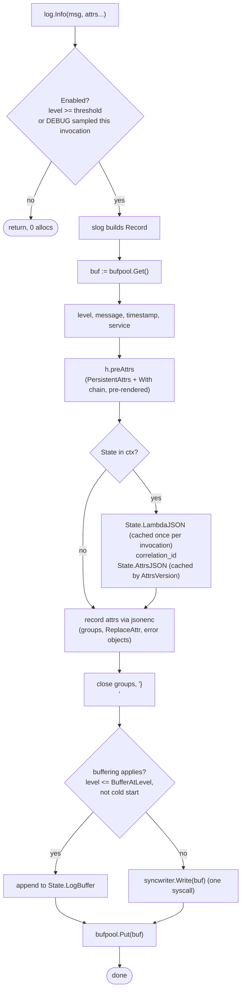
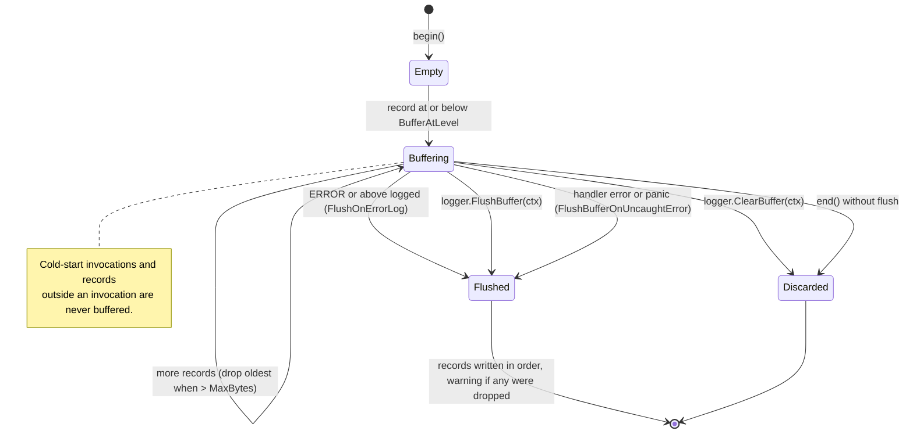

# 02. Logger

A `log/slog` handler that writes Powertools-shaped JSON lines. Consumers use the standard
`*slog.Logger` API; the only Powertools-specific calls are for invocation-scoped keys,
correlation IDs and the buffer.

## 1. Output format

One JSON object per line, written with a single `Write`. Key order is fixed for the
standard keys (cosmetic, but it matches upstream and makes log tailing readable).

| Key | Type | When | Source |
| --- | --- | --- | --- |
| `level` | string | always | one of `TRACE DEBUG INFO WARN ERROR FATAL` (see §2) |
| `message` | string | always | `slog.Record.Message` |
| `timestamp` | string | always | RFC 3339 with milliseconds, UTC: `2026-10-15T14:48:00.000Z` |
| `service` | string | always | `Options.Service` / `POWERTOOLS_SERVICE_NAME` / `service_undefined` |
| `sampling_rate` | number | when rate > 0 | `Options.SampleRate` |
| `cold_start` | bool | wrapper in use | `State.ColdStart` |
| `function_name` | string | wrapper in use | `lambdacontext.FunctionName` |
| `function_memory_size` | number | wrapper in use | `lambdacontext.MemoryLimitInMB` |
| `function_arn` | string | wrapper in use | `State.FunctionARN` |
| `function_request_id` | string | wrapper in use | `State.RequestID` |
| `xray_trace_id` | string | trace header present | `State.Trace.Root`; falls back to `_X_AMZN_TRACE_ID` per R2 |
| `correlation_id` | string | set | `State.CorrelationID` |
| `location` | string | `Options.AddSource` | `main.handle:42` (function name and line, mirroring Python's `location: "collect.handler:9"`) |
| persistent attrs | any | always | `Options.PersistentAttrs` and `logger.With(...)` |
| invocation attrs | any | set | `logger.AppendKeys(ctx, …)` |
| record attrs | any | per call | `log.Info("msg", "k", v)` |
| `error` | object | an attr value is `error` | `{"name": "*fs.PathError", "message": "...", "cause": [...]}` (see §7) |

Timestamp layout follows the TypeScript edition and satisfies ALC (R5). Python's default
(`2021-05-03 10:20:19,650+0000`) is **not** RFC 3339 and would make Lambda re-stamp and
re-level the line; it is not offered.

Reserved keys: if a consumer attr uses `level`, `message`, `timestamp`, `service`,
`sampling_rate` or `xray_trace_id`, the handler drops the attr and emits one warning per
process (TypeScript behaviour). Lambda context keys may be overridden by consumer attrs
to allow redaction.

Dev mode (`POWERTOOLS_DEV=true`): indented output. Never on in Lambda.

Example:

```json
{"level":"INFO","message":"collecting payment","timestamp":"2026-10-15T14:48:00.123Z","service":"payment","cold_start":true,"function_name":"payment-prod","function_memory_size":256,"function_arn":"arn:aws:lambda:eu-west-1:123456789012:function:payment-prod","function_request_id":"c6af9ac6-7b61-11e6-9a41-93e812345678","xray_trace_id":"1-5759e988-bd862e3fe1be46a994272793","correlation_id":"8f0c…","order_id":"o-123"}
```

## 2. Levels

Decision 2: the logger supports **all six Lambda Advanced Logging Controls levels** as
`slog` levels. `slog.Level` is an integer and custom values are a supported, documented
use of the package, so the two extra levels are plain constants, not a wrapper type.
The emitted names are exactly the names Lambda filters on (R5), so Lambda never
re-levels a line.

| Constant | Value | Emitted string | Accepted when parsing |
| --- | --- | --- | --- |
| `logger.LevelTrace` | `slog.Level(-8)` | `TRACE` | `TRACE` |
| `slog.LevelDebug` | -4 | `DEBUG` | `DEBUG` |
| `slog.LevelInfo` | 0 | `INFO` | `INFO` |
| `slog.LevelWarn` | 4 | `WARN` | `WARN`, `WARNING` (Python) |
| `slog.LevelError` | 8 | `ERROR` | `ERROR` |
| `logger.LevelFatal` | `slog.Level(12)` | `FATAL` | `FATAL`, `CRITICAL` (Powertools) |
| `logger.LevelSilent` | `slog.Level(16)` | threshold only; nothing should log at it | `SILENT` (decision 19) |

- `ParseLevel(s string) (slog.Level, error)` is exported; it is case-insensitive and
  returns `ErrInvalidLevel` otherwise. It is what reads `POWERTOOLS_LOG_LEVEL` and
  `AWS_LAMBDA_LOG_LEVEL`.
- `LevelName(l slog.Level) string` returns the table's string for the six values and
  falls back to `slog.Level.String()` (`INFO+2`) for others. Lambda treats such lines as
  `INFO`; documented.
- Naming follows the style guide's no-repetition rule (`logger.LevelTrace`, not
  `logger.LogLevelTrace`), matching `slog.LevelDebug`.
- `Fatal` is a level, not an action: nothing in this package calls `os.Exit` or panics.
  A Lambda handler returns its error; the runtime reports it.
- `LevelSilent` is a threshold, not a level to log at. `Options.Level = logger.LevelSilent`
  or `POWERTOOLS_LOG_LEVEL=SILENT` makes `Enabled` false for every record, including
  `FATAL`, with zero cost per call. There is no `Silent` package function; a record
  logged explicitly at that level would print `SILENT`, which Lambda treats as `INFO`,
  and the library never does that.

### Package functions (the custom-logger shape)

`*slog.Logger` has methods for the four standard levels only. For symmetry across all
six, and so that code deep in the call graph needs only `ctx`, the package exposes:

```go
package logger

const (
    LevelTrace  = slog.Level(-8)
    LevelFatal  = slog.Level(12)
    LevelSilent = slog.Level(16) // threshold only
)

// Each function resolves the invocation's logger from ctx (FromContext) and calls
// Logger.Log with the matching level, exactly like slog.Log but with the Powertools
// levels. Example: logger.Trace(ctx, "cache lookup", "key", k)
func Trace(ctx context.Context, msg string, args ...any)
func Debug(ctx context.Context, msg string, args ...any)
func Info(ctx context.Context, msg string, args ...any)
func Warn(ctx context.Context, msg string, args ...any)
func Error(ctx context.Context, msg string, args ...any)
func Fatal(ctx context.Context, msg string, args ...any)
func Log(ctx context.Context, level slog.Level, msg string, args ...any)
```

These are sugar over `FromContext(ctx).Log(ctx, level, msg, args...)`; they allocate
nothing beyond what `slog.Logger.Log` allocates and they respect `Enabled` before
building the record. When no invocation is in `ctx`, `FromContext` returns
`slog.Default()`, which is `slog`'s own mechanism and the only process-wide fallback
the package uses (decision 7).

Level precedence and the ALC warning are specified in 01 §3.

## 3. Options and constructors

```go
package logger

type Options struct {
    Service         string          // POWERTOOLS_SERVICE_NAME
    Level           slog.Leveler    // nil ⇒ env / INFO. A *slog.LevelVar makes it changeable at runtime.
    SampleRate      float64         // POWERTOOLS_LOGGER_SAMPLE_RATE, 0..1
    Writer          io.Writer       // nil ⇒ os.Stdout. Wrapped by internal/syncwriter.
    PersistentAttrs []slog.Attr     // rendered once; appear on every line
    AddSource       bool            // "location" key; costs a runtime.CallersFrames per record
    Location        *time.Location  // nil ⇒ UTC
    TimestampLayout string          // "" ⇒ "2006-01-02T15:04:05.000Z07:00"
    ReplaceAttr     func(groups []string, a slog.Attr) slog.Attr  // same contract as slog.HandlerOptions
    Buffer          BufferOptions
    Pretty          *bool           // nil ⇒ POWERTOOLS_DEV
}

type BufferOptions struct {
    Enabled          bool
    MaxBytes         int        // 0 ⇒ 20480
    BufferAtLevel    slog.Level // records at or below this level are buffered; default DEBUG
    FlushOnErrorLog  bool       // default true when Enabled
}

func New(opts Options) *slog.Logger          // slog.New(NewHandler(opts))
func NewHandler(opts Options) *Handler       // the slog.Handler; exported for composition (MultiHandler, tee)
func (h *Handler) Enabled(ctx context.Context, l slog.Level) bool
func (h *Handler) Handle(ctx context.Context, r slog.Record) error
func (h *Handler) WithAttrs(attrs []slog.Attr) slog.Handler
func (h *Handler) WithGroup(name string) slog.Handler
func (h *Handler) Level() slog.Level         // effective level after ALC precedence
func (h *Handler) SampleRate() float64       // used by the wrapper for the per-invocation decision
```

`New` returns `*slog.Logger` on purpose: there is no `logger.Logger` type, so consumers
and third-party libraries (`net/http`, AWS SDK logging adapters) interoperate through the
standard type. `NewHandler` is exported so consumers can compose it
(`slog.NewMultiHandler(powertoolsHandler, otherHandler)`, Go 1.26).

## 4. Invocation-scoped API

```go
// FromContext returns a logger bound to the invocation: the handler reads invocation
// state from ctx on every call, so this is simply the configured logger. It exists so
// code deep in the call graph does not need the *slog.Logger passed around; it falls
// back to slog.Default() when the wrapper is not in use.
func FromContext(ctx context.Context) *slog.Logger

// AppendKeys adds attrs visible to every log line of this invocation, from any goroutine
// holding ctx. Equivalent to Powertools appendKeys / append_keys but scoped to the
// invocation instead of the process (R4).
func AppendKeys(ctx context.Context, attrs ...slog.Attr)
func RemoveKeys(ctx context.Context, keys ...string)
func ResetKeys(ctx context.Context)
func Keys(ctx context.Context) []slog.Attr   // snapshot copy

func SetCorrelationID(ctx context.Context, id string)
func CorrelationID(ctx context.Context) string

func FlushBuffer(ctx context.Context)        // write buffered records in order, then clear
func ClearBuffer(ctx context.Context)        // drop buffered records
```

Why not return a derived `*slog.Logger` from `AppendKeys`? Because upstream semantics
are "visible to subsequent logs in this request, including the caller's logger", which
needs shared per-invocation state. Lexical scoping is still available through
`log.With(...)`, which the handler pre-renders once.

## 5. Handler internals (performance-driven)

Follows the slog handler guide: pre-format what can be pre-formatted, allocate once per
record from a pool, write once.

```go
type Handler struct {
    cfg       config          // immutable
    w         *syncwriter.Writer
    level     slog.Leveler
    preAttrs  []byte          // rendered PersistentAttrs + WithAttrs chain, e.g. `,"env":"prod"`
    groups    []string        // open groups from WithGroup
    preGroups []byte          // rendered `,"g1":{"g2":{` prefix for record attrs
    nOpen     int             // braces to close
}
```

`Handle(ctx, r)`:

1. `s := invocation.FromContext(ctx)` (one lookup, may be nil).
2. `buf := bufpool.Get()`; append `{"level":"`, level name, `","message":`, quoted
   message, `,"timestamp":"`, `r.Time.UTC().AppendFormat(...)`, `","service":"…"`.
3. Append `h.preAttrs`.
4. If `s != nil`: append `s.LambdaJSON` (rendered lazily once per invocation and cached
   in `State`: `cold_start`, `function_*`, `xray_trace_id`), then `correlation_id` if set,
   then `s.AttrsJSON` (cached by `AttrsVersion`, re-rendered only after `AppendKeys`;
   the snapshot is taken under `s.Mu` and released before the write).
5. Append `h.preGroups`, then each record attr via `jsonenc.AppendAttr` (resolves
   `LogValuer`, handles groups, applies `ReplaceAttr`, renders `error` values per §7),
   then closing braces, then `}\n`.
6. If buffering applies (§9): copy into the invocation buffer; else `h.w.Write(buf)`.
7. `bufpool.Put(buf)`.



`Enabled(ctx, l)`: `l >= h.Level() || (l >= slog.LevelDebug && s != nil && s.DebugSampled)`.
No allocation; no lookup when the level alone decides.

JSON string escaping and number formatting come from `internal/jsonenc`, backed by
`encoding/json/jsontext.AppendQuote` and `strconv` (decisions 1 and 23).
Arbitrary `slog.KindAny` values use `encoding/json/v2` (`json.MarshalWrite` into the same
buffer); this is the only allocation-heavy path and it is only taken for non-scalar values.
Values of type `jsontext.Value` are copied verbatim after `IsValid` (decision 23).

`WithAttrs` returns a new `*Handler` with `preAttrs` extended (copy-on-write; the original
is untouched). `WithGroup` extends `groups`/`preGroups`. Both allocate; they are called
when loggers are derived, not per record.

## 6. Sampling

- Decision per invocation in `begin`: `DebugSampled = rate > 0 && rand.Float64() < rate`
  using `math/rand/v2` (non-cryptographic is fine; it is a sampling decision).
- Without the wrapper, consumers call `logger.RefreshSampleRate(ctx)`; this mirrors
  `refreshSampleRateCalculation`.
- `sampling_rate` key is emitted on every line when rate > 0 (upstream behaviour).
- ALC still filters after us (R5): if ALC is `INFO`, sampled `DEBUG` lines are dropped by
  Lambda. Documented, not worked around.

## 7. Errors in attributes

A record attr whose value is an `error` (`slog.KindAny`) renders as an object:

```json
"error": {"name": "*url.Error", "message": "Get \"https://x\": timeout", "cause": ["net/http: timeout"]}
```

- `name`: dynamic type name, obtained with `%T` on the cold path only.
- `message`: `err.Error()`.
- `cause`: the `errors.Unwrap` chain messages, present only when non-empty.
- `stack`: not in v1. Go errors carry no stack; adding one requires a convention the
  consumer implements. Candidate for v1.1: honour an optional `StackTrace() []uintptr`
  method defined by the consumer.

`log.Error("msg", "err", err)` and `log.Error("msg", slog.Any("error", err))` both work;
the key name is whatever the consumer chose.

## 8. Event logging and correlation IDs

- Event logging is a wrapper feature (`Options.LogEvent` or `POWERTOOLS_LOGGER_LOG_EVENT`).
  With `WrapHandler` the raw payload bytes are embedded verbatim as the `event` value
  (a `jsontext.Value`, zero decode, zero re-encode; validated once with
  `IsValid(jsontext.AllowDuplicateNames(true), jsontext.AllowInvalidUTF8(true))` so a
  payload Lambda accepted is never rejected by the stricter v2 defaults). With `Wrap[In, Out]` the typed value
  is marshalled with `encoding/json/v2` (`json.Marshal`), which costs one marshal only
  when event logging is on.
- Correlation ID extraction order: `Options.CorrelationIDFunc` (typed, no cost) >
  `Options.CorrelationIDPath` evaluated by `internal/jsonpath` on the raw bytes
  (`WrapHandler`) or on a marshalled copy (`Wrap`, cost documented) > none.
- Built-in paths, as string constants in package `logger` (`CorrelationPathAPIGatewayREST`
  etc.):

| Constant | Path |
| --- | --- |
| `API_GATEWAY_REST` | `requestContext.requestId` |
| `API_GATEWAY_HTTP` | `requestContext.requestId` |
| `APPSYNC_AUTHORIZER` | `requestContext.requestId` |
| `APPSYNC_RESOLVER` | `request.headers."x-amzn-trace-id"` |
| `APPLICATION_LOAD_BALANCER` | `headers."x-amzn-trace-id"` |
| `EVENT_BRIDGE` | `id` |
| `LAMBDA_FUNCTION_URL` | `requestContext.requestId` |
| `S3_OBJECT_LAMBDA` | `xAmzRequestId` |
| `VPC_LATTICE` | `headers."x-amzn-trace-id"` |

`internal/jsonpath` supports dot-separated keys with optional double-quoted segments for
keys containing `-` or `.`; it is not JMESPath. `go-jmespath` is archived and is not a
dependency.

## 9. Buffering

Per-invocation buffer stored in `State.LogBuffer` (type `invocation.LogBuffer`: a mutex, a byte budget and a slice of rendered records), allocated on first use.

- Records with level ≤ `BufferAtLevel` are buffered (rendered bytes, not `slog.Record`,
  so timestamps are preserved and no record state escapes).
- `MaxBytes` enforced; when full, the oldest records are dropped and a warning is
  emitted on flush ("buffer dropped N records").
- A single record larger than `MaxBytes` is written directly with a warning.
- `FlushOnErrorLog`: any record at `ERROR` or above flushes the buffer **before** the
  error line is written.
- `FlushBufferOnUncaughtError` (wrapper option): flush in `end` when `err != nil` or the
  handler panicked.
- After `end()` (`State.Closed`), records from late goroutines are written immediately,
  never buffered, still carrying the old invocation's keys (01 §7.4). The opt-in
  pre-timeout flush (`DeadlineMargin`) flushes the buffer before the deadline (01 §7 D6).
- Not buffered: records emitted outside an invocation (`State == nil`) and records during
  a cold start (upstream behaviour, keeps init diagnostics visible).
- Buffered bytes are written with one `Write` per record to keep line atomicity.



## 10. Lambda ALC interplay

- `AWS_LAMBDA_LOG_LEVEL` wins over everything (01 §3) and a one-time warning is logged
  when the Powertools level is more verbose.
- Level strings and timestamps satisfy R5 so Lambda never re-levels our lines.
- `AWS_LAMBDA_LOG_FORMAT=TEXT` with our JSON output is fine: Lambda forwards the line as is.

## 11. Testing

- `testing/slogtest.Run` conformance (groups, empty attrs, zero time, `LogValuer`).
- Golden tests decode the line with `encoding/json/v2` into `map[string]any` and compare
  with `cmp.Diff` (semantic comparison, per the style guide), plus a key-order test on
  the raw prefix for the fixed standard keys.
- Table tests for level parsing, precedence with ALC, sampling boundaries (`0`, `1`,
  `0.5` with a seeded `rand.Rand` injected through an unexported field in tests).
- Buffer tests: overflow, oversize record, flush on error, flush on uncaught error,
  concurrent `AppendKeys` from goroutines under `-race`.
- `AllocsPerRun` tests for `Info` with 0, 3 and 10 scalar attrs and for a disabled level.

## 12. Performance targets

Measured in 05-performance.md; targets after baseline: 0 allocations per enabled record
with scalar attrs (pooled buffer, no escapes), 0 allocations for a disabled level, under
1 µs per record excluding the `Write` syscall.

## 13. Parity matrix

| Feature | Python | TypeScript | This plan |
| --- | --- | --- | --- |
| Standard keys | yes | yes | yes, TypeScript timestamp layout |
| Levels | DEBUG…CRITICAL | TRACE…CRITICAL, SILENT | TRACE…FATAL (Lambda names); `CRITICAL`, `WARNING`, `SILENT` accepted on input |
| Lambda context keys | yes | yes | yes, via wrapper |
| `log_event` | yes | yes | yes |
| Correlation ID path | JMESPath | JMESPath | dot path + typed func |
| `append_keys` / `remove_keys` / `clear_state` | process-scoped | instance-scoped | invocation-scoped |
| Persistent keys | yes | yes | `Options.PersistentAttrs`, `With` |
| Child loggers | yes | `createChild` | `log.With`, `slog.New(handler.WithAttrs(...))` |
| Sampling | yes | yes | yes |
| Buffering | yes | yes | yes |
| Custom formatter | subclass | subclass | `ReplaceAttr`, or wrap/compose the handler |
| `logRecordOrder` | yes | yes | no (fixed standard order, then attrs); v1.1 candidate |
| Exception / stack serialisation | traceback | `stack` | `name`, `message`, `cause`; stack in v1.1 |
| `POWERTOOLS_DEV` pretty print | yes | yes | yes |
| Thread-safe keys | `thread_safe_append_keys` | n/a | all keys are goroutine-safe |
