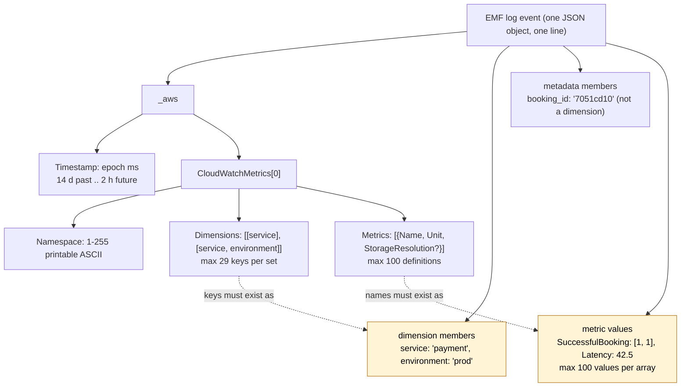
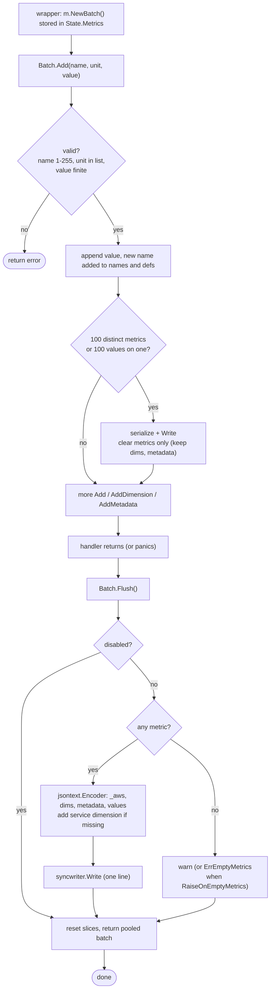

# 03. Metrics

CloudWatch Embedded Metric Format (EMF) emitter. Metrics are aggregated in memory per
invocation and written to stdout as one JSON blob; CloudWatch extracts them
asynchronously, so the function never calls `PutMetricData`.

## 1. EMF reference (what we must produce)

```json
{
  "_aws": {
    "Timestamp": 1760540880123,
    "CloudWatchMetrics": [
      {
        "Namespace": "ServerlessAirline",
        "Dimensions": [["service"], ["service", "environment"]],
        "Metrics": [
          {"Name": "SuccessfulBooking", "Unit": "Count"},
          {"Name": "Latency", "Unit": "Milliseconds", "StorageResolution": 1}
        ]
      }
    ]
  },
  "service": "payment",
  "environment": "prod",
  "booking_id": "7051cd10",
  "SuccessfulBooking": [1, 1],
  "Latency": 42.5
}
```



Constraints enforced (R10, EMF specification, Powertools constants):

| Item | Limit | Behaviour on violation |
| --- | --- | --- |
| Metric definitions per blob | 100 | auto-flush when the 100th distinct metric is added |
| Values per metric array | 100 | auto-flush when a metric reaches 100 values (Python behaviour) |
| Dimension keys per set | 29 (Powertools) of 30 (spec) | `Add*Dimension` returns `ErrTooManyDimensions` |
| Dimension key | 1–250 printable ASCII, not only whitespace, not starting with `:` | dropped with a warning (Python drops empty), error for the rest |
| Dimension value | 1–1024 printable ASCII, not only whitespace | dropped with a warning |
| Namespace | 1–255 printable ASCII | `New` validates when provided; `Flush` returns `ErrNamespaceMissing` when absent |
| Metric name | 1–255 characters after `TrimSpace` | `Add` returns `ErrInvalidName` |
| Value | finite float64 within ±2^360 | `Add` returns `ErrInvalidValue` for NaN/Inf |
| Unit | one of the 27 CloudWatch units | `Add` returns `ErrInvalidUnit` |
| Resolution | 1 or 60 | typed, cannot be wrong |
| Timestamp | within 14 days past, 2 hours future | `SetTimestamp` logs a warning; value still used |
| Blob size | well under the 1 MB log event limit and the 256 KB Lambda line limit | 100-metric cap keeps typical blobs under 10 KB |

Units (from the EMF JSON schema): `Seconds Microseconds Milliseconds Bytes Kilobytes
Megabytes Gigabytes Terabytes Bits Kilobits Megabits Gigabits Terabits Percent Count
Bytes/Second Kilobytes/Second Megabytes/Second Gigabytes/Second Terabytes/Second
Bits/Second Kilobits/Second Megabits/Second Gigabits/Second Terabits/Second Count/Second
None`.

`StorageResolution` is omitted for standard resolution (Python does this to avoid
needless ingestion); `Unit` is always written.

## 2. Options and constructor

```go
package metrics

type Unit string           // typed constants: metrics.Count, metrics.Milliseconds, ...
type Resolution int        // metrics.Standard = 60, metrics.High = 1

type Options struct {
    Namespace         string            // POWERTOOLS_METRICS_NAMESPACE
    Service           string            // POWERTOOLS_SERVICE_NAME ⇒ "service" dimension
    FunctionName      string            // POWERTOOLS_METRICS_FUNCTION_NAME ⇒ ColdStart dimension
    DefaultDimensions map[string]string // copied at New; present in every blob and every Single
    Disabled          *bool             // nil ⇒ POWERTOOLS_METRICS_DISABLED (and POWERTOOLS_DEV rule)
    Writer            io.Writer         // nil ⇒ os.Stdout, wrapped by syncwriter
    Logger            *slog.Logger      // for warnings; nil ⇒ slog.Default()
}

// New validates what can be validated eagerly (namespace and default dimension syntax)
// and returns an immutable *Metrics that is safe for concurrent use.
func New(opts Options) (*Metrics, error)
```

Dev rule (TypeScript parity): when `POWERTOOLS_DEV=true` metrics are silenced unless
`POWERTOOLS_METRICS_DISABLED=false` is set explicitly, which lets tests spy on stdout.

## 3. Per-invocation API

```go
// Batch accumulates metrics for one invocation. It is created by the wrapper and stored
// in the invocation state; outside the wrapper, create one with Metrics.NewBatch.
// All methods are safe for concurrent use and safe on a nil *Batch (no-ops), so code
// can call metrics.FromContext(ctx).Add(...) without checking.
type Batch struct { /* unexported */ }

func FromContext(ctx context.Context) *Batch
func (m *Metrics) NewBatch() *Batch

func (b *Batch) Add(name string, unit Unit, value float64) error
func (b *Batch) AddHighResolution(name string, unit Unit, value float64) error
func (b *Batch) AddDimension(name, value string) error          // appends to the first dimension set
func (b *Batch) AddDimensions(dims map[string]string) error     // creates an additional dimension set (default dims + dims)
func (b *Batch) AddMetadata(key string, value any)              // top-level member, not a dimension
func (b *Batch) SetTimestamp(t time.Time)                       // epoch ms; warning if outside the window
func (b *Batch) Flush() error                                   // serialize + one Write + reset + mark flushed; ErrEmptyMetrics only when RaiseOnEmptyMetrics
func (b *Batch) FlushSnapshot() error                           // serialize + Write what is there, keep accepting (used by the pre-timeout flush)
func (b *Batch) Len() int

// Single emits one metric with its own dimensions and namespace the moment Emit is called.
func (m *Metrics) Single(name string, unit Unit, value float64) *Single
func (s *Single) AddDimension(name, value string) *Single
func (s *Single) AddMetadata(key string, value any) *Single
func (s *Single) WithNamespace(ns string) *Single
func (s *Single) WithTimestamp(t time.Time) *Single
func (s *Single) HighResolution() *Single
func (s *Single) Emit() error
```

`Add` returns `error` rather than panicking or silently dropping, per the Google style
guide. Callers that prefer fire-and-forget write `_ = b.Add(...)`; the error path is
only taken on programmer mistakes (bad unit, NaN), which tests catch.

Why a method set on `*Batch` and not package functions taking `ctx`: the batch is the
natural unit of ownership, it is testable without a context, and it keeps `metrics`
free of any dependency on the wrapper beyond `FromContext`.

## 4. Batch internals

```go
type Batch struct {
    m          *Metrics
    mu         sync.Mutex
    names      []string           // insertion order (EMF output order), cap 16 preallocated
    defs       map[string]*metricDef  // name → unit, resolution, values
    dims       []dimension        // first dimension set, defaults copied in at creation
    dimSets    [][]dimension      // additional sets from AddDimensions
    metadata   []keyValue         // insertion order
    timestamp  int64              // 0 ⇒ now at Flush
    flushed    bool               // set by Flush; later Add returns ErrBatchFlushed (01 §7.4)
}

type metricDef struct {
    unit       Unit
    resolution Resolution
    values     []float64          // cap 4 preallocated; EMF writes a scalar when len == 1
}
```

A `Batch` is **never pooled** (01 §7 D4): a goroutine that outlives the handler may
still hold the pointer, and reusing the object would let it write into the next
invocation's metrics. One allocation per invocation plus the preallocated slices is the
cost. `Flush` sets `flushed`; a later `Add` returns `ErrBatchFlushed`, drops the value
and logs one `WARN` per batch naming the metric. The opt-in pre-timeout flush
(01 §7 D6) calls `FlushSnapshot`, which writes what is there and keeps the batch open.

`names` keeps a stable output order so that golden tests and log readers are
deterministic; the map gives O(1) lookup for repeated `Add` of the same name.

## 5. Serialization

Written with a pooled `jsontext.Encoder` (`internal/jsonenc.Encoder`, 11 §3 A) in this
order: `_aws` object (Timestamp, one `CloudWatchMetrics` directive with `Namespace`,
`Dimensions` arrays, `Metrics` definitions), then dimension members (first set, then
additional sets, later values override earlier for the same key, matching Python's
`all_dimensions` merge), then metadata, then metric values. The encoder guarantees
balanced objects and valid strings, so the serializer cannot produce a malformed blob;
the cost is one encoder reset per flush, once per invocation. Floats via `strconv.AppendFloat(buf, v, 'f', -1, 64)`;
integers that are whole render as `1`, not `1.0` (CloudWatch accepts both; this keeps
blobs smaller). Metadata values of arbitrary type use `encoding/json/v2`
(`json.MarshalWrite` into the same buffer); `jsontext.Value` metadata is copied verbatim.

One `Write` of `buf + "\n"` through the shared `syncwriter` (R4).

## 6. Cold-start metric

Wrapper option `CaptureColdStartMetric`. On the invocation that observes the cold start
(01 §5) the wrapper emits a **separate** blob:

```json
{"_aws":{"Timestamp":…,"CloudWatchMetrics":[{"Namespace":"ServerlessAirline","Dimensions":[["function_name","service"]],"Metrics":[{"Name":"ColdStart","Unit":"Count"}]}]},"function_name":"payment-prod","service":"payment","ColdStart":1}
```

`function_name` resolution order: `Options.FunctionName` > `POWERTOOLS_METRICS_FUNCTION_NAME`
> `lambdacontext.FunctionName`. Default dimensions are included (TypeScript behaviour).
Nothing is emitted on warm invocations (no `ColdStart: 0`).

## 7. Flush semantics

- Explicit `Flush()` by the consumer, or automatic at the end of the wrapped handler,
  including when the handler returns an error or panics (deferred).
- Auto-flush at 100 metrics / 100 values clears only the metric set; dimensions and
  metadata are kept for the next blob (Python behaviour).
- Empty batch: warning `"No application metrics to publish. The cold-start metric may be published if enabled."`
  unless `RaiseOnEmptyMetrics`, in which case `Flush` returns `ErrEmptyMetrics` and the
  wrapper returns it as the handler error **only if the handler itself succeeded**.
- Disabled: `Flush` resets and returns nil without writing.
- After `Flush`, `Add` returns `ErrBatchFlushed` (late goroutine, 01 §7.4); `FlushSnapshot`
  does not close the batch.
- `service` dimension is added at flush if `Service` is set and no `service` dimension
  exists (Python behaviour).



## 8. Testing

- Golden EMF blobs decoded with `encoding/json/v2` and compared with `cmp.Diff`; a separate test embeds the EMF
  JSON schema from the CloudWatch docs and validates every golden blob with a
  test-only validator (`github.com/santhosh-tekuri/jsonschema/v6`, decision 13; it never
  reaches consumers because it is imported only from `_test.go` files).
- Table tests for every limit in §1 and for dimension-set merging.
- Concurrency test: 100 goroutines adding metrics to one batch under `-race`.
- Auto-flush boundary tests (100th metric, 100th value).
- Timestamp window warnings with an injected clock (unexported `now func() time.Time`).
- `AllocsPerRun`: `Add` existing name = 0, `Add` new name ≤ 2, `Flush` with 10 metrics
  ≤ 1 (the buffer comes from the pool).

## 9. Parity matrix

| Feature | Python | TypeScript | This plan |
| --- | --- | --- | --- |
| `add_metric` / `addMetric` with unit and resolution | yes | yes | `Add`, `AddHighResolution` |
| Multi-value metrics | yes | yes | yes |
| 100-metric auto flush | yes | yes | yes, plus 100-value rule |
| `add_dimension`, `add_dimensions` (sets) | yes | yes | yes |
| Default dimensions | yes | yes | `Options.DefaultDimensions` (immutable) |
| `set_default_dimensions` / `clear_default_dimensions` at runtime | yes | yes | no: mutation of a shared instance is unsafe under R4; create a second `*Metrics` instead |
| Metadata | yes | yes | yes |
| `single_metric` | yes | yes | `Single` builder |
| Cold-start metric | yes | yes | yes |
| `raise_on_empty_metrics` / `throwOnEmptyMetrics` | yes | yes | `RaiseOnEmptyMetrics` |
| Custom timestamp | yes | yes | `SetTimestamp` |
| `POWERTOOLS_METRICS_DISABLED` | yes | yes | yes |
| Datadog / other providers | yes | no | no |
| `EphemeralMetrics` isolation | yes | n/a | every `Batch` is isolated by construction |
