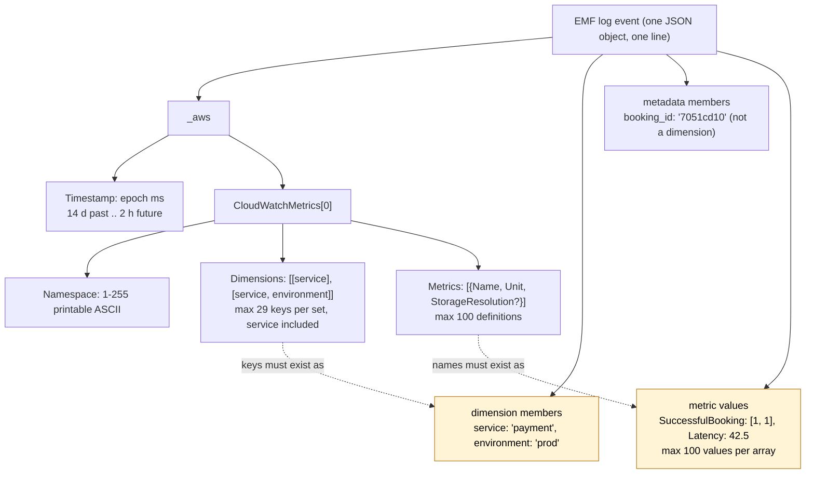
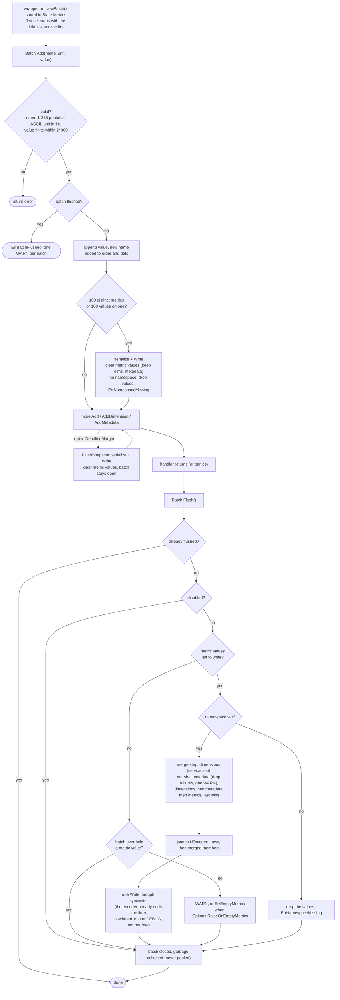

# 03. Metrics

CloudWatch Embedded Metric Format (EMF) emitter. Metrics are aggregated in memory per
invocation and written to stdout as one JSON blob; CloudWatch extracts them
asynchronously, so the function never calls `PutMetricData`.

> **About the implementation notes.** This plan was implemented by a reference
> implementation and released as v1.0.0. Paragraphs marked **Validated in
> implementation** confirm a choice of this plan; paragraphs marked **Changed after
> implementation** correct the plan where the implementation proved it wrong, ambiguous or
> too literal, with the reason. §10 shows how callers use the intended API.

## 1. EMF reference (what we must produce)

```json
{
  "_aws": {
    "Timestamp": 1760540880123,
    "CloudWatchMetrics": [
      {
        "Namespace": "ServerlessAirline",
        "Dimensions": [["service"], ["service", "environment"]],
        "Metrics": [
          {"Name": "SuccessfulBooking", "Unit": "Count"},
          {"Name": "Latency", "Unit": "Milliseconds", "StorageResolution": 1}
        ]
      }
    ]
  },
  "service": "payment",
  "environment": "prod",
  "booking_id": "7051cd10",
  "SuccessfulBooking": [1, 1],
  "Latency": 42.5
}
```

> **Validated in implementation.** The reference implementation produces this example
> byte for byte (compacted onto one line); a test compares the bytes, not only the decoded
> value, so the member order stays stable.



Constraints enforced (R10, EMF specification, Powertools constants):

| Item | Limit | Behaviour on violation |
| --- | --- | --- |
| Metric definitions per blob | 100 | auto-flush when the 100th distinct metric is added |
| Values per metric array | 100 | auto-flush when a metric reaches 100 values (Python behaviour) |
| Dimension keys per set | 29 (Powertools) of 30 (spec), **`service` included** | `AddDimension`, `AddDimensions` and `Single.Emit` return `ErrTooManyDimensions`; `New` returns it when `service` plus `DefaultDimensions` exceed 29 keys. The cold-start set adds `function_name`, so it has at most 30 keys, the spec limit |
| Dimension key | 1–250 printable ASCII bytes, not only spaces, not starting with `:`, not `_aws` | an empty or blank key is dropped with a warning (Python drops empty), checked first; every other violation returns `ErrInvalidDimension`. In `DefaultDimensions` every violation is `ErrInvalidDimension` from `New` |
| Dimension value | 1–1024 printable ASCII bytes, not only spaces | dropped with a warning; in `DefaultDimensions` and `Options.Service` it is `ErrInvalidDimension` from `New` |
| Namespace | 1–255 printable ASCII bytes, not only spaces | `New` and `Single.Emit` return `ErrNamespaceMissing` for an invalid namespace; serialization returns `ErrNamespaceMissing` when it is absent |
| Metric name | 1–255 printable ASCII bytes, not only spaces, not `_aws` | `Add` returns `ErrInvalidName` |
| Value | finite float64 within ±2^360 | `Add` returns `ErrInvalidValue` for NaN, ±Inf and any `math.Abs(v) > 0x1p360` |
| Unit | one of the 27 CloudWatch units | `Add` returns `ErrInvalidUnit` |
| Resolution | 1 or 60 | chosen by the method (`Add` or `AddHighResolution`), cannot be wrong |
| Timestamp | within 14 days past, 2 hours future | `SetTimestamp` logs a warning; value still used |
| Blob size | well under the 1 MB log event limit and the 256 KB Lambda line limit | 100-metric cap keeps typical blobs under 10 KB |

> **Changed after implementation.** (1) The 29-key limit **includes `service`**, because
> `service` is always the first dimension (§2); counting it separately would let a set
> reach 31 keys with the cold-start `function_name`. (2) Metric names must be printable
> ASCII, not merely "1–255 characters after `TrimSpace`": the EMF JSON schema requires
> it, and `_aws` is rejected because it would duplicate the `_aws` member. Dimension keys
> follow the same `_aws` rule. (3) An invalid namespace returns **`ErrNamespaceMissing`**
> rather than a new sentinel: a namespace CloudWatch cannot use is, for the caller, a
> missing namespace, and one fewer sentinel keeps the error surface small. (4) The value
> range is checked explicitly, because `jsontext` would otherwise write a NaN as a string
> and CloudWatch would drop the whole blob. (5) There is no exported resolution type; see
> §2.

Units (from the EMF JSON schema): `Seconds Microseconds Milliseconds Bytes Kilobytes
Megabytes Gigabytes Terabytes Bits Kilobits Megabits Gigabits Terabits Percent Count
Bytes/Second Kilobytes/Second Megabytes/Second Gigabytes/Second Terabytes/Second
Bits/Second Kilobits/Second Megabits/Second Gigabits/Second Terabits/Second Count/Second
None`.

`StorageResolution` is omitted for standard resolution (Python does this to avoid
needless ingestion); `Unit` is always written.

`Dimensions` always lists `service`, so the first set is never empty through the API. The
encoder still writes `"Dimensions":[[]]` for a blob whose first set is empty (the schema
requires at least one set and accepts an empty one); only hand-built test blobs reach that
rule.

## 2. Options and constructor

```go
package metrics

type Unit string           // typed constants: metrics.Count, metrics.Milliseconds, ...
                           // the storage resolution is chosen by the method, not by a type

type Options struct {
    Namespace           string            // POWERTOOLS_METRICS_NAMESPACE
    Service             string            // POWERTOOLS_SERVICE_NAME, else "service_undefined" ⇒ "service" dimension, always
    FunctionName        string            // POWERTOOLS_METRICS_FUNCTION_NAME ⇒ ColdStart dimension
    DefaultDimensions   map[string]string // copied at New; present in every blob and every Single
    RaiseOnEmptyMetrics bool              // Flush returns ErrEmptyMetrics instead of a warning on an empty batch
    Disabled            *bool             // nil ⇒ POWERTOOLS_METRICS_DISABLED (and POWERTOOLS_DEV rule)
    Writer              io.Writer         // nil ⇒ the stdout writer shared with the logger
    Logger              *slog.Logger      // for warnings; nil ⇒ slog.Default(), looked up at log time
}

// New validates what can be validated eagerly (namespace, service and default dimension
// syntax) and returns an immutable *Metrics that is safe for concurrent use.
func New(opts Options) (*Metrics, error)
```

> **Changed after implementation.** (1) The planned `type Resolution int` with
> `metrics.Standard` and `metrics.High` is **not exported**: no exported function took or
> returned it, because the resolution is chosen by the method (`Add`,
> `AddHighResolution`, `Single.HighResolution`), so the three identifiers would only have
> been frozen surface, and `metrics.High` reads poorly without its type nearby. A later
> `AddWithResolution`-style API can export a type again without breaking anything.
> (2) `RaiseOnEmptyMetrics` moved here from the wrapper options: `Flush` is the code that
> reads it, and consumers who build batches with `NewBatch` outside the wrapper need it
> too. (3) `Service` defaults to `service_undefined` and is **always** the first default
> dimension (TypeScript behaviour), so "add `service` if it is set" never has to be
> decided at flush time.

`New` resolves, in order (the environment is read only here, so tests can use `t.Setenv`
before constructing): the namespace (option, else `POWERTOOLS_METRICS_NAMESPACE`; a
non-empty invalid one returns `ErrNamespaceMissing`; an empty one is accepted and every
flush then returns `ErrNamespaceMissing`); the service (option, else
`POWERTOOLS_SERVICE_NAME`, else `service_undefined`; an invalid value returns
`ErrInvalidDimension`); the default dimensions (`service` first, then the keys of
`DefaultDimensions` in sorted order; an explicit `DefaultDimensions["service"]` replaces
the service value in place; more than 29 keys returns `ErrTooManyDimensions`); the
function name; the disabled switch; the writer.

> **Validated in implementation.** `New` returning `(*Metrics, error)` while
> `logger.New` returns no error was kept on purpose: an invalid namespace, service or
> default dimension would make every later blob invalid, so metrics validates at
> construction, whereas the logger can fall back to a default and warn once.

Zero values: a `Metrics` not obtained from `New`, a `Batch` not obtained from `NewBatch`
or `FromContext` and a `Single` not obtained from `(*Metrics).Single` are inert: every
method behaves as on a nil receiver, and nothing panics. `New` sets an unexported flag
that nothing else sets.

Logging: warnings go to `Options.Logger`, else to `slog.Default()` looked up when the line
is logged. `metrics` never imports `logger`, so it cannot use the invocation's logger.

Writer: when `Writer` is nil, metrics write through the one package-level, mutex-guarded
stdout writer that the logger also uses, so a log line and an EMF blob never interleave.
A writer supplied by the consumer is wrapped in its own serializing writer at `New`; it is
not shared with other utilities.

Dev rule (TypeScript parity): when `POWERTOOLS_DEV=true` metrics are silenced unless
`POWERTOOLS_METRICS_DISABLED=false` is set explicitly, which lets tests spy on stdout. An
unparseable `POWERTOOLS_METRICS_DISABLED` counts as unset.

> **Changed after implementation.** Dev mode affects only this switch: EMF blobs are
> **never indented**, even with `POWERTOOLS_DEV=true`, because Lambda splits stdout on
> newlines and CloudWatch would see fragments. Indentation is the logger
> pretty-printer's alone.

## 3. Per-invocation API

```go
// Batch accumulates metrics for one invocation. It is created by the wrapper and stored
// in the invocation state; outside the wrapper, create one with Metrics.NewBatch.
// All methods are safe for concurrent use and safe on a nil *Batch (no-ops, nil error),
// so code can call metrics.FromContext(ctx).Add(...) without checking.
type Batch struct { /* unexported */ }

func FromContext(ctx context.Context) *Batch
func (m *Metrics) NewBatch() *Batch

func (b *Batch) Add(name string, unit Unit, value float64) error
func (b *Batch) AddHighResolution(name string, unit Unit, value float64) error
func (b *Batch) AddDimension(name, value string) error          // appends to the first dimension set
func (b *Batch) AddDimensions(dims map[string]string) error     // creates an additional dimension set (default dims + dims)
func (b *Batch) AddMetadata(key string, value any)              // top-level member, not a dimension; marshalled at each write
func (b *Batch) SetTimestamp(t time.Time)                       // epoch ms; warning if outside the window
func (b *Batch) Flush() error                                   // serialize + one Write + mark flushed; returns only sentinels
func (b *Batch) FlushSnapshot() error                           // serialize + Write + clear the values written; batch stays open
func (b *Batch) Len() int                                       // distinct definitions held and not yet written

// EmitColdStart writes the separate ColdStart blob (§6) at once. It does not check the
// cold-start flag; the caller (normally the wrapper) decides when to call it.
func (m *Metrics) EmitColdStart(functionName string) error

// Single emits one metric with its own dimensions and namespace the moment Emit is called.
func (m *Metrics) Single(name string, unit Unit, value float64) *Single
func (s *Single) AddDimension(name, value string) *Single
func (s *Single) AddMetadata(key string, value any) *Single
func (s *Single) WithNamespace(ns string) *Single
func (s *Single) WithTimestamp(t time.Time) *Single
func (s *Single) HighResolution() *Single
func (s *Single) Emit() error
```

> **Changed after implementation.** `EmitColdStart` is exported. The plan had the wrapper
> build the cold-start blob through an unexported path; exporting it means the wrapper
> uses only the public API (`NewBatch`, `FlushSnapshot`, `Flush`, `EmitColdStart`), with no
> back door between packages, and a consumer without the wrapper can emit the same blob
> from its own cold-start check.

`Add` returns `error` rather than panicking or silently dropping, per the Google style
guide. Callers that prefer fire-and-forget write `_ = b.Add(...)`; the error path is
only taken on programmer mistakes (bad unit, NaN), which tests catch. `Add` (and
`AddHighResolution`) can also return `ErrNamespaceMissing` when the 100-metric or
100-value auto-flush has no namespace to serialize with; that blob's values are dropped,
so memory stays bounded and the caller learns the configuration error at the point of
loss. A write error during an auto-flush is logged at `DEBUG` and `Add` returns nil.

Method details settled by the implementation:

- Validation order of `Add`: name, unit, value, then the flushed check, so a late `Add`
  with invalid arguments returns the validation error. The same name with another unit or
  resolution keeps one definition with the last unit and resolution (Python).
- Disabled: every method still validates its arguments and returns the same validation
  errors, then stores and writes nothing. Validation allocates nothing, so "zero work when
  disabled" holds for allocations and I/O.
- `AddDimension` appends to, or overwrites in place in, the first set; sets created
  earlier by `AddDimensions` are not changed (Python).
- `AddDimensions` creates a set from the defaults plus `dims`: defaults first (`service`,
  then the sorted defaults), then the new keys sorted, a key equal to a default
  overwriting that default's value in this set only. An empty map is a silent no-op; an
  invalid key returns `ErrInvalidDimension` and adds nothing; a set with the same keys as
  an existing additional set replaces that set's values instead of adding a duplicate.
- `SetTimestamp`: a zero `time.Time` resets to "now at each serialization"; the window
  boundaries are inclusive; the timestamp is kept across auto-flushes and snapshots.
- `Single`: validation is deferred to `Emit` (a builder cannot return errors); the first
  builder error wins and is returned by `Emit`. The builder is not consumed, so a second
  `Emit` writes a second blob. A `Single` is not safe for concurrent use.

Late calls, after `Flush` (a goroutine that outlived its invocation, 01 §7.4):

| Call | Result |
| --- | --- |
| `Add`, `AddHighResolution` | `ErrBatchFlushed` (after validation); the value is dropped; one WARN per batch naming the first metric |
| `AddDimension`, `AddDimensions` | `ErrBatchFlushed`, no WARN |
| `AddMetadata`, `SetTimestamp` | no effect, no WARN |
| `FlushSnapshot`, `Flush` | no-op, nil |
| `Len` | 0 |

Why a method set on `*Batch` and not package functions taking `ctx`: the batch is the
natural unit of ownership, it is testable without a context, and it keeps `metrics`
free of any dependency on the wrapper beyond `FromContext`.

## 4. Batch internals

```go
type Batch struct {
    orderBuf  [16]*metricDef        // inline backing array of order
    m         *Metrics
    defs      map[string]*metricDef // nil until the first new name
    dimsBuf   [8]dimension          // inline backing array of dims
    order     []*metricDef          // insertion order (EMF output order)
    dims      []dimension           // first dimension set, defaults copied in at creation
    dimSets   [][]dimension         // additional sets from AddDimensions; nil until used
    metadata  []keyValue            // insertion order; nil until used
    timestamp int64                 // tsSet false ⇒ now at each serialization
    mu        sync.Mutex
    held      bool                  // a metric value was stored at least once (§7 empty rule)
    flushed   bool                  // set by Flush; later Add returns ErrBatchFlushed (01 §7.4)
    // plus one-shot warning flags
}

type metricDef struct {
    name       string
    unit       Unit
    values     []float64            // = inline[:0]; EMF writes a scalar when len == 1
    resolution storageResolution    // unexported
    inline     [4]float64
}
```

> **Changed after implementation.** The plan's `names []string` plus a map became
> `order []*metricDef` (same role, one pointer per entry, no second lookup at
> serialization), and the preallocated slices became inline arrays inside the struct.
> Result: `NewBatch` is exactly **one** allocation (the struct with its inline buffers)
> when the defaults fit eight entries, the map is created lazily on the first new name, a
> new name is one allocation (the `metricDef` with its inline `[4]float64`), and `Flush`
> allocates nothing. Field order follows `betteralign`, which moves the inline arrays to
> the front. The reference implementation measured `Batch` at 520 bytes and `metricDef`
> at 96 bytes.

A `Batch` is **never pooled** (01 §7 D4): a goroutine that outlives the handler may
still hold the pointer, and reusing the object would let it write into the next
invocation's metrics. One allocation per invocation is the cost. After `Flush` the batch
is left to the garbage collector.

Locking: every method holds the batch mutex for its whole critical section,
serialization and the `Write` included, so a snapshot and a concurrent `Add` see one
consistent state. Lock order is the batch mutex, then the writer's mutex; neither calls
back. Warnings are collected in locals and logged after the unlock, so a slow logger
does not hold the batch, and a logger whose handler calls back into the batch cannot
deadlock it. The only consumer code
that runs under the batch mutex is a metadata value's `MarshalJSON`; a panic there is
recovered by the serializer.

The opt-in pre-timeout flush (01 §7 D6) calls `FlushSnapshot`.

> **Changed after implementation.** `FlushSnapshot` does not merely "write what is there
> and keep the batch open": it then **clears the metric values it wrote**, exactly like
> auto-flush, and keeps dimensions, metadata, the timestamp and the open state. Otherwise
> the `Flush` in `end()` would write the same values a second time and CloudWatch would
> double-count them. On an empty batch it writes nothing and warns nothing; without a
> namespace it drops the values and returns `ErrNamespaceMissing`, which the wrapper logs
> at `WARN`.

`order` keeps a stable output order so that golden tests and log readers are
deterministic; the map gives O(1) lookup for repeated `Add` of the same name.

## 5. Serialization

One code path serializes every blob: auto-flush, `FlushSnapshot`, `Flush`, `Single.Emit`
and `EmitColdStart`. It has two steps.

**Merge step (before encoding).** It builds the list of top-level members in a pooled
scratch slice (linear scan, no map):

1. Dimension members: the first set, then the additional sets. `service` is already the
   first default dimension, so nothing is added at flush (the output equals Python's "add
   `service` if missing"). A later set overrides an earlier one for the same key
   (Python's `all_dimensions` merge).
2. Metadata members, each marshalled here, before it joins the merge.
3. Metric values.

Key collisions follow Python's `{**dimensions, **metadata, **metrics}`: the last one wins,
and a member keeps the position of its first occurrence, like a Python dict merge. So
`AddMetadata("service", …)` overrides the `service` dimension value, and a metric named
like a dimension or metadata key overrides both. The merged list has unique names, so the
encoder never sees a duplicate member name.

> **Changed after implementation.** The merge step is new. A `jsontext.Encoder` returns
> an error on a duplicate member name, and that error would lose the **whole** blob;
> deduplicating before encoding keeps the encoder's guarantees and matches Python's output
> for every collision.

Metadata marshalling and drop rules:

- A `jsontext.Value` is checked with `IsValid` (default options, so duplicate names and
  invalid UTF-8 fail) and embedded with `enc.WriteValue`, which compacts it: the blob
  always stays on one line, and its bytes may differ from the input in whitespace.
- Any other value goes through `json.Marshal` (`encoding/json/v2`, default options) inside
  a `recover` wrapper, then `enc.WriteValue`. Nothing calls `json.MarshalWrite` into the
  encoder's buffer, which would bypass the encoder's comma and colon handling.
- A value that fails (`time.Duration`, an `error`, a `chan`, a string with invalid UTF-8)
  or whose `MarshalJSON` panics is dropped with any partial bytes; the batch logs one
  `WARN` naming the key (once per batch), and the flush goes on and succeeds. Because a
  failed value is dropped before the merge, it never shadows a dimension member. `nil`
  marshals to `null` and is kept.
- Keys `""`, `"_aws"` and keys with invalid UTF-8 are dropped with the same one `WARN`
  (the encoder would replace invalid bytes with U+FFFD, so two keys could collide). The
  same key twice keeps the first position and the last value.
- A value is marshalled each time a blob is written, so it must not be mutated
  concurrently and its `MarshalJSON` must not call back into the batch.

> **Changed after implementation.** The plan wrote metadata with `json.MarshalWrite` into
> the shared buffer. That would bypass the encoder's comma and colon handling, and a
> marshal error halfway through would leave partial bytes in the blob; marshalling to
> bytes first, then `WriteValue`, makes "the serializer cannot produce a malformed blob"
> true.

**Encoding.** A pooled `jsontext.Encoder` (`internal/jsonenc.Encoder`, 11 §3 A) writes, in
this order: the `_aws` object (Timestamp, one `CloudWatchMetrics` directive with
`Namespace`, `Dimensions` arrays, `Metrics` definitions), then the merged members. Every
byte goes through the encoder as tokens: floats as `jsontext.Float` (whole values render as
`1`, not `1.0`; CloudWatch accepts both and blobs stay smaller), `Timestamp` and
`StorageResolution` as `jsontext.Int` (the schema types them `integer`). The encoder
guarantees balanced objects and valid strings; the cost is one encoder reset per blob.

The encoding is about 40 token writes, none of which can fail on validated input. They go
through a small "sticky" writer that keeps the first error and turns every later call into
a no-op, checked once before the `Write`. An encoder error (a bug) aborts the blob: nothing
is written.

**Write.** The encoder ends a top-level value with `"\n"` itself, so the serializer adds no
newline of its own. One `Write` through the shared serializing writer (R4).

> **Changed after implementation.** The plan's "one `Write` of `buf + "\n"`" would have
> produced an empty line after every blob, because `jsontext.Encoder` already terminates
> each top-level value with a newline.

## 6. Cold-start metric

Wrapper option `CaptureColdStartMetric`. On the invocation that observes the cold start
(01 §5) the wrapper calls `m.EmitColdStart(lambdacontext.FunctionName)`, which writes a
**separate** blob at once:

```json
{"_aws":{"Timestamp":…,"CloudWatchMetrics":[{"Namespace":"ServerlessAirline","Dimensions":[["function_name","service"]],"Metrics":[{"Name":"ColdStart","Unit":"Count"}]}]},"function_name":"payment-prod","service":"payment","ColdStart":1}
```

`function_name` resolution order: `Options.FunctionName` > `POWERTOOLS_METRICS_FUNCTION_NAME`
(read once by `New`) > the `functionName` argument. Default dimensions are included
(TypeScript behaviour). Nothing is emitted on warm invocations (no `ColdStart: 0`).

> **Changed after implementation: the set rules.** The set is `function_name` **first**,
> then the defaults (`service` first). A `DefaultDimensions` entry named `function_name` is
> replaced by the resolved name, which keeps the first position (Python and TypeScript add
> it after the defaults, so the resolved name wins), and the set **never repeats a key**.
> When no name resolves, or it is not a valid dimension value, `function_name` is omitted
> silently and a default `function_name` stays in its sorted position. The defaults hold
> at most 29 keys, so the set never exceeds the EMF limit of 30. The blob holds only
> `ColdStart` (`Count`, value 1, standard resolution), no metadata. `EmitColdStart` returns
> the same errors as `Single.Emit` (`ErrNamespaceMissing`, a write error) and returns nil
> without writing when metrics are disabled.

## 7. Flush semantics

- Explicit `Flush()` by the consumer, or automatic at the end of the wrapped handler,
  including when the handler returns an error or panics (deferred).
- Auto-flush at 100 metrics / 100 values clears only the metric values; dimensions and
  metadata are kept for the next blob (Python behaviour).
- `FlushSnapshot` (pre-timeout flush) does the same: serialize, write, clear the metric
  values, keep dimensions, metadata and the open state. It does not close the batch.
- `Flush` checks, in this order: already flushed (no-op, nil); mark the batch flushed;
  disabled (nil, never `ErrEmptyMetrics`); no values left (empty rule below); no namespace
  (the values are dropped and `Flush` returns `ErrNamespaceMissing`).
- Empty batch at `Flush`: warning `"No application metrics to publish. The cold-start metric may be published if enabled."`
  unless `Options.RaiseOnEmptyMetrics`, in which case `Flush` returns `ErrEmptyMetrics`.
- `service` is the first default dimension: it is in every dimension set from `NewBatch`
  on, so nothing is added at flush.

> **Changed after implementation: `Flush` returns only sentinels.** `Flush` returns
> `ErrEmptyMetrics` or `ErrNamespaceMissing` and **never an I/O error**: a write failure is
> logged once per batch at `DEBUG` and dropped (`FlushSnapshot` and the auto-flush do the
> same; `Single.Emit` and `EmitColdStart` do return the writer's error). The reason is the
> wrapper's rule: it returns **any** `Flush` error as the invocation error when the handler
> succeeded (the handler's result value is still returned), and logs it at `WARN` when the
> handler failed or panicked, so a stdout hiccup must never fail an invocation, while a
> function without a namespace fails loudly, as Python and TypeScript raise.

> **Changed after implementation: the empty rule.** A batch counts as empty only if it
> **never held a metric value** during the invocation. When an auto-flush or a
> `DeadlineMargin` snapshot already wrote every value, `Flush` writes nothing and neither
> warns nor returns `ErrEmptyMetrics`. This is a deliberate, documented difference from
> Python, which warns after an auto-flush emptied the set; with a pre-timeout snapshot the
> Python rule would turn a healthy invocation into a failed one.

> **Changed after implementation: disabled.** `Flush` on a disabled batch marks it flushed
> and returns nil without writing; it does not "reset", because a batch is never reused
> (§4).



## 8. Testing

- EMF blobs are decoded with `encoding/json/v2` and its **default** options, strictly: a
  duplicate member name or invalid UTF-8 fails the test, because EMF needs unique member
  names. This is the opposite of the logger's tests, which decode with
  `AllowDuplicateNames` because log lines may legitimately repeat keys (02 §1); the two
  decoders are kept apart so a permissive helper never hides an EMF bug.
- Golden EMF blobs (`testdata/golden/*.json`) are hand-written against the specification,
  not generated by the code under test (no `-update` flag), with a fixed timestamp, and
  compared with `cmp.Diff` after decoding. One test compares the §1 example byte for byte.
- A separate test embeds the EMF JSON schema from the CloudWatch docs and validates every
  golden blob and every generated blob with a test-only validator
  (`github.com/santhosh-tekuri/jsonschema/v6`, decision 13; it never reaches consumers
  because it is imported only from `_test.go` files). Generated blobs cover the limits: 100
  definitions, 100 values, 29 dimension keys in a batch set and the 30-key cold-start set.
- Schema details that proved necessary: the schema's `$id` values are fragments, which the
  2020-12 metaschema rejects, so it is compiled as Draft 7
  (`Compiler.DefaultDraft(jsonschema.Draft7)`); and since JSON has no comments, a
  provenance file next to the schema (`testdata/emf-schema.SOURCE.md`) records the source
  URL, the retrieval date and the license.
- A fuzz test feeds batches built from the limit boundaries to the schema validator; its
  seed corpus runs on every `go test`, and `go test -fuzz` explores further locally.
- Table tests for every limit in §1 (boundaries included), the 27 units, the value range
  (±2^360, NaN, ±Inf, negative zero), dimension-set merging, collisions, metadata drop
  rules, the `Flush` check order, late calls and the disabled matrix
  (`Disabled` × `POWERTOOLS_METRICS_DISABLED` × `POWERTOOLS_DEV`).
- Concurrency tests under `-race`: 100 goroutines adding to shared and own names with
  auto-flushes in between (every value exactly once across all blobs), adds racing with
  snapshots and `Flush`, and concurrent batches sharing one writer (no interleaved line).
  The `DeadlineMargin` snapshot racing with goroutines runs inside `testing/synctest`, so
  the timer fires deterministically.
- Auto-flush boundary tests (100th metric, 100th value), with and without a namespace.
- Timestamp window warnings with an injected clock (unexported `now func() time.Time`); the
  package tests are internal for that seam, the runnable examples external.
- Allocation budgets with `AllocsPerRun` after a warm-up run, writing to `io.Discard` with a
  discard logger and non-constant values, in files excluded from `-race` builds (the race
  runtime drops `sync.Pool` items at random):

  | Test | Budget | Measured by the reference implementation |
  | --- | --- | --- |
  | `NewBatch` with `service` + 2 defaults | ≤ 1 | 1 |
  | `Add` of an existing name with room in its values | 0 | 0 |
  | `Add` of a new name within 16 names | ≤ 2 | 1 (the `metricDef` with its inline array) |
  | `Add` and `AddDimensions` on a disabled batch | 0 | 0 |
  | `Add` with an invalid unit | 0 | 0 |
  | `Flush` of 10 metrics with `service` + 4 dimensions, no metadata | ≤ 1 | 0 |
  | the same plus two `jsontext.Value` metadata members | ≤ 1 | 0 |
  | `FlushSnapshot` of an empty batch | 0 | 0 |
  | `Single(…).AddDimension(…).Emit()` without metadata | recorded | 2 |

  Metadata of type `any` adds the allocations of `json.Marshal` and is not budgeted;
  `jsontext.Value` metadata adds none.

> **Validated in implementation.** A reference implementation measured, with Go 1.27 on an
> arm64 developer laptop (medians of 10 runs, writer `io.Discard`):
>
> | Benchmark | ns/op | allocs/op |
> | --- | ---: | ---: |
> | `Add`, existing name | 12.8 | 0 |
> | `Add`, new name (per `Add`, 16 names per op) | 48.6 | 1 |
> | `NewBatch` + 10 `Add` + 2 `AddDimension` + `Flush` | 2267 | 15 |
> | `json.Marshal` of the equivalent `map[string]any` blob (baseline) | 3603 | 71 |
> | `Single(…).Emit()` | 514 | 2 |
> | `EmitColdStart` | about 500 | 1 |
>
> The whole batch lifecycle is 0.63x the cost of marshalling an equivalent map with
> `encoding/json/v2`, with 15 allocations against 71 (the 15 are the batch and its 10
> definitions; `Flush` itself allocates nothing). Escape analysis reports the local
> definition built by `Single.Emit` and `EmitColdStart` as moved to the heap, so those two
> paths are recorded rather than budgeted.

## 9. Parity matrix

| Feature | Python | TypeScript | This plan |
| --- | --- | --- | --- |
| `add_metric` / `addMetric` with unit and resolution | yes | yes | `Add`, `AddHighResolution` (resolution chosen by the method) |
| Multi-value metrics | yes | yes | yes |
| 100-metric auto flush | yes | yes | yes, plus 100-value rule |
| `add_dimension`, `add_dimensions` (sets) | yes | yes | yes |
| Default dimensions | yes | yes | `Options.DefaultDimensions` (immutable), `service` always first |
| `set_default_dimensions` / `clear_default_dimensions` at runtime | yes | yes | no: mutation of a shared instance is unsafe under R4; create a second `*Metrics` instead |
| Metadata | yes | yes | yes; same merge order as Python (dimensions, metadata, metrics, last wins) |
| `single_metric` | yes | yes | `Single` builder |
| Cold-start metric | yes | yes | `EmitColdStart`, called by the wrapper when `CaptureColdStartMetric` is set |
| `raise_on_empty_metrics` / `throwOnEmptyMetrics` | yes | yes | `Options.RaiseOnEmptyMetrics` |
| Empty warning after an auto-flush emptied the batch | yes | not checked | no: empty means never held a value (§7) |
| Custom timestamp | yes | yes | `SetTimestamp` |
| `POWERTOOLS_METRICS_DISABLED` | yes | yes | yes |
| Datadog / other providers | yes | no | no |
| `EphemeralMetrics` isolation | yes | n/a | every `Batch` is isolated by construction |

## 10. Usage examples (intended API)

These snippets are examples of the intended API, checked against the exported signatures
of the reference implementation. Import paths are omitted; `metrics` and `powertools`
stand for the metrics package and the root wrapper package; `Order`, `Receipt` and
`charge` are placeholders of the consumer's code.

Construct once, in `main`, and let the wrapper own the per-invocation batch:

```go
m, err := metrics.New(metrics.Options{
    Namespace:         "ServerlessAirline",                      // else POWERTOOLS_METRICS_NAMESPACE
    Service:           "payment",                                // else POWERTOOLS_SERVICE_NAME, else service_undefined
    DefaultDimensions: map[string]string{"environment": "prod"}, // after service, sorted
})
if err != nil {
    // ErrNamespaceMissing (invalid namespace), ErrInvalidDimension, ErrTooManyDimensions
    log.Fatal(err)
}

lambda.Start(powertools.Wrap(handle, powertools.Options{
    Metrics:                m,    // one fresh *metrics.Batch per invocation, flushed at the end
    CaptureColdStartMetric: true, // separate ColdStart blob on the cold invocation
}))
```

Inside the handler, the batch comes from the context (a nil batch outside the wrapper,
whose methods do nothing):

```go
func handle(ctx context.Context, in Order) (Receipt, error) {
    b := metrics.FromContext(ctx)

    start := time.Now()
    err := charge(ctx, in)

    // Standard resolution (60 s); a second Add of the same name makes an array.
    if addErr := b.Add("SuccessfulBooking", metrics.Count, 1); addErr != nil {
        return Receipt{}, addErr // a programmer error: bad unit, NaN, invalid name
    }

    // High resolution (1 s): the method chooses StorageResolution.
    _ = b.AddHighResolution("Latency", metrics.Milliseconds,
        float64(time.Since(start).Microseconds())/1000)

    _ = b.AddDimension("payment_method", in.Method)                    // first set
    _ = b.AddDimensions(map[string]string{"region": in.Region})        // extra set: service, environment, region
    b.AddMetadata("booking_id", in.ID)                                 // searchable member, not a dimension
    b.AddMetadata("cart", jsontext.Value(`{"items":3}`))               // embedded verbatim (compacted)

    return Receipt{OrderID: in.ID}, err // the wrapper calls b.Flush()
}
```

Outside the wrapper, the caller owns the batch and the flush:

```go
b := m.NewBatch()
b.SetTimestamp(eventTime) // optional; zero time means "now at each write"

_ = b.Add("RecordsProcessed", metrics.Count, float64(n))

switch err := b.Flush(); {
case errors.Is(err, metrics.ErrNamespaceMissing):
    // configuration error: no namespace anywhere
case errors.Is(err, metrics.ErrEmptyMetrics):
    // only with Options.RaiseOnEmptyMetrics
}

// Too late: a goroutine that outlived the flush.
if err := b.Add("Late", metrics.Count, 1); errors.Is(err, metrics.ErrBatchFlushed) {
    // value dropped, one WARN per batch
}
```

One metric with its own dimensions and namespace, written at once, and the cold-start blob
from a consumer's own cold-start check:

```go
err := m.Single("OrderRejected", metrics.Count, 1).
    AddDimension("reason", "fraud").
    WithNamespace("ServerlessAirline/Risk").
    HighResolution().
    Emit() // builder errors surface here; the writer's error too

if coldStart {
    _ = m.EmitColdStart(lambdacontext.FunctionName) // Options.FunctionName or the env var win
}
```
