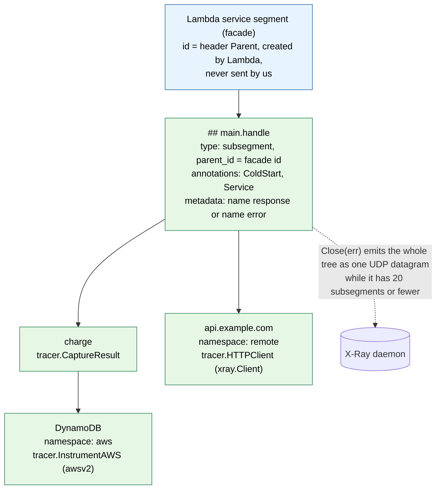
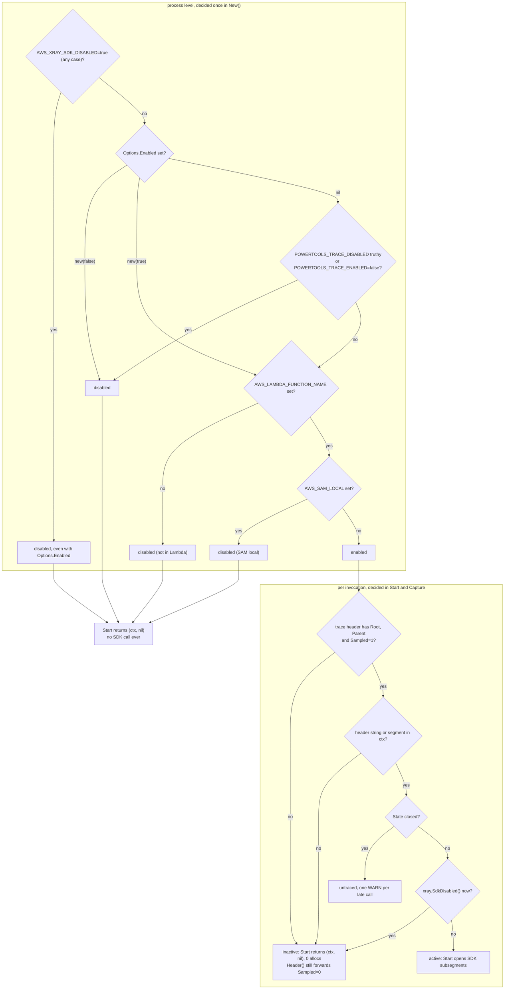
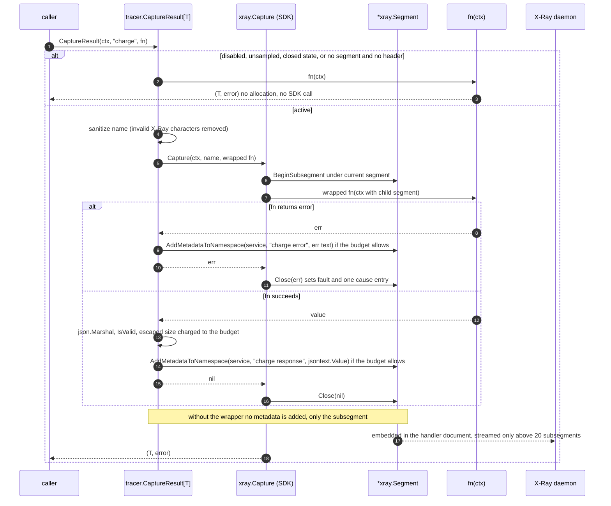
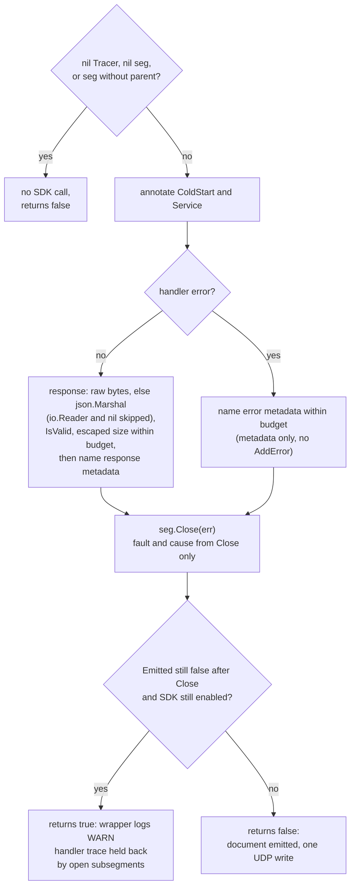

# 04. Tracer

A thin wrapper over the AWS X-Ray SDK for Go (`github.com/aws/aws-xray-sdk-go/v2`), the
same approach Powertools Python and TypeScript take with their X-Ray SDKs. The wrapper adds
the Powertools semantics (handler subsegment, `ColdStart` and `Service` annotations,
response and error metadata, enable/disable rules, context helpers, typed capture
helpers) and exposes the SDK's own `*xray.Segment` for everything else.

The SDK facts in this file hold for `aws-xray-sdk-go/v2` v2.0.x and come from its `xray`,
`header`, `xraylog` and `instrumentation/awsv2` sources and from the documents it emits.
Every SDK upgrade re-checks them; the golden tests of §8 fail when the emitted documents
change. §11 shows the API in use.

## 1. Decision record

Decision 3: **wrap the SDK**, because AWS maintains it and it already handles the Lambda
facade segment, emission, streaming of large trees, HTTP client tracing, AWS SDK v2
instrumentation and SQL tracing.

Consequences, all accepted:

| Consequence | How the plan deals with it |
| --- | --- |
| The SDK pulls grpc, protobuf, fasthttp, the AWS SDK for Go v2 core, route53 and `golang.org/x/net` into binaries that import `tracer` (R11), and into every consumer's module graph because the library is one module (decision 25). | Only the `tracer` package's production code imports the SDK, enforced by the `deps` CI job (06 §5). Test files may import it (decision 31): they are never linked into consumer binaries. The root wrapper imports `tracer`, because the handler-segment plumbing lives there, so **every binary that calls `Wrap` links the SDK**, even with `Options.Tracer` nil. Only a binary that uses `logger` and `metrics` without the wrapper stays SDK-free; that is what the size gate checks (05 §6). |
| The SDK keeps global mutable configuration (`xray.Configure`, `xray.SetLogger`, which is "not goroutine safe, only set from `init()`"). | The library **never mutates SDK globals** (decision 31): `tracer.New` touches no SDK state, and the consumer installs the SDK logger in `main` (§6). Daemon address, emitter and strategies are left to the SDK's environment handling (`AWS_XRAY_DAEMON_ADDRESS`, `AWS_XRAY_CONTEXT_MISSING`), which Lambda sets. Tests attach a per-context emitter with `xray.ContextWithConfig` (§8). |
| The SDK's default logger writes plain-text `[INFO]` and `[ERROR]` lines to stdout, which in Lambda is the same stream as the JSON logs and EMF: at least one `Emitter using address` line per cold start, plus every UDP write error. | Every example and the package quick start call `xray.SetLogger(tracer.NewXRayLogger(lg))` in `main`, before `lambda.Start` (§6, decision 20). The library itself never calls `SetLogger`. |
| SDK package init panics if `AWS_XRAY_DAEMON_ADDRESS` is malformed, and writes `/tmp/.aws-xray/initialized` when `LAMBDA_TASK_ROOT` is set. | Documented in the tracer package docs. Both are SDK behaviours the library does not change. |
| `xray.SdkDisabled()` reads `AWS_XRAY_SDK_DISABLED` with `os.Getenv` on every call and compares it with `strings.ToLower(v) == "true"` (any case, no trimming). | The tracer reads the variable with exactly the SDK's comparison, and because the SDK re-reads it per call, every path that would trace also checks `xray.SdkDisabled()` **last**, after every cheap check (§3). |
| `*xray.Segment` methods are **not** nil-safe. Only `Close` checks for a nil receiver; `AddAnnotation`, `AddMetadata`, `AddMetadataToNamespace`, `AddError` and `DownstreamHeader` panic on nil. A shared `&xray.Segment{Dummy: true}` is no stand-in (`AddError` dereferences its parent). | `Start` and `FromContext` return nil when not traced, and say so. The nil-safe package helpers `AddAnnotation`, `AddMetadata`, `AddResponseMetadata`, `AddErrorMetadata` and `Header` nil-check before every SDK call (§4, decision 31). |
| The SDK streams by **subsegment count**, not by size: completed children are sent separately only while the tree holds more than 20 subsegments (`MaxSubsegmentCount`). A document larger than one UDP datagram (about 64 kB on Linux, 9216 bytes on macOS) fails the write, the SDK only logs the error, and **the whole handler trace is lost**. | Metadata is charged against a per-invocation budget (§4, decisions 11 and 33): 48 KiB of escaped metadata across the handler segment and every `Capture` child together, which leaves room under the datagram for ids, annotations, `aws` and `http` blocks and error causes. |
| Raw SDK instrumentation (`awsv2.AWSV2Instrumentor`, `xray.Client`, `xray.RoundTripper`, `xray.SQLContext`) ignores `POWERTOOLS_TRACE_*`. Outside Lambda a headerless context makes each instrumented call log a context-missing error. | `tracer.HTTPClient` and `tracer.InstrumentAWS` apply the Powertools enable rules and leave the client untouched when tracing is disabled (§7, decision 22). Raw SDK use stays documented: only `AWS_XRAY_SDK_DISABLED=true` stops it. |
| Module graph: `InstrumentAWS` names `middleware.Stack` from `github.com/aws/smithy-go`, and the `awsv2` import pulls in the AWS SDK for Go v2 core. | `smithy-go` is a **direct** requirement (it is already in the SDK's graph, so no new module); `go mod tidy` adds `github.com/aws/aws-sdk-go-v2` as an **indirect** requirement (Apache-2.0). The license check (06 §4) covers both. |
| The `golang.org/x/net` version that an SDK release requires can lag behind fixes for advisories that `govulncheck` reports as reachable through `tracer` (the HTTP/2 code is linked through the SDK's HTTP paths). | When `govulncheck` flags it, the module raises `x/net` with an explicit indirect requirement on a fixed version (decision 35), and drops that floor once an SDK release requires a fixed version itself. `govulncheck` runs on every pull request (06 §5), so a new advisory surfaces before a release. |
| The SDK's `Segment` is a large struct with an embedded `sync.RWMutex`, maps for annotations and metadata, and a goroutine per *root* segment for context cancellation. Other SDK paths that start goroutines: `xray.CaptureAsync`, and the centralized sampling strategy's poller on the first `ShouldTrace`. | The wrapper calls none of them. In Lambda the facade is built by `BeginFacadeSegment`, which starts no goroutine and never calls `ShouldTrace`; `BeginSubsegment`, `Capture` and `Close` are synchronous, and the UDP emitter writes inline. So the "synchronous" principle (05 §1) holds for the whole tracer path in Lambda. Consumers who call `xray.BeginSegment` or `xray.CaptureAsync` themselves own those goroutines. The sampled path is budgeted relative to an SDK baseline (§9, 05 §3). |
| The SDK's `xray` package has no test daemon, and a custom `xray.Emitter` **never sees child subsegments**: only `DefaultEmitter.Emit` packs embedded and streamed children into the document. | Tests use a per-test UDP listener with `xray.NewDefaultEmitter`, attached through `xray.ContextWithConfig` (§8, §11.5). An in-memory recorder implementing `xray.Emitter` is used only to count emissions in allocation tests and benchmarks, which must not do I/O. |

Nothing is hidden. Where the SDK already offers the right API (`seg.AddAnnotation`,
`seg.AddMetadataToNamespace`, `seg.AddError`, `xray.AddAnnotation(ctx, …)`, `xray.Client`,
`xray.RoundTripper`, `xray.SQLContext`, `awsv2.AWSV2Instrumentor`), the plan documents it
and does not duplicate it. The tracer adds a helper only where the raw call panics on a
nil segment (`AddAnnotation`, `AddMetadata`) or ignores the Powertools switches
(`HTTPClient`, `InstrumentAWS`). Consumers call the SDK directly on a non-nil
`*xray.Segment` for everything else.

## 2. X-Ray model (R9) and what the SDK does for us

```text
Lambda service segment (facade)      ← SDK: BeginFacadeSegment from ctx.Value("x-amzn-trace-id"), never sent
└── "## main.handle"                  ← our Start ⇒ xray.BeginSubsegment; SDK emits it on Close (parent.Facade)
    ├── "charge"                      ← our Capture / Start; embedded in the parent document by the SDK
    │   └── "DynamoDB" (namespace aws)   ← tracer.InstrumentAWS ⇒ awsv2.AWSV2Instrumentor
    └── "api.example.com" (namespace remote) ← tracer.HTTPClient ⇒ xray.Client
```



Facts from `xray/segment.go`, `xray/lambda.go` and `header/header.go` that the wrapper
relies on:

- **Facade creation.** `BeginSubsegment(ctx, name)` creates the facade on first use when
  `ctx.Value("x-amzn-trace-id")` is present and no segment is in `ctx`. That value is set
  by `aws-lambda-go` on every invocation (R2), so the SDK is correct under
  multi-concurrency without `_X_AMZN_TRACE_ID`. The wrapper reads the same key and
  nothing else (decision 30): no `_X_AMZN_TRACE_ID` fallback and no `os.Getenv` per
  invocation. A missing or empty value means "no trace" for the logger and the tracer
  alike, so both always agree with the SDK.
- **Trace header parsing rule** (decisions 30 and 35). The wrapper parses the header once
  per invocation, without allocating (every field is a substring), and agrees with the
  SDK's `header.FromString` on the three fields that decide tracing: fields are split on
  `;` and trimmed, empty fields are ignored, `Root=`, `Parent=` and `Sampled=` are
  recognised **in any position** (a later duplicate wins), `Sampled` is true only for
  `Sampled=1` (`Sampled=?` and a missing flag are not sampled), and `Self=` and fields
  without `=` are skipped. `Rest` is one substring over the **trailing contiguous run**
  of other fields (for example `Lineage=a87bd80c:0`), so `Header` can forward them.
  Accepted divergence: other fields placed *before* a later known field are dropped from
  `Rest`, while the SDK keeps them in `AdditionalData`. Lambda always sends the canonical
  order with extra fields last, and a single substring keeps the parse allocation-free
  for every header. A table test in the `tracer` package (the only package allowed to
  import the SDK) runs both parsers over the same inputs, and another checks that the
  wrapper's key constant equals `xray.LambdaTraceHeaderKey`.
- **One segment key.** The current segment lives only under the SDK's `xray.ContextKey`.
  `xray.Client`, the awsv2 middleware and direct SDK calls find their parent only through
  `xray.GetSegment(ctx)`, so the tracer defines no segment key of its own and the
  invocation state holds no segment. A sampled `Start` therefore costs only the SDK's own
  `context.WithValue`.
- **Unsampled.** With `Sampled=0` in the header, the facade is unsampled and subsegments
  are `Dummy`: allocated but never emitted. The wrapper avoids even the allocation (§3).
- **Context missing.** With no header and no segment, `BeginSubsegment` invokes the
  context-missing strategy (`LOG_ERROR` in Lambda, a panic under `RUNTIME_ERROR`) and
  returns `nil`. The wrapper never lets this happen: it opens a subsegment only when the
  same source the SDK checks (a segment in `ctx`, or a header string under the ctx key)
  is present. A value under that key that is not a `string` means untraced on every path,
  because the SDK's unchecked type assertion would panic.
- **Names.** Names longer than 200 characters are truncated by the SDK. Python's X-Ray
  SDK additionally **removes** the characters `?;*()!$~^<>`; the wrapper strips the same
  set before calling the SDK, so names match across runtimes. The check is
  `strings.ContainsAny` over a constant ASCII string, so no package-level table is
  needed; a clean name is returned without copying (0 allocations) and a dirty one costs
  1 allocation. A name made only of invalid characters becomes `""`, which the SDK
  accepts.
- **Emission.** `Close(err)` on a subsegment whose parent is the facade marks
  `type: "subsegment"`, sets `parent_id` and emits over UDP synchronously. Nested
  subsegments are embedded. A closed segment is emitted only once no descendant is open
  (`flush()` checks `openSegments == 0 && EndTime > 0`), and only then is the exported
  `Emitted` field set under the segment lock. The streaming threshold is a subsegment
  count (`MaxSubsegmentCount`, 20), never a size, and `DefaultEmitter.Emit` makes one
  `conn.Write` per document and only logs a failure (§1).
- **Errors.** `seg.AddError(err)` sets `fault` and a `cause` built by the SDK's exception
  formatting strategy. `Close(err)` calls the same error recording, so calling both
  `AddError(err)` and `Close(err)` on one segment records the exception **twice**. The
  wrapper's error paths therefore add metadata only and leave `fault` and `cause` to
  `Close(err)`, so a failing invocation carries exactly one `cause.exceptions` entry.
- **Annotation types.** `seg.AddAnnotation` accepts `bool`, `int`, `uint`, `float32`,
  `float64` and `string` only. `int64` and every other integer width are rejected with
  an error; callers convert to `int`.
- **v1 marshal of embedded raw JSON.** The SDK marshals documents with v1
  `encoding/json`. A `jsontext.Value` is embedded as raw JSON, and v1 **re-validates,
  compacts and HTML-escapes** it: `<`, `>` and `&` grow from one byte to a six-byte
  `<`-style escape, and U+2028 and U+2029 grow by three bytes. The decoded value
  equals ours, but the bytes may differ. `json.RawMessage` behaves the same, so it is no
  alternative (decision 23). An invalid value makes the marshal fail, and **the whole
  document, with every embedded child, is dropped**. Worked example: the string
  `"a<b>&c"` is 8 bytes from `encoding/json/v2` and 23 bytes once embedded by v1
  (`8 + 3 × 5`).
- **Downstream header.** `seg.DownstreamHeader().String()` yields the outbound
  `X-Amzn-Trace-Id` value with `Parent` = this segment's id and the parent's sampling
  decision, including `Sampled=0`, so downstream services never start orphan traces. It
  drops extra fields such as `Lineage`, because it copies them only from the parent's
  incoming header, which the Lambda facade never sets; `Header` appends `Rest` itself
  (§7).

## 3. Enable / disable rules

Process level, decided once in `New` and cached:

1. `AWS_XRAY_SDK_DISABLED` is not `true`. This rule is absolute: it disables tracing even
   with `Options.Enabled = new(true)`.
2. `Options.Enabled`, when set, decides; when nil, `POWERTOOLS_TRACE_DISABLED` is not
   truthy and `POWERTOOLS_TRACE_ENABLED` is not `false`. `Options.Enabled` overrides only
   these two variables.
3. `AWS_LAMBDA_FUNCTION_NAME` is set (R1; `AWS_EXECUTION_ENV` is not used).
4. `AWS_SAM_LOCAL` is not set.

Rules 3 and 4 apply whatever `Options.Enabled` says. When disabled, the wrapper never
calls an SDK function.

Why `AWS_XRAY_SDK_DISABLED` wins over the option: with that variable set,
`BeginSubsegment` returns a bare `&xray.Segment{}` without a parent, its `Close` returns
before sending (so `Emitted` never becomes true and the held-back check of §5.1 would
fire falsely), and `xray.Capture`'s recover path dereferences the missing parent,
replacing a consumer panic with a nil-pointer panic. The variable is compared **exactly
like the SDK**: `strings.ToLower(v) == "true"`, so `true`, `TRUE` and `True` disable
while `1` and `true` with a leading space do not; no `strconv.ParseBool`, no trimming. A
test pins each of those five spellings.

Because the SDK re-reads the variable on every call, the tracer also checks
`xray.SdkDisabled()` **last** on every path that would trace (one `os.Getenv`, no
allocation, never reached on an untraced path). Setting it after `New` therefore stops
tracing from the next `Start` or `Capture`. The other variables are read once in `New`;
changing them later has no effect on that `*Tracer`.

`HTTPClient` and `InstrumentAWS` run at init, usually before any `*Tracer` exists, so
they evaluate the same environment rules when called; `Options.Enabled` cannot reach a
client built that way.

Invocation level, decided in `Start` and `Capture`, in this order:

1. The invocation state (01 §4.1) has `Trace.Sampled == true` and non-empty `Root` and
   `Parent`. This check runs first, so a late call on an unsampled invocation stays
   silent and allocation-free.
2. `ctx` holds a segment or a header string under the ctx key, the only sources
   `BeginSubsegment` uses to find a parent. Without one the SDK would call its
   context-missing strategy.
3. The state is not closed (§5.1); a late call logs one `WARN` and stays untraced.
4. `xray.SdkDisabled()` is false right now.

Without the wrapper there is no state and no cached decision: package-level `Start`,
`Capture` and `CaptureResult` trace when `ctx` holds a segment, or a header with
`Sampled=1`, and the SDK's own `AWS_XRAY_SDK_DISABLED` check passes. Code that needs the
Powertools rules without the wrapper holds a `*Tracer` and calls its methods.



## 4. API

```go
package tracer

import (
    "context"
    "encoding/json/jsontext"
    "fmt"
    "log/slog"
    "net/http"

    "github.com/aws/aws-xray-sdk-go/v2/xray"
    "github.com/aws/aws-xray-sdk-go/v2/xraylog"
    "github.com/aws/smithy-go/middleware"
)

// Options configures a Tracer. The zero value is usable. Built once per process, so the
// field order is the documentation order (betteralign ignores it, 05 §4).
type Options struct {
    Service         string       // "Service" annotation and metadata namespace; "" ⇒ POWERTOOLS_SERVICE_NAME, then "service_undefined"
    Enabled         *bool        // nil ⇒ env rules (§3); overrides POWERTOOLS_TRACE_* only, never AWS_XRAY_SDK_DISABLED=true
    CaptureResponse *bool        // nil ⇒ POWERTOOLS_TRACER_CAPTURE_RESPONSE, default true
    CaptureError    *bool        // nil ⇒ POWERTOOLS_TRACER_CAPTURE_ERROR, default true
    MetadataBudget  int          // <= 0 ⇒ 48 * 1024 escaped bytes per invocation, handler and Capture children together
    Logger          *slog.Logger // diagnostics (skipped metadata, bad names, late calls); nil ⇒ slog.Default()
}

// New never fails: nothing in Options can be invalid (decision 44).
func New(opts Options) *Tracer
func (t *Tracer) Enabled() bool

// Start opens a subsegment under the current segment in ctx. It returns (ctx, nil) when
// tracing is disabled, the invocation is unsampled, the state is closed, or no trace
// header or segment is present, so the wrapper never triggers the SDK's context-missing
// strategy. Safe on a nil *Tracer.
func (t *Tracer) Start(ctx context.Context, name string) (context.Context, *xray.Segment)

// Go 1.27 generic methods: the typed capture helper is a method as well as a package
// function, so code holding a *Tracer does not need the package-level lookup.
func (t *Tracer) Capture(ctx context.Context, name string, fn func(context.Context) error) error
func (t *Tracer) CaptureResult[T any](ctx context.Context, name string, fn func(context.Context) (T, error)) (T, error)

// Package-level forms find the Tracer in the invocation state, so deep code does not
// need the *Tracer. Without the wrapper they fall back to the SDK directly when a
// segment or a sampled header is present in ctx (§3).
func Start(ctx context.Context, name string) (context.Context, *xray.Segment)
func Capture(ctx context.Context, name string, fn func(context.Context) error) error
func CaptureResult[T any](ctx context.Context, name string, fn func(context.Context) (T, error)) (T, error)
func FromContext(ctx context.Context) *xray.Segment // xray.GetSegment(ctx); nil when not traced
func TraceID(ctx context.Context) string            // root id from the invocation state, else from the ctx header
func Header(ctx context.Context) string             // outbound X-Amzn-Trace-Id; "" only when no header exists (§7)

// Nil-safe helpers on the current segment: each is a no-op when ctx holds no segment, so
// code that may run untraced needs no nil check. Metadata goes to the service namespace
// ("default" without the wrapper) and is charged to the budget.
func AddAnnotation(ctx context.Context, key string, value any) error // bool, int, uint, float32, float64, string; int64 rejected
func AddMetadata(ctx context.Context, key string, value any) error   // nil also when the value is skipped (budget, invalid)
func AddResponseMetadata(ctx context.Context, name string, v any)    // "<name> response"
// AddErrorMetadata records "<name> error" and also calls seg.AddError, for callers that
// will not close the segment with the error. Combined with seg.Close(err) on the same
// segment it would record the exception twice (§2).
func AddErrorMetadata(ctx context.Context, name string, err error)

// Client instrumentation that honours the Powertools switches (§3, §7). Call at init.
func HTTPClient(c *http.Client) *http.Client                    // unchanged when disabled or the HTTPS switch is false; else xray.Client(c)
func InstrumentAWS(apiOptions *[]func(*middleware.Stack) error) // no-op when disabled or apiOptions is nil; else awsv2.AWSV2Instrumentor

// Wrapper plumbing (§5). With Start, it is all the root wrapper needs, so the root
// package's production code never names an *xray.Segment method. Exported only because
// the root package builds it (decision 44); consumers of Wrap never call it.
type HandlerEnd struct {
    Name            string         // handler name without "## ", used in the metadata keys
    ColdStart       bool           // "ColdStart" annotation
    Response        any            // Wrap: typed response, marshalled once with encoding/json/v2; never recorded when it is an io.Reader
    RawResponse     jsontext.Value // WrapHandler: response bytes, checked with IsValid, recorded by reference
    Err             error          // handler error, or the recovered panic as an error
    CaptureResponse *bool          // per-handler override; nil keeps Options.CaptureResponse
    CaptureError    *bool          // per-handler override; nil keeps Options.CaptureError
}

func (t *Tracer) EndHandler(ctx context.Context, seg *xray.Segment, e HandlerEnd) (heldBack bool)

// NewXRayLogger adapts a *slog.Logger to the SDK's xraylog.Logger, whose single method is
// Log(level xraylog.LogLevel, msg fmt.Stringer), with levels Debug, Info, Warn and Error,
// called concurrently. The adapter maps the four levels onto slog levels and checks
// Enabled before calling msg.String(), so the SDK's deferred formatting is preserved. It
// is goroutine-safe because *slog.Logger is. The caller passes it to xray.SetLogger from
// main before the first invocation (SetLogger is not goroutine-safe).
func NewXRayLogger(l *slog.Logger) *XRayLogger
func (x *XRayLogger) Log(level xraylog.LogLevel, msg fmt.Stringer) // implements xraylog.Logger
```

Rules the API follows:

- **Nil-safety.** `Start` (method and package function) and `FromContext` return a nil
  segment when not traced, and `Start` is safe on a nil `*Tracer`. Among the SDK's
  segment methods only `Close` is nil-safe, and `Close` on nil is **not free**: the SDK
  reads the environment and boxes a debug-log argument before any logger sees it (1
  allocation, even with `xraylog.NullLogger`). Hot paths write
  `if seg != nil { seg.Close(err) }`.
- **Metadata budget** (decision 33). Every metadata value the tracer adds (handler
  response or error, `Capture` response or error, the helpers) is charged against one
  per-invocation budget. The used-bytes counter lives in the invocation state as an
  atomic, because `Capture` children may run in goroutines. A value is counted at its
  escaped size, `len(b) + 5 × (count of '<', '>' and '&') + 3 × (count of U+2028 and
  U+2029)`, which is exact for the compact output of `json.Marshal` and an upper bound for
  pretty-printed raw input; one byte scan, no second marshal. Bytes are reserved with a
  compare-and-swap loop, so a value that does not fit is never charged and the counter
  never overshoots. A value that does not fit is skipped with one `WARN` naming the key,
  its escaped size and the budget; the segment and the rest of the document are still
  emitted. The handler response is charged last, so it is the value skipped when the
  children used the budget up. Without the wrapper there is no state and no budget.
- **`IsValid` is mandatory.** Every `jsontext.Value`, a caller-supplied value and the raw
  response bytes of `WrapHandler` included, passes `IsValid()` before it reaches
  `AddMetadataToNamespace`; an invalid one is skipped with a `WARN`, because v1 would
  otherwise drop the whole document (§2).
- **A panicking marshaller is recovered.** A `MarshalJSON` or `MarshalJSONTo` that panics
  counts as "not marshallable": the tracer recovers around its single `json.Marshal`
  call, logs one `WARN` and skips the value. `encoding/json/v2` does not recover such
  panics, and the handler's metadata is recorded after the wrapper's own recover has run,
  so without this a diagnostic would crash a successful invocation. `AddMetadata` returns
  `nil` for any skipped value; only the SDK's own error is returned.
- **Switches.** The helpers are explicit requests and ignore the capture switches; the
  switches govern only the automatic capture in `Capture`, `CaptureResult` and
  `EndHandler`. `Capture` (error-only `fn`) adds no response metadata; `CaptureResult`
  skips an untyped nil result and records a typed nil pointer as `null`. In `Capture`
  and `CaptureResult` the metadata keys use the sanitised name; `EndHandler` uses the
  handler name as given.
- **Without the wrapper** the package forms record the subsegment, `fault` and `cause`,
  but no response or error metadata, because the service namespace, the switches and the
  budget live in the `*Tracer` and the state.
- **Generic method.** `(*Tracer).CaptureResult[T]` uses Go 1.27 generic methods: the type
  argument is inferred from `fn` as for the package function, and may be written
  explicitly (`tr.CaptureResult[Quote](ctx, "quote", fn)`) where it helps the reader.
  Interface methods still cannot be generic, which does not matter here: the library
  exports no interfaces.

`Capture` and `CaptureResult` are the Go form of `capture_method` / `captureMethod`. One
guard function, `active`, covers every untraced case in the order of §3 (disabled,
unsampled, no segment or header string in `ctx`, closed state with one `WARN` per late
call, SDK disabled now), so the untraced path is a single call followed by `fn(ctx)`:

```go
func CaptureResult[T any](ctx context.Context, name string, fn func(context.Context) (T, error)) (out T, err error) {
    t := tracerFrom(ctx)
    if !t.active(ctx) { // nil-safe; covers every untraced case, 0 allocations
        return fn(ctx)
    }

    name = sanitize(name)
    err = xray.Capture(ctx, name, func(ctx context.Context) error { // SDK opens, closes, records fault and cause, re-panics
        var ferr error

        out, ferr = fn(ctx)
        if ferr != nil {
            t.addErrorMetadata(ctx, name, ferr) // metadata only, never seg.AddError

            return ferr
        }

        t.addResponseMetadata(ctx, name, out)

        return nil
    })

    return out, err
}
```

Without a `*Tracer` (a traced `ctx` but no wrapper), `active` falls back to the SDK
checks of §3 and the wrapped `fn` returns right after running, adding no metadata.
`Close(err)` inside `xray.Capture` is the single place that sets `fault` and `cause`, so
a failing `Capture` produces exactly one `cause.exceptions` entry.



Nothing else is wrapped: annotations, metadata namespaces, HTTP blocks, `aws` blocks and
SQL data are the SDK's API on the returned `*xray.Segment`, used after a nil check (or
through the nil-safe helpers above).

## 5. Handler segment lifecycle (wrapper)

In `begin` (01 §4.3), when active: `ctx, seg = t.Start(ctx, handlerName)` with
`handlerName = "## " + <Go function name of the handler>` computed once at wrap time
(for example `## main.handle`, mirroring Python's `## lambda_handler`; `_HANDLER` is the
executable name on `provided.al2023` and is not used). Under `WrapHandler` the derived
name is the dynamic type of the handler (for example `## *main.router`, decision 35).
`Options.HandlerName` replaces the derived name; the `"## "` prefix is always added.

The root wrapper keeps `seg` in a local variable captured by its deferred `end` and
makes **one call**, `t.EndHandler(ctx, seg, tracer.HandlerEnd{…})` (§4). The invocation
state holds no segment and the root package never calls an `*xray.Segment` method, so no
production package other than `tracer` imports the SDK (decision 31). `EndHandler` does:

0. Return `false` at once, with no SDK call, for a nil `*Tracer`, a nil `seg`, or a
   segment without a parent (what the SDK returns while `AWS_XRAY_SDK_DISABLED` is set).
1. `seg.AddAnnotation("ColdStart", e.ColdStart)` and `seg.AddAnnotation("Service", service)`.
   `Service` is always annotated, because the service is never empty (option, else
   `POWERTOOLS_SERVICE_NAME`, else `service_undefined`, as in the other utilities).
2. Success and capture on: take `RawResponse` when it is non-empty, else marshal
   `Response` once with `encoding/json/v2`; check `IsValid`; charge the escaped size to
   the budget (§4); then `seg.AddMetadataToNamespace(service, name+" response", value)`.
   `RawResponse` is recorded by reference, never copied; an empty `RawResponse` falls
   back to `Response`, so a handler returning no bytes records nothing and logs nothing.
   A nil response is skipped. Off with `POWERTOOLS_TRACER_CAPTURE_RESPONSE=false` or the
   option.
3. **Streaming responses are not recorded.** When `Response` implements `io.Reader` (for
   example a Function URL streaming response), nothing is recorded, nothing is charged
   and no `WARN` is logged: `aws-lambda-go` reads the body after the wrapper returns, so
   marshalling the reader would record junk, use up the budget, or consume the body. The
   handler segment is still annotated, closed and emitted.
4. Error and capture on: `seg.AddMetadataToNamespace(service, name+" error", err.Error())`
   within the budget. Metadata only: `seg.AddError` is **not** called, because
   `Close(err)` in step 6 records the exception and calling both records it twice (§2).
5. Panic: the wrapper passes the recovered value as `Err = fmt.Errorf("panic: %v", v)`
   and re-panics after `EndHandler` returns (01 §6).
6. `seg.Close(e.Err)`. `fault` and `cause` come from `Close` only. The SDK emits the
   document (one UDP write) because the parent is the facade.
7. After `Close`: read `seg.Emitted` under `seg.RLock()` and return
   `heldBack = !seg.Emitted && !xray.SdkDisabled()`. The environment read runs only on the
   rare not-emitted path, so a variable set between `Start` and `EndHandler` cannot cause
   a false warning. The wrapper logs the `WARN` of 01 §7 D7 when it is true.

Metadata key names `"<name> response"` and `"<name> error"` and the rule namespace =
service come from Powertools Python's `tracing/tracer.py`. v1 `encoding/json` inside the
SDK re-encodes the `jsontext.Value` at emission (§2), so the decoded value equals ours
while the bytes may differ; the library itself marshals the response exactly once
(decision 23).



### 5.1 Open children, late goroutines and the SDK's emission rule

`xray/segment.go`: a closed segment is emitted only when `openSegments == 0`
(`flush()` checks `openSegments == 0 && EndTime > 0`); the last child to close walks up
to the parent and triggers the emission. Consequence in Lambda: a subsegment opened in a
goroutine and still open when the handler segment is closed **holds back the whole
handler trace** until that goroutine closes it, which may be after the environment is
frozen (01 §7 F2), so the trace arrives late or never.

The SDK already exposes the signal: after `seg.Close(err)`, the exported `Emitted` field
stays false while any descendant is open. The library keeps no counter of its own
(decision 31); `EndHandler` checks `Emitted` (§5 step 7), so the warning fires for
children opened by `tracer.Start`, `Capture`, `xray.Client`, the awsv2 middleware or
direct SDK calls alike, and never when every child was closed. A counter of the tracer's
own children would miss every SDK-opened child.

The rules around it:

- **Late guard.** `Start`, `Capture` and `CaptureResult` on a closed state return
  `(ctx, nil)` or run `fn` untraced and log one `WARN` per late call, so a late goroutine
  never appends to an already emitted segment through the tracer (the SDK would re-emit
  the parent document on the late child's close). One `WARN` per call, not per
  invocation: a once-per-invocation flag would need a mutable field on a state that is
  otherwise frozen after `end`.
- **What the guard cannot cover.** Direct SDK calls in late goroutines (`xray.Client`,
  clients from `HTTPClient` and `InstrumentAWS`, `xray.BeginSubsegment`) still find the
  handler segment in `ctx`, attach to it, and make the SDK re-emit the parent document
  when they close. The guard also covers only calls made after the wrapper's end, not
  calls racing the handler's return: between `seg.Close` and the moment the state is
  marked closed, a goroutine still running can attach to the already emitted handler
  segment and trigger a second emission. The consumer rule covers both: wait for
  goroutines, close their segments, then return (01 §7.5).
- **Held-back values stay referenced.** A held-back trace keeps a reference to every
  metadata value until it is emitted, and the SDK marshals them when the last child
  closes, possibly after the handler has returned. A `WrapHandler` handler therefore must
  not modify bytes it returned. This is documented, not enforced by a copy, because a copy
  would cost one allocation of the response size on every captured invocation.
- **SDK-opened children can hold the trace back too.** When an `xray.Client` request
  times out, the SDK leaves its `response` child open (it opens it when the request is
  written and only the first response byte closes it), so `EndHandler` reports a
  held-back trace. A test with a client timeout pins this behaviour; the library does
  not work around it.

## 6. Configuration of the SDK

- **Daemon address.** The SDK reads `AWS_XRAY_DAEMON_ADDRESS` at package init *and again
  on every `xray.ContextWithConfig` call*, where the variable wins over
  `Config.DaemonAddr`. Lambda sets it. The wrapper exposes no option for it; local runs
  point the SDK at a daemon with the same variable, or leave tracing disabled (the
  default outside Lambda).
- **Context missing.** Lambda sets `AWS_XRAY_CONTEXT_MISSING=LOG_ERROR`. The guards of §3
  mean the strategy is reached only by direct SDK calls from consumer code.
- **Logger: required in practice.** Without `xray.SetLogger(tracer.NewXRayLogger(lg))` in
  `main`, before `lambda.Start`, the SDK writes plain-text lines to stdout between the
  JSON logs and the EMF blobs. Package init logs nothing, so that one call routes every
  SDK line through the JSON logger. `SetLogger` writes an unsynchronised global, so a
  test that calls it must not run in parallel with tests that drive the SDK.
- **`ContextWithConfig` once, never per invocation** (decision 31). Every call
  re-resolves the daemon address, logs at `INFO`, and makes a `DefaultEmitter` re-dial
  UDP **without closing the previous socket**, so a per-invocation call leaks one socket
  per invocation. Consumers who need a different emitter or sampling strategy call it
  once at init and reuse the resulting context's configuration (or pass an emitter whose
  `RefreshEmitterWithAddress` is idempotent). The library itself never calls it outside
  tests, where it is the test seam (§8).

## 7. Propagation

| Direction | Mechanism |
| --- | --- |
| HTTP clients | `tracer.HTTPClient(c)` (decision 22) returns `c` unchanged when tracing is disabled or `POWERTOOLS_TRACER_CAPTURE_HTTPS_REQUESTS=false`, and `xray.Client(c)` otherwise: a `remote` subsegment named after the host, `X-Amzn-Trace-Id` injected, `http` block recorded, `error`/`throttle`/`fault` by status (a 503 sets `fault`). A nil `c` means `http.DefaultClient`'s settings without aliasing the shared client (a new zero `*http.Client` when disabled, `xray.Client(nil)`'s fresh copy when enabled), so a caller never mutates the process-wide default by accident. `&http.Client{Transport: xray.RoundTripper(base)}` stays available as raw SDK use. |
| AWS SDK for Go v2 | `tracer.InstrumentAWS(&cfg.APIOptions)`, a no-op when tracing is disabled (or the pointer is nil) and `awsv2.AWSV2Instrumentor` from `github.com/aws/aws-xray-sdk-go/v2/instrumentation/awsv2` otherwise: `aws` subsegments with `operation`, `region` and `request_id`. Wrapped because the raw instrumentor ignores the Powertools switches and, outside Lambda, logs a context-missing error on every AWS call. Dependency effect: `smithy-go` direct, `aws-sdk-go-v2` core indirect (§1). |
| Any other client | `tracer.Header(ctx)`. The only source is the ctx trace header (decision 30). With a segment: `seg.DownstreamHeader().String()` plus `";" + Rest` (the SDK drops extra fields such as `Lineage`, §2). Without one: rebuilt from the invocation state's header with `Parent` = the facade id (omitted if the header has none), `Sampled=1` kept, and `Sampled=0`, `Sampled=?` or a missing flag all forwarded as `Sampled=0`, then `Rest`. `""` only when no header exists. The header is **always** forwarded when one exists, including `Sampled=0`, so downstream services do not start orphan traces. Budget: 0 allocations without a header, 1 when rebuilt. `xray.Client`, `xray.RoundTripper` and the awsv2 instrumentor still drop extra fields (SDK behaviour, documented as a known limitation). |
| Logs | `xray_trace_id` on every line (02 §1) from the invocation state, not from the SDK, so it is present even when tracing is disabled. |
| SQL | `xray.SQLContext` from the SDK, documented; like any raw SDK call it ignores the Powertools switches. |

## 8. Testing

**The SDK-driving seam is a per-test UDP listener.** A custom `xray.Emitter` never sees
child subsegments (only `DefaultEmitter` packs them), so a recorder cannot check
`Capture` children or their metadata; and no separate test binary is needed, because
`xray.ContextWithConfig` re-reads the environment on each call. The seam (§11.5):

1. Clear `AWS_XRAY_DAEMON_ADDRESS` and `AWS_XRAY_CONTEXT_MISSING` with `t.Setenv`
   (`ContextWithConfig` reads both on every call: the first would redirect the emitter,
   the second would replace the strategy), and `LAMBDA_TASK_ROOT` (`NewDefaultEmitter`
   writes `/tmp/.aws-xray/initialized` when it is set).
2. Open `net.ListenPacket("udp", "127.0.0.1:0")`, build
   `xray.NewDefaultEmitter(pc.LocalAddr().(*net.UDPAddr))`, and attach it with
   `xray.ContextWithConfig(ctx, xray.Config{Emitter: emt, ContextMissingStrategy: missing})`,
   leaving `DaemonAddr` empty. `missing` counts context-missing calls, which the tracer
   must never cause.
3. Read each datagram into a 65536-byte buffer with a deadline and assert
   `n < len(buf)`, so a truncated datagram (`ReadFrom` truncates silently on Linux)
   fails as a size error, not a JSON error. Strip the `{"format": "json", "version": 1}`
   header line, assert the document is under 9216 bytes (the macOS datagram limit, so
   tests pass on developer laptops too), decode with `encoding/json/v2`
   (`jsontext.AllowDuplicateNames(true)`, `jsontext.AllowInvalidUTF8(true)`) and compare
   with `cmp.Diff` against a golden file recorded from real SDK output (an `-update`
   flag rewrites them). "Nothing emitted" is a read that must time out with
   `os.ErrDeadlineExceeded`.
4. Deterministic ids: subsegment ids and exception ids come from `crypto/rand`, so each
   golden test calls `cryptotest.SetGlobalRandom(t, 1)` (Go 1.26). Golden comparisons
   ignore times, `parent_id` on embedded children (the SDK keeps the facade id there),
   the working directory and stack frames; separate assertions check those.

Because `t.Setenv` and `SetGlobalRandom` forbid `t.Parallel`, the SDK-driving tests run
sequentially inside the package (packages still run in parallel). Budget tests use a
small `MetadataBudget` to stay under 9216 bytes. An in-memory recorder implementing
`xray.Emitter` (`Emit(*xray.Segment)`, `RefreshEmitterWithAddress(*net.UDPAddr)`) is
used only to count emissions (emitted once, never when unsampled, the re-emission caused
by a late direct child) and in allocation tests and benchmarks, which must not do I/O.

**Root wrapper tests.** The wrapper's tracer tests sit in the root package next to its
logger and metrics tests, and all root test files compile into one test binary. Each
file therefore prefixes its package-level identifiers (for example `xrayTracingEnv`,
`newXRayDaemon`) to avoid collisions, builds its own copy of the UDP seam (no test helper
is exported from `tracer`), and has no package-level flag, no `TestMain` and no golden
files: expected documents are inline maps compared after normalisation. Test files may
import the SDK because the import rule covers production code only (decision 31).

Tests to write:

- **Enable rules** (§3), table-driven with `t.Setenv`: `AWS_XRAY_SDK_DISABLED` as
  `true`, `TRUE` and `True` (off) and `1` and `" true"` (on); `Options.Enabled` beating
  the `POWERTOOLS_TRACE_*` variables but not a missing function name, SAM local or
  `AWS_XRAY_SDK_DISABLED=true`; the SDK disabled after `New` (no bare `&Segment{}`
  returned, a panic in `fn` keeps its value).
- **Untraced paths**: disabled, unsampled, empty `Parent`, no header, empty header, a
  non-string under the key, a sampled state without header or segment, a closed state.
  Each returns `(ctx, nil)`, sends no datagram, causes no context-missing call, and runs
  `fn` exactly once.
- **Header parser** agreeing with `header.FromString` on `Root`, `Parent` and `Sampled`
  over the same inputs (any position, duplicates, `Sampled=?`, `Self=`, fields without
  `=`, whitespace), plus the `Rest` divergence case; the key constant equal to
  `xray.LambdaTraceHeaderKey`.
- **Names**: clean name returned without copying, every invalid character stripped, a
  name of only invalid characters becoming `""`.
- **`Capture` and `CaptureResult`** with success, error and panic: one `cause.exceptions`
  entry on error, the panic value preserved, metadata keys with the sanitised name,
  untyped nil skipped, typed nil pointer recorded as `null`, no metadata without the
  wrapper.
- **`EndHandler`**: golden documents for success, error and panic under `Wrap` and
  `WrapHandler`; an `io.Reader` response reaching the runtime untouched with no metadata
  and no `WARN`; an empty `RawResponse` recording nothing; the held-back result with a
  child left open and with an SDK client timeout.
- **`Header`** in sampled, unsampled, `Sampled=?` and headerless contexts, with and
  without a segment, with a `Lineage` field forwarded; **`TraceID`** with and without the
  wrapper.
- **Budget**: a value with many `<`, `>` and `&` is charged at exactly its byte length in
  the emitted datagram; an invalid `jsontext.Value`, invalid UTF-8 inside one, a value
  that cannot be marshalled and a `MarshalJSON` that panics are each skipped with a
  `WARN` while the document still arrives and the handler's value and nil error are
  returned; the handler response is the value skipped when children used the budget up.
  With 30 children of 1 KiB under a 4096-byte budget, the tree holds 31 subsegments, so
  the SDK streams 11 children and the handler document embeds 19: **exactly 12
  datagrams**, none with more metadata than the budget.
- **Concurrency**: 50 goroutines opening and closing subsegments under one handler
  segment, under `-race` (the SDK's locking is exercised; the helpers must not add
  races). Every child counts toward the tree's 51 subsegments and a plain `Close` never
  decrements the count, so at emission the SDK streams one completed child per step
  while the count is above 20: 31 streamed children plus one handler document embedding
  19, **exactly 32 datagrams**. The test asserts that count and that every child appears
  exactly once across embedded and streamed documents, not a golden file (ids arrive in
  scheduling order).
- **`HTTPClient`**: `httptest.NewTestServer` (Go 1.27, in-memory network) inside a
  `testing/synctest` bubble, with `synctest.Sleep` driving client timeouts
  deterministically; assertions on the injected `X-Amzn-Trace-Id` header and the recorded
  `remote` subsegment, a 503 setting `fault`, the pass-through case when the switch is
  `false`, and `HTTPClient(nil)` never returning `http.DefaultClient` itself. The UDP
  listener is opened outside the bubble, and fake time advances by itself once every
  goroutine in the bubble is blocked. The timeout case leaves the SDK's `response` child
  open, so `EndHandler` reports a held-back trace (§5.1).
- **`InstrumentAWS`**: a nil pointer and a disabled tracer leave `APIOptions` unchanged;
  enabled, one middleware is appended and an AWS call against an `httptest` endpoint
  records an `aws` subsegment.
- **`NewXRayLogger`**: the four SDK levels map to slog levels, `msg.String()` is not
  called when the level is disabled.
- **Allocations** (`testing.AllocsPerRun`, files tagged `//go:build unit && !race`
  because the race detector changes allocation counts): disabled and unsampled paths are
  exactly 0; the sampled path is gated relative to a bare `xray.BeginSubsegment`/`Close`
  pair measured in the same test, so an SDK upgrade does not break the relative budget
  (§9).
- **Integration** (optional, 07 Phase 5): deploy `examples/full` with `Tracing: Active`;
  assert with `aws xray get-trace-summaries` and `batch-get-traces` that `## main.handle`
  exists with `ColdStart` and `Service` annotations and nested `aws` and `remote`
  subsegments.

Acceptance checks for the tracer:

- [ ] A sampled wrapped invocation emits exactly one handler document with `ColdStart`,
      `Service`, response or error metadata and its children; an unsampled or disabled
      one emits nothing and allocates nothing in the tracer.
- [ ] No path of the library triggers the SDK's context-missing strategy.
- [ ] A failing invocation carries exactly one `cause.exceptions` entry.
- [ ] No document exceeds the datagram because of library metadata; an over-budget value
      is skipped with one `WARN` and the trace still arrives.
- [ ] An open child at the handler's end produces one `WARN`; a fully closed tree never
      does.
- [ ] `Header` forwards `Sampled=0` and extra fields; the outbound header of a traced
      `HTTPClient` call names the subsegment as `Parent`.
- [ ] No production package other than `tracer` imports the SDK, and the library calls
      no SDK global setter.

## 9. Performance budgets

- **Disabled or unsampled:** 0 allocations, no SDK call, no `os.Getenv`; a few
  nanoseconds per `Start` plus guarded `Close`.
- **Sampled:** the cost is the SDK's (`BeginSubsegment`: segment struct with mutex, maps
  on first annotation or metadata, `crypto/rand` id, `os.Getenv` reads for
  `AWS_XRAY_NOOP_ID` and `AWS_XRAY_SDK_DISABLED`). The wrapper adds the sanitised name (no
  allocation when the name is already clean), its own last-moment `xray.SdkDisabled()`
  read (one `os.Getenv`, no allocation) and the metadata marshal when capture is on.
- **Response capture** is the one deliberately expensive step and is off with a single
  environment variable.

| Path | allocs/op budget | Expected cost |
| --- | --- | --- |
| `Start` + guarded `Close`, tracing disabled | 0, exact | a few ns |
| `Start` + guarded `Close`, unsampled | 0, exact | a few ns |
| `Start` + `Close`, sampled leaf | SDK baseline + ≤ 1 | SDK baseline + 0 allocations, well under 100 ns more |
| `CaptureResult`, sampled, response captured | SDK baseline + the marshal | a handful of allocations for the marshal and the metadata entry |
| `EndHandler`, 5 children, capture off | SDK baseline + ≤ 2 | SDK baseline + 0 allocations, well under 200 ns more |
| `EndHandler`, 5 children, capture on | recorded | the marshal of the response on top of the line above |
| `Header`, no header | 0, exact | tens of ns at most |
| `Header`, rebuilt from the header | ≤ 1 | one string allocation, tens of ns |
| `Header`, from a segment | recorded, SDK-bound | several allocations inside `DownstreamHeader` |
| helpers without a segment, `TraceID`, untraced `Capture`, escaped-size scan | 0, exact | one `ctx.Value` or a byte scan |
| sanitised (dirty) name | ≤ 1 | one string allocation |
| `Close` on a nil segment (SDK) | recorded, not gated | 1 allocation inside the SDK, hence the `seg != nil` guard |

The SDK baseline rows (bare `xray.BeginSubsegment` + `Close` under the facade, and the
handler end with 5 children using SDK calls only) are benchmarks of their own, run in the
same test binary, so every relative budget compares like with like (05 §3).

## 10. Parity matrix

| Feature | Python | TypeScript | This plan |
| --- | --- | --- | --- |
| Handler decorator / middleware | yes | yes | wrapper (`Wrap`, `WrapHandler`) |
| `## handler` subsegment, `ColdStart`, `Service` annotations | yes | yes | yes |
| Response and error as metadata | yes | yes | yes, same keys, per-invocation budget |
| `capture_method` | yes | yes | `Capture`, `CaptureResult[T]` |
| Manual subsegments, annotations, metadata | via provider | via provider | nil-safe `tracer.AddAnnotation` / `tracer.AddMetadata`, or directly on a non-nil `*xray.Segment` |
| AWS SDK instrumentation | auto-patch | `captureAWSv3Client` | `tracer.InstrumentAWS` over `awsv2.AWSV2Instrumentor` (explicit, honours the Powertools switches) |
| HTTP client instrumentation | auto-patch | automatic | `tracer.HTTPClient` over `xray.Client` (explicit, honours the Powertools switches) |
| SQL tracing | via SDK | no | `xray.SQLContext` (SDK) |
| `ignore_endpoint` | yes | no | no in v1 |
| Root trace ID helper | no | `getRootXrayTraceId` | `TraceID(ctx)` |
| Escape hatch (`tracer.provider`) | yes | yes | the `*xray.Segment` and the `xray` package themselves |
| Auto-disable outside Lambda | yes | yes | yes (R1-correct) for the wrapper and the tracer helpers; raw SDK instrumentation needs `AWS_XRAY_SDK_DISABLED=true` |
| Provider abstraction / OpenTelemetry | yes | no | no in v1 (decision 8) |

## 11. Usage examples

These snippets show the API of §4 in use. The module path
`github.com/<owner>/powertools-lambda-go` is a placeholder (decision 25).

### 11.1 Set-up in `main`: SDK logger, clients, Tracer, wrapper

Everything process-wide happens once, before `lambda.Start`. `HTTPClient` and
`InstrumentAWS` evaluate the enable rules when called (§3), so they leave the clients
untouched outside Lambda, under SAM local or when tracing is switched off.

```go
package main

import (
	"context"
	"net/http"
	"os"
	"time"

	"github.com/aws/aws-lambda-go/lambda"
	"github.com/aws/aws-sdk-go-v2/config"
	"github.com/aws/aws-sdk-go-v2/service/dynamodb"
	"github.com/aws/aws-xray-sdk-go/v2/xray"

	powertools "github.com/<owner>/powertools-lambda-go"
	"github.com/<owner>/powertools-lambda-go/logger"
	"github.com/<owner>/powertools-lambda-go/tracer"
)

// Clients are built once at init and shared by every invocation.
var (
	ddb    *dynamodb.Client
	quotes *http.Client
)

func main() {
	lg := logger.New(logger.Options{Service: "payment"})

	// SDK lines as JSON through the logger. Call before lambda.Start: SetLogger is not
	// goroutine-safe.
	xray.SetLogger(tracer.NewXRayLogger(lg))

	cfg, err := config.LoadDefaultConfig(context.Background())
	if err != nil {
		lg.Error("load AWS config", "error", err)
		os.Exit(1)
	}

	tracer.InstrumentAWS(&cfg.APIOptions) // "aws" subsegments; no-op when tracing is disabled
	ddb = dynamodb.NewFromConfig(cfg)

	quotes = tracer.HTTPClient(&http.Client{Timeout: 5 * time.Second}) // "remote" subsegments

	tr := tracer.New(tracer.Options{
		Service:         "payment",
		CaptureResponse: new(false), // responses may carry personal data
		Logger:          lg,
	})

	lambda.Start(powertools.Wrap(handle, powertools.Options{Logger: lg, Tracer: tr}))
}
```

The wrapper opens `## main.handle` around every sampled invocation, annotates
`ColdStart` and `Service`, records the error (and the response when capture is on)
within the metadata budget, closes the segment and warns when an open child holds the
trace back (§5).

### 11.2 Inside the handler: helpers, Capture and CaptureResult

```go
func handle(ctx context.Context, in Order) (Receipt, error) {
	log := logger.FromContext(ctx)

	// Nil-safe helpers: no-ops returning nil when the invocation is not traced.
	if err := tracer.AddAnnotation(ctx, "order_id", in.ID); err != nil { // indexed, searchable
		log.WarnContext(ctx, "annotation rejected", "error", err)
	}

	// Annotations take int, not int64: convert wider integers explicitly.
	_ = tracer.AddAnnotation(ctx, "amount_cents", int(in.AmountCents))
	_ = tracer.AddMetadata(ctx, "items", len(in.Items)) // not indexed, charged to the budget

	// CaptureResult: value and error come back unchanged, traced or not.
	q, err := tracer.CaptureResult(ctx, "quote", func(ctx context.Context) (Quote, error) {
		return fetchQuote(ctx, quotes, in) // the HTTP call nests under "quote"
	})
	if err != nil {
		return Receipt{}, err
	}

	// Capture: error-only work, no response metadata.
	err = tracer.Capture(ctx, "charge", func(ctx context.Context) error {
		_, err := ddb.PutItem(ctx, chargeItem(in, q)) // "DynamoDB" nests under "charge"

		return err
	})
	if err != nil {
		return Receipt{}, err // the wrapper records it; Close(err) sets fault and cause once
	}

	return Receipt{OrderID: in.ID, Status: "charged"}, nil
}
```

Code that holds the `*Tracer` (for example a service struct built in `main`) calls the
methods instead of the package functions. The generic method infers `T` like the package
function, or takes it explicitly:

```go
type Service struct {
	tr     *tracer.Tracer
	quotes *http.Client
}

func (s *Service) Quote(ctx context.Context, in Order) (Quote, error) {
	return s.tr.CaptureResult[Quote](ctx, "quote", func(ctx context.Context) (Quote, error) {
		return fetchQuote(ctx, s.quotes, in)
	})
}
```

### 11.3 Manual subsegments with Start

`Start` returns a nil segment when not traced. Every SDK method except `Close` panics on
nil, and `Close` on nil allocates, so the segment is used behind a nil check:

```go
func reserve(ctx context.Context, sku string, qty int) (err error) {
	ctx, seg := tracer.Start(ctx, "reserve stock")
	if seg != nil {
		defer func() { seg.Close(err) }() // fault and cause from Close only

		_ = seg.AddAnnotation("sku", sku)
		_ = seg.AddMetadata("qty", qty)
	}

	return reserveInStore(ctx, sku, qty) // children opened with ctx nest under "reserve stock"
}
```

A goroutine started inside a traced handler closes its subsegment before the handler
returns (01 §7.5); otherwise the whole handler trace is held back (§5.1).

### 11.4 Propagating the trace to a client the SDK does not instrument

```go
req, err := http.NewRequestWithContext(ctx, http.MethodPost, url, body)
if err != nil {
	return err
}

// "" only when the invocation has no trace header. Unsampled invocations still forward
// Sampled=0, so the downstream service does not start an orphan trace.
if h := tracer.Header(ctx); h != "" {
	req.Header.Set("X-Amzn-Trace-Id", h)
}

resp, err := plainClient.Do(req) // no "remote" subsegment: only the header is propagated
```

`tracer.TraceID(ctx)` returns the root id (for example to return it to a caller), with
or without the wrapper.

### 11.5 Test seam

The seam of §8, which reads real SDK documents, children included. Variables are cleared
first because `ContextWithConfig` reads them on every call. The helpers live in the
`tracer` package's tagged test files; the root package keeps its own prefixed copy.

```go
//go:build unit

package tracer

import (
	"bytes"
	"context"
	"encoding/json/jsontext"
	"encoding/json/v2"
	"errors"
	"net"
	"os"
	"sync/atomic"
	"testing"
	"time"

	"github.com/aws/aws-xray-sdk-go/v2/xray"
)

// countMissing is an xray context-missing strategy that only counts its calls.
type countMissing struct{ n atomic.Int32 }

func (c *countMissing) ContextMissing(any) { c.n.Add(1) }

func listenDaemon(t *testing.T, ctx context.Context) (context.Context, net.PacketConn, *countMissing) {
	t.Helper()

	t.Setenv("AWS_XRAY_DAEMON_ADDRESS", "")
	t.Setenv("AWS_XRAY_CONTEXT_MISSING", "")
	t.Setenv("LAMBDA_TASK_ROOT", "")

	pc, err := net.ListenPacket("udp", "127.0.0.1:0")
	if err != nil {
		t.Fatal(err)
	}

	t.Cleanup(func() { pc.Close() })

	emt, err := xray.NewDefaultEmitter(pc.LocalAddr().(*net.UDPAddr))
	if err != nil {
		t.Fatal(err)
	}

	missing := &countMissing{}

	ctx, err = xray.ContextWithConfig(ctx, xray.Config{Emitter: emt, ContextMissingStrategy: missing})
	if err != nil {
		t.Fatal(err)
	}

	return ctx, pc, missing
}

// readDocument returns the next emitted document, or ok == false when none arrives
// before the deadline.
func readDocument(t *testing.T, pc net.PacketConn, wait time.Duration) (doc map[string]any, ok bool) {
	t.Helper()

	if err := pc.SetReadDeadline(time.Now().Add(wait)); err != nil {
		t.Fatal(err)
	}

	buf := make([]byte, 65536)

	n, _, err := pc.ReadFrom(buf)
	if errors.Is(err, os.ErrDeadlineExceeded) {
		return nil, false
	}

	if err != nil {
		t.Fatalf("read datagram: %v", err)
	}

	if n == len(buf) {
		t.Fatalf("datagram of %d bytes may be truncated", n)
	}

	_, body, found := bytes.Cut(buf[:n], []byte("\n")) // strip {"format": "json", "version": 1}
	if !found {
		t.Fatalf("datagram without header line: %q", buf[:n])
	}

	if len(body) >= 9216 {
		t.Fatalf("document of %d bytes would not fit a macOS datagram", len(body))
	}

	if err := json.Unmarshal(body, &doc, jsontext.AllowDuplicateNames(true), jsontext.AllowInvalidUTF8(true)); err != nil {
		t.Fatalf("decode document: %v", err)
	}

	return doc, true
}
```

A test then builds the invocation context with the trace-header helper of
`internal/testsupport`, runs the code under test, reads documents until the expected
count arrives, asserts `missing.n.Load() == 0`, and compares each normalised document
with its golden file using `cmp.Diff`.
