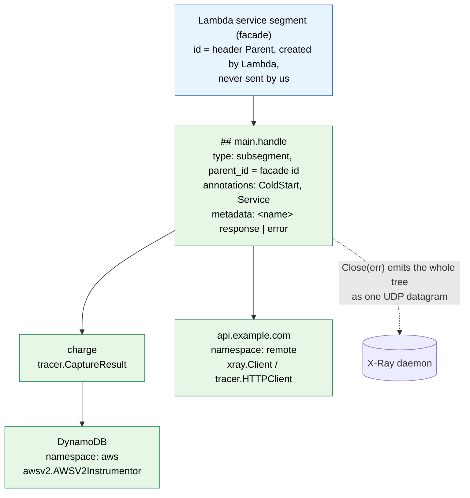
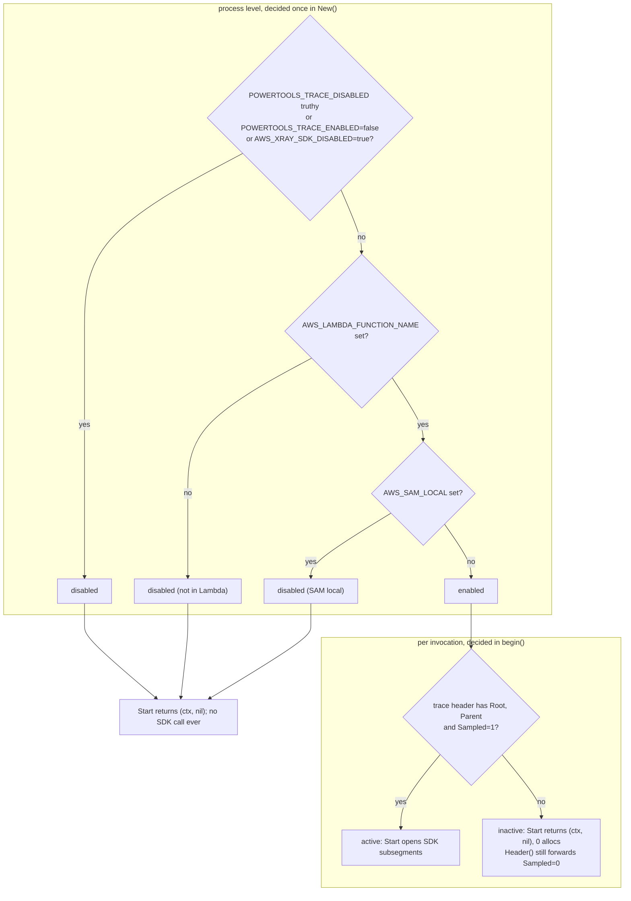
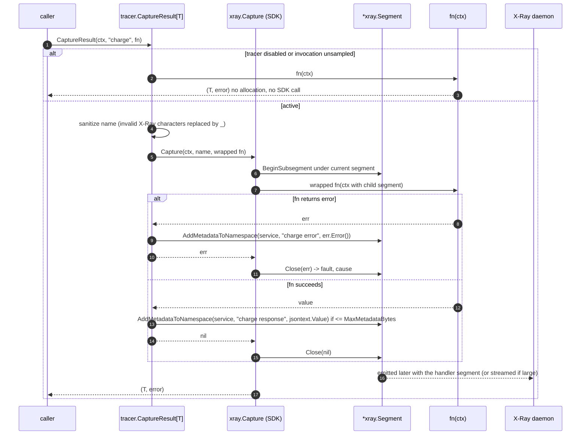

# 04. Tracer

A thin wrapper over the AWS X-Ray SDK for Go (`github.com/aws/aws-xray-sdk-go/v2`), the
same approach Powertools Python and TypeScript take with their X-Ray SDKs. The wrapper adds
the Powertools semantics (handler subsegment, `ColdStart` and `Service` annotations,
response and error metadata, enable/disable rules, context helpers, typed capture
helpers) and exposes the SDK's own `*xray.Segment` for everything else.

## 1. Decision record

Decision (2026-10-15, reviewer): **wrap the SDK**, because AWS maintains it and it already
handles the Lambda facade segment, emission, streaming of large documents, HTTP client
tracing, AWS SDK v2 instrumentation and SQL tracing.

Consequences, all accepted:

| Consequence | How the plan deals with it |
| --- | --- |
| The SDK pulls grpc, protobuf, fasthttp, aws-sdk-go-v2 core, route53 and x/net into the binary (R11). | The tracer is its **own module** (01 §2). Consumers who use only the logger or metrics never download or link it. Binary size and init time are measured in Phase 5 for the `examples/full` function. |
| The SDK keeps global mutable configuration (`xray.Configure`, `xray.SetLogger`, which is "not goroutine safe, only set from `init()`"). | `tracer.New` never touches global SDK state by default. Daemon address, emitter and strategies are left to the SDK's environment handling (`AWS_XRAY_DAEMON_ADDRESS`, `AWS_XRAY_CONTEXT_MISSING`), which Lambda sets. Tests use `xray.ContextWithConfig` for a per-context emitter instead of globals. |
| SDK package init panics if `AWS_XRAY_DAEMON_ADDRESS` is malformed, and writes `/tmp/.aws-xray/initialized` when `LAMBDA_TASK_ROOT` is set. | Documented in the tracer package docs. Both are SDK behaviours we do not change. |
| `xray.SdkDisabled()` reads `AWS_XRAY_SDK_DISABLED` with `os.Getenv` on every call. | Our enable check happens first and is a cached boolean; the SDK's per-call read only happens on active paths. |
| The SDK's `Segment` is a large struct with an embedded `sync.RWMutex`, maps for annotations and metadata, and a goroutine per *root* segment for context cancellation. | In Lambda there is never a root segment (the facade is built by `BeginFacadeSegment`, which starts no goroutine), so the goroutine cost does not apply. Allocation budgets for the sampled path are measured, not designed (05 §3). |
| No `TestDaemon` in the SDK's `xray` package. | Tests implement the SDK's `xray.Emitter` interface (two methods) with an in-memory recorder, attached through `xray.ContextWithConfig(ctx, xray.Config{Emitter: rec})`. |

Not wrapped: nothing is hidden. Where the SDK already offers the right API
(`seg.AddAnnotation`, `seg.AddMetadataToNamespace`, `seg.AddError`, `xray.AddAnnotation(ctx, …)`,
`xray.Client`, `xray.RoundTripper`, `xray.SQLContext`, `awsv2.AWSV2Instrumentor`), the plan
documents it and does not duplicate it.

## 2. X-Ray model (R9) and what the SDK does for us

```
Lambda service segment (facade)      ← SDK: BeginFacadeSegment from ctx.Value("x-amzn-trace-id"), never sent
└── "## main.handle"                  ← our Start ⇒ xray.BeginSubsegment; SDK emits it on Close (parent.Facade)
    ├── "charge"                      ← our Capture / Start; embedded in the parent document by the SDK
    │   └── "DynamoDB" (namespace aws)   ← awsv2.AWSV2Instrumentor
    └── "api.example.com" (namespace remote) ← xray.Client / xray.RoundTripper
```



Facts from `xray/segment.go` and `xray/lambda.go` (v2.0.4) that the wrapper relies on:

- `BeginSubsegment(ctx, name)` creates the facade on first use when
  `ctx.Value("x-amzn-trace-id")` is present and no segment is in `ctx`. That value is set
  by `aws-lambda-go` on every invocation (R2), so the SDK is correct under
  multi-concurrency without `_X_AMZN_TRACE_ID`.
- With `Sampled=0` in the header, the facade is unsampled and subsegments are `Dummy`:
  allocated but never emitted. The wrapper avoids even the allocation (§4).
- With no header and no segment, `BeginSubsegment` invokes the context-missing strategy
  (`LOG_ERROR` in Lambda) and returns `nil`. The wrapper never lets this happen (§4).
- Names longer than 200 characters are truncated by the SDK. Python additionally
  replaces `[?;*()!$~^<>]`; the wrapper does the same with a byte table before calling
  the SDK, so names match across runtimes.
- `Close(err)` on a subsegment whose parent is the facade marks `type: "subsegment"`,
  sets `parent_id` and emits over UDP synchronously. Nested subsegments are embedded;
  the default streaming strategy sends completed children independently when a document
  grows past its threshold.
- `seg.AddError(err)` sets `fault` and a `cause` built by the SDK's exception formatting
  strategy. `seg.AddAnnotation` validates value types (bool, int, uint, float, string).
- `seg.DownstreamHeader().String()` yields the outbound `X-Amzn-Trace-Id` value with
  `Parent` = this segment's id and the parent's sampling decision, including `Sampled=0`,
  so downstream services never start orphan traces.

## 3. Enable / disable rules

Process-level (decided once in `New`, cached):

1. `POWERTOOLS_TRACE_DISABLED` not truthy, `POWERTOOLS_TRACE_ENABLED` not `false`,
   `AWS_XRAY_SDK_DISABLED` not `true`;
2. `AWS_LAMBDA_FUNCTION_NAME` set (R1; `AWS_EXECUTION_ENV` is not used);
3. `AWS_SAM_LOCAL` not set.

`Options.Enabled *bool` overrides rule 1 only. When disabled, no SDK function is ever
called by the wrapper.

Invocation-level: active only when the invocation state (01 §4.1) has
`Trace.Sampled == true` and non-empty `Root` and `Parent`. Without the wrapper, the
header in `ctx` decides, exactly as the SDK does.



## 4. API

```go
package tracer

import "github.com/aws/aws-xray-sdk-go/v2/xray"

type Options struct {
    Service          string  // POWERTOOLS_SERVICE_NAME ⇒ "Service" annotation and metadata namespace
    Enabled          *bool   // nil ⇒ env rules (§3)
    CaptureResponse  *bool   // nil ⇒ POWERTOOLS_TRACER_CAPTURE_RESPONSE, default true
    CaptureError     *bool   // nil ⇒ POWERTOOLS_TRACER_CAPTURE_ERROR, default true
    MaxMetadataBytes int     // 0 ⇒ 60 * 1024; response/error metadata larger than this is skipped with a warning
    Logger           *slog.Logger // wrapper diagnostics (skipped metadata, bad names); nil ⇒ slog.Default()
}

func New(opts Options) *Tracer
func (t *Tracer) Enabled() bool

// Start opens a subsegment under the current segment in ctx. It returns (ctx, nil)
// when tracing is disabled, the invocation is unsampled, or no trace header or segment
// is present, so the SDK's context-missing strategy is never triggered by the wrapper.
// All *xray.Segment methods used by the wrapper are safe on nil through the package
// helpers below; direct SDK calls on a nil segment are the caller's responsibility.
func (t *Tracer) Start(ctx context.Context, name string) (context.Context, *xray.Segment)

// Go 1.27 generic methods: the typed capture helper is a method as well as a package
// function, so code holding a *Tracer does not need the package-level lookup.
func (t *Tracer) Capture(ctx context.Context, name string, fn func(context.Context) error) error
func (t *Tracer) CaptureResult[T any](ctx context.Context, name string, fn func(context.Context) (T, error)) (T, error)

// Package-level helpers that find the Tracer in the invocation state, so deep code does
// not need the *Tracer. Without the wrapper they fall back to the SDK directly when a
// segment or header is present in ctx.
func Start(ctx context.Context, name string) (context.Context, *xray.Segment)
func Capture(ctx context.Context, name string, fn func(context.Context) error) error
func CaptureResult[T any](ctx context.Context, name string, fn func(context.Context) (T, error)) (T, error)
func FromContext(ctx context.Context) *xray.Segment   // xray.GetSegment(ctx)
func TraceID(ctx context.Context) string              // root id from the invocation state, else xray.TraceID(ctx)
func Header(ctx context.Context) string               // outbound X-Amzn-Trace-Id; "" only when no header exists (§7)
func AddResponseMetadata(ctx context.Context, name string, v any)   // "<name> response" under the service namespace, size-guarded
func AddErrorMetadata(ctx context.Context, name string, err error)  // "<name> error" under the service namespace + seg.AddError

// NewXRayLogger adapts a *slog.Logger to the SDK's xraylog.Logger (verified in
// xraylog/xray_log.go v2.0.4: a single method Log(level xraylog.LogLevel, msg fmt.Stringer),
// levels Debug, Info, Warn, Error, callable concurrently). The adapter maps the four
// SDK levels onto slog levels, checks Enabled before calling msg.String() so the SDK's
// deferred formatting is preserved, and is goroutine-safe because *slog.Logger is.
// The caller passes it to xray.SetLogger from main before the first invocation, as the
// SDK requires (SetLogger is not goroutine-safe).
func NewXRayLogger(l *slog.Logger) *XRayLogger
```

`Capture` and `CaptureResult` are the Go form of `capture_method` / `captureMethod`:

```go
func CaptureResult[T any](ctx context.Context, name string, fn func(context.Context) (T, error)) (out T, err error) {
    t := tracerFrom(ctx)
    if t == nil || !t.active(ctx) { return fn(ctx) }           // zero-cost path
    name = sanitize(name)
    err = xray.Capture(ctx, name, func(ctx context.Context) error {   // SDK opens, closes, records fault+cause, re-panics
        var ferr error
        out, ferr = fn(ctx)
        if ferr != nil { t.addErrorMetadata(ctx, name, ferr); return ferr }
        t.addResponseMetadata(ctx, name, out)
        return nil
    })
    return out, err
}
```



Nothing else is wrapped: annotations, metadata namespaces, HTTP blocks, `aws` blocks and
SQL data are the SDK's API on the returned `*xray.Segment`.

## 5. Handler segment lifecycle (wrapper)

In `begin` (01 §4.3) when active: `ctx, seg = t.Start(ctx, s.HandlerName)` with
`HandlerName = "## " + <Go function name of the handler>` computed once at wrap time
(for example `## main.handle`, mirroring Python's `## lambda_handler`; `_HANDLER` is
the executable name on `provided.al2023` and is not used). `Options.HandlerName`
overrides.

In `end`:

1. `seg.AddAnnotation("ColdStart", s.ColdStart)`; `seg.AddAnnotation("Service", service)` when set.
2. Success and `CaptureResponse`: marshal the response with `encoding/json/v2`
   (`json.Marshal`); if the bytes exceed `MaxMetadataBytes`, log a warning and skip;
   otherwise `seg.AddMetadataToNamespace(service, name+" response", jsontext.Value(bytes))`.
   The SDK marshals the segment with v1 `encoding/json`, which on Go 1.27 is backed by
   the v2 implementation and embeds a `jsontext.Value` verbatim, so the response is
   encoded exactly once (decision 23; verified in Phase 4 with a recorded segment,
   `json.RawMessage` being the fallback). Off with `POWERTOOLS_TRACER_CAPTURE_RESPONSE=false`.
3. Error and `CaptureError`: `seg.AddMetadataToNamespace(service, name+" error", err.Error())`
   then `seg.Close(err)`, which sets `fault` and `cause` through the SDK.
4. Panic: `seg.Close(fmt.Errorf("panic: %v", v))` before re-panicking (01 §6).
5. Otherwise `seg.Close(nil)`. The SDK emits the document (one UDP write) because the
   parent is the facade.

Metadata key names `"<name> response"` and `"<name> error"` and the namespace = service
rule come from `tracing/tracer.py`.

### 5.1 Open children, late goroutines and the SDK's emission rule

`xray/segment.go`: a closed segment is emitted only when `openSegments == 0`
(`flush()` checks `openSegments == 0 && EndTime > 0`); the last child to close walks up
to the parent and triggers the emission. Consequence in Lambda: a subsegment opened in a
goroutine and still open when the handler segment is closed **holds back the whole
handler trace** until that goroutine closes it, which may be after the environment is
frozen (01 §7 F2), so the trace arrives late or never. The wrapper therefore:

- counts children opened through `tracer.Start`/`Capture` in `State.OpenSegments` and
  logs a `WARN` with the count in `end()` when it is not zero (D7);
- refuses to open a child after `end()`: `Start` on a closed `State` returns `(ctx, nil)`
  and logs one `WARN`, so a late goroutine never appends to an already emitted segment
  (the SDK would re-emit the parent document on the late child's close);
- documents the consumer rule: wait for goroutines, close their segments, then return
  (01 §7.5).

## 6. Configuration of the SDK

- Daemon address: the SDK reads `AWS_XRAY_DAEMON_ADDRESS` at init; Lambda sets it. The
  wrapper exposes no option for it. Local runs point the SDK at a daemon with the same
  variable, or disable tracing (the default outside Lambda).
- Context missing: Lambda sets `AWS_XRAY_CONTEXT_MISSING=LOG_ERROR`; the wrapper's guards
  in §4 mean the strategy is only reached by direct SDK calls from consumer code.
- Logger: `xray.SetLogger(tracer.NewXRayLogger(lg))` from `main`, optional.
- Per-context configuration (`xray.ContextWithConfig`) is the test seam and is also
  available to consumers who need a different emitter or sampling strategy for a subset
  of invocations.

## 7. Propagation

| Direction | Mechanism |
| --- | --- |
| HTTP clients | `xray.Client(c)` or `&http.Client{Transport: xray.RoundTripper(base)}`: `remote` subsegment named after the host, `X-Amzn-Trace-Id` injected, `http` block recorded, `error`/`throttle`/`fault` by status. `POWERTOOLS_TRACER_CAPTURE_HTTPS_REQUESTS=false` is honoured by a one-line helper `tracer.HTTPClient(c *http.Client) *http.Client` that returns `c` unchanged when the variable is false or tracing is disabled, and `xray.Client(c)` otherwise. |
| AWS SDK for Go v2 | `awsv2.AWSV2Instrumentor(&cfg.APIOptions)` from `github.com/aws/aws-xray-sdk-go/v2/instrumentation/awsv2`: `aws` subsegments with `operation`, `region`, `request_id`. Documented, not wrapped. |
| Any other client | `tracer.Header(ctx)`: `seg.DownstreamHeader().String()` when a segment exists; otherwise rebuilt from the invocation state's header with `Parent` = the facade id and the original `Sampled` flag; `""` only when no header exists. The header is **always** forwarded when one exists, including `Sampled=0`, so downstream services do not start orphan traces. |
| Logs | `xray_trace_id` on every line (02 §1) from the invocation state, not from the SDK, so it is present even when tracing is disabled. |
| SQL | `xray.SQLContext` from the SDK, documented. |

## 8. Testing

- A recording emitter implementing `xray.Emitter` (`Emit(*xray.Segment)`,
  `RefreshEmitterWithAddress(*net.UDPAddr)`), attached with `xray.ContextWithConfig`
  to the test context; assertions decode the emitted segment's JSON and compare with
  `cmp.Diff`, ignoring ids and times. The SDK copies per-context configuration into
  the facade segment (`assignConfiguration` falls back to its global config field by
  field only where the per-context value is nil), so these tests never read or write
  `globalCfg` and run safely with `t.Parallel()`. The SDK still resolves its daemon
  address from the environment at package init; that is harmless here because the
  recording emitter never dials.
- One end-to-end test with a real UDP listener on `127.0.0.1:0` and
  `AWS_XRAY_DAEMON_ADDRESS` set through `t.Setenv` **in a separate test binary**
  (`tracer/internal/udptest`), because the SDK reads the variable at package init.
- Table tests: enable rules (§3) with `t.Setenv`, name sanitisation, size guard,
  `Capture`/`CaptureResult` with success, error and panic, `Header` in sampled,
  unsampled and headerless contexts, `TraceID` with and without the wrapper.
- Concurrency: 50 goroutines opening and closing subsegments under one handler segment
  under `-race` (the SDK's locking is exercised, our helpers must not add races).
- `tracer.HTTPClient` tests: `httptest.NewTestServer` (Go 1.27, in-memory network) inside
  a `testing/synctest` bubble, with `synctest.Sleep` to drive client timeouts
  deterministically; assertions on the injected `X-Amzn-Trace-Id` header and the recorded
  `remote` subsegment, plus the pass-through case when the env switch is `false`.
- `AllocsPerRun`: disabled and unsampled paths are 0 allocations; the sampled path is
  measured and recorded, with a test asserting our overhead on top of a bare
  `xray.BeginSubsegment`/`Close` pair is at most 1 allocation.
- Integration (Phase 5): deploy `examples/full` with `Tracing: Active`; assert with
  `aws xray get-trace-summaries` that `## main.handle` exists with `ColdStart` and
  `Service` annotations and nested `aws` and `remote` subsegments.

## 9. Performance notes

- Disabled or unsampled: 0 allocations, no SDK call, no `os.Getenv`.
- Sampled: cost is the SDK's (`BeginSubsegment`: segment struct with mutex, maps on first
  annotation or metadata, `crypto/rand` id, two `os.Getenv` reads for `AWS_XRAY_NOOP_ID`
  and `AWS_XRAY_SDK_DISABLED`). The wrapper adds the sanitised name (no allocation when
  the name is already clean) and the metadata marshal when capture is on.
- Response capture is the one deliberately expensive step and is off with a single
  environment variable.

## 10. Parity matrix

| Feature | Python | TypeScript | This plan |
| --- | --- | --- | --- |
| Handler decorator / middleware | yes | yes | wrapper (`Wrap`, `WrapHandler`) |
| `## handler` subsegment, `ColdStart`, `Service` annotations | yes | yes | yes |
| Response and error as metadata | yes | yes | yes, same keys, size-guarded |
| `capture_method` | yes | yes | `Capture`, `CaptureResult[T]` |
| Manual subsegments, annotations, metadata | via provider | via provider | directly on `*xray.Segment` |
| AWS SDK instrumentation | auto-patch | `captureAWSv3Client` | `awsv2.AWSV2Instrumentor` (SDK, explicit) |
| HTTP client instrumentation | auto-patch | automatic | `xray.Client` / `tracer.HTTPClient` (explicit) |
| SQL tracing | via SDK | no | `xray.SQLContext` (SDK) |
| `ignore_endpoint` | yes | no | no in v1 |
| Root trace ID helper | no | `getRootXrayTraceId` | `TraceID(ctx)` |
| Escape hatch (`tracer.provider`) | yes | yes | the `*xray.Segment` and the `xray` package themselves |
| Auto-disable outside Lambda | yes | yes | yes (R1-correct) |
| Provider abstraction / OpenTelemetry | yes | no | no in v1 (decision 8) |
