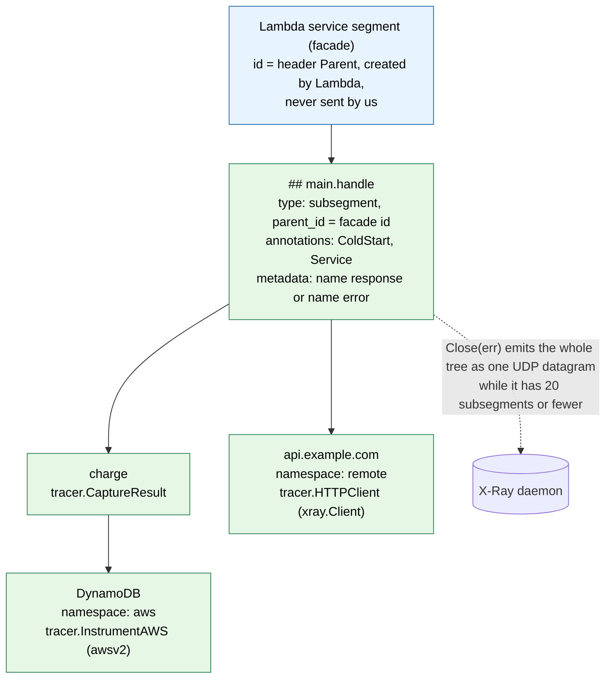
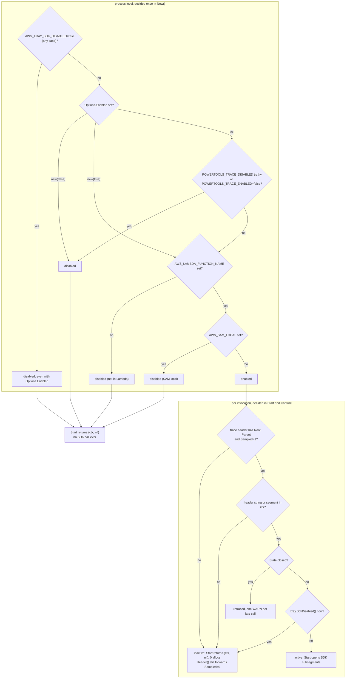
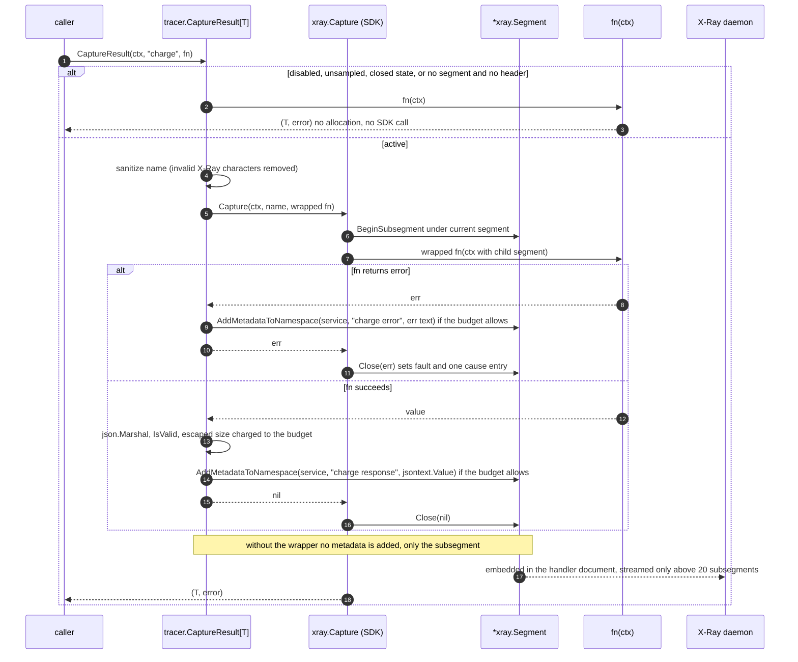
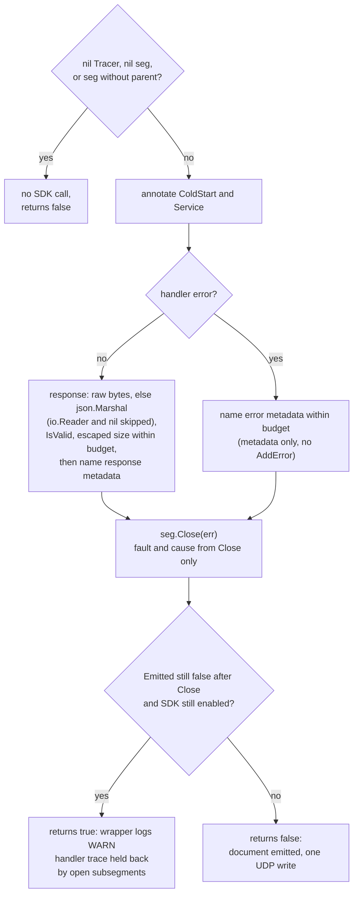

# 04. Tracer

A thin wrapper over the AWS X-Ray SDK for Go (`github.com/aws/aws-xray-sdk-go/v2`), the
same approach Powertools Python and TypeScript take with their X-Ray SDKs. The wrapper adds
the Powertools semantics (handler subsegment, `ColdStart` and `Service` annotations,
response and error metadata, enable/disable rules, context helpers, typed capture
helpers) and exposes the SDK's own `*xray.Segment` for everything else.

> **Implementation status.** A reference implementation of this plan was completed and
> released as v1.0.0 (Go 1.27.2, `aws-xray-sdk-go/v2` v2.0.4). Notes marked **Validated
> in implementation** confirm a point of the plan; notes marked **Changed after
> implementation** record where the implementation proved the plan wrong, what replaced
> it and why. The SDK facts below were checked against the SDK sources and against
> datagrams the SDK actually emitted. §11 shows the intended API in use.

## 1. Decision record

Decision (2026-10-15, reviewer): **wrap the SDK**, because AWS maintains it and it already
handles the Lambda facade segment, emission, streaming of large documents, HTTP client
tracing, AWS SDK v2 instrumentation and SQL tracing.

Consequences, all accepted:

| Consequence | How the plan deals with it |
| --- | --- |
| The SDK pulls grpc, protobuf, fasthttp, aws-sdk-go-v2 core, route53 and x/net into binaries that import `tracer` (R11), and into every consumer's module graph because the library is one module (decision 25). | Only the `tracer` package imports the SDK, enforced by the `deps` CI job (06 §5); a logger-only or metrics-only binary does not link it. Binary size and init time are measured in Phase 5 for a logger-only and a full function. Validated in implementation, with one pitfall: the import rule covers production code only (`_test.go` files may import the SDK, they are never linked into consumers), and the root wrapper imports `tracer`, so **every binary that calls `Wrap` links the SDK**. Only a binary that uses `logger` and `metrics` without the wrapper stays SDK-free (measured sizes in 05 §6). |
| The SDK keeps global mutable configuration (`xray.Configure`, `xray.SetLogger`, which is "not goroutine safe, only set from `init()`"). | `tracer.New` never touches global SDK state; after implementation the rule is stricter: the library never mutates SDK globals at all, and the SDK logger is installed by the consumer in `main` (§6). Daemon address, emitter and strategies are left to the SDK's environment handling (`AWS_XRAY_DAEMON_ADDRESS`, `AWS_XRAY_CONTEXT_MISSING`), which Lambda sets. Tests use `xray.ContextWithConfig` for a per-context emitter instead of globals. |
| The SDK's default logger writes plain-text `[INFO]` and `[ERROR]` lines to stdout, which in Lambda is the same stream as the JSON logs and EMF (at least one `Emitter using address` line per cold start, plus every UDP write error). Added after implementation. | Every example and the package quick start call `xray.SetLogger(tracer.NewXRayLogger(lg))` in `main`, before `lambda.Start` (§6). The library itself never calls `SetLogger`. |
| SDK package init panics if `AWS_XRAY_DAEMON_ADDRESS` is malformed, and writes `/tmp/.aws-xray/initialized` when `LAMBDA_TASK_ROOT` is set. | Documented in the tracer package docs. Both are SDK behaviours we do not change. |
| `xray.SdkDisabled()` reads `AWS_XRAY_SDK_DISABLED` with `os.Getenv` on every call and compares it with `strings.ToLower(v) == "true"` (any case, no trimming). | Our enable check happens first, is a cached boolean, and reads the variable with exactly the SDK's comparison (§3). Because the SDK re-reads it per call, every path that would trace also checks `xray.SdkDisabled()` last, after every cheap check (§3). |
| `*xray.Segment` methods are **not** nil-safe. Only `Close` checks for a nil receiver; `AddAnnotation`, `AddMetadata`, `AddMetadataToNamespace`, `AddError` and `DownstreamHeader` panic on nil. A shared `&xray.Segment{Dummy: true}` is no stand-in (`AddError` dereferences its parent). Added after implementation. | `Start` and `FromContext` return nil when not traced, and say so. Nil-safe package helpers `AddAnnotation`, `AddMetadata`, `AddResponseMetadata`, `AddErrorMetadata` and `Header` nil-check before every SDK call (§4). |
| The SDK streams by **subsegment count**, not by size: completed children are sent separately only when the tree has more than 20 subsegments. A document larger than one UDP datagram (about 64 kB on Linux, 9216 bytes on macOS) fails the write, the SDK only logs the error, and the whole handler trace is lost. Added after implementation. | The per-value size guard is replaced by a per-invocation metadata budget (§4): 48 KiB of escaped metadata across the handler segment and every `Capture` child together. |
| Raw SDK instrumentation (`awsv2.AWSV2Instrumentor`, `xray.Client`, `xray.RoundTripper`, `xray.SQLContext`) ignores `POWERTOOLS_TRACE_*`. Outside Lambda a headerless context makes each instrumented call log a context-missing error. Added after implementation. | `tracer.HTTPClient` and `tracer.InstrumentAWS` apply the Powertools enable rules and leave the client untouched when tracing is disabled (§7). Raw SDK use stays documented: only `AWS_XRAY_SDK_DISABLED=true` stops it. |
| Module graph: `InstrumentAWS` names `middleware.Stack` from `github.com/aws/smithy-go`, and the `awsv2` import pulls in the AWS SDK for Go v2 core. Added after implementation. | `smithy-go` becomes a **direct** requirement (it is already in the SDK's graph, so no new module); `go mod tidy` adds `github.com/aws/aws-sdk-go-v2` as an **indirect** requirement (Apache-2.0). The `golang.org/x/net` version the SDK v2.0.4 requires failed `govulncheck` at implementation time (HTTP/2 advisories GO-2026-6603, -6611, -6612 and -6617, reported reachable through `tracer`), so the module raises `x/net` explicitly and drops the floor once an SDK release requires a fixed version. |
| The SDK's `Segment` is a large struct with an embedded `sync.RWMutex`, maps for annotations and metadata, and a goroutine per *root* segment for context cancellation. Other SDK paths that start goroutines: `xray.CaptureAsync`, and the centralized sampling strategy's poller on the first `ShouldTrace`. | The wrapper calls none of them. In Lambda the facade is built by `BeginFacadeSegment`, which starts no goroutine and never calls `ShouldTrace`; `BeginSubsegment`, `Capture` and `Close` are synchronous, and the UDP emitter writes inline. So the "synchronous" principle (05 §1) holds for the whole tracer path in Lambda. Consumers who call `xray.BeginSegment` or `xray.CaptureAsync` themselves own those goroutines. Allocation budgets for the sampled path are measured, not designed (05 §3). |
| No `TestDaemon` in the SDK's `xray` package, and a custom `xray.Emitter` **never sees child subsegments**: only `DefaultEmitter.Emit` packs embedded and streamed children into the document. | Changed after implementation: tests use a per-test UDP listener with `xray.NewDefaultEmitter`, attached through `xray.ContextWithConfig` (§8). An in-memory recorder implementing `xray.Emitter` is kept only to count emissions in allocation tests and benchmarks. |

Not wrapped: nothing is hidden. Where the SDK already offers the right API
(`seg.AddAnnotation`, `seg.AddMetadataToNamespace`, `seg.AddError`, `xray.AddAnnotation(ctx, …)`,
`xray.Client`, `xray.RoundTripper`, `xray.SQLContext`, `awsv2.AWSV2Instrumentor`), the plan
documents it and does not duplicate it.

> **Changed after implementation.** The tracer adds a helper only where the raw call
> panics on a nil segment (`AddAnnotation`, `AddMetadata`) or ignores the Powertools
> switches (`HTTPClient`, `InstrumentAWS`). Consumers still call the SDK directly on a
> non-nil `*xray.Segment` for everything else.

## 2. X-Ray model (R9) and what the SDK does for us

```text
Lambda service segment (facade)      ← SDK: BeginFacadeSegment from ctx.Value("x-amzn-trace-id"), never sent
└── "## main.handle"                  ← our Start ⇒ xray.BeginSubsegment; SDK emits it on Close (parent.Facade)
    ├── "charge"                      ← our Capture / Start; embedded in the parent document by the SDK
    │   └── "DynamoDB" (namespace aws)   ← tracer.InstrumentAWS ⇒ awsv2.AWSV2Instrumentor
    └── "api.example.com" (namespace remote) ← tracer.HTTPClient ⇒ xray.Client
```



Facts from `xray/segment.go` and `xray/lambda.go` (v2.0.4) that the wrapper relies on:

- `BeginSubsegment(ctx, name)` creates the facade on first use when
  `ctx.Value("x-amzn-trace-id")` is present and no segment is in `ctx`. That value is set
  by `aws-lambda-go` on every invocation (R2), so the SDK is correct under
  multi-concurrency without `_X_AMZN_TRACE_ID`. Validated in implementation: the
  wrapper reads the same key and nothing else. There is no `_X_AMZN_TRACE_ID` fallback
  and no `os.Getenv` per invocation; a missing or empty value means "no trace" for the
  logger and the tracer alike, so both always agree with the SDK.
- **Trace header parsing rule** (added after implementation). The wrapper parses the
  header once per invocation, without allocating (every field is a substring), and must
  agree with the SDK's `header.FromString` on the three fields that decide tracing:
  fields are split on `;` and trimmed, empty fields are ignored, `Root=`, `Parent=` and
  `Sampled=` are recognised **in any position** (a later duplicate wins), `Sampled` is
  true only for `Sampled=1` (`Sampled=?` and a missing flag are not sampled), and `Self=`
  and fields without `=` are skipped. `Rest` is one substring over the **trailing
  contiguous run** of other fields (for example `Lineage=a87bd80c:0`), so `Header` can
  forward them. Accepted divergence: other fields placed *before* a later known field
  are dropped from `Rest`, while the SDK keeps them in `AdditionalData`. Lambda always
  sends the canonical order with extra fields last, and a single substring keeps the
  parse allocation-free for every header. A table test in the `tracer` package (the only
  package allowed to import the SDK) runs both parsers over the same inputs, and another
  checks that the wrapper's key constant equals `xray.LambdaTraceHeaderKey`.
- The current segment lives only under the SDK's `xray.ContextKey`. `xray.Client`, the
  awsv2 middleware and direct SDK calls find their parent only through
  `xray.GetSegment(ctx)`, so the tracer defines no segment key of its own and the
  invocation state holds no segment (added after implementation).
- With `Sampled=0` in the header, the facade is unsampled and subsegments are `Dummy`:
  allocated but never emitted. The wrapper avoids even the allocation (§4).
- With no header and no segment, `BeginSubsegment` invokes the context-missing strategy
  (`LOG_ERROR` in Lambda) and returns `nil`. The wrapper never lets this happen (§4): it
  opens a subsegment only when the same source the SDK checks (a segment in `ctx`, or a
  header string under the ctx key) is present. A value under that key that is not a
  `string` means untraced on every path, because the SDK's unchecked type assertion
  would panic.
- Names longer than 200 characters are truncated by the SDK. Python additionally
  replaces `[?;*()!$~^<>]`; the wrapper does the same with a byte table before calling
  the SDK, so names match across runtimes. **Changed after implementation:** Python's
  X-Ray SDK *removes* those characters rather than replacing them, so the wrapper strips
  them. It uses `strings.ContainsAny` over a constant ASCII string instead of a byte
  table (no package-level table variable is needed); a clean name is returned without
  copying (0 allocations) and a dirty one costs 1 allocation. A name made only of invalid
  characters becomes `""`, which the SDK accepts.
- `Close(err)` on a subsegment whose parent is the facade marks `type: "subsegment"`,
  sets `parent_id` and emits over UDP synchronously. Nested subsegments are embedded;
  the default streaming strategy sends completed children independently when a document
  grows past its threshold. **Changed after implementation:** emission happens only
  once no descendant is open (`flush()` checks `openSegments == 0`), and only then is the
  exported `Emitted` field set under the segment lock. The streaming threshold is a
  subsegment count (`MaxSubsegmentCount`, 20), never a size, and `DefaultEmitter.Emit`
  makes one `conn.Write` per document and only logs a failure (§1).
- `seg.AddError(err)` sets `fault` and a `cause` built by the SDK's exception formatting
  strategy. `seg.AddAnnotation` validates value types (bool, int, uint, float, string).
  **Changed after implementation:** `Close(err)` also calls the same error recording, so
  calling both `AddError(err)` and `Close(err)` on one segment records the exception
  twice; the wrapper's error paths therefore add metadata only and leave fault and cause
  to `Close(err)`. `AddAnnotation` accepts `bool`, `int`, `uint`, `float32`, `float64`
  and `string` only: `int64` and other integer widths are rejected with an error.
- **v1 marshal of embedded raw JSON** (added after implementation). The SDK marshals
  documents with v1 `encoding/json`. A `jsontext.Value` (or `json.RawMessage`, which
  behaves the same, so it is not a "fallback") is embedded as raw JSON: v1 re-validates,
  compacts and HTML-escapes it. `<`, `>` and `&` grow to six-byte `<`-style escapes;
  U+2028 and U+2029 grow by three bytes. An invalid value makes the marshal fail and the
  whole document, with every embedded child, is dropped. Measured on Go 1.27.2: `"a<b>&c"`
  is 8 bytes from v2 and 23 bytes as embedded by v1.
- `seg.DownstreamHeader().String()` yields the outbound `X-Amzn-Trace-Id` value with
  `Parent` = this segment's id and the parent's sampling decision, including `Sampled=0`,
  so downstream services never start orphan traces. Found in implementation: it drops
  extra fields such as `Lineage`, because it copies them only from the parent's incoming
  header, which the Lambda facade never sets; `Header` appends `Rest` itself (§7).

## 3. Enable / disable rules

Process-level (decided once in `New`, cached):

1. `POWERTOOLS_TRACE_DISABLED` not truthy, `POWERTOOLS_TRACE_ENABLED` not `false`,
   `AWS_XRAY_SDK_DISABLED` not `true`;
2. `AWS_LAMBDA_FUNCTION_NAME` set (R1; `AWS_EXECUTION_ENV` is not used);
3. `AWS_SAM_LOCAL` not set.

`Options.Enabled *bool` overrides rule 1 only. When disabled, no SDK function is ever
called by the wrapper.

> **Changed after implementation.** `Options.Enabled` overrides only the two
> `POWERTOOLS_TRACE_*` variables of rule 1. `AWS_XRAY_SDK_DISABLED=true` always
> disables, even with `Options.Enabled = new(true)`, and rules 2 and 3 still apply.
> Reason, from the SDK sources: with that variable set, `BeginSubsegment` returns a bare
> `&xray.Segment{}` without a parent, its `Close` returns before sending (so `Emitted`
> never becomes true and the held-back check of §5.1 would fire falsely), and
> `xray.Capture`'s recover path dereferences the missing parent, replacing a consumer
> panic with a nil-pointer panic. The variable is compared **exactly like the SDK**:
> `strings.ToLower(v) == "true"`, so `true`, `TRUE` and `True` disable while `1` and
> `true` with a leading space do not; no `strconv.ParseBool`, no trimming. A test pins each
> of those five spellings.
>
> Because the SDK re-reads the variable on every call, the tracer also checks
> `xray.SdkDisabled()` **last** on every path that would trace (one `os.Getenv`, no
> allocation, never reached on an untraced path). Setting it after `New` therefore stops
> tracing from the next `Start` or `Capture`. The other variables are read once in `New`;
> changing them later has no effect on that `*Tracer`.
>
> `HTTPClient` and `InstrumentAWS` run at init, usually before any `*Tracer` exists, so
> they evaluate the same environment rules when called; `Options.Enabled` cannot reach a
> client built that way.

Invocation-level: active only when the invocation state (01 §4.1) has
`Trace.Sampled == true` and non-empty `Root` and `Parent`. Without the wrapper, the
header in `ctx` decides, exactly as the SDK does.

> **Changed after implementation.** A sampled State is not enough on its own:
> `BeginSubsegment` finds a parent only through a segment in `ctx` or the header string
> under the ctx key, so tracing also requires one of the two (otherwise the SDK would
> call its context-missing strategy, which panics under `RUNTIME_ERROR`). The state must
> also not be closed (§5.1), and the unsampled check runs before the closed check, so a
> late call on an unsampled invocation stays silent and allocation-free. Without the
> wrapper, package-level `Start`, `Capture` and `CaptureResult` have no cached
> environment decision: only the header's `Sampled` flag and the SDK's own
> `AWS_XRAY_SDK_DISABLED` check apply. Code that needs the Powertools rules without the
> wrapper holds a `*Tracer` and calls its methods.



## 4. API

```go
package tracer

import "github.com/aws/aws-xray-sdk-go/v2/xray"

type Options struct {
    Service          string  // POWERTOOLS_SERVICE_NAME ⇒ "Service" annotation and metadata namespace
    Enabled          *bool   // nil ⇒ env rules (§3)
    CaptureResponse  *bool   // nil ⇒ POWERTOOLS_TRACER_CAPTURE_RESPONSE, default true
    CaptureError     *bool   // nil ⇒ POWERTOOLS_TRACER_CAPTURE_ERROR, default true
    MaxMetadataBytes int     // 0 ⇒ 60 * 1024; response/error metadata larger than this is skipped with a warning
                             // CHANGED after implementation: replaced by MetadataBudget (see below)
    Logger           *slog.Logger // wrapper diagnostics (skipped metadata, bad names); nil ⇒ slog.Default()
}

func New(opts Options) *Tracer
func (t *Tracer) Enabled() bool

// Start opens a subsegment under the current segment in ctx. It returns (ctx, nil)
// when tracing is disabled, the invocation is unsampled, or no trace header or segment
// is present, so the SDK's context-missing strategy is never triggered by the wrapper.
// All *xray.Segment methods used by the wrapper are safe on nil through the package
// helpers below; direct SDK calls on a nil segment are the caller's responsibility.
func (t *Tracer) Start(ctx context.Context, name string) (context.Context, *xray.Segment)

// Go 1.27 generic methods: the typed capture helper is a method as well as a package
// function, so code holding a *Tracer does not need the package-level lookup.
func (t *Tracer) Capture(ctx context.Context, name string, fn func(context.Context) error) error
func (t *Tracer) CaptureResult[T any](ctx context.Context, name string, fn func(context.Context) (T, error)) (T, error)

// Package-level helpers that find the Tracer in the invocation state, so deep code does
// not need the *Tracer. Without the wrapper they fall back to the SDK directly when a
// segment or header is present in ctx.
func Start(ctx context.Context, name string) (context.Context, *xray.Segment)
func Capture(ctx context.Context, name string, fn func(context.Context) error) error
func CaptureResult[T any](ctx context.Context, name string, fn func(context.Context) (T, error)) (T, error)
func FromContext(ctx context.Context) *xray.Segment   // xray.GetSegment(ctx)
func TraceID(ctx context.Context) string              // root id from the invocation state, else xray.TraceID(ctx)
func Header(ctx context.Context) string               // outbound X-Amzn-Trace-Id; "" only when no header exists (§7)
func AddResponseMetadata(ctx context.Context, name string, v any)   // "<name> response" under the service namespace, size-guarded
func AddErrorMetadata(ctx context.Context, name string, err error)  // "<name> error" under the service namespace + seg.AddError

// NewXRayLogger adapts a *slog.Logger to the SDK's xraylog.Logger (verified in
// xraylog/xray_log.go v2.0.4: a single method Log(level xraylog.LogLevel, msg fmt.Stringer),
// levels Debug, Info, Warn, Error, callable concurrently). The adapter maps the four
// SDK levels onto slog levels, checks Enabled before calling msg.String() so the SDK's
// deferred formatting is preserved, and is goroutine-safe because *slog.Logger is.
// The caller passes it to xray.SetLogger from main before the first invocation, as the
// SDK requires (SetLogger is not goroutine-safe).
func NewXRayLogger(l *slog.Logger) *XRayLogger
```

> **Changed after implementation.** The released API keeps every signature above
> except `MaxMetadataBytes`, and adds the members below. Signatures are the exported
> ones of the reference implementation; comments are condensed.

```go
type Options struct {
    Service         string       // "Service" annotation and metadata namespace; "" ⇒ POWERTOOLS_SERVICE_NAME, then "service_undefined"
    Enabled         *bool        // nil ⇒ env rules (§3); overrides POWERTOOLS_TRACE_* only, never AWS_XRAY_SDK_DISABLED=true
    CaptureResponse *bool        // nil ⇒ POWERTOOLS_TRACER_CAPTURE_RESPONSE, default true
    CaptureError    *bool        // nil ⇒ POWERTOOLS_TRACER_CAPTURE_ERROR, default true
    MetadataBudget  int          // <= 0 ⇒ 48 * 1024 escaped bytes per invocation, handler and Capture children together
    Logger          *slog.Logger // diagnostics (skipped metadata, bad names, late calls); nil ⇒ slog.Default()
}

// Nil-safe helpers on the current segment: each is a no-op returning nil when ctx holds
// no segment, so code that may run untraced needs no nil check.
func AddAnnotation(ctx context.Context, key string, value any) error // bool, int, uint, float32, float64, string; int64 rejected
func AddMetadata(ctx context.Context, key string, value any) error   // service namespace ("default" without the wrapper); budgeted

// AddErrorMetadata also calls seg.AddError, for callers that will not close the segment
// with the error. Combined with seg.Close(err) on the same segment it would record the
// exception twice (§2).
func AddErrorMetadata(ctx context.Context, name string, err error)

// Client instrumentation that honours the Powertools switches (§3, §7). Call at init.
func HTTPClient(c *http.Client) *http.Client                    // c unchanged when disabled or the HTTPS switch is false; else xray.Client(c)
func InstrumentAWS(apiOptions *[]func(*middleware.Stack) error) // no-op when disabled or apiOptions is nil; else awsv2.AWSV2Instrumentor

// Wrapper plumbing (§5): with Start, all the root wrapper needs, so its production code
// never names *xray.Segment methods. Exported only because the root package builds it;
// consumers of Wrap never call it.
type HandlerEnd struct {
    Name            string         // handler name without "## ", used in the metadata keys
    ColdStart       bool           // "ColdStart" annotation
    Response        any            // Wrap: typed response, marshalled once with encoding/json/v2; never recorded when it is an io.Reader
    RawResponse     jsontext.Value // WrapHandler: response bytes, checked with IsValid, recorded by reference
    Err             error          // handler error, or the recovered panic as an error
    CaptureResponse *bool          // per-handler override; nil keeps Options.CaptureResponse
    CaptureError    *bool          // per-handler override; nil keeps Options.CaptureError
}
func (t *Tracer) EndHandler(ctx context.Context, seg *xray.Segment, e HandlerEnd) (heldBack bool)

func (x *XRayLogger) Log(level xraylog.LogLevel, msg fmt.Stringer) // implements xraylog.Logger
```

Notes on the released API, each found while implementing it:

- **Nil-safety.** `Start` (method and package function) and `FromContext` return a nil
  segment when not traced, and `Start` is safe on a nil `*Tracer`. Only `Close` is
  nil-safe among the SDK's segment methods, and `Close` on nil is **not free** (the SDK
  reads the environment and boxes a debug-log argument: 1 allocation), so hot paths write
  `if seg != nil { seg.Close(err) }`.
- **Metadata budget** (replaces `MaxMetadataBytes`). Every metadata value the tracer adds
  (handler response or error, `Capture` response or error, the helpers) is charged against
  one per-invocation budget. The used-bytes counter lives in the invocation state as an
  atomic, because `Capture` children may run in goroutines. A value is counted at its
  escaped size, `len(b) + 5 × (count of '<', '>' and '&') + 3 × (count of U+2028 and
  U+2029)`, which is exact for the compact output of `json.Marshal` and an upper bound for
  pretty-printed raw input. Bytes are reserved with a compare-and-swap loop, so a value
  that does not fit is never charged and the counter never overshoots. A value that does
  not fit is skipped with one `WARN` naming the key, its escaped size and the budget; the
  segment and the rest of the document are still emitted. The handler response is charged
  last, so it is the value skipped when the children used the budget up. The 48 KiB
  default leaves room under the 64 kB datagram for ids, annotations, `aws` and `http`
  blocks and error causes. Without the wrapper there is no state and no budget.
- **`IsValid` is mandatory.** Every `jsontext.Value` (a caller-supplied value and the raw
  response bytes of `WrapHandler` included) passes `IsValid()` before it reaches
  `AddMetadataToNamespace`; an invalid one is skipped with a `WARN`, because v1 would
  otherwise drop the whole document (§2).
- **A panicking marshaller must be recovered.** A `MarshalJSON` or `MarshalJSONTo` that
  panics counts as "not marshallable": the tracer recovers around its single
  `json.Marshal` call, logs one `WARN` and skips the value. `encoding/json/v2` does not
  recover such panics, and the handler's metadata is recorded after the wrapper's own
  recover has run, so without this a diagnostic would crash a successful invocation.
  `AddMetadata` returns `nil` for any skipped value; only the SDK's own error is returned.
- **Switches.** The helpers are explicit requests and ignore the capture switches; the
  switches govern only the automatic capture in `Capture`, `CaptureResult` and
  `EndHandler`. `Capture` (error-only `fn`) adds no response metadata; `CaptureResult`
  skips an untyped nil result and records a typed nil pointer as `null`. In `Capture` and
  `CaptureResult` the metadata keys use the sanitised name; `EndHandler` uses the
  handler name as given.
- **Without the wrapper** the package forms record the subsegment, fault and cause, but
  no response or error metadata, because the service namespace, switches and budget live
  in the `*Tracer` and the state.
- **Generic method.** `(*Tracer).CaptureResult[T]` shipped as planned on Go 1.27: the
  type argument is inferred from `fn` as for the package function, and may be written
  explicitly (`tr.CaptureResult[int](ctx, "charge", fn)`) where it helps the reader.

`Capture` and `CaptureResult` are the Go form of `capture_method` / `captureMethod`:

```go
func CaptureResult[T any](ctx context.Context, name string, fn func(context.Context) (T, error)) (out T, err error) {
    t := tracerFrom(ctx)
    if t == nil || !t.active(ctx) { return fn(ctx) }           // zero-cost path
    name = sanitize(name)
    err = xray.Capture(ctx, name, func(ctx context.Context) error {   // SDK opens, closes, records fault+cause, re-panics
        var ferr error
        out, ferr = fn(ctx)
        if ferr != nil { t.addErrorMetadata(ctx, name, ferr); return ferr }
        t.addResponseMetadata(ctx, name, out)
        return nil
    })
    return out, err
}
```

> **Validated in implementation, with two refinements.** The shape above shipped. The
> guard became one function that covers every untraced case in the order of §3
> (disabled, unsampled, closed state with one `WARN` per late call, no segment or header
> string in `ctx`, SDK disabled now), and without a `*Tracer` the wrapped `fn` returns
> right after running, adding no metadata. `addErrorMetadata` writes metadata only and
> never calls `seg.AddError`, so `Close(err)` inside `xray.Capture` is the single place
> that sets `fault` and `cause`, and a failing `Capture` produces exactly one
> `cause.exceptions` entry.



Nothing else is wrapped: annotations, metadata namespaces, HTTP blocks, `aws` blocks and
SQL data are the SDK's API on the returned `*xray.Segment`, used after a nil check (or
through the nil-safe helpers above).

## 5. Handler segment lifecycle (wrapper)

In `begin` (01 §4.3) when active: `ctx, seg = t.Start(ctx, s.HandlerName)` with
`HandlerName = "## " + <Go function name of the handler>` computed once at wrap time
(for example `## main.handle`, mirroring Python's `## lambda_handler`; `_HANDLER` is
the executable name on `provided.al2023` and is not used). `Options.HandlerName`
overrides.

In `end`:

1. `seg.AddAnnotation("ColdStart", s.ColdStart)`; `seg.AddAnnotation("Service", service)` when set.
2. Success and `CaptureResponse`: marshal the response with `encoding/json/v2`
   (`json.Marshal`); if the bytes exceed `MaxMetadataBytes`, log a warning and skip;
   otherwise `seg.AddMetadataToNamespace(service, name+" response", jsontext.Value(bytes))`.
   The SDK marshals the segment with v1 `encoding/json`, which on Go 1.27 is backed by
   the v2 implementation and embeds a `jsontext.Value` verbatim, so the response is
   encoded exactly once (decision 23; verified in Phase 4 with a recorded segment,
   `json.RawMessage` being the fallback). Off with `POWERTOOLS_TRACER_CAPTURE_RESPONSE=false`.
3. Error and `CaptureError`: `seg.AddMetadataToNamespace(service, name+" error", err.Error())`
   then `seg.Close(err)`, which sets `fault` and `cause` through the SDK.
4. Panic: `seg.Close(fmt.Errorf("panic: %v", v))` before re-panicking (01 §6).
5. Otherwise `seg.Close(nil)`. The SDK emits the document (one UDP write) because the
   parent is the facade.

Metadata key names `"<name> response"` and `"<name> error"` and the namespace = service
rule come from `tracing/tracer.py`.

> **Changed after implementation.** The steps stand, with these corrections:
>
> - **One exported call does it all.** The root wrapper keeps `seg` in a local variable
>   captured by its deferred `end` and calls `t.EndHandler(ctx, seg, tracer.HandlerEnd{…})`
>   (§4). The invocation state holds no segment and the root package never calls an
>   `*xray.Segment` method, so no production package other than `tracer` imports the SDK.
>   `EndHandler` returns `false` at once, with no SDK call, for a nil `*Tracer`, a nil
>   `seg`, or a segment without a parent (what the SDK returns while
>   `AWS_XRAY_SDK_DISABLED` is set).
> - **Step 1:** `Service` is always annotated, because the service is never empty
>   (option, else `POWERTOOLS_SERVICE_NAME`, else `service_undefined`, as in the other
>   utilities).
> - **Step 2:** the claim that v1 embeds a `jsontext.Value` "verbatim" is wrong. v1
>   re-validates, compacts and HTML-escapes it (§2), so the decoded value equals ours but
>   the bytes may differ, and `json.RawMessage` behaves the same (it is not a fallback).
>   The size check is the per-invocation budget at escaped size, after `IsValid`.
>   `WrapHandler` passes its raw response bytes as `RawResponse`, recorded by reference,
>   never copied; an empty `RawResponse` falls back to `Response`, so a handler returning
>   no bytes records nothing and logs nothing.
> - **Streaming responses are not recorded.** When the response implements `io.Reader`
>   (for example a Function URL streaming response), nothing is recorded, nothing is
>   charged and no `WARN` is logged: aws-lambda-go reads the body after the wrapper
>   returns, so marshalling the reader would record junk, use up the budget, or consume
>   the body. The handler segment is still annotated, closed and emitted, and a wrapper
>   test checks that the reader reaches the runtime untouched.
> - **Step 3:** error metadata only; `seg.AddError` is **not** called, because `Close(err)`
>   in step 5 records the exception and calling both records it twice (§2).
> - **Step 4:** the panic reaches `EndHandler` as `Err = fmt.Errorf("panic: %v", v)`; the
>   wrapper re-panics afterwards.
> - **After `Close`:** `EndHandler` reads `seg.Emitted` under `seg.RLock()` and returns
>   `heldBack = !seg.Emitted && !xray.SdkDisabled()` (the environment read runs only on
>   the rare not-emitted path, so a variable set between `Start` and `EndHandler` cannot
>   cause a false warning). The wrapper logs the `WARN` of 01 §7 D7 when it is true.
>
> Under `WrapHandler` the derived handler name is the dynamic type of the handler (for
> example `## *main.router`); `Options.HandlerName` replaces the derived name and the
> `"## "` prefix is always added.



### 5.1 Open children, late goroutines and the SDK's emission rule

`xray/segment.go`: a closed segment is emitted only when `openSegments == 0`
(`flush()` checks `openSegments == 0 && EndTime > 0`); the last child to close walks up
to the parent and triggers the emission. Consequence in Lambda: a subsegment opened in a
goroutine and still open when the handler segment is closed **holds back the whole
handler trace** until that goroutine closes it, which may be after the environment is
frozen (01 §7 F2), so the trace arrives late or never. The wrapper therefore:

- counts children opened through `tracer.Start`/`Capture` in `State.OpenSegments` and
  logs a `WARN` with the count in `end()` when it is not zero (D7);
- refuses to open a child after `end()`: `Start` on a closed `State` returns `(ctx, nil)`
  and logs one `WARN`, so a late goroutine never appends to an already emitted segment
  (the SDK would re-emit the parent document on the late child's close);
- documents the consumer rule: wait for goroutines, close their segments, then return
  (01 §7.5).

> **Changed after implementation.** The `State.OpenSegments` counter is removed. The
> SDK already exposes the signal: after `seg.Close(err)`, the exported `Emitted` field
> stays false while any descendant is open. Checking it (inside `EndHandler`, §5) makes
> the warning fire for children opened by `tracer.Start`, `Capture`, `xray.Client`, the
> awsv2 middleware or direct SDK calls alike, and never when every child was closed. A
> counter saw only the tracer's own children. Other refinements:
>
> - The late guard covers `tracer.Start` and `Capture`/`CaptureResult` only, with one
>   `WARN` per late call (a once-per-invocation flag would need a mutable field on a
>   state that is otherwise frozen after `end`). Direct SDK calls in late goroutines
>   (`xray.Client`, clients from `HTTPClient` and `InstrumentAWS`,
>   `xray.BeginSubsegment`) still find the handler segment in `ctx`, attach to it, and
>   make the SDK re-emit the parent document when they close; only the consumer rule
>   covers them.
> - The guard covers calls made after the wrapper's end, not calls racing the handler's
>   return: between `seg.Close` and the moment the state is marked closed, a goroutine
>   still running can attach to the already emitted handler segment and trigger a second
>   emission. Again only the consumer rule prevents it.
> - A held-back trace keeps a reference to every metadata value until it is emitted, and
>   the SDK marshals them when the last child closes, possibly after the handler has
>   returned. A `WrapHandler` handler must therefore not modify bytes it returned; the
>   bytes are documented, not copied, because a copy would cost one allocation of the
>   response size on every captured invocation.
> - An SDK-opened child can hold the trace back too: when an `xray.Client` request times
>   out, the SDK leaves its `response` child open (it opens it when the request is
>   written and only the first response byte closes it), so `EndHandler` reports a
>   held-back trace. A test with a client timeout proves it; the library does not work
>   around it.

## 6. Configuration of the SDK

- Daemon address: the SDK reads `AWS_XRAY_DAEMON_ADDRESS` at init; Lambda sets it. The
  wrapper exposes no option for it. Local runs point the SDK at a daemon with the same
  variable, or disable tracing (the default outside Lambda).
- Context missing: Lambda sets `AWS_XRAY_CONTEXT_MISSING=LOG_ERROR`; the wrapper's guards
  in §4 mean the strategy is only reached by direct SDK calls from consumer code.
- Logger: `xray.SetLogger(tracer.NewXRayLogger(lg))` from `main`, optional.
- Per-context configuration (`xray.ContextWithConfig`) is the test seam and is also
  available to consumers who need a different emitter or sampling strategy for a subset
  of invocations.

> **Changed after implementation.**
>
> - **Daemon address:** the SDK reads `AWS_XRAY_DAEMON_ADDRESS` at package init *and
>   again on every `xray.ContextWithConfig` call*, where the variable wins over
>   `Config.DaemonAddr`.
> - **Logger:** not optional in practice. Without
>   `xray.SetLogger(tracer.NewXRayLogger(lg))` in `main`, before `lambda.Start`, the SDK
>   writes plain-text lines to stdout between the JSON logs and EMF blobs. Package init
>   logs nothing, so that one call silences every SDK line. `SetLogger` writes an
>   unsynchronised global, so a test that calls it must not run in parallel with tests
>   that drive the SDK.
> - **`ContextWithConfig` is a pitfall per invocation.** Every call re-resolves the
>   daemon address, logs at `INFO`, and makes a `DefaultEmitter` re-dial UDP without
>   closing the previous socket. Consumers call it once at init and reuse the result (or
>   pass an emitter whose `RefreshEmitterWithAddress` is idempotent). The library itself
>   never calls it outside tests.

## 7. Propagation

| Direction | Mechanism |
| --- | --- |
| HTTP clients | `xray.Client(c)` or `&http.Client{Transport: xray.RoundTripper(base)}`: `remote` subsegment named after the host, `X-Amzn-Trace-Id` injected, `http` block recorded, `error`/`throttle`/`fault` by status. `POWERTOOLS_TRACER_CAPTURE_HTTPS_REQUESTS=false` is honoured by a one-line helper `tracer.HTTPClient(c *http.Client) *http.Client` that returns `c` unchanged when the variable is false or tracing is disabled, and `xray.Client(c)` otherwise. Validated in implementation, plus one detail: a nil `c` means `http.DefaultClient`'s settings without aliasing the shared client (a new zero `*http.Client` when disabled, `xray.Client(nil)`'s fresh copy when enabled), so a caller never mutates the process-wide default by accident. |
| AWS SDK for Go v2 | `awsv2.AWSV2Instrumentor(&cfg.APIOptions)` from `github.com/aws/aws-xray-sdk-go/v2/instrumentation/awsv2`: `aws` subsegments with `operation`, `region`, `request_id`. Documented, not wrapped. **Changed after implementation:** wrapped as `tracer.InstrumentAWS(&cfg.APIOptions)`, a no-op when tracing is disabled (or the pointer is nil) and the SDK's `awsv2` instrumentor otherwise, because the raw instrumentor ignores the Powertools switches and, outside Lambda, logs a context-missing error on every AWS call. Dependency effect: `smithy-go` direct, `aws-sdk-go-v2` core indirect (§1). |
| Any other client | `tracer.Header(ctx)`: `seg.DownstreamHeader().String()` when a segment exists; otherwise rebuilt from the invocation state's header with `Parent` = the facade id and the original `Sampled` flag; `""` only when no header exists. The header is **always** forwarded when one exists, including `Sampled=0`, so downstream services do not start orphan traces. Validated in implementation, with refinements: the only source is the ctx trace header; with a segment, `";" + Rest` is appended to `DownstreamHeader().String()` (the SDK drops extra fields such as `Lineage`, §2); when rebuilt, `Parent` is omitted if the header has none, `Sampled=1` is kept, and `Sampled=0`, `Sampled=?` or a missing flag are all forwarded as `Sampled=0`, then `Rest`. `xray.Client`, `xray.RoundTripper` and the awsv2 instrumentor still drop extra fields (SDK behaviour, documented as a known limitation). Measured: 0 allocations without a header, 1 when rebuilt. |
| Logs | `xray_trace_id` on every line (02 §1) from the invocation state, not from the SDK, so it is present even when tracing is disabled. |
| SQL | `xray.SQLContext` from the SDK, documented; like any raw SDK call it ignores the Powertools switches. |

## 8. Testing

- A recording emitter implementing `xray.Emitter` (`Emit(*xray.Segment)`,
  `RefreshEmitterWithAddress(*net.UDPAddr)`), attached with `xray.ContextWithConfig`
  to the test context; assertions decode the emitted segment's JSON and compare with
  `cmp.Diff`, ignoring ids and times. The SDK copies per-context configuration into
  the facade segment (`assignConfiguration` falls back to its global config field by
  field only where the per-context value is nil), so these tests never read or write
  `globalCfg` and run safely with `t.Parallel()`. The SDK still resolves its daemon
  address from the environment at package init; that is harmless here because the
  recording emitter never dials.
- One end-to-end test with a real UDP listener on `127.0.0.1:0` and
  `AWS_XRAY_DAEMON_ADDRESS` set through `t.Setenv` **in a separate test binary**
  (`tracer/internal/udptest`), because the SDK reads the variable at package init.

> **Changed after implementation: a per-test UDP listener replaces both bullets above.**
> A custom `xray.Emitter` never sees child subsegments (only `DefaultEmitter` packs
> them), so a recorder cannot check `Capture` children or their metadata. No separate
> binary is needed either, because `xray.ContextWithConfig` re-reads the environment on
> each call. The seam that worked:
>
> 1. Clear `AWS_XRAY_DAEMON_ADDRESS` and `AWS_XRAY_CONTEXT_MISSING` with `t.Setenv`
>    (`ContextWithConfig` reads both on every call: the first would redirect the emitter,
>    the second would replace the strategy), and `LAMBDA_TASK_ROOT` (`NewDefaultEmitter`
>    writes `/tmp/.aws-xray/initialized` when it is set).
> 2. Open `net.ListenPacket("udp", "127.0.0.1:0")`, build
>    `xray.NewDefaultEmitter(pc.LocalAddr().(*net.UDPAddr))`, and attach it with
>    `xray.ContextWithConfig(ctx, xray.Config{Emitter: emt, ContextMissingStrategy: missing})`,
>    leaving `DaemonAddr` empty. `missing` counts context-missing calls, which the tracer
>    must never cause.
> 3. Read each datagram into a 65536-byte buffer with a deadline and assert
>    `n < len(buf)`, so a truncated datagram (`ReadFrom` truncates silently on Linux)
>    fails as a size error, not a JSON error. Strip the `{"format": "json", "version": 1}`
>    header line, assert the document is under 9216 bytes (the macOS datagram limit, so
>    tests pass on developer laptops too), decode with `encoding/json/v2`
>    (`AllowDuplicateNames`, `AllowInvalidUTF8`) and compare with `cmp.Diff` against a
>    golden file recorded from real SDK output (an `-update` flag rewrites them).
>    "Nothing emitted" is a short read that must time out.
> 4. Deterministic ids: subsegment ids and exception ids come from `crypto/rand`, so each
>    golden test calls `cryptotest.SetGlobalRandom(t, 1)` (Go 1.26). Golden comparisons
>    ignore times, `parent_id` on embedded children (the SDK keeps the facade id there),
>    the working directory and stack frames; separate assertions check those.
>
> Because `t.Setenv` and `SetGlobalRandom` forbid `t.Parallel`, the SDK-driving tests run
> sequentially inside the package (packages still run in parallel); the earlier claim
> that these tests "run safely with `t.Parallel()`" did not survive. The budget tests use
> a small `MetadataBudget` to stay under 9216 bytes. The in-memory recorder is kept only
> to count emissions (emitted once, never when unsampled, the re-emission caused by a
> late direct child) and for allocation tests and benchmarks, which must not do I/O.
>
> **Pitfall for the root wrapper tests.** The wrapper's tracer tests sit in the root
> package next to its logger and metrics tests, and all root test files compile into one
> test binary. Each file therefore prefixes its package-level identifiers (for example
> `xrayTracingEnv`, `newXRayDaemon`) to avoid collisions, builds its own copy of the UDP
> seam (no test helper is exported from `tracer`), and has no package-level flag, no
> `TestMain` and no golden files: expected documents are inline maps compared after
> normalisation. Test files may import the SDK because the import rule covers
> production code only.

- Table tests: enable rules (§3) with `t.Setenv`, name sanitisation, size guard,
  `Capture`/`CaptureResult` with success, error and panic, `Header` in sampled,
  unsampled and headerless contexts, `TraceID` with and without the wrapper.
  Added after implementation: `AWS_XRAY_SDK_DISABLED` as `true`, `TRUE` and `True`
  (off) and `1` and `true` with a leading space (on); `Options.Enabled` beating the `POWERTOOLS_TRACE_*`
  variables but not a missing function name, SAM local or `AWS_XRAY_SDK_DISABLED=true`;
  the SDK disabled after `New` (no bare `&Segment{}` returned, a panic in `fn` keeps its
  value); the header parser agreeing with the SDK's; every untraced path (disabled,
  unsampled, empty `Parent`, no header, empty header, a non-string under the key, a
  sampled State without header or segment) returning `(ctx, nil)` with no datagram and
  no context-missing call; `fn` running exactly once on every path.
- Concurrency: 50 goroutines opening and closing subsegments under one handler segment
  under `-race` (the SDK's locking is exercised, our helpers must not add races).
  Measured in implementation: every child counts toward the tree's 51 subsegments and a
  plain `Close` never decrements the count, so at emission the SDK streams one completed
  child per step while the count is above 20, giving **exactly 32 datagrams** (31
  streamed children and one handler document embedding 19). The test asserts that count
  and that every child appears exactly once across embedded and streamed documents, not
  a golden file (ids arrive in scheduling order).
- `tracer.HTTPClient` tests: `httptest.NewTestServer` (Go 1.27, in-memory network) inside
  a `testing/synctest` bubble, with `synctest.Sleep` to drive client timeouts
  deterministically; assertions on the injected `X-Amzn-Trace-Id` header and the recorded
  `remote` subsegment, plus the pass-through case when the env switch is `false`.
  Validated in implementation; the UDP listener must be opened outside the bubble, fake
  time advances by itself once every goroutine in the bubble is blocked, and the timeout
  case leaves the SDK's `response` child open, so `EndHandler` reports a held-back trace
  (§5.1). Also: a 503 sets `fault`, and `HTTPClient(nil)` never returns
  `http.DefaultClient` itself.
- Budget (added after implementation): a value with many `<`, `>` and `&` is charged at
  exactly its byte length in the emitted datagram; invalid `jsontext.Value`, invalid UTF-8
  inside one, a value that cannot be marshalled and a `MarshalJSON` that panics are all
  skipped with a `WARN` while the document still arrives and the handler's value and nil
  error are returned; 30 children of 1 KiB under a 4096-byte budget give exactly 12
  datagrams, none with more metadata than the budget.
- `AllocsPerRun`: disabled and unsampled paths are 0 allocations; the sampled path is
  measured and recorded, with a test asserting our overhead on top of a bare
  `xray.BeginSubsegment`/`Close` pair is at most 1 allocation. Validated in
  implementation (numbers in §9): the allocation tests carry `//go:build unit && !race`
  because the race detector changes allocation counts, and the SDK baseline is measured
  in the same test, so an SDK upgrade does not break the relative budget.
- Integration (Phase 5): deploy `examples/full` with `Tracing: Active`; assert with
  `aws xray get-trace-summaries` that `## main.handle` exists with `ColdStart` and
  `Service` annotations and nested `aws` and `remote` subsegments.

## 9. Performance notes

- Disabled or unsampled: 0 allocations, no SDK call, no `os.Getenv`.
- Sampled: cost is the SDK's (`BeginSubsegment`: segment struct with mutex, maps on first
  annotation or metadata, `crypto/rand` id, two `os.Getenv` reads for `AWS_XRAY_NOOP_ID`
  and `AWS_XRAY_SDK_DISABLED`). The wrapper adds the sanitised name (no allocation when
  the name is already clean) and the metadata marshal when capture is on.
- Response capture is the one deliberately expensive step and is off with a single
  environment variable.

> **Validated in implementation.** A reference implementation measured the following
> with Go 1.27.2 on darwin/arm64 (Apple M5 Pro laptop), medians of 10 runs. Allocation
> counts do not depend on the machine; the `ns/op` values are history for that laptop,
> not a check against the Graviton targets of 05 §3.
>
> | Path | ns/op | B/op | allocs/op |
> | --- | ---: | ---: | ---: |
> | `Start` + guarded `Close`, tracing disabled | 1.7 | 0 | 0 |
> | `Start` + guarded `Close`, unsampled | 4.3 | 0 | 0 |
> | SDK baseline: bare `xray.BeginSubsegment` + `Close` under the facade | 675.8 | 1753 | 27 |
> | `Start` + `Close`, sampled leaf | 725.3 | 1753 | 27 |
> | `CaptureResult`, sampled, response captured | 1167 | 2462 | 36 |
> | handler segment end, 5 children: SDK calls only | 2960 | 6292 | 103 |
> | `EndHandler`, 5 children, capture off | 3079 | 6292 | 103 |
> | `EndHandler`, 5 children, capture on | 3442 | 6993 | 111 |
> | `Header`, rebuilt from the header | 27.9 | 80 | 1 |
> | `Header`, from a segment | 130.4 | 456 | 8 |
>
> So a sampled leaf adds about 50 ns and **no allocation** to the SDK baseline, and
> `EndHandler` with capture off adds about 120 ns and no allocation; both relative
> budgets (SDK + 1 and SDK + 2) hold with room to spare. The helpers without a segment,
> `TraceID`, an untraced `Capture` and the escaped-size scan are 0 allocations; a
> sanitised (dirty) name costs 1. Two pitfalls: `Close` on a **nil** segment costs 1
> allocation (the SDK boxes a debug-log argument before any logger sees it, even with
> `xraylog.NullLogger`), so the zero-cost claim covers `Start` plus a `Close` guarded by
> `seg != nil`; and the tracer's own last-moment `AWS_XRAY_SDK_DISABLED` read (§3) adds
> one `os.Getenv` on the sampled path, without an allocation.

## 10. Parity matrix

| Feature | Python | TypeScript | This plan |
| --- | --- | --- | --- |
| Handler decorator / middleware | yes | yes | wrapper (`Wrap`, `WrapHandler`) |
| `## handler` subsegment, `ColdStart`, `Service` annotations | yes | yes | yes |
| Response and error as metadata | yes | yes | yes, same keys, per-invocation budget (changed after implementation) |
| `capture_method` | yes | yes | `Capture`, `CaptureResult[T]` |
| Manual subsegments, annotations, metadata | via provider | via provider | nil-safe `tracer.AddAnnotation` / `tracer.AddMetadata`, or directly on a non-nil `*xray.Segment` |
| AWS SDK instrumentation | auto-patch | `captureAWSv3Client` | `tracer.InstrumentAWS` over `awsv2.AWSV2Instrumentor` (explicit, honours the Powertools switches) |
| HTTP client instrumentation | auto-patch | automatic | `tracer.HTTPClient` over `xray.Client` (explicit, honours the Powertools switches) |
| SQL tracing | via SDK | no | `xray.SQLContext` (SDK) |
| `ignore_endpoint` | yes | no | no in v1 |
| Root trace ID helper | no | `getRootXrayTraceId` | `TraceID(ctx)` |
| Escape hatch (`tracer.provider`) | yes | yes | the `*xray.Segment` and the `xray` package themselves |
| Auto-disable outside Lambda | yes | yes | yes (R1-correct) for the wrapper and the tracer helpers; raw SDK instrumentation needs `AWS_XRAY_SDK_DISABLED=true` |
| Provider abstraction / OpenTelemetry | yes | no | no in v1 (decision 8) |

## 11. Usage examples (intended API)

Added after implementation. These snippets are **examples of the intended API**, written
against the exported signatures of the reference implementation (§4). They are
illustrative, not copied from it; the module path is a placeholder.

### 11.1 Set-up in `main`: SDK logger, clients, Tracer, wrapper

Everything process-wide happens once, before `lambda.Start`. `HTTPClient` and
`InstrumentAWS` evaluate the enable rules when called (§3), so they leave the clients
untouched outside Lambda, under SAM local or when tracing is switched off.

```go
package main

import (
	"context"
	"net/http"
	"os"
	"time"

	"github.com/aws/aws-lambda-go/lambda"
	"github.com/aws/aws-sdk-go-v2/config"
	"github.com/aws/aws-sdk-go-v2/service/dynamodb"
	"github.com/aws/aws-xray-sdk-go/v2/xray"

	powertools "github.com/<owner>/powertools-lambda-go" // placeholder module path
	"github.com/<owner>/powertools-lambda-go/logger"
	"github.com/<owner>/powertools-lambda-go/tracer"
)

var (
	ddb    *dynamodb.Client
	quotes *http.Client
)

func main() {
	lg := logger.New(logger.Options{Service: "payment"})
	xray.SetLogger(tracer.NewXRayLogger(lg)) // SDK lines as JSON; init only, SetLogger is not goroutine-safe

	cfg, err := config.LoadDefaultConfig(context.Background())
	if err != nil {
		lg.Error("load AWS config", "error", err)
		os.Exit(1)
	}

	tracer.InstrumentAWS(&cfg.APIOptions) // "aws" subsegments; no-op when tracing is disabled
	ddb = dynamodb.NewFromConfig(cfg)
	quotes = tracer.HTTPClient(&http.Client{Timeout: 5 * time.Second}) // "remote" subsegments

	tr := tracer.New(tracer.Options{
		Service:         "payment",
		CaptureResponse: new(false), // responses may carry personal data
		Logger:          lg,
	})

	lambda.Start(powertools.Wrap(handle, powertools.Options{Logger: lg, Tracer: tr}))
}
```

The wrapper opens `## main.handle` around every sampled invocation, annotates
`ColdStart` and `Service`, records the error (and the response when capture is on)
within the metadata budget, closes the segment and warns when an open child holds the
trace back (§5).

### 11.2 Inside the handler: helpers, Capture and CaptureResult

```go
func handle(ctx context.Context, in Order) (Receipt, error) {
	// Nil-safe helpers: no-ops returning nil when the invocation is not traced.
	if err := tracer.AddAnnotation(ctx, "order_id", in.ID); err != nil { // indexed; int64 is rejected, use int
		logger.FromContext(ctx).WarnContext(ctx, "annotation rejected", "error", err)
	}
	_ = tracer.AddMetadata(ctx, "items", len(in.Items)) // non-indexed, charged to the budget

	// CaptureResult: value and error come back unchanged, traced or not.
	q, err := tracer.CaptureResult(ctx, "quote", func(ctx context.Context) (Quote, error) {
		return fetchQuote(ctx, quotes, in) // the HTTP call nests under "quote"
	})
	if err != nil {
		return Receipt{}, err
	}

	// Capture: error-only work, no response metadata.
	err = tracer.Capture(ctx, "charge", func(ctx context.Context) error {
		_, err := ddb.PutItem(ctx, chargeItem(in, q)) // "DynamoDB" nests under "charge"
		return err
	})
	if err != nil {
		return Receipt{}, err // the wrapper records it; Close(err) sets fault and cause once
	}

	return Receipt{OrderID: in.ID, Status: "charged"}, nil
}
```

Code that holds the `*Tracer` (for example a service struct built in `main`) can call
the methods instead of the package functions; the generic method infers `T` like the
package function, or takes it explicitly:

```go
q, err := s.tr.CaptureResult[Quote](ctx, "quote", func(ctx context.Context) (Quote, error) {
	return fetchQuote(ctx, s.quotes, in)
})
```

### 11.3 Manual subsegments with Start

`Start` returns a nil segment when not traced. Every SDK method except `Close` panics on
nil, and `Close` on nil allocates, so the segment is used behind a nil check:

```go
func reserve(ctx context.Context, sku string, qty int) (err error) {
	ctx, seg := tracer.Start(ctx, "reserve stock")
	if seg != nil {
		defer func() { seg.Close(err) }() // fault and cause from Close only

		_ = seg.AddAnnotation("sku", sku)
		_ = seg.AddMetadata("qty", qty)
	}

	return reserveInStore(ctx, sku, qty) // children opened with ctx nest under "reserve stock"
}
```

### 11.4 Propagating the trace to a client the SDK does not instrument

```go
req, err := http.NewRequestWithContext(ctx, http.MethodPost, url, body)
if err != nil {
	return err
}

// "" only when the invocation has no trace header. Unsampled invocations still forward
// Sampled=0, so the downstream service does not start an orphan trace.
if h := tracer.Header(ctx); h != "" {
	req.Header.Set("X-Amzn-Trace-Id", h)
}

resp, err := plainClient.Do(req) // no "remote" subsegment: only the header is propagated
```

`tracer.TraceID(ctx)` returns the root id (for example to return it to a caller), with
or without the wrapper.

### 11.5 Test seam (sketch)

The seam that the reference implementation used to read real SDK documents, children
included (§8). Variables are cleared first because `ContextWithConfig` reads them on
every call:

```go
func listenDaemon(t *testing.T, ctx context.Context) (context.Context, net.PacketConn) {
	t.Helper()
	t.Setenv("AWS_XRAY_DAEMON_ADDRESS", "")
	t.Setenv("AWS_XRAY_CONTEXT_MISSING", "")
	t.Setenv("LAMBDA_TASK_ROOT", "")

	pc, err := net.ListenPacket("udp", "127.0.0.1:0")
	if err != nil {
		t.Fatal(err)
	}
	t.Cleanup(func() { pc.Close() })

	emt, err := xray.NewDefaultEmitter(pc.LocalAddr().(*net.UDPAddr))
	if err != nil {
		t.Fatal(err)
	}

	ctx, err = xray.ContextWithConfig(ctx, xray.Config{Emitter: emt})
	if err != nil {
		t.Fatal(err)
	}

	return ctx, pc // read datagrams from pc, strip the format header line, decode with json/v2
}
```
