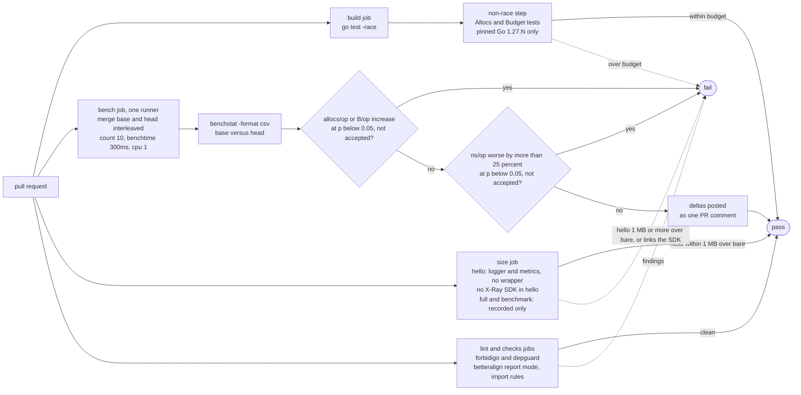

# 05. Performance

Performance is a requirement, not a later optimisation. This file defines the hot paths,
the budgets, how they are measured and how CI enforces them.

> **Implementation status.** A reference implementation of this plan was completed and
> released as v1.0.0. Every allocation budget of §3 was met without changing a budget.
> Notes marked **Validated in implementation** confirm a point; notes marked **Changed
> after implementation** record what the implementation proved wrong and why. Numbers
> quoted from it are framed as "a reference implementation measured": unless stated
> otherwise they come from **Go 1.27.2 on darwin/arm64 (an Apple M5 Pro laptop)**,
> medians of 10 runs. Allocation counts do not depend on the machine; `ns/op` values do,
> so they are history for that machine, not a check against the Graviton targets.

## 1. Principles

1. **Nothing per record that can be done per process or per invocation.** Static attrs
   are rendered at construction; Lambda context keys are rendered once per invocation
   and cached; env vars are read once.
2. **No reflection, `fmt` or `regexp` on hot paths; no v1 `encoding/json` anywhere.**
   The only reflection is `runtime.FuncForPC` once at wrap time (changed after
   implementation: `WrapHandler` also uses `reflect.TypeOf(h)` once at wrap time to
   derive its handler name, 04 §5). `%T` and
   `encoding/json/v2` are allowed on cold paths: error rendering, metadata of arbitrary
   type, response capture (decision 23).
3. **Pooled buffers, single write.** `internal/bufpool` hands out `[]byte` with a
   64 KiB return cap (larger buffers are dropped, not pooled, to avoid pinning memory).
4. **Zero work when disabled.** Level gate, unsampled trace, disabled metrics: no
   allocation, no lookup beyond what decides the gate.
5. **Synchronous.** No background goroutines, timers or channels in the library's own
   code: nothing to lose at freeze, nothing to drain, trivially testable (Google: prefer
   synchronous functions). The single exception is the opt-in `DeadlineMargin` timer
   (01 §7 D6), one `time.AfterFunc` per invocation, stopped in `end()`, tested under
   `synctest`; its callback runs in a goroutine only if it fires, and 01 §7 D6 defines
   the race with `end()`. Scope of the claim: it covers `internal`, `logger`, `metrics`,
   `tracer` and the root wrapper. The X-Ray SDK, imported only by `tracer`, has paths that
   start goroutines (`xray.BeginSegment` and other root segments, `xray.CaptureAsync`,
   the centralized sampling poller on the first `ShouldTrace`); the wrapper calls none of
   them, and in Lambda facade mode `BeginSubsegment` and `Close` are synchronous
   (04 §1). Consumers who call those SDK functions directly own those goroutines. The
   `goroutineleak` test (06 §1) is the proof: zero goroutines owned by library packages
   after 1000 invocations, with and without `DeadlineMargin`.
   **Changed after implementation:** the `goroutineleak` profile alone is not a proof. It
   reports only goroutines permanently blocked on unreachable primitives, and a pending
   `time.AfterFunc` is not a goroutine at all, so no profile can show it. The proof has
   three parts, run after 1000 invocations with and without `DeadlineMargin`: the
   `goroutineleak` profile reports zero; a scan of the full `goroutine` profile
   (`WriteTo(w, 2)`) finds no frame from the module's import path outside the test; and a
   `synctest` test returns before the margin, sleeps past the deadline and asserts that
   the stopped timer never fired (no pre-timeout `WARN`, no extra EMF blob).
6. **Cold start matters as much as steady state.** No `init()` work beyond env reads,
   no package-level tables built at init that are not constants, standard library only
   in `internal`, `logger` and `metrics`. The X-Ray SDK (whose package init reads env
   and dials nothing) is imported only by the `tracer` package, so it is linked only
   into binaries that use tracing.
   **Changed after implementation:** "binaries that use tracing" is too narrow. The root
   wrapper imports `tracer` (its handler-segment plumbing lives there), so **every binary
   that calls `Wrap` links the X-Ray SDK**, even with `Options.Tracer` nil. Only a binary
   that uses `logger` and `metrics` without the wrapper stays SDK-free, which is what the
   size gate measures (§6). The rule covers production code: `_test.go` files may import
   the SDK, because test files are never linked into consumer binaries. Env reads also
   moved out of `init()` entirely: constructors read the environment when called and cache
   the result, so nothing reads it per invocation and tests can `t.Setenv` before
   constructing.
7. **Small when unavoidable.** Go 1.27's size-specialised allocators make objects under
   80 bytes up to 30 % cheaper to allocate. Per-record allocations that cannot be
   pooled away (an `*XRayLogger` message wrapper, a sanitised segment name) are kept
   under that size; per-invocation objects (`State`, the batch) are allocated once and
   may be larger. `betteralign` (§4) keeps the small ones small.

## 2. Hot-path inventory

| Path | Frequency | Design |
| --- | --- | --- |
| `Handler.Enabled` | every log call | integer compare; one `ctx.Value` only when sampling can matter |
| `Handler.Handle` scalar attrs | every emitted log | pooled buffer, appends only, one `Write` |
| `Handler.Handle` with `KindAny` | occasional | `encoding/json/v2` into the same buffer |
| `AppendKeys` | few per invocation | lock, append, bump version; rendering deferred to next `Handle` and cached |
| `Batch.Add` existing name | many per invocation | lock, map lookup, append float |
| `Batch.Add` new name | ≤ 100 per invocation | map insert, `names` append |
| `Batch.Flush` | once per invocation | one serialization, one `Write` |
| `tracer.Start`/`Close` disabled or unsampled | tens per invocation | cached boolean checks, no SDK call, 0 allocations |
| `tracer.AddAnnotation`/`AddMetadata` without a segment (added after implementation) | tens per invocation | one `ctx.Value`, return `nil`, 0 allocations |
| `tracer.Start`/`Close` sampled | tens per invocation | SDK-bound (`xray.BeginSubsegment`, `Close`); wrapper adds name sanitisation only |
| handler segment `Close` | once per invocation | SDK serialises the tree and writes one UDP datagram; after implementation, followed by one `RLock` read of the segment's `Emitted` field for the open-subsegment warning |
| wrapper `begin`/`end` | once per invocation | one `State` alloc, one `WithValue`, header parse without allocation (slices of the header string) |

## 3. Budgets

Budgets are set **after** the first baseline measurement on the CI machine and then
frozen as `testing.AllocsPerRun` tests. The numbers below are the design targets.
Baselines are taken with Go 1.27 defaults (Green Tea garbage collector, size-specialised
allocation, `encoding/json` backed by v2) and the toolchain version is recorded next to
the numbers.

| Operation | allocs/op | ns/op (arm64 Graviton, target) | Reference implementation measured: allocs/op, ns/op (laptop) |
| --- | --- | --- | --- |
| `log.Info("msg")` disabled level | 0 | < 10 | 0, 4.3 |
| `log.Info("msg", 3 scalar attrs)` enabled, wrapper active | 0 | < 900 (excluding `Write`) | 0 with `LogAttrs` and 5 scalar attrs, 419.8 (see the notes below) |
| `log.Info` with one `slog.Any(struct)` | ≤ 3 | < 3000 | 3, 623.0 |
| `logger.AppendKeys(ctx, 1 attr)` | ≤ 1 | < 200 | 0, 25.0 (the next record 0) |
| `Batch.Add` existing name | 0 | < 60 | 0, 12.8 |
| `Batch.Add` new name | ≤ 2 | < 300 | 1, 48.6 per `Add` |
| `Batch.Flush` 10 metrics, 2 dims | ≤ 1 | < 4000 (excluding `Write`) | 0 for `Flush` itself; 2267 for a whole blob (new batch, 10 `Add`, 2 dimensions, `Flush`) |
| `tracer.Start` + `Close` disabled or unsampled | 0 | < 20 | 0, 1.7 disabled and 4.3 unsampled |
| `tracer.Start` + `Close` sampled leaf | SDK baseline + ≤ 1 | SDK baseline + < 200 | SDK 27 + 0, SDK 675.8 + 49.5 |
| handler segment `Close`, 5 children | SDK baseline + ≤ 2 | SDK baseline (recorded, not gated) | SDK 103 + 0 with capture off, SDK 2960 + 119 |
| `Wrap` overhead per invocation, all three on, no I/O | ≤ 12 | < 20000 | 3 (4 in the benchmark, whose struct event costs one more), 217.2 |
| `Options.PprofLabels` extra cost per invocation | ≤ 3 | < 1500 | 3, about 50 |
| `Options.DeadlineMargin` extra cost per invocation (arm + stop) | ≤ 2 | < 500 | 2, about 80 |
| `end()` total, all three on, no I/O wait | counted in the `Wrap` row | < 20000, never waits on `ctx` (01 §7 D1) | counted in the `Wrap` row |
| package init of core (`go test -run XXX -bench init`) | n/a | < 1 ms | not recorded |

> **Validated in implementation.** No measured allocation count exceeded its budget, so
> no budget changed. Points a re-implementer should know:
>
> - **Locking rule.** Once measured, budgets are frozen as `AllocsPerRun` tests with a
>   fixed rule: a row whose budget is 0 asserts `== 0`; any other row asserts
>   `<= min(budget, measured + 1)`; a row relative to the X-Ray SDK asserts
>   `<= SDK baseline + min(delta budget, measured delta + 1)`, with the SDK baseline
>   measured in the same test so an SDK upgrade does not break it. A measured value above
>   its budget is never absorbed: the code is fixed, or the budget changes with a
>   recorded decision.
> - **The logger rows need sharper wording.** "3 scalar attrs" is only zero-alloc
>   through `(*slog.Logger).LogAttrs`: up to 5 attrs fit inline in a `slog.Record`, so
>   `LogAttrs` with 0, 3 or 5 scalar attrs is 0 allocations enabled or disabled, and 10
>   attrs cost 1 (measured 1, 601.5 ns). Key-value calls (`log.Info("msg", "k", v)`)
>   box every non-constant value into `...any` at the call site, before `Enabled` runs;
>   that cost is the caller's, so it is budgeted at 1 per boxed value and documented
>   (`LogAttrs` is recommended on hot paths). Measured: 3 values cost 2, because the
>   runtime boxes a small integer without allocating.
> - **Budget tests must use non-constant values** (variables, not literals), or they
>   pass vacuously on constant-folded arguments.
> - **`Batch.Flush` measured 0** once the key-collision merge reused the batch's
>   preallocated slices; the test is locked at 1 by the rule above.
> - Paths outside this table were gated too: the header parser, the pooled buffer, the
>   synchronised writer and the attr encoder are 0 allocations; `tracer.Header` is 0
>   without a header and 1 when rebuilt; a sanitised segment name costs 1; the SDK's
>   `Close` on a nil segment costs 1 (recorded, not gated, 04 §9).

Comparison baselines recorded alongside: `slog.JSONHandler` for the same record
(our handler must be within 1.2x of it with the wrapper off and must not exceed 1.5x with
the wrapper on), and `encoding/json.Marshal` of an equivalent map for EMF (ours must be
faster).

> **Changed after implementation.** The EMF baseline is `encoding/json/v2`
> `json.Marshal` of the equivalent `map[string]any`, because v1 `encoding/json` is
> banned everywhere (decision 23), tests included. The baselines are measured in the same
> run and recorded, not gated. A reference implementation measured (Go 1.27.2, Apple M5
> Pro, every side writing to `io.Discard`):
>
> | Ours | Baseline | Ours (ns/op) | Baseline (ns/op) | Ratio | Target |
> | --- | --- | ---: | ---: | ---: | --- |
> | 5 scalar attrs, wrapper off | `slog.JSONHandler`, same record | 384.1 | 442.8 | 0.87x | within 1.2x: met |
> | 5 scalar attrs, wrapper on | `slog.JSONHandler`, same record | 419.8 | 442.8 | 0.95x | at most 1.5x: met |
> | one `slog.Any(struct)` | `slog.JSONHandler`, same record | 623.0 | 566.7 | 1.10x | none (recorded) |
> | EMF blob, 10 metrics, 2 dimensions | `json.Marshal` of the equivalent map | 2267 | 3603 | 0.63x | ours faster: met |
>
> Ours writes the Lambda keys (and, with the wrapper on, the invocation keys) that
> `slog.JSONHandler` does not, so the ratios are conservative. Both EMF sides build the
> blob from scratch in every iteration; the map baseline allocates 71 times and 6511
> bytes per blob against 15 and 2528.

## 4. Techniques, by component

### Logger

- `preAttrs` rendered at `WithAttrs`; `preGroups` rendered at `WithGroup`.
- Level name lookup: `[6]string` indexed by `(level+8)/4` for the six canonical levels,
  fallback to `slog.Level.String()` otherwise.
- Timestamp: `time.Time.AppendFormat` with the fixed layout; no `Format` (allocates).
- Lambda context block rendered once per invocation into `State.lambdaJSON` on first
  `Handle` (lazy, so invocations that never log pay nothing).
- `AppendKeys` rendering cached by `attrsVersion`; `Handle` compares a `uint32` and
  reuses the cached bytes.
- Record attrs: `r.Attrs(func(a slog.Attr) bool)` iteration, no `[]slog.Attr`
  materialisation.
- Quoting via `jsontext.AppendQuote` (Go 1.27) or an internal `appendString` (Go 1.26).
  Changed after implementation: `jsontext.AppendQuote` only, since the floor is Go 1.27;
  no hand-rolled escaping.
- `Write` through `syncwriter` which does **not** copy; the pooled buffer is handed to
  `os.Stdout.Write` directly under the mutex.

### Metrics

- `Batch` slices preallocated with caps 16 (names), 4 (values per metric), 8 (dims).
- Unit validation by `switch` on the string (compiler-generated jump), no map.
- Dimension key validation by a `[256]bool` printable-ASCII table.
- Serialization writes `"Name"` strings via the same quote routine; whole floats are
  written as integers.

### Tracer

- Disabled or unsampled: `Start` returns `(ctx, nil)` without allocating a new context
  and without calling the SDK (which would allocate a `Dummy` segment and read two
  environment variables per call).
- Name sanitisation with a `[256]bool` table; the input string is returned unchanged
  when clean, so no allocation on the common path. Changed after implementation: the
  invalid characters are stripped (Python's behaviour, 04 §2) and the check is
  `strings.ContainsAny` over a constant ASCII string, which needs no package-level
  table; measured 0 allocations for a clean name, 1 for a dirty one.
- Response metadata marshalled once with `encoding/json/v2` into bytes stored as a
  `jsontext.Value`, which the SDK embeds verbatim at emission; the size guard uses
  `len(bytes)`, no second marshal. Changed after implementation: the SDK's v1 marshal
  does not embed it verbatim but re-validates, compacts and HTML-escapes it (`<`, `>`
  and `&` grow to 6 bytes), so `IsValid` is checked first and the guard is a
  per-invocation budget (48 KiB across the handler and every `Capture` child) counted
  at escaped size with one byte scan, still without a second marshal. The SDK streams
  by subsegment count, not size, so an oversized document would be dropped whole
  (04 §1). The current segment lives only under the SDK's context key, so a sampled
  `Start` costs only the SDK's own `WithValue`.
- Everything else is the SDK's: its allocations are measured as a baseline benchmark
  (`xray.BeginSubsegment` + `Close` with the Lambda facade) and our overhead is gated
  relative to it, not in absolute terms.

### Struct layout (betteralign)

- Every struct that is allocated per invocation or per record (`invocation.State`,
  `invocation.TraceHeader`, `invocation.LogBuffer`, `logger.Handler`, `metrics.Batch`,
  `metrics.metricDef`, `metrics.dimension`, `tracer.Tracer`) has its fields ordered by
  [`betteralign`](https://github.com/dkorunic/betteralign), a drop-in replacement for
  `fieldalignment` that preserves comments, sorts stably and writes files atomically.
  Ordering rule applied by the tool: zero-sized fields first, then higher alignment,
  pointer-bearing before pointer-free, fewer trailing non-pointer bytes, larger size.
  The payoff is twofold: fewer padding bytes per allocation, and fewer pointer-bearing
  bytes for the garbage collector to scan, which matters for `State`, the long-lived
  per-invocation object. The X-Ray SDK's `Segment` is not ours to reorder.
- Exported option structs (`powertools.Options`, `logger.Options`, `metrics.Options`,
  `tracer.Options`) carry `// betteralign:ignore` inside the struct body: they are built
  once per process, and their source order is their documentation order on `pkg.go.dev`.
- Keyed struct literals everywhere (a Google style rule for literals of types from other
  packages, extended here to all struct literals) mean the tool's positional-literal
  guard never blocks a rewrite, and a reorder can never silently mis-assign a field.
- Workflow: `make align` runs `betteralign -apply ./...` on the module and on `examples`, followed by
  `go build ./...` and `go test ./...` (the tool's documented safety check, because
  positional literals of exported structs in other packages are not detected). CI runs
  the report-only mode and fails on any finding (§6). The tool is single-pass, so
  `make align` runs it twice.
- Pinned invocation, no `go.mod` pollution of the module:
  `go run github.com/dkorunic/betteralign/cmd/betteralign@<pinned version> ./...`.
  The version lives in one Makefile variable. Alternative if more tools accumulate: a
  `tools` module with Go 1.24+ `tool` directives, kept out of the published module so
  consumers' dependency graphs stay clean.
- Known caveats, all handled: files are LF (`.gitattributes`), there are no cgo, ABI or
  wire-format structs in the library (JSON output is assembled by hand, never by
  `unsafe` or offsets), and the false-sharing warning does not apply because no struct
  is written concurrently by goroutines pinned to different cores on purpose.

> **Changed after implementation: tool pitfalls.** Each of these cost a CI run in the
> reference implementation.
>
> - **Placement of the ignore directive.** The pinned betteralign honoured
>   `// betteralign:ignore` only on the opening-brace line
>   (`type Options struct { // betteralign:ignore`), not inside the body as written
>   above. Elsewhere it is silently ignored and the option struct gets reordered.
> - **Exported structs that are not ignored get reordered**, and with them their
>   documentation order (the wrapper's end-of-handler struct, for example). Keyed
>   literals make this harmless for code; only the reading order changes.
> - **Build tags.** Every test file carries a build tag, and betteralign v0.15 ignores
>   its own `-tags` flag, so the tags go through `GOFLAGS` (for example
>   `GOFLAGS=-tags=unit betteralign -apply -test_files ./...`); otherwise tagged test
>   files are never checked.
> - **Exit status.** The tool exits non-zero on the run that changes something, so
>   `make align` is run again to confirm a clean tree, and the developer still runs
>   `go build` and the tests afterwards.
> - **Installation.** The tool is installed with `go install …@<pinned version>` from one
>   Makefile variable, like every other tool, rather than `go run` on each call.
>
> Validated: once in place, the hot structs never needed another change. Sizes measured
> with `unsafe.Sizeof` on 64-bit: invocation state 320 bytes, trace header 56, log buffer
> 72, logger handler 128, metrics batch 520, metric definition 96, dimension 32, tracer 56.

### Wrapper

- `State` is one allocation; the context chain grows by one `WithValue` (plus one for
  the current segment when sampled; after implementation, that one is the SDK's own
  `WithValue`, because the segment lives only under the SDK's context key). Per-invocation objects (`State`, `Batch`,
  `LogBuffer`) are never pooled (01 §7 D4); only transient record buffers are.
- Trace header parsed by scanning the string once; fields are substrings (no allocation).
  Validated in implementation (measured 0 allocations): the header comes only from
  `ctx.Value("x-amzn-trace-id")`, never `os.Getenv` per invocation, and `Rest` (the
  trailing run of other fields, 04 §2) is a substring too.
- Cold start: `atomic.Bool.CompareAndSwap`.
- `HandlerName` computed at wrap time.

## 5. Measurement protocol

- Benchmarks live next to the code (`*_bench_test.go`) and use `b.ReportAllocs()` and
  `b.Loop()` (Go 1.24+). They write to `io.Discard` or a recording `xray.Emitter` to exclude I/O.
  Validated in implementation: the recording emitter is a counting `xray.Emitter`
  defined in the `tracer` package's own test files, and `internal/benchutil` must not
  import the X-Ray SDK (it is production code for the import rule), so the SDK baseline
  benchmark lives in `tracer`'s tests. Gated benchmarks share a `Gated` name prefix, so
  the CI gate can select them with `-bench 'Gated'`.
- Allocation budget tests carry an extra `!race` build constraint and run in a separate
  step without `-race` or coverage, on the pinned toolchain only (added after
  implementation): the race runtime makes `sync.Pool` drop items at random and changes
  allocation counts, so exact budgets are only meaningful without it. A nightly job on
  Go tip skips them, because tip's escape analysis changes the counts.
- A benchmark harness in `internal/benchutil` builds a realistic invocation context
  (trace header, `lambdacontext`) so the wrapper-on numbers are representative.
- `make bench` runs `go test -run '^$' -bench . -benchmem -count 10 ./...` and stores
  `benchstat`-compatible output under `bench/results/<git-sha>.txt` (ignored by git
  except the frozen baseline file). **Changed after implementation:** there is no frozen
  baseline file at all. `make bench` writes to an ignored build directory, and a second
  target runs the same interleaved A/B comparison and gate script as CI (§6) on a
  developer machine, merge base against the working tree, so a laptop and CI give the
  same verdict. A results history document records the toolchain, the measured budgets
  and the benchmark medians, and is never a gate input.
- Profiles: `make profile` produces CPU and alloc profiles for the three main benchmarks;
  reviewed when a budget test fails. In CI the profiles and the `benchstat` input are
  written to `t.ArtifactDir()` / `b.ArtifactDir()` (Go 1.26) and uploaded as job
  artifacts with `go test -artifacts`. **Changed after implementation:** profiles are
  written for the gated benchmarks of each package into an ignored build directory; when
  the CI gate fails, the job profiles the regressed packages and uploads the profiles
  with both bench files, the CSV and the report as an ordinary job artifact.
  `ArtifactDir` and `go test -artifacts` turned out to be unnecessary.
- Lambda-level validation (M5): deploy `examples/benchmark` with 128 MB and 1024 MB
  memory, run 1000 invocations each, and record `REPORT` durations and init durations
  with and without the wrapper. Target: < 1 ms added per invocation at 1024 MB, < 5 ms
  added init. **Refined during implementation:** the benchmark is two binaries running
  the same deterministic work, one without any Powertools import and one under `Wrap`
  with logger, metrics and tracer, so the init comparison includes linking and package
  init of the X-Ray SDK. Per function and memory size: 1000 sequential warm invocations
  (the first, cold one dropped) and 20 forced cold starts, `Duration` and
  `Init Duration` parsed from each `REPORT` line; overhead = p50(wrapped) − p50(plain),
  with p90, p99 and the mean reported and the toolchain read from the deployed binaries.
  The targets are enforced at 1024 MB only. The deployment templates deploy the
  prebuilt, measured binary rather than rebuilding it. At the time of writing these
  Lambda-level numbers are **not yet measured**: they need an AWS sandbox account, and
  the release did not wait for them.

## 6. CI gates

> **Changed after implementation.** The gates below replace the original design (kept
> after the diagram for reference). The implementation dropped two of its ideas: the
> **frozen baseline file**, replaced by an interleaved A/B run of the merge base and the
> head on the same runner in the same job, so both sides of every comparison come from
> one machine and one run; and the **10 % `ns/op` threshold**, replaced by 25 % to keep
> the noise of shared runners from blocking pull requests. Allocations are the hard
> gate, time a loose one.



Original design, superseded:


1. `AllocsPerRun` tests fail the build when a budget is exceeded (exact numbers, not
   "less than", for the 0-allocation paths; budgets with a margin of +1 for the others).
   Validated in implementation, made precise by the locking rule of §3
   (`<= min(budget, measured + 1)`, SDK-relative rows measured against an SDK baseline
   in the same test). The budget tests run in a separate step without `-race` on the
   pinned toolchain (§5).
2. `benchstat` comparison against the frozen baseline fails the job when `ns/op` on
   any gated benchmark regresses by more than 10 % at p < 0.05 (`benchstat -alpha 0.05`).
   Runs on a dedicated job with `GOMAXPROCS=1` and `-cpu 1` for stability; noisy results
   are re-run once before failing.
   **Changed after implementation: the interleaved A/B gate.** One required job checks
   out the merge base and the PR head and runs the gated subset (`-bench 'Gated'`) of
   both on the same runner, interleaved (base, head, base, head), with
   `-count 10 -benchtime 300ms -cpu 1`. `benchstat -format csv base=base.txt
   head=head.txt` feeds a small gate script, the same one developers run locally. Rules
   that a re-implementer should copy:
   - **benchstat always exits 0**, so the script must parse it. It reads the two medians
     and the `p=` value, never the "vs base" column, so one `sync.Pool` drop in ten runs
     does not move the verdict.
   - `allocs/op` and `B/op` are the hard gate: any increase at p < 0.05 fails (counts are
     deterministic, so a 0 to 1 regression has equal samples and p = 0.000); a
     non-significant increase is reported as a warning.
   - `ns/op` fails only above **25 %** at p < 0.05; smaller deltas are informational.
     Whether 20 % is safe on the runners is reviewed after 20 recorded PR runs.
   - A benchmark present on one side only is reported as `new` or `removed` and never
     gated, so renaming or adding a gated benchmark does not block its own pull request.
     A unit added with `b.ReportMetric` (for example `ns/add`) is reported as `info`,
     never gated, because it is a derived view of `ns/op`.
   - The escape hatch is a reviewed accept-list file: one benchmark name per line,
     exactly as benchstat prints it. A failing row whose name is listed becomes
     `accepted`. The file changes only in the pull request that needs it (for example an
     SDK bump that adds one allocation inside the SDK while the library's delta against
     the SDK baseline benchmark is unchanged), and that description says why. Once it
     merges, the merge base already holds the increase, so the next run reports the line
     as `stale accept` and the next pull request removes it.
   - The report goes to the job summary and to one PR comment updated in place; on a
     failure the regressed packages are profiled (§5).
3. Binary size check, built with `-trimpath -ldflags=-s -w` for `linux/arm64`:
   `examples/hello` (logger and metrics only) must add less than 1 MB over a bare
   function; `examples/full` (with `tracer`, which links the X-Ray SDK and its
   dependencies) is recorded and reported on every run but not gated, because the
   delta is the SDK's.
   **Changed after implementation.** `examples/hello` uses `logger` and `metrics`
   **without the wrapper**, because the wrapper imports `tracer` and so links the X-Ray
   SDK (§1). The gate also checks that `hello` does not reach the SDK, the root package
   or `tracer` (`go list -deps` over its source and the `dep` lines that
   `go version -m` reads from the binary), so a small SDK subset cannot slip in under
   the limit. Both sides are built in the same run with the same toolchain
   (`CGO_ENABLED=0`, `-tags lambda.norpc`), so no baseline file is committed; 1 MB means
   1 048 576 bytes. A reference implementation measured, with Go 1.27.2 cross-compiling
   for linux/arm64 (sizes do not depend on the host):

   | Binary | Contents | Bytes | MiB | Delta over bare | Rule |
   | --- | --- | ---: | ---: | ---: | --- |
   | bare | `lambda.Start` only | 6291616 | 6.00 | 0 | baseline |
   | hello | logger and metrics, no wrapper | 6422688 | 6.13 | +131072 (128 KiB) | gated: under 1 MiB |
   | benchmark-wrapped | `Wrap` with logger, metrics and tracer | 11993248 | 11.44 | +5701632 (5.4 MiB) | recorded |
   | full | as above, plus the AWS SDK for Go v2 core, `config` and DynamoDB | 16253088 | 15.50 | +9961472 (9.5 MiB) | recorded |

   ```mermaid
   xychart-beta
     title "Stripped linux arm64 binary size (MiB)"
     x-axis ["bare", "hello", "benchmark-wrapped", "full"]
     y-axis "MiB" 0 --> 17
     bar [6.00, 6.13, 11.44, 15.50]
   ```

   So logger plus metrics cost an eighth of the 1 MiB budget, while the X-Ray SDK and
   its dependency tree (grpc, protobuf, fasthttp, x/net, ...) add megabytes to any
   binary that calls `Wrap`; the plan accepts that cost. One way to avoid it, not tried
   in the reference implementation, would be to move the tracer plumbing out of the
   wrapper's import graph.
4. `betteralign ./...` in report mode on the module and on `examples`; any
   finding fails the `lint` job with the tool's own diagnostic
   (`8 bytes saved: struct of size 24 could be 16`). Test files are included
   (`-test_files`) so test fixtures do not drift either. Validated in implementation,
   with the tag and directive pitfalls of §4 (the tags must reach the tool through
   `GOFLAGS`, or tagged test files are never checked).
5. `go vet`, `staticcheck` and `gofmt` as usual. The hot-path rule (no `fmt`, `reflect`,
   `regexp` in `internal/jsonenc`, `internal/syncwriter`, `internal/invocation`, the
   `logger` handler files and `metrics`) is enforced by `golangci-lint`'s `forbidigo`
   and `depguard`, scoped by package path, with `//nolint:forbidigo` on the documented
   cold-path functions (error rendering, `%T`). No in-house analyzer (11 §3 B).

## 7. Forbidden on hot paths

`fmt.Sprintf`/`Fprintf`, `reflect`, `regexp`, v1 `encoding/json` (banned everywhere, decision 23),
`os.Getenv` per invocation (added after implementation: environment variables are read by
constructors only, and the trace header comes from the context), `map`
iteration with ordering sorts, `time.Format`, string concatenation in loops, `defer` in
tiny leaf functions where it measurably costs (allowed elsewhere), interface conversions
of scalars that escape (inside the library; the caller's own key-value boxing is
documented in §3), `context.WithValue` per log call, goroutines, channels.
