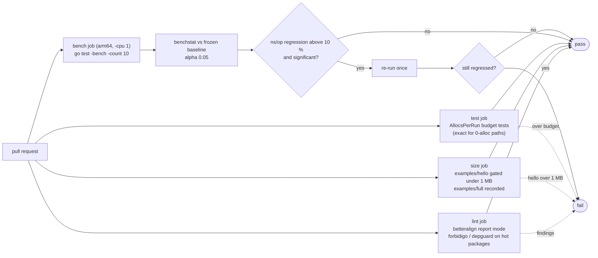

# 05. Performance

Performance is a requirement, not a later optimisation. This file defines the hot paths,
the budgets, how they are measured and how CI enforces them.

## 1. Principles

1. **Nothing per record that can be done per process or per invocation.** Static attrs
   are rendered at construction; Lambda context keys are rendered once per invocation
   and cached; env vars are read once.
2. **No reflection, `fmt` or `regexp` on hot paths; no v1 `encoding/json` anywhere.**
   The only reflection is `runtime.FuncForPC` once at wrap time. `%T` and
   `encoding/json/v2` are allowed on cold paths: error rendering, metadata of arbitrary
   type, response capture (decision 23).
3. **Pooled buffers, single write.** `internal/bufpool` hands out `[]byte` with a
   64 KiB return cap (larger buffers are dropped, not pooled, to avoid pinning memory).
4. **Zero work when disabled.** Level gate, unsampled trace, disabled metrics: no
   allocation, no lookup beyond what decides the gate.
5. **Synchronous.** No background goroutines, timers or channels in the library's own
   code: nothing to lose at freeze, nothing to drain, trivially testable (Google: prefer
   synchronous functions). The single exception is the opt-in `DeadlineMargin` timer
   (01 §7 D6), one `time.AfterFunc` per invocation, stopped in `end()`, tested under
   `synctest`; its callback runs in a goroutine only if it fires, and 01 §7 D6 defines
   the race with `end()`. Scope of the claim: it covers `internal`, `logger`, `metrics`,
   `tracer` and the root wrapper. The X-Ray SDK, a dependency of `tracer`, has paths that
   start goroutines (`xray.BeginSegment` and other root segments, `xray.CaptureAsync`,
   the centralized sampling poller on the first `ShouldTrace`); the wrapper calls none of
   them, and in Lambda facade mode `BeginSubsegment` and `Close` are synchronous
   (04 §1). Consumers who call those SDK functions directly own those goroutines. The
   `goroutineleak` test (06 §1) is the proof: zero goroutines owned by library packages
   after 1000 invocations, with and without `DeadlineMargin`.
6. **Cold start matters as much as steady state.** No `init()` work beyond env reads,
   no package-level tables built at init that are not constants, standard library only
   in `internal`, `logger` and `metrics`. The X-Ray SDK (whose package init reads env
   and dials nothing) is linked only through the `tracer` module.
7. **Small when unavoidable.** Go 1.27's size-specialised allocators make objects under
   80 bytes up to 30 % cheaper to allocate. Per-record allocations that cannot be
   pooled away (an `*XRayLogger` message wrapper, a sanitised segment name) are kept
   under that size; per-invocation objects (`State`, the batch) are allocated once and
   may be larger. `betteralign` (§4) keeps the small ones small.

## 2. Hot-path inventory

| Path | Frequency | Design |
| --- | --- | --- |
| `Handler.Enabled` | every log call | integer compare; one `ctx.Value` only when sampling can matter |
| `Handler.Handle` scalar attrs | every emitted log | pooled buffer, appends only, one `Write` |
| `Handler.Handle` with `KindAny` | occasional | `encoding/json/v2` into the same buffer |
| `AppendKeys` | few per invocation | lock, append, bump version; rendering deferred to next `Handle` and cached |
| `Batch.Add` existing name | many per invocation | lock, map lookup, append float |
| `Batch.Add` new name | ≤ 100 per invocation | map insert, `names` append |
| `Batch.Flush` | once per invocation | one serialization, one `Write` |
| `tracer.Start`/`Close` disabled or unsampled | tens per invocation | cached boolean checks, no SDK call, 0 allocations |
| `tracer.Start`/`Close` sampled | tens per invocation | SDK-bound (`xray.BeginSubsegment`, `Close`); wrapper adds name sanitisation only |
| handler segment `Close` | once per invocation | SDK serialises the tree and writes one UDP datagram |
| wrapper `begin`/`end` | once per invocation | one `State` alloc, one `WithValue`, header parse without allocation (slices of the header string) |

## 3. Budgets

Budgets are set **after** the first baseline measurement on the CI machine and then
frozen as `testing.AllocsPerRun` tests. The numbers below are the design targets.
Baselines are taken with Go 1.27 defaults (Green Tea garbage collector, size-specialised
allocation, `encoding/json` backed by v2) and the toolchain version is recorded next to
the numbers.

| Operation | allocs/op | ns/op (arm64 Graviton, target) |
| --- | --- | --- |
| `log.Info("msg")` disabled level | 0 | < 10 |
| `log.Info("msg", 3 scalar attrs)` enabled, wrapper active | 0 | < 900 (excluding `Write`) |
| `log.Info` with one `slog.Any(struct)` | ≤ 3 | < 3000 |
| `logger.AppendKeys(ctx, 1 attr)` | ≤ 1 | < 200 |
| `Batch.Add` existing name | 0 | < 60 |
| `Batch.Add` new name | ≤ 2 | < 300 |
| `Batch.Flush` 10 metrics, 2 dims | ≤ 1 | < 4000 (excluding `Write`) |
| `tracer.Start` + `Close` disabled or unsampled | 0 | < 20 |
| `tracer.Start` + `Close` sampled leaf | SDK baseline + ≤ 1 | SDK baseline + < 200 |
| handler segment `Close`, 5 children | SDK baseline + ≤ 2 | SDK baseline (recorded, not gated) |
| `Wrap` overhead per invocation, all three on, no I/O | ≤ 12 | < 20000 |
| `Options.PprofLabels` extra cost per invocation | ≤ 3 | < 1500 |
| `Options.DeadlineMargin` extra cost per invocation (arm + stop) | ≤ 2 | < 500 |
| `end()` total, all three on, no I/O wait | counted in the `Wrap` row | < 20000, never waits on `ctx` (01 §7 D1) |
| package init of core (`go test -run XXX -bench init`) | n/a | < 1 ms |

Comparison baselines recorded alongside: `slog.JSONHandler` for the same record
(our handler must be within 1.2x of it with the wrapper off and must not exceed 1.5x with
the wrapper on), and `encoding/json.Marshal` of an equivalent map for EMF (ours must be
faster).

## 4. Techniques, by component

**Logger**
- `preAttrs` rendered at `WithAttrs`; `preGroups` rendered at `WithGroup`.
- Level name lookup: `[6]string` indexed by `(level+8)/4` for the six canonical levels,
  fallback to `slog.Level.String()` otherwise.
- Timestamp: `time.Time.AppendFormat` with the fixed layout; no `Format` (allocates).
- Lambda context block rendered once per invocation into `State.lambdaJSON` on first
  `Handle` (lazy, so invocations that never log pay nothing).
- `AppendKeys` rendering cached by `attrsVersion`; `Handle` compares a `uint32` and
  reuses the cached bytes.
- Record attrs: `r.Attrs(func(a slog.Attr) bool)` iteration, no `[]slog.Attr`
  materialisation.
- Quoting via `jsontext.AppendQuote` (Go 1.27) or an internal `appendString` (Go 1.26).
- `Write` through `syncwriter` which does **not** copy; the pooled buffer is handed to
  `os.Stdout.Write` directly under the mutex.

**Metrics**
- `Batch` slices preallocated with caps 16 (names), 4 (values per metric), 8 (dims).
- Unit validation by `switch` on the string (compiler-generated jump), no map.
- Dimension key validation by a `[256]bool` printable-ASCII table.
- Serialization writes `"Name"` strings via the same quote routine; whole floats are
  written as integers.

**Tracer**
- Disabled or unsampled: `Start` returns `(ctx, nil)` without allocating a new context
  and without calling the SDK (which would allocate a `Dummy` segment and read two
  environment variables per call).
- Name sanitisation with a `[256]bool` table; the input string is returned unchanged
  when clean, so no allocation on the common path.
- Response metadata marshalled once with `encoding/json/v2` into bytes stored as a
  `jsontext.Value`, which the SDK embeds verbatim at emission; the size guard uses
  `len(bytes)`, no second marshal.
- Everything else is the SDK's: its allocations are measured as a baseline benchmark
  (`xray.BeginSubsegment` + `Close` with the Lambda facade) and our overhead is gated
  relative to it, not in absolute terms.

**Struct layout (betteralign)**
- Every struct that is allocated per invocation or per record (`invocation.State`,
  `invocation.TraceHeader`, `invocation.LogBuffer`, `logger.Handler`, `metrics.Batch`,
  `metrics.metricDef`, `metrics.dimension`, `tracer.Tracer`) has its fields ordered by
  [`betteralign`](https://github.com/dkorunic/betteralign), a drop-in replacement for
  `fieldalignment` that preserves comments, sorts stably and writes files atomically.
  Ordering rule applied by the tool: zero-sized fields first, then higher alignment,
  pointer-bearing before pointer-free, fewer trailing non-pointer bytes, larger size.
  The payoff is twofold: fewer padding bytes per allocation, and fewer pointer-bearing
  bytes for the garbage collector to scan, which matters for `State`, the long-lived
  per-invocation object. The X-Ray SDK's `Segment` is not ours to reorder.
- Exported option structs (`powertools.Options`, `logger.Options`, `metrics.Options`,
  `tracer.Options`) carry `// betteralign:ignore` inside the struct body: they are built
  once per process, and their source order is their documentation order on `pkg.go.dev`.
- Keyed struct literals everywhere (a Google style rule for literals of types from other
  packages, extended here to all struct literals) mean the tool's positional-literal
  guard never blocks a rewrite, and a reorder can never silently mis-assign a field.
- Workflow: `make align` runs `betteralign -apply ./...` in every module, followed by
  `go build ./...` and `go test ./...` (the tool's documented safety check, because
  positional literals of exported structs in other packages are not detected). CI runs
  the report-only mode and fails on any finding (§6). The tool is single-pass, so
  `make align` runs it twice.
- Pinned invocation, no `go.mod` pollution of any module:
  `go run github.com/dkorunic/betteralign/cmd/betteralign@<pinned version> ./...`.
  The version lives in one Makefile variable. Alternative if more tools accumulate: a
  `tools` module with Go 1.24+ `tool` directives, kept out of the published modules so
  consumers' dependency graphs stay clean.
- Known caveats, all handled: files are LF (`.gitattributes`), there are no cgo, ABI or
  wire-format structs in the library (JSON output is assembled by hand, never by
  `unsafe` or offsets), and the false-sharing warning does not apply because no struct
  is written concurrently by goroutines pinned to different cores on purpose.

**Wrapper**
- `State` is one allocation; the context chain grows by one `WithValue` (plus one for
  the current segment when sampled). Per-invocation objects (`State`, `Batch`,
  `LogBuffer`) are never pooled (01 §7 D4); only transient record buffers are.
- Trace header parsed by scanning the string once; fields are substrings (no allocation).
- Cold start: `atomic.Bool.CompareAndSwap`.
- `HandlerName` computed at wrap time.

## 5. Measurement protocol

- Benchmarks live next to the code (`*_bench_test.go`) and use `b.ReportAllocs()` and
  `b.Loop()` (Go 1.24+). They write to `io.Discard` or a recording `xray.Emitter` to exclude I/O.
- A benchmark harness in `internal/benchutil` builds a realistic invocation context
  (trace header, `lambdacontext`) so the wrapper-on numbers are representative.
- `make bench` runs `go test -run '^$' -bench . -benchmem -count 10 ./...` and stores
  `benchstat`-compatible output under `bench/results/<git-sha>.txt` (ignored by git
  except the frozen baseline file).
- Profiles: `make profile` produces CPU and alloc profiles for the three main benchmarks;
  reviewed when a budget test fails. In CI the profiles and the `benchstat` input are
  written to `t.ArtifactDir()` / `b.ArtifactDir()` (Go 1.26) and uploaded as job
  artifacts with `go test -artifacts`.
- Lambda-level validation (M5): deploy `examples/benchmark` with 128 MB and 1024 MB
  memory, run 1000 invocations each, and record `REPORT` durations and init durations
  with and without the wrapper. Target: < 1 ms added per invocation at 1024 MB, < 5 ms
  added init.

## 6. CI gates

1. `AllocsPerRun` tests fail the build when a budget is exceeded (exact numbers, not
   "less than", for the 0-allocation paths; budgets with a margin of +1 for the others).
2. `benchstat` comparison against the frozen baseline fails the job when `ns/op` on
   any gated benchmark regresses by more than 10 % at p < 0.05 (`benchstat -alpha 0.05`).
   Runs on a dedicated job with `GOMAXPROCS=1` and `-cpu 1` for stability; noisy results
   are re-run once before failing.
3. Binary size check, built with `-trimpath -ldflags=-s -w` for `linux/arm64`:
   `examples/hello` (logger and metrics only) must add less than 1 MB over a bare
   function; `examples/full` (with `tracer`, which links the X-Ray SDK and its
   dependencies) is recorded and reported on every run but not gated, because the
   delta is the SDK's.
4. `betteralign ./...` in report mode on every module; any
   finding fails the `lint` job with the tool's own diagnostic
   (`8 bytes saved: struct of size 24 could be 16`). Test files are included
   (`-test_files`) so test fixtures do not drift either.
5. `go vet`, `staticcheck` and `gofmt` as usual. The hot-path rule (no `fmt`, `reflect`,
   `regexp` in `internal/jsonenc`, `internal/syncwriter`, `internal/invocation`, the
   `logger` handler files and `metrics`) is enforced by `golangci-lint`'s `forbidigo`
   and `depguard`, scoped by package path, with `//nolint:forbidigo` on the documented
   cold-path functions (error rendering, `%T`). No in-house analyzer (11 §3 B).

## 7. Forbidden on hot paths

`fmt.Sprintf`/`Fprintf`, `reflect`, `regexp`, v1 `encoding/json` (banned everywhere, decision 23), `map`
iteration with ordering sorts, `time.Format`, string concatenation in loops, `defer` in
tiny leaf functions where it measurably costs (allowed elsewhere), interface conversions
of scalars that escape, `context.WithValue` per log call, goroutines, channels.
