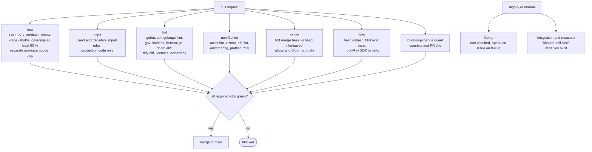
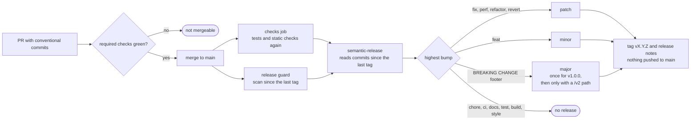

# 06. Testing and CI

## 1. Test layers

The layers below were planned up front; a reference implementation of this plan later
confirmed that every one of them is needed, and refined how several of them work. The
refinements are folded into the table and marked "decided during implementation" in the
decision log (09).

**Build tags on test files (optional convention).** A repository may put a build tag on
every test file, for example `//go:build unit`, so that a plain `go build` never compiles
test helpers. If it does, every tool that reads tests must pass the tag (`go test`,
`go vet`, `go fix`, golangci-lint `run.build-tags`, betteralign, the coverage run), and
three kinds of files differ: allocation-budget files carry `//go:build unit && !race`
(Performance row), the real-AWS integration harness carries its own tag
(`//go:build integration`, Integration row), and the `example_test.go` files carry **no**
tag, because `go doc -ex` ignores examples in tagged files and `go doc` has no `-tags`
flag (Examples row, decision 38). The cost of the convention is in 11 §2: a tool run
without the tag silently skips every test.

| Layer | Scope | Tooling | Where |
| --- | --- | --- | --- |
| Unit | one package, pure functions and small types | `testing`, table tests, `go-cmp` | `*_test.go` beside the code |
| Conformance | the `slog.Handler` contract | `testing/slogtest.Run` with a result function that decodes each line with `jsontext.AllowDuplicateNames(true)` and `jsontext.AllowInvalidUTF8(true)` and renames the Powertools keys back to slog's (`message` to `msg`, `timestamp` to `time`, `location` to `source`). The handler emits `timestamp` only when `r.Time` is non-zero and `location` only when `AddSource` is set and `r.PC != 0`, and drops an empty `Attr{}`, because `slogtest` checks all three | `logger/handler_test.go` |
| Golden | exact output documents (log lines, EMF blobs, X-Ray documents) | decode with `encoding/json/v2` using `AllowDuplicateNames(true)` and `AllowInvalidUTF8(true)` (log lines may repeat a key, as `slog.JSONHandler` lines do), then `cmp.Diff`; raw-prefix check only for key order. X-Ray documents ignore times, `Dummy`, `parent_id` on embedded children, `cause.working_directory` and the exception `stack` (asserted separately as non-empty) | `testdata/*.json` |
| Schema | EMF blobs against the AWS JSON schema | test-only validator (decision 13); a provenance file next to the schema in `testdata` records the source URL, retrieval date and license, since JSON has no comments | `metrics/schema_test.go` |
| Lifecycle | wrapper with a simulated runtime context | `lambdacontext.NewContext`; the trace header set through **one** test helper that carries the single SA1029 suppression (§4); `bytes.Buffer` writers; `WrapHandler` driven by a hand-written `lambda.Handler` that owns its bytes, never `lambda.NewHandler(fn)` (decision 29); a test proves that `_X_AMZN_TRACE_ID` alone means "no trace" (decision 30) | `wrap_test.go` at the root with the utilities as stubs (Phase 1); then one file per utility, `wrap_logger_test.go`, `wrap_metrics_test.go`, `wrap_tracer_test.go`, so the parallel phases never edit the same test file (07 Phase 1) |
| X-Ray emission | the documents the SDK actually sends, children and metadata included | a per-test UDP listener: `net.ListenPacket("udp", "127.0.0.1:0")`, `xray.NewDefaultEmitter(addr)`, `xray.ContextWithConfig(ctx, xray.Config{Emitter: emt})` with `t.Setenv("AWS_XRAY_DAEMON_ADDRESS", "")`; read the datagram, strip the `{"format": "json", "version": 1}` header line, decode, `cmp.Diff`. Test documents stay under 9216 bytes, the default UDP datagram limit on macOS. An in-memory `xray.Emitter` only counts emissions: it cannot see child subsegments the way the wire format does. No separate test binary is needed | `tracer` package tests; `wrap_tracer_test.go` for the wrapper (test files may import the SDK, §4) |
| Concurrency | multi-goroutine and multi-invocation interleaving | `-race`, `testing/synctest` where time matters | each package |
| Deadline and cancellation | the margin timer is armed only when `DeadlineMargin > 0`, a deadline exists and more than the margin remains; it fires at deadline minus margin and flushes; the timer firing concurrently with `end()` yields at most one extra `WARN` and one extra blob, never a lost or duplicated metric (01 §7 D6); `end()` runs and flushes when the handler returns `ctx.Err()`; late goroutines after `end()` get the 01 §7.4 behaviour and never touch a following invocation | `testing/synctest` bubble with a fake clock: deadline at +3 s, margin 100 ms, `synctest.Sleep` to the margin; a second invocation started while a goroutine of the first is still running | `deadline_test.go` |
| Leaks | no library goroutine is left behind, and a stopped margin timer never fires | three checks, because the `goroutineleak` profile reports only goroutines that are blocked forever. (1) After 1000 wrapped invocations, with and without `DeadlineMargin` (stopped and fired cases): `p := pprof.Lookup("goroutineleak")`, `p.WriteTo(&buf, 1)` first (the count is meaningful only after `WriteTo`), then `p.Count() == 0` and no stack in `buf` contains the module path. (2) After fired callbacks finish, `pprof.Lookup("goroutine").WriteTo(w, 2)` and fail on any stack with a frame from the module outside the test. (3) In a `synctest` bubble the handler returns before the margin, `synctest.Sleep` runs past the deadline, and an unexported call counter of the pre-timeout callback is still 0 | `leak_test.go`, `deadline_test.go` |
| Performance | allocation budgets and benchmarks | `testing.AllocsPerRun` with **non-constant** values (constants are not boxed, so they hide allocations), `b.Loop`, `benchstat`. Budget files are excluded from race builds (`//go:build !race`, or `unit && !race`): `sync.Pool` drops items at random under the race detector, so counts are not reproducible there. They run in a separate non-race CI step | `*_alloc_test.go`, `*_bench_test.go` |
| Examples | runnable documentation | `Example*` functions with `// Output:` where the example does not block (`lambda.Start` does); files without a build tag, using no helper or type from a tagged test file; an untagged `go vet` of the public packages proves they compile on their own | `example_test.go` per package |
| Integration (optional) | real Lambda, real X-Ray, real CloudWatch | SAM deploy of a prebuilt `bootstrap` (the binary the size gate measured, no `sam build`), then Go tests with AWS SDK clients behind `//go:build integration`: invoke, then poll logs, EMF metrics and traces with deadlines (metrics take minutes to appear, traces less). Without the stack variables or AWS credentials every test **skips**, checked before any AWS call, unless a "required" variable is set; a CI step on every pull request runs the harness with nothing set and fails unless it skips | `examples/integration`, nightly or manual workflow only (§5.3) |

## 2. Rules (from the Google style guide)

- Only the standard `testing` package plus `github.com/google/go-cmp`. No assertion
  libraries, no mocking frameworks.
- Table-driven tests with named struct fields; each row has a `name`; subtests via
  `t.Run(tc.name, …)`; `t.Error` for independent mismatches, `t.Fatal` only when the
  rest would be meaningless; failure messages in `got/want` form with inputs included.
- Test helpers call `t.Helper()`, do setup and cleanup only, and never hide the link
  between a failure and its cause. Shared helpers live in one internal package (for
  example `internal/testsupport`) that only test files import.
- Hermetic tests: `t.Setenv` for environment, injected clocks through unexported fields,
  `testing/cryptotest.SetGlobalRandom` (Go 1.26) for deterministic X-Ray segment ids in
  golden tests, `t.TempDir` for files, `t.Context()` for contexts.
- `t.Setenv` cannot run under `t.Parallel()`, so the X-Ray tests that clear
  `AWS_XRAY_DAEMON_ADDRESS` run serially. A test that calls `xray.SetLogger` (process-wide,
  not goroutine-safe) never runs in parallel with tests that drive the SDK; `TestMain` is
  the safe place for it.
- The wrapper's cold-start flag is process-wide, so with `-shuffle=on` any test can be the
  cold one. Tests find EMF blobs by metric name and never assert on the number of blobs
  when the cold-start metric is on.
- Compare semantic content, not serialized bytes, except in the explicit key-order
  tests.
- Tests of exported behaviour live in `package x_test`; tests that need unexported
  access live in `package x`.

### Example: testing a handler through the wrapper

An example of the intended API, as a consumer would write it. The wrapper returns an
ordinary function, so a test calls it with a simulated runtime context and decodes what
the utilities wrote.

```go
package orders_test

import (
	"bytes"
	"encoding/json/jsontext"
	json "encoding/json/v2"
	"testing"

	"github.com/aws/aws-lambda-go/lambdacontext"
	"github.com/google/go-cmp/cmp"

	powertools "github.com/<owner>/powertools-lambda-go"
	"github.com/<owner>/powertools-lambda-go/logger"
	"github.com/<owner>/powertools-lambda-go/metrics"

	"example.com/orders"
)

func TestHandleThroughWrapper(t *testing.T) {
	var logs, emf bytes.Buffer // one buffer per utility: they do not share a lock

	lg := logger.New(logger.Options{Service: "orders", Writer: &logs, Pretty: new(false)})

	m, err := metrics.New(metrics.Options{Namespace: "Shop", Writer: &emf, Disabled: new(false)})
	if err != nil {
		t.Fatalf("metrics.New() error = %v", err)
	}

	h := powertools.Wrap(orders.Handle, powertools.Options{Logger: lg, Metrics: m})

	ctx := lambdacontext.NewContext(t.Context(), &lambdacontext.LambdaContext{
		AwsRequestID: "req-1",
	})

	if _, err := h(ctx, orders.Order{ID: "o-1"}); err != nil {
		t.Fatalf("handler error = %v", err)
	}

	line := decodeFirst(t, logs.Bytes())
	if diff := cmp.Diff("req-1", line["function_request_id"]); diff != "" {
		t.Errorf("function_request_id mismatch (-want +got):\n%s", diff)
	}
}

// decodeFirst decodes the first JSON line. Duplicate keys and invalid UTF-8 are
// allowed, because log lines may contain both, exactly as slog.JSONHandler lines do.
func decodeFirst(t *testing.T, b []byte) map[string]any {
	t.Helper()

	first, _, _ := bytes.Cut(b, []byte("\n"))

	var m map[string]any
	if err := json.Unmarshal(first, &m,
		jsontext.AllowDuplicateNames(true), jsontext.AllowInvalidUTF8(true)); err != nil {
		t.Fatalf("decode %q: %v", first, err)
	}

	return m
}
```

The trace header is a plain string context key fixed by `aws-lambda-go`, so a test that
needs it keeps one helper with the one suppression the repository allows:

```go
// withTraceHeader puts an X-Ray trace header where aws-lambda-go puts it.
func withTraceHeader(ctx context.Context, h string) context.Context {
	return context.WithValue(ctx, "x-amzn-trace-id", h) //nolint:staticcheck // SA1029: key fixed by aws-lambda-go
}
```

### Example: a deadline test in a synctest bubble

An example of the intended API: the fake clock makes the `DeadlineMargin` timer
deterministic, so the test asserts what was flushed before the "timeout" without sleeping
for real.

```go
// slowHandler blocks until the invocation's context ends, like a handler about to time out.
func slowHandler(ctx context.Context, _ orders.Order) (struct{}, error) {
	<-ctx.Done()

	return struct{}{}, ctx.Err()
}

func TestMarginFlushesBeforeTimeout(t *testing.T) {
	synctest.Test(t, func(t *testing.T) {
		var logs bytes.Buffer

		lg := logger.New(logger.Options{Writer: &logs, Pretty: new(false)})
		h := powertools.Wrap(slowHandler, powertools.Options{
			Logger:         lg,
			DeadlineMargin: 100 * time.Millisecond,
		})

		ctx, cancel := context.WithDeadline(t.Context(), time.Now().Add(3*time.Second))
		defer cancel()

		go func() { _, _ = h(ctx, orders.Order{ID: "o-1"}) }()

		synctest.Sleep(3*time.Second - 100*time.Millisecond) // the margin fires here
		synctest.Wait()

		if !bytes.Contains(logs.Bytes(), []byte(`"level":"WARN"`)) {
			t.Errorf("no pre-timeout WARN before the deadline; logs:\n%s", logs.String())
		}
	})
}
```

## 3. Test doubles the library provides

Nothing exported for testing. Consumers test their handlers by:

- passing an `io.Writer` (`bytes.Buffer`) in `logger.Options.Writer` and
  `metrics.Options.Writer`, then decoding the lines (with `AllowDuplicateNames`). One
  buffer per utility: each utility serialises its own writer, so one buffer shared by
  both is a data race once the `DeadlineMargin` timer writes;
- attaching a per-test UDP listener as the X-Ray emitter with `xray.ContextWithConfig`
  (§1, X-Ray emission row), or leaving the tracer disabled (the default outside Lambda);
- calling the handler directly without the wrapper: logger and metrics write
  context-free output, `metrics.FromContext` returns a nil `*Batch` whose methods are
  no-ops, `tracer.Capture` and `CaptureResult` run `fn` untraced when ctx holds no segment
  and no sampled trace header, and `tracer.AddAnnotation` and `tracer.AddMetadata` return
  nil. `*xray.Segment` methods are **not** nil-safe (only `Close` is), so consumer code
  calls the tracer helpers, never methods on a segment that may be nil (decision 31).

A small `powertoolstest` package (name follows the Google `…test` convention) is a v1.1
candidate: `NewInvocationContext(t, opts)` returning a `ctx` with a fake Lambda context
and trace header (it would take over the SA1029 helper), and a `CaptureEMF(w)` decoder.
Not in v1 to keep the API surface small.

## 4. Lint and static analysis

Every check has a `make` target, so CI and a laptop run the same command, and `make
checks` runs every static check CI runs.

- `gofmt` through `go fmt` (CI fails if the build step changes a file; reproducible
  because the toolchain is pinned, below), `go vet ./...` (Go 1.27 adds the `%w` on `*E`
  check, and `go test` runs `stdversion` by default), `govulncheck`, and golangci-lint v2
  with a minimal set: `errcheck`, `ineffassign`, `staticcheck`, `unused`, a complexity
  ratchet (`gocognit` above 60 and `cyclop` above 25 fail; a function over a threshold is
  split, never exempted; `_test.go` files are exempt), plus `forbidigo` and `depguard`
  scoped to the hot-path packages (05 §6).
- `go fix -diff ./...` must be empty: the Go 1.26/1.27 modernizers (`atomictypes`,
  `embedlit`, `slicesbackward`, `unsafefuncs`, `waitgroupgo`, `//go:fix inline`) are
  applied before review, never left for later. With tagged test files, `go fix` needs the
  tag too, or it never sees the tests.
- No `//go:linkname` anywhere (Go 1.27 tightened linkname access; the library has no
  reason to use it).
- `betteralign` (report mode, pinned version) fails on any suboptimal struct layout; it
  is run standalone because golangci-lint integration with auto-fix is not supported.
  `make align` applies fixes locally (05 §4).
- `depguard` fails the `lint` job if any file imports `"encoding/json"`; only
  `encoding/json/v2` and `encoding/json/jsontext` are allowed (decision 23).
- `go mod tidy -diff` and `go mod verify`. Go 1.27 `tidy` merges scattered `require`
  blocks into two (direct, then indirect); do not re-split them by hand.
- Import rules (`deps`), two rules, both on **production** code only, since test files are
  never linked into consumer binaries (decision 31): (a) direct, from `go list -f` over
  `.Imports` (not `.TestImports` or `.XTestImports`), no package except `tracer` imports
  `github.com/aws/aws-xray-sdk-go/...`; (b) transitive, `go list -deps` of `logger`,
  `metrics` and `internal/...`: none reaches the SDK, none reaches a utility package other
  than itself, and `internal/...` reaches no utility. `depguard` mirrors rule (a) and
  exempts test files.
- SA1029 (string context key): exactly one line in the module carries the suppression, in
  the shared test helper that sets `"x-amzn-trace-id"`; every test goes through it.
- Third-party licenses: `go-licenses check` with forbidden, restricted and reciprocal
  license types disallowed, for the library and for what the example binaries link.
- Doc coverage: every exported identifier has a doc comment that starts with its name
  (`revive`'s `exported` rule, run in the API review, 08 §3).
- `make doc-check`: for each public package, `go doc -ex` lists at least one example, and
  an untagged `go vet` of the public packages compiles the example files on their own;
  it also greps production code for leftover stub sentences from the API-freeze phase
  (07 Phase 1).
- **Toolchain pinning.** `go.mod` carries `go 1.27.0` and a `toolchain go1.27.N` line;
  every required job reads `go-version-file: go.mod`, so gofmt, vet and fix give the same
  answer everywhere. A routine dependency-update pull request bumps the toolchain line.
  After a toolchain bump the pinned Go tools are re-installed, because a helper built
  with an older Go fails on the new sources.

### 4.1 Lint of non-Go files

A MegaLinter-style job (or the individual tools) lints what Go tooling does not see:

| Tool | Scope | Note |
| --- | --- | --- |
| `actionlint` | workflow files | catches expression and shell errors before a run |
| `zizmor` | workflow files | per-job least-privilege `permissions`, `persist-credentials: false` on every checkout that does not push, public actions pinned by full commit SHA; exceptions inline as `# zizmor: ignore[rule] - reason` |
| `cfn-lint` | the SAM templates under `examples/<name>/template.yaml` only | the runner picks CloudFormation files by content, so a path filter is needed or any YAML that mentions a template keyword is linted |
| editorconfig checker | text files | `.go`, golden files, `testdata/` and `docs/` excluded: their whitespace is content (gofmt tabs, golden output, aligned Mermaid) |
| prettier | JSON and YAML | `testdata/` excluded, since fixtures are byte-exact |
| a secret scanner | the repository | |
| `trivy` | dependencies and IaC | skips `go.mod` files, so `govulncheck` stays the single authority for Go code (pitfalls below) |

Markdown with Mermaid is checked by rendering, not by a linter: diagrams must parse with
the Mermaid version GitHub uses, with no HTML entities, no raw `<` or `>` inside labels
and no semicolons in sequence messages (GitHub decodes entities before parsing).

### 4.2 Known pitfalls (found by a reference implementation)

- **Coverage thresholds per package.** Coverage tools that derive a file's package from
  the path before the last `/` treat each root-package file as its own package once the
  module prefix is stripped, and name `logger/*.go` as `logger`, not `logger/`. With
  `go-test-coverage`, a per-package override is `^logger$`, not `^logger/` (which matches
  no package and silently applies nothing), and the root package needs `^[^/]+\.go$`,
  which applies the threshold to every root file. Check that each override actually
  matches by reading the tool's breakdown once.
- **`govulncheck` findings in transitive dependencies.** An SDK release can require a
  version of an indirect module with known vulnerabilities (at the time of writing the
  X-Ray SDK pulled a `golang.org/x/net` with HTTP/2 advisories, reported as reachable
  through `tracer`). The fix is an explicit indirect floor on the fixed version in `go.mod`, with a
  comment to remove it once an SDK release requires a fixed version. The never-released
  `examples` module is left to dependency-update pull requests, so an advisory in an AWS
  service client never blocks an unrelated library change.
- **`betteralign` ignores its own `-tags` flag** (v0.15); pass tags through
  `GOFLAGS=-tags=...` so tagged test files are analysed.
- **`go doc -ex` and build tags.** Examples in tagged files are invisible to `go doc -ex`,
  with or without `GOFLAGS`, and `go doc` does not type-check, so it never reports an
  example that does not compile. Hence the untagged `go vet` in `doc-check`.
- **`go doc` documents only its first package argument** and exits 0 for the rest, so a
  loop over packages is needed in any script that reads its output.
- **benchstat always exits 0**, so the bench gate is a script over its CSV output
  (§5.2), never its exit code or its "vs base" column.

## 5. CI pipeline (GitHub Actions)

### 5.1 Pull-request checks



| Job | Matrix | Steps |
| --- | --- | --- |
| `test` | Go from `go.mod` (1.27.x); `ubuntu-latest` (amd64) and `ubuntu-24.04-arm` | `go build ./...`, `go test -race -shuffle=on -coverprofile ./...`, coverage ≥ 90 % for `logger`, `metrics`, `tracer`, root (each override added when its phase merges); then the non-race step that runs only the allocation-budget tests (`-run 'Allocs\|Budget'`), without `-race` or `-shuffle`; then the integration harness with no variables set, which must skip |
| `deps` | Go 1.27.x | the two import rules of §4 |
| `lint` | Go 1.27.x | gofmt, vet, golangci-lint, govulncheck, betteralign (report mode), `go fix -diff`, tidy diff, `go mod verify`, licenses, `doc-check`, and the self-tests of the gate and guard scripts against fixtures |
| non-Go lint | | §4.1 |
| `bench` | Go 1.27.x, one runner | A/B in one job (05 §6): check out the merge base and the head, run the gated benchmark subset of both **interleaved** (base, head, base, head…) with `-count 10 -benchtime 300ms -cpu 1`, then `benchstat -format csv` and a gate script. Any `allocs/op` or `B/op` increase at p < 0.05 fails; `ns/op` fails above 25 % at p < 0.05, smaller deltas are reported. A benchmark on one side only is `new` or `removed`, never gated, so a rename does not block; units added with `b.ReportMetric` are informational. A reviewable accept-list file turns a listed failing benchmark into `accepted`; a listed name that matched nothing is reported `stale` for the next pull request to remove. The report goes to the job summary and one PR comment updated in place; on a failure the regressed packages are profiled and the profiles uploaded. **No committed baseline**: a baseline recorded on another machine is noise |
| `size` | Go 1.27.x | build `examples/bare` (a plain `aws-lambda-go` main), `examples/hello` (logger and metrics, no wrapper), `examples/full` and the benchmark binaries for `linux/arm64` with `-tags lambda.norpc -trimpath -ldflags='-s -w'`, all in the same run (no committed baseline). Fail when `hello` adds 1 MiB or more over `bare`, when `hello` reaches the X-Ray SDK, the root package or `tracer` (`go list -deps`, and the `dep` lines of `go version -m` on the binary), or when the binaries come from different toolchains; record the rest. This also proves the `replace`-based examples module builds |
| breaking-change guard | | §6 |

`GOFLAGS=-mod=mod` is never used; the module cache is restored from `go.sum`. Every job
runs from the repository root (the library module) and, where relevant, from `examples/`.

### 5.2 Rollout of the gates

Gates are introduced in a fixed order so that none blocks work it cannot yet judge:

- `test`, `deps`, `lint` and coverage are blocking from Phase 0. A coverage tool passes
  with 0 of 0 statements on a tree of `doc.go` files, and every Phase 1 stub package gets
  a small test so the thresholds stay meaningful.
- `size` is created with the examples (Phase 5) and is blocking from its creation.
- `bench` runs report-only until the budgets are locked, then blocks (Phase 6).
- Go tip never blocks a merge: it runs in the nightly workflow, and a failure opens or
  updates one issue.
- Docs-only pull requests (only Markdown or files under `docs/`) skip the code jobs, and
  the release workflow ignores such pushes to `main` (decision 45). A skipped job counts
  as passed for a required check, so the pull request stays mergeable; a diff that cannot
  be computed runs every job.

### 5.3 Nightly workflow

| Job | Steps |
| --- | --- |
| `tip` | build tip from source (`gotip` at a pinned version, `GOTOOLCHAIN=local` so the `toolchain` line does not switch away from it), `go test -race ./...` (which skips the `!race` budget files), `go vet`; `continue-on-error`, failures open an issue |
| `integration` | **optional**: skipped until repository variables name an AWS role and region, so a fork or a half-configured repository skips instead of failing. Then OIDC credentials (no stored keys), `sam deploy` of the prebuilt examples with per-run stack names, the Go harness with the "required" variable set, and `sam delete` of every stack under `if: always()`, with credentials refreshed first when a run can outlive a one-hour session |
| `measure` | manual dispatch, gated like `integration`: one job per memory size (128 MB and 1024 MB) so each fits one session; deploys the plain and wrapped benchmark binaries and records the Lambda-level overhead (05 §5) |

## 6. Release process

- **One module, one version (decision 25).** A single git tag `vX.Y.Z` versions every
  package. `go get github.com/<owner>/powertools-lambda-go@vX.Y.Z` (`<owner>` is a placeholder)
  brings `logger`, `metrics`, `tracer` and the wrapper at that version. There are no
  per-package tags, no `go.work`, and no `require` lines between components to rewrite.
- Why one version rather than per-package versions: the wrapper and the three utilities
  share the `internal/invocation.State` contract, so there is nothing to version
  separately without inventing a compatibility matrix; consumers and the release notes
  see one version for the toolkit, as with Powertools Python. The accepted cost (the
  X-Ray SDK in every consumer's module graph, never in logger-only binaries) is stated in
  01 §2 and bounded by the `deps` job.
- `examples/` is an untagged module with `replace github.com/<owner>/powertools-lambda-go => ../`.
  It is built in CI but never released; its dependencies (SAM, AWS service clients) stay
  out of the library's `go.mod`.
- `internal/...` is outside the compatibility promise by construction (consumers cannot
  import it).

### 6.1 Versions from conventional commits (decided during implementation)

The first draft of this plan kept a hand-written `CHANGELOG.md` and a `make release`
target. The plan now cuts releases with semantic-release (any implementation that
follows the conventional-commits angular preset) on every push to `main`, after re-running
the tests and static checks. There is no hand-maintained changelog, no release target, and
nothing is tagged or pushed to `main` by hand (decision 27).

| Commit type | Release |
| --- | --- |
| `feat` | minor |
| `fix`, `perf`, `refactor`, `revert` | patch |
| `BREAKING CHANGE` footer | major: used once, to cut `v1.0.0` |
| `build`, `chore`, `ci`, `docs`, `style`, `test` | none |

- **Seed tag.** A `v0.0.0` tag on `main` before the first release makes semantic-release
  count from v0; without any tag its first run cuts `1.0.0`.
- **v0 per phase.** Each phase that merges `feat` commits releases the next v0 minor, so
  every phase ships a version that can be tried; fixes give patches (decision 34). During
  v0 Go gives no compatibility promise, so an exported API may still change, written as
  `feat` or `fix`, never as a breaking change.
- **v1.0.0 once.** After the API review (08 §3), one commit with a `BREAKING CHANGE` footer
  cuts `v1.0.0`; v0 to v1 needs no `/v2` module path. Merge that pull request with a merge
  commit, not a squash: a squash header gains a ` (#N)` suffix and the PR description
  becomes the body, both outside the reviewed form.
- **After v1.0.0** a breaking change needs a `/v2` module path. A `BREAKING CHANGE` footer
  without that migration would make semantic-release tag `v2.0.0` on a module path that
  still says v1, which Go consumers cannot use.
- **Examples do not release.** The release rules have no scope filter, so example-only
  changes use `chore(examples)` or `test(examples)`, never `feat` or `fix`.
- Raising the `go` directive is a `feat` (a minor release) and is named in its description
  so the release notes show it.

### 6.2 Breaking-change guard (decided during implementation)

Two facts about the angular parser make an unchecked commit history dangerous:

- Its header pattern has **no `!`**, so a `feat(x)!:` commit is not a conventional
  commit for it: it releases nothing and disappears from the release notes.
- Its note pattern is case-insensitive and applies to **every line of every commit**,
  merge commits and non-conventional commits included. A `docs` commit whose body starts a
  line with the breaking-change phrase cuts a major. Write the phrase mid-line or in
  backticks when explaining it.

So a guard script scans exactly the ranges semantic-release reads: on every pull request,
`<base>..<head>` plus the PR title (a squash merge can make the title the commit header,
and the job re-runs when the title is edited); on `main`, the highest reachable version
tag to `HEAD`, as a job the release job needs. It fails on any bang header and on any note
line, except the single v1.0.0 commit while no v1 tag exists, and, after v1.0.0, a note
from a commit whose own `go.mod` declares the next `/vN` path. A note commit reverted in
the same range, or a full SHA listed in a reviewed allow-list file, is cleared. When the
guard holds a release on `main`, the recovery is `git revert` of the commit that carries
the marker (not of the merge commit, which leaves the commit in range), merged before any
other releasing change; removing the guard from the release job's dependencies is not a
recovery. The script has fixture-based self-tests in CI.



## 7. Documentation

- Package docs with runnable examples (`pkg.go.dev` is the reference for a public module);
  `go doc -ex` (Go 1.27) lists them per package and `doc-check` fails if a public package
  has none. The examples therefore live in untagged files (§1).
- `README.md`: install, 30-line example, env var table, link to Powertools concepts, and
  the versioning rule (v0 may be pinned without a promise; after v1.0.0 a breaking change
  needs `/v2`).
- `docs/`: one page per utility mirroring the upstream feature pages' structure
  (key features, getting started, advanced, testing), so users of the Python or
  TypeScript docs find the same headings.
- `docs/COMPATIBILITY.md`: the three parity matrices from 02, 03, 04.
