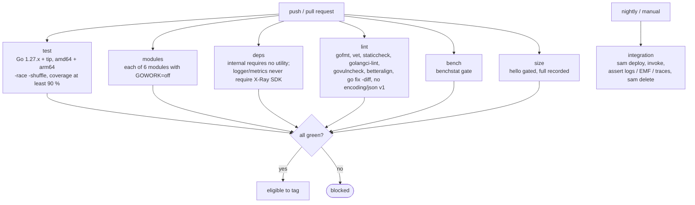
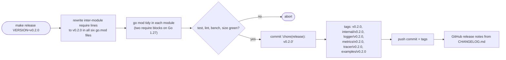

# 06. Testing and CI

## 1. Test layers

| Layer | Scope | Tooling | Where |
| --- | --- | --- | --- |
| Unit | one package, pure functions and small types | `testing`, table tests, `go-cmp` | `*_test.go` beside the code |
| Conformance | the `slog.Handler` contract | `testing/slogtest.Run` | `logger/handler_test.go` |
| Golden | exact output documents (log lines, EMF blobs, X-Ray documents) | decode with `encoding/json/v2` then `cmp.Diff`; raw-prefix check only for key order | `testdata/*.json` |
| Schema | EMF blobs against the AWS JSON schema | test-only validator (decision 13) | `metrics/schema_test.go` |
| Lifecycle | wrapper with a simulated runtime context | `lambdacontext.NewContext`, `context.WithValue(ctx, "x-amzn-trace-id", …)`, a recording `xray.Emitter` via `xray.ContextWithConfig`, `bytes.Buffer` writer | `powertools/wrap_test.go` |
| Concurrency | multi-goroutine and multi-invocation interleaving | `-race`, `testing/synctest` where time matters | each package |
| Deadline and cancellation | `DeadlineMargin` fires before the deadline and flushes; `end()` runs and flushes when the handler returns `ctx.Err()`; late goroutines after `end()` get the 01 §7.4 behaviour and never touch a following invocation | `testing/synctest` bubble with a fake clock: deadline at +3 s, margin 100 ms, `synctest.Sleep` to the margin; a second invocation started while a goroutine of the first is still running | `powertools/deadline_test.go` |
| Leaks | the library never leaks a goroutine | after 1000 wrapped invocations, `pprof.Lookup("goroutineleak")` (GA in Go 1.27) must report zero goroutines owned by library packages | `powertools/leak_test.go` |
| Performance | allocation budgets and benchmarks | `testing.AllocsPerRun`, `b.Loop`, `benchstat` | `*_bench_test.go`, `perf_test.go` |
| Examples | runnable documentation | `Example*` functions with `// Output:` | `example_test.go` per package |
| Integration | real Lambda, real X-Ray, real CloudWatch | SAM deploy of `examples/`, assertions with the AWS CLI | `examples/`, manual or nightly |

## 2. Rules (from the Google style guide)

- Only the standard `testing` package plus `github.com/google/go-cmp`. No assertion
  libraries, no mocking frameworks.
- Table-driven tests with named struct fields; each row has a `name`; subtests via
  `t.Run(tc.name, …)`; `t.Error` for independent mismatches, `t.Fatal` only when the
  rest would be meaningless; failure messages in `got/want` form with inputs included.
- Test helpers call `t.Helper()`, do setup and cleanup only, and never hide the link
  between a failure and its cause.
- Hermetic tests: `t.Setenv` for environment, injected clocks through unexported fields,
  `testing/cryptotest.SetGlobalRandom` (Go 1.26) for deterministic X-Ray segment ids in
  golden tests, `t.TempDir` for files, `t.Context()` for contexts.
- Compare semantic content, not serialized bytes, except in the explicit key-order
  tests.
- Tests of exported behaviour live in `package x_test`; tests that need unexported
  access live in `package x`.

## 3. Test doubles the library provides

Nothing exported for testing. Consumers test their handlers by:

- passing an `io.Writer` (`bytes.Buffer`) in `logger.Options.Writer` and
  `metrics.Options.Writer`, then decoding the lines;
- attaching a recording `xray.Emitter` with `xray.ContextWithConfig` to the test
  context, or leaving the tracer disabled (the default outside Lambda);
- calling the handler directly without the wrapper: all utilities degrade to no-ops or
  context-free output, so plain unit tests need no setup.

A small `powertoolstest` package (name follows the Google `…test` convention) is a v1.1
candidate: `NewInvocationContext(t, opts)` returning a `ctx` with a fake Lambda context
and trace header, and a `CaptureEMF(w)` decoder. Not in v1 to keep the API surface small.

## 4. Lint and static analysis

- `gofmt -l` (fail on any file; the toolchain is pinned in CI because Go 1.27 changed
  alignment rules), `go vet ./...` (Go 1.27 adds the `%w` on `*E` check, and `go test`
  runs `stdversion` by default), `staticcheck`, `govulncheck`, `golangci-lint` with a
  minimal config (`errcheck`, `ineffassign`, `unused`, `misspell`, `gocritic`
  diagnostics, plus `forbidigo` and `depguard` scoped to the hot-path packages, 05 §6).
- `go fix -diff ./...` must be empty: the Go 1.26/1.27 modernizers (`atomictypes`,
  `embedlit`, `slicesbackward`, `unsafefuncs`, `waitgroupgo`, `//go:fix inline`) are
  applied before review, never left for later.
- No `//go:linkname` anywhere (Go 1.27 tightened linkname access; the library has no
  reason to use it).
- `betteralign ./...` (report mode, pinned version via `go run …@version`) fails on
  any suboptimal struct layout; it is run standalone because golangci-lint integration
  with auto-fix is not supported. `make align` applies fixes locally (05 §4).
- A `grep`-based check (or `depguard` in golangci-lint) fails the `lint` job if any file
  imports `"encoding/json"`; only `encoding/json/v2` and `encoding/json/jsontext` are
  allowed (decision 23).
- `go mod tidy -diff` and `go mod verify`.
- Doc coverage: every exported identifier has a doc comment (`revive` `exported` rule).

## 5. CI pipeline (GitHub Actions)

| Job | Matrix | Steps |
| --- | --- | --- |
| `test` | Go 1.27.x and tip; `ubuntu-latest` (amd64) and `ubuntu-24.04-arm` | `go build ./...`, `go test -race -shuffle=on -coverprofile ./...`, coverage ≥ 90 % for `logger`, `metrics`, `tracer`, root |
| `modules` | same | for each of the six modules: `go build ./...` and `go test -race ./...` run from the module directory with `GOWORK=off`, so every module proves it builds against its own `go.mod`, not only through `go.work` |
| `deps` | Go 1.27.x | `go mod graph` per module; fails if `internal` requires any utility module, or if `logger` or `metrics` require `aws-xray-sdk-go` |
| `lint` | Go 1.27.x | gofmt, vet, staticcheck, golangci-lint, govulncheck, betteralign (report mode), tidy check |
| `bench` | Go 1.27.x, arm64 runner | `make bench`, `benchstat` against the frozen baseline, 10 % regression gate (05 §6) |
| `size` | Go 1.27.x | build `examples/hello` (gated) and `examples/full` (recorded) for `linux/arm64` |
| `integration` (nightly, manual dispatch) | | `sam build && sam deploy` to a sandbox account, invoke, assert logs/EMF/traces with the AWS CLI, `sam delete` |

`GOFLAGS=-mod=mod` is never used; the module cache is restored from `go.sum`.

## 6. Release process

- Semantic versioning. `v0.x` until the API review checklist (08 §3) passes; then
  `v1.0.0` with a compatibility promise for the exported API of every module except
  `internal`, which has no external consumers by construction.
- **How Go versions a multi-module repository (standard, not a choice).** Each module
  is versioned by its own git tag prefixed with the module directory: `logger/v0.1.0`,
  `internal/v0.1.0`, `tracer/v0.1.0`; the root module uses a plain `v0.1.0`.
  `go get github.com/aizon-shared/powertools-lambda-go/logger@v0.1.0` resolves the
  `logger/v0.1.0` tag. This is documented in the Go modules reference ("Multiple-module
  repositories" in *Managing module source*). `go.work` is a development convenience and
  never decides versions; `go.mod` files never contain `replace` directives.
- **Why lockstep tagging (decision 21).** Lockstep means every
  release tags all six modules with the *same* version number, whether or not a module
  changed. It is a release-process convention layered on the standard mechanism above,
  used by OpenTelemetry-Go and matching how Powertools Python/TypeScript ship one
  version for the toolkit. Reasons:
  1. The root wrapper writes fields of `internal/invocation.State` that `logger`,
     `metrics` and `tracer` read. The four modules must agree on one `internal`
     contract. Go's minimum version selection resolves `internal` to the highest version
     any of them requires, which is safe only while `internal` stays backward compatible
     within the major version; lockstep makes "which `internal` goes with which
     `logger`" a question nobody has to answer.
  2. Consumers and the changelog see one version for the toolkit.
  3. The release target is trivial: rewrite the inter-module `require` lines to the new
     version, run `go mod tidy` in each module (which on Go 1.27 normalises each file to
     two `require` blocks), commit, create the six tags. A tag on an unchanged module is
     harmless.
- **The alternative: independent versioning per module** (used by `aws-sdk-go-v2` and
  `google-cloud-go`). A module is tagged only when it changes, and tooling bumps the
  `require` lines of dependants whenever `internal` changes. It saves consumers nothing,
  needs release tooling, and pays off only when modules have separate owners or release
  cadences. Switching to it later breaks nobody, because tags are per module either way.
- `make release VERSION=` implements lockstep; revisited at `v1.0.0` only if modules get separate owners.

- `CHANGELOG.md` kept by hand per release; GitHub release notes generated from it.
- Tagging requires green `test`, `lint`, `bench` and `size` jobs on the commit.
- `go.mod` `go` directive is only raised in a minor release and announced in the
  changelog.

## 7. Documentation

- Package docs with runnable examples (`pkg.go.dev` is the reference); `go doc -ex`
  (Go 1.27) lists them per package and the docs job fails if a utility has none.
- `README.md`: install, 30-line example, env var table, link to Powertools concepts.
- `docs/`: one page per utility mirroring the upstream feature pages' structure
  (key features, getting started, advanced, testing), so users of the Python or
  TypeScript docs find the same headings.
- `docs/COMPATIBILITY.md`: the three parity matrices from 02, 03, 04.
