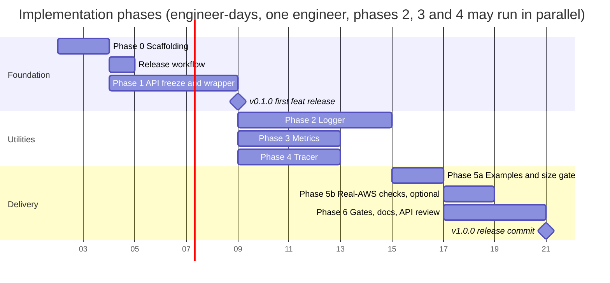
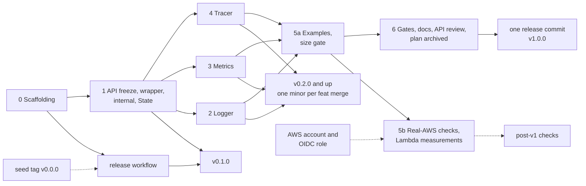

# 07. Roadmap

Estimates are engineer-days for one engineer who knows Go and Lambda, excluding review
turnaround. Phases are sequential, except Phases 2, 3 and 4, which run in parallel after
Phase 1; tasks inside a phase can be parallelised where marked (∥).



The start date is a placeholder for the chart; durations and dependencies are the plan.
Phases 3 and 4 finish before Phase 2 when run in parallel, so Phase 5a waits on Phase 2.
Phase 5b needs an AWS account and runs alongside Phase 6 or after it; the v1.0.0 commit
does not wait for it (decision 41). The release workflow lands right after Phase 0, so
every phase after it releases a v0 version when it merges ([Releases](#releases)).

## Releases

Releases come from conventional commits (06 §6.1, decisions 27 and 34): a seed tag
`v0.0.0` on `main`, then semantic-release on every push to `main`.

| Commit type | Release |
| --- | --- |
| `feat` | minor: v0.1.0, v0.2.0, and so on |
| `fix`, `perf`, `refactor`, `revert` | patch: v0.1.1 |
| `BREAKING CHANGE` footer | major: used once, at the end of Phase 6, to cut v1.0.0 |
| `chore`, `ci`, `docs`, `test`, `build`, `style` | no release |

What each phase therefore releases:

| Phase | Typical commit types | Release effect |
| --- | --- | --- |
| 0 Scaffolding, release workflow | `chore`, `ci`, `build`, `docs` | none (the seed tag is created by hand once, before the workflow's first run) |
| 1 API freeze and wrapper | `feat` | v0.1.0, the API-freeze version that later `apidiff` runs compare against |
| 2, 3, 4 utilities | `feat`, `fix` | one minor per `feat` merge, in merge order |
| 5a examples | `chore(examples)`, `test(examples)`, `ci`; `feat` or `fix` only for library changes | none, unless the library changed |
| 6 gates, docs, API review | `ci`, `docs`, `test`; `feat` or `fix` for API review changes | a last v0 minor or patch, API-identical to v1.0.0; then the release commit cuts v1.0.0 |

## Phase 0: Scaffolding (2 days)

- [ ] Copy the decision log (09) to `docs/DECISIONS.md` once; from then on new decisions
      go there.
- [ ] One `go.mod` (`go 1.27.0` plus a `toolchain go1.27.N` line) for the library and an
      untagged `examples/go.mod` with a `replace` to the parent; the `deps` CI job enforcing
      the import rules (06 §4).
- [ ] Repository layout from 01 §2 with a `doc.go` (package comment) in every planned
      package, so `go build`, `go vet` and `go test` succeed in both modules on day one.
      Add `examples/bare`, a minimal `aws-lambda-go` main with no Powertools import: the
      size baseline (05 §6). It is the only example in Phase 0.
- [ ] `LICENSE`, `README.md` skeleton, `CONTRIBUTING.md`, `.github/workflows/`, `Makefile`
      (`build`, `test`, `test-coverage`, `lint`, `vulncheck`, `go-fix`, `align`,
      `deps-check`, `licenses-check`, `bench`, `bench-compare`, `profile`,
      `build-examples`, `checks`). No `CHANGELOG.md` and no `release` target: releases
      come from commits.
- [ ] Lint configuration (06 §4), the non-Go lint of 06 §4.1 and the doc-coverage rule.
- [ ] `betteralign` pinned in the Makefile (`align` target: apply twice, build, test) and
      wired into the `lint` job in report mode; `.gitattributes` forcing LF.
- [ ] Coverage gate blocking from the start (it passes with 0 of 0 statements).
- [ ] Release workflow (06 §6): seed tag `v0.0.0`, semantic-release on push to `main`,
      the breaking-change guard. It merges before the first `feat` of Phase 1.

Acceptance: empty packages compile, CI green on an empty test suite.

## Phase 1: API freeze and wrapper (5 days)

Phase 1 is the **API-freeze point**: it writes the final exported signatures of `logger`,
`metrics` and `tracer` that the wrapper uses, as documented no-op stubs, and implements
the wrapper in full against them. After it, Phases 2, 3 and 4 fill in only their own
package bodies (Lessons, below).

- [ ] `internal/lambdaenv`: typed getters read when called (constructors cache the result;
      no init-time snapshot, so tests can `t.Setenv` before constructing), truthy parsing
      (`true/1/yes` style used upstream), precedence helper, `InLambda`, SAM detection,
      `ParseTraceHeader` (zero-alloc; agrees with the SDK on `Root`, `Parent` and
      `Sampled`), function metadata, cold-start rule for `AWS_LAMBDA_INITIALIZATION_TYPE`.
      ∥
- [ ] `internal/bufpool`, `internal/syncwriter` (with the one shared stdout writer used
      when a utility's `Writer` is nil). ∥
- [ ] `internal/jsonenc`: string quoting through `jsontext`, numbers, `slog.Value` of all
      kinds, groups, `any` via `encoding/json/v2`, `jsontext.Value` passthrough. Unit tests
      against `encoding/json/v2` output for equivalence. ∥
- [ ] `internal/jsonpath`: dot path with quoted segments over raw bytes; tests with the
      nine built-in paths. ∥
- [ ] `internal/testsupport`: test helpers, including the one helper that sets the trace
      header key (the single SA1029 suppression). ∥
- [ ] `internal/invocation.State`, complete (the utility phases fill it, they do not
      reshape it), `NewContext`, `FromContext`, key helpers with locking.
- [ ] Final exported signatures of the three utilities as documented no-op stubs, and the
      X-Ray SDK in `go.mod` (the tracer API returns `*xray.Segment`). Every stub package
      gets a small test so the coverage thresholds stay meaningful.
- [ ] Root package: `Options`, `Wrap[In, Out]`, `WrapHandler` (raw payload and response
      bytes; not for `lambda.NewHandler(fn)`, decision 29), shared `begin`/`end`, cold
      start, panic policy, handler name derivation, `ColdStart(ctx)`, `RequestID(ctx)`,
      `FunctionARN(ctx)`, opt-in `PprofLabels`.
- [ ] Deadline handling (01 §7): `RemainingTime`, `Deadline`, `State.Closed`, opt-in
      `DeadlineMargin` (timer in an unexported struct local to `begin`/`end`); `synctest`
      tests for the arm, stop and `Closed` mechanics. Flush-content tests move to the
      utility phases.
- [ ] Leak test after 1000 wrapped invocations (06 §1, three checks).
- [ ] Lifecycle tests with simulated runtime context; `-race` tests for concurrent first
      invocations.

Acceptance: `go doc` shows every exported signature of the three utilities with its doc
comment; a handler wrapped with all three utilities nil runs with zero behavioural change;
`go test -race ./...` green; `deps` passes with the SDK in `go.mod`; `betteralign ./...`
reports nothing; `begin`/`end` allocation count recorded as baseline.

## Phase 2: Logger (6 days)

- [ ] Six ALC levels (`LevelTrace`, `LevelFatal`) plus the `LevelSilent` threshold, `ParseLevel` with aliases, `LevelName`, package functions `Trace…Fatal(ctx, …)` and `Log` (they build the record themselves so `location` names the caller), ALC precedence and one-time warning.
- [ ] `Handler` on slog's `commonHandler` structure: `Enabled`, `Handle`, `WithAttrs`, `WithGroup`, `ReplaceAttr` (record and `With` attrs only), `AddSource`.
- [ ] Invocation keys API, correlation ID API, `FromContext` (falls back to `slog.Default()`).
- [ ] Error rendering (§7), `KindAny` with the `!ERROR:<err>` fallback, reserved-key handling, dev mode pretty print.
- [ ] Sampling per invocation (requires the wrapper); `LevelSilent` wins over sampling.
- [ ] Buffering (§9) including flush-on-error and flush-on-uncaught-error bodies behind the calls Phase 1 wired.
- [ ] Event logging and correlation-ID extraction bodies; tests in `wrap_logger_test.go`.
- [ ] `slogtest` conformance, golden tests, concurrency tests, `AllocsPerRun`, benchmarks vs `slog.JSONHandler`.
- [ ] Package docs and examples; the 90 % coverage override for `logger`.

Acceptance: `slogtest.Run` passes; golden output matches the TypeScript examples in the
docs for the same inputs (modulo values); logger benchmarks within the ratios in 05 §3.

## Phase 3: Metrics (4 days)

- [ ] `Unit`, validation tables, sentinel errors (the storage resolution is chosen by the method, `Add` or `AddHighResolution`, and needs no exported type, decision 43).
- [ ] `Metrics`, `New` validation, dev/disabled rules, `Options.RaiseOnEmptyMetrics`.
- [ ] `Batch`: add, dimensions, dimension sets, metadata, timestamp, auto-flush, `Flush`, `FlushSnapshot`, `ErrBatchFlushed` after close (no pooling, 01 §7 D4).
- [ ] Serializer with a pooled `jsontext.Encoder` and a merge step before encoding (11 §3 A).
- [ ] `Single` builder; `(*Metrics).EmitColdStart` body; tests in `wrap_metrics_test.go`.
- [ ] Golden and schema tests, limit tests, concurrency test, `AllocsPerRun`, benchmarks.
- [ ] Package docs and examples; the 90 % coverage override for `metrics`.

Acceptance: every golden blob validates against the EMF schema; CloudWatch extracts
metrics from a deployed example (checked in Phase 5b).

## Phase 4: Tracer (4 days)

- [ ] Enable rules, `Options`, `Tracer`, cached activity check against the invocation state.
- [ ] `Start` over `xray.BeginSubsegment` with the never-trigger-context-missing guards; name sanitisation; the late-`Start` guard.
- [ ] `Capture`, `CaptureResult[T]` over `xray.Capture`; `AddResponseMetadata` / `AddErrorMetadata` under a per-invocation metadata budget; `jsontext.Value` checked with `IsValid` before it reaches the SDK, whose v1 marshal re-validates, compacts and HTML-escapes it.
- [ ] Nil-safe helpers `AddAnnotation`, `AddMetadata`, `InstrumentAWS` (because `*xray.Segment` methods are not nil-safe); `FromContext`, `TraceID`, `Header` (always-forward rule), `HTTPClient` honouring `POWERTOOLS_TRACER_CAPTURE_HTTPS_REQUESTS`.
- [ ] `NewXRayLogger` adapter for `xray.SetLogger`; the library never calls the setter.
- [ ] Body of the end-of-handler helper that Phase 1 already calls (annotations, response/error metadata, panic, the open-subsegment warning, 04 §5.1); tests in `wrap_tracer_test.go`.
- [ ] Tests through a per-test UDP listener (06 §1); concurrency tests; `AllocsPerRun` relative to the SDK baseline.
- [ ] Package docs: SDK behaviours consumers must know (global config, init panic on a malformed daemon address, `/tmp/.aws-xray/initialized`, segment methods not nil-safe), and how to use `xray.Client`, `xray.SQLContext` directly.

Acceptance: recorded segments carry `## main.handle`, `ColdStart`, `Service`, the
metadata keys and `fault`/`cause` on error; a deployed example shows the same in the
X-Ray console with nested `aws` and `remote` subsegments (Phase 5b).

## Phase 5: Integrations and examples (4 days)

PR 5a, examples and the size gate (2 days):

- [ ] `examples/`: `hello` (logger and metrics without the wrapper, so it never links the
      X-Ray SDK), `full` (all three + DynamoDB + HTTP, wiring `tracer.InstrumentAWS` and
      `tracer.HTTPClient`), `benchmark` (two binaries, plain and wrapped, sharing the same
      work, so the init comparison includes linking and package init). Each has a SAM
      template that deploys the prebuilt
      `GOOS=linux GOARCH=arm64 CGO_ENABLED=0 go build -tags lambda.norpc -trimpath -ldflags='-s -w'`
      binary, so the deployed binary is the measured one.
- [ ] A stub-client test in `examples` proves the `aws` subsegment and header injection
      end to end.
- [ ] The blocking `size` job (06 §5.1).
- [ ] The nightly workflow with the Go tip job active and the `integration` and `measure`
      jobs present but skipped until the AWS variables exist; the integration harness as
      Go tests behind `//go:build integration`, proven to skip on every pull request.

PR 5b, real-AWS checks (2 days, optional for the release): set the repository variables
for an AWS role and region, run the nightly `integration` job green, run `measure` at
128 MB and 1024 MB and record the results in `docs/PERFORMANCE.md` (05 §5). No new code.

Acceptance: 5a merges on its own once the examples build and the size gate is green; 5b:
integration job green against a sandbox account, measured overhead within the targets.

## Phase 6: Gates, docs, API review, release (4 days)

- [ ] Lock the allocation budgets as tests against the measured values; the non-race step stays required.
- [ ] `bench` becomes blocking (06 §5.1): interleaved A/B, allocation metrics as the hard gate.
- [ ] Profile the three main benchmarks; fix any hot spot above budget.
- [ ] Walk `10-go-127-checklist.md`: every "adopted" row is implemented, `go fix -diff` is empty.
- [ ] Run `make align` over the final hot structs listed in 05 §4, review the diff
      (field order is now a performance decision, so the commit message records the
      bytes saved per struct), confirm `-race` tests and benchmarks still pass.
- [ ] `docs/` pages per utility, `COMPATIBILITY.md`, `README.md` final.
- [ ] API review against 08 §3, with `apidiff` against the Phase 1 freeze tag; rename or
      remove anything that fails, as `feat` or `fix` commits during v0 (08 §4).
- [ ] Move `.plan/` to `docs/design/` and 09 to `docs/DECISIONS.md` so the repository never carries a plan that disagrees with the code (11 §3 C).
- [ ] Last: one commit with a `BREAKING CHANGE` footer, merged with a merge commit; the
      release workflow cuts **v1.0.0** (06 §6.1).

Acceptance: all CI gates blocking; `pkg.go.dev` (or `go doc -ex`) shows docs with
examples for every package; the `v1.0.0` tag and its release notes exist.

Total: about 29 engineer-days, plus about one day for the release workflow, which runs
alongside Phase 1 and stays off the critical path.

> [!NOTE]
> A reference implementation re-estimated this plan after a pre-implementation review of
> the SDKs: Phase 0 grew by about one day (repository tooling) and Phase 1 by about two
> (the API freeze and the complete wrapper), Phases 2 and 4 traded a day, for about 32
> engineer-days in total and a critical path of about 21 days with three engineers on
> Phases 2, 3 and 4. That is a re-estimate, not a measurement; the chart above keeps the
> first-draft numbers.

## Dependencies between phases

Phase 1 is a prerequisite for 2, 3 and 4. It freezes the exported API of the three
utilities and implements `begin`/`end` in full against it, so Phases 2, 3 and 4 fill in
only their own package bodies and add wrapper tests in their own files. The only files
they share are `go.mod` and `go.sum`, so they can be developed and merged in parallel by
different engineers. Phase 5a needs 2, 3 and 4; Phase 5b also needs an AWS account. Phase
6 needs 5a; its v1.0.0 commit does not wait for 5b.



## Example: the intended end-to-end `main.go`

An example of the intended API, as Phase 6 should leave it: utilities built once in
`main`, configuration from the `POWERTOOLS_*` environment where options are left empty,
one wrapped typed handler.

```go
package main

import (
	"context"
	"log/slog"
	"os"
	"time"

	"github.com/aws/aws-lambda-go/lambda"
	"github.com/aws/aws-xray-sdk-go/v2/xray"

	powertools "github.com/<owner>/powertools-lambda-go"
	"github.com/<owner>/powertools-lambda-go/logger"
	"github.com/<owner>/powertools-lambda-go/metrics"
	"github.com/<owner>/powertools-lambda-go/tracer"
)

type Order struct {
	ID    string  `json:"id"`
	Total float64 `json:"total"`
}

type Receipt struct {
	OrderID string `json:"orderId"`
}

func handle(ctx context.Context, in Order) (Receipt, error) {
	logger.Info(ctx, "processing order", slog.String("order_id", in.ID))

	// Nil-safe without the wrapper: a nil *Batch is a no-op.
	if err := metrics.FromContext(ctx).Add("Orders", metrics.Count, 1); err != nil {
		return Receipt{}, err
	}

	// A subsegment around the downstream call; runs untraced when not sampled.
	err := tracer.Capture(ctx, "charge", func(ctx context.Context) error {
		return charge(ctx, in)
	})
	if err != nil {
		return Receipt{}, err
	}

	return Receipt{OrderID: in.ID}, nil
}

// charge stands for a downstream call that honours ctx.
func charge(ctx context.Context, _ Order) error { return ctx.Err() }

func main() {
	lg := logger.New(logger.Options{}) // service and level from the environment

	// Route the SDK's own messages through the logger. Process-wide and not
	// goroutine-safe, so it runs here, before lambda.Start; the library never calls it.
	xray.SetLogger(tracer.NewXRayLogger(lg))

	met, err := metrics.New(metrics.Options{}) // namespace from POWERTOOLS_METRICS_NAMESPACE
	if err != nil {
		lg.Error("metrics configuration", slog.Any("error", err))
		os.Exit(1)
	}

	lambda.Start(powertools.Wrap(handle, powertools.Options{
		Logger:                 lg,
		Metrics:                met,
		Tracer:                 tracer.New(tracer.Options{}),
		LogEvent:               new(false), // wins over POWERTOOLS_LOGGER_LOG_EVENT
		CorrelationIDPath:      logger.CorrelationPathAPIGatewayREST,
		CaptureColdStartMetric: true,
		DeadlineMargin:         500 * time.Millisecond, // flush diagnostics before a timeout
	}))
}
```

## Lessons from a reference implementation

A reference implementation followed this roadmap to v1.0.0. What it confirmed or
changed, stated as rules for the next one:

1. **Freeze the exported API first, as documented stubs.** Phase 1 writes every exported
   signature the wrapper calls (for example `(*metrics.Metrics).NewBatch`,
   `(*Batch).Flush`, `(*Batch).FlushSnapshot`, `(*metrics.Metrics).EmitColdStart`,
   `logger.FlushBuffer`, `(*tracer.Tracer).Start` and the end-of-handler helper) with
   complete doc comments and no-op bodies, adds the X-Ray SDK to `go.mod`, writes the
   complete `State`, and implements `begin`/`end` in full. The utility phases then touch
   only their package and one `wrap_<utility>_test.go` file each, so they merge in any
   order without conflicts. A doc check greps for the stub sentence ("implemented in
   Phase N") so none survives, and `apidiff` against the freeze tag shows exactly what
   changed afterwards: only the API review's own changes and their consequences.
2. **Review the plan against the real SDKs before Phase 0.** Reading the SDK sources
   turned up facts the plan had wrong: `*xray.Segment` methods are not nil-safe,
   `lambda.NewHandler(fn)` returns bytes from a pooled buffer (so `WrapHandler` cannot
   accept it), the SDK streams by subsegment count rather than by size, and its v1
   marshal re-escapes an embedded `jsontext.Value`. Each became a decision (09, decisions
   29 to 33). Budget time for this review; it is cheaper than discovering them in Phase 4.
3. **Stacked pull requests merge bottom-up.** When parallel phases are stacked (each
   branch on the previous one), merge the bottom one into `main` first, retarget the next
   to `main`, and repeat. Merging an upper pull request first merges it into its base
   branch, not `main`: nothing releases, and several phases later land as one release
   with the bottom pull request. A stacked pull request's checks also run against its
   base branch, so the A/B bench gate compares against that branch, not `main`.
4. **Choose commit types for their release effect.** Library code is `feat` or `fix`;
   example-only changes are `chore(examples)` or `test(examples)`, because the release
   rules have no scope filter; tooling, docs and tests release nothing. During v0 an API
   change is `feat` or `fix`, never a breaking-change marker, and nothing in a commit body
   starts a line with the breaking-change phrase (06 §6.2).
5. **v0 per phase, one breaking-change commit for v1.0.0.** Every phase ships a v0
   version that consumers can pin and try. The API review's changes ship during v0, so
   the last v0 release is API-identical to v1.0.0, and the release commit only declares
   stability.
6. **Real-AWS checks are optional and gated on repository variables.** The integration
   and measurement jobs are merged present and skipped until variables name an AWS role
   and region, and the harness proves on every pull request that it skips cleanly. The
   release does not wait for them: the CloudWatch and X-Ray acceptances become post-v1
   checks, and a failure there is a v1 `fix` (decisions 41 and 45).
7. **Introduce gates report-only, then block** (06 §5.2): coverage from day one (it
   passes on an empty tree), `size` when the examples exist, `bench` once the budgets
   are locked, Go tip never.

## Risks

| Risk | Impact | Mitigation |
| --- | --- | --- |
| X-Ray SDK global state: `xray.Configure` and `xray.SetLogger` are process-wide and the latter is not goroutine-safe; SDK package init panics on a malformed `AWS_XRAY_DAEMON_ADDRESS`; `*xray.Segment` methods are not nil-safe | surprising failures in tests, at cold start, or on unsampled invocations | the library never calls the global setters (examples call `xray.SetLogger` in `main`); per-test UDP listener with `xray.ContextWithConfig`; `SetLogger` tests never run in parallel with SDK-driving tests; nil-safe tracer helpers and nil checks in `end()`; documented in package docs |
| Single module: the X-Ray SDK and its tree are in every consumer's module graph, even logger-only users | Dependabot and `go.sum` noise for users who never link the SDK | `deps` job guarantees only `tracer` imports it and that `logger`, `metrics` and `internal/...` never reach it, so binaries are unaffected; `govulncheck` reports reachable vulnerabilities only; documented in the README; splitting `tracer` into its own module remains possible at a major version (decision 25) |
| Parallel Phases 2, 3 and 4 conflict in the wrapper or `State` | merge conflicts, rework | Phase 1 freezes the API and implements `begin`/`end` in full; each phase touches only its package and its own `wrap_*_test.go` file |
| Stacked pull requests merged top-down | phases never reach `main` on their own; several land as one release | merge bottom-up, retarget the next pull request to `main` after each merge (Lessons 3) |
| Multi-concurrency semantics change in `aws-lambda-go` | trace header source breaks | the header comes only from `ctx.Value("x-amzn-trace-id")` and is parsed in `internal/lambdaenv` (decision 30); integration test under Managed Instances when available |
| `WrapHandler(lambda.NewHandler(fn))` under `MaxConcurrency` above 1 | data race on pooled response bytes | `WrapHandler` is documented for hand-written handlers that own their bytes; other shapes use `Wrap` with a one-line closure adapter (decision 29) |
| `encoding/json/v2` API churn after 1.27 | compile breaks on tip | the package is GA in Go 1.27 and covered by the standard library compatibility promise; all use goes through `internal/jsonenc`, so an adjustment is one package wide (decision 23); tip runs in a nightly, non-required job |
| Budgets too aggressive for CI noise | flaky `bench` job | A/B in one job on one runner, interleaved, `-cpu 1`; `allocs/op` and `B/op`, which are deterministic, are the hard gate; `ns/op` fails only above 25 % at p < 0.05; allocation tests run without `-race` |
| A breaking-change marker during v0, including a body line that only explains the rule | semantic-release cuts v1.0.0 before the API review; a bang header instead drops the commit from versioning silently | the breaking-change guard on every pull request and before every release (06 §6.2); recovery by reverting the commit that carries the marker |
| A breaking-change commit after v1.0.0 | v2.0.0 tagged on a module path without `/v2`, unusable by Go consumers | the guard accepts a note after v1.0.0 only from a commit whose `go.mod` declares the next `/vN` path |
| No AWS account for the real-AWS checks | Phase 5b waits | the jobs skip until the variables exist; v1.0.0 does not wait for 5b (decision 41) |
| Scope creep toward other Powertools utilities | schedule | non-goals in README; new utilities are new plans |
