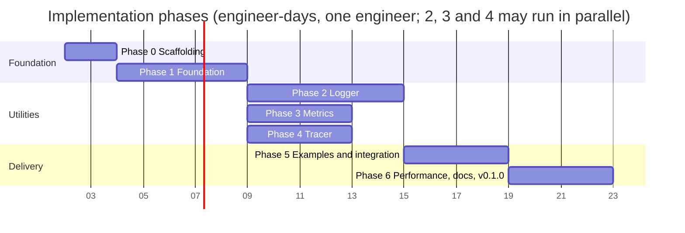
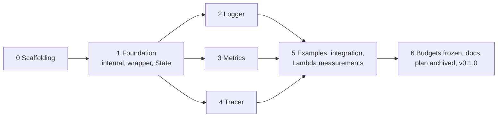

# 07. Roadmap

Estimates are engineer-days for one engineer who knows Go and Lambda, excluding review
turnaround. Phases are sequential; tasks inside a phase can be parallelised where marked
(∥).

The start date is a placeholder for the chart; durations and dependencies are the plan.
Phases 3 and 4 finish before Phase 2 when run in parallel, so Phase 5 waits on Phase 2.

## Phase 0: Scaffolding (2 days)

- [ ] Copy the decision log (09) to `docs/DECISIONS.md`; all 23 decisions are taken.
- [ ] Six `go.mod` files with `go 1.27.0` (root, `internal`, `logger`, `metrics`, `tracer`, `examples`) and a `go.work`; the `deps` CI job enforcing that `internal` requires no utility and that `logger`/`metrics` never require the X-Ray SDK.
- [ ] Repository layout from 01 §2; `LICENSE`, `README.md` skeleton, `CONTRIBUTING.md`,
      `CHANGELOG.md`, `.github/workflows/{test,lint,bench,size}.yml`, `Makefile`
      (`test`, `lint`, `bench`, `profile`, `build-examples`).
- [ ] Lint configuration (06 §4) and the doc-coverage rule.
- [ ] `betteralign` pinned in the Makefile (`align` target: apply twice, build, test) and
      wired into the `lint` job in report mode; `.gitattributes` forcing LF.
- [ ] Decision log: copy 09 answers into `docs/DECISIONS.md`.

Acceptance: empty packages compile, CI green on an empty test suite.

## Phase 1: Foundation (5 days)

- [ ] `internal/env`: typed getters, truthy parsing (`true/1/yes` style used upstream), precedence helper. ∥
- [ ] `internal/lambdaenv`: `InLambda`, SAM detection, `ParseTraceHeader` (zero-alloc), function metadata snapshot, cold-start rule for `AWS_LAMBDA_INITIALIZATION_TYPE`. ∥
- [ ] `internal/bufpool`, `internal/syncwriter`. ∥
- [ ] `internal/jsonenc`: string quoting (jsontext or internal), numbers, `slog.Value` of all kinds, groups, `any` via `encoding/json/v2`, `jsontext.Value` passthrough. Unit tests against `encoding/json/v2` output for equivalence. ∥
- [ ] `internal/jsonpath`: dot path with quoted segments over raw bytes; tests with the nine built-in paths.
- [ ] `internal/invocation.State`, `NewContext`, `FromContext`, key helpers with locking.
- [ ] Root package: `Options`, `Wrap[In, Out]`, `WrapHandler`, shared `begin`/`end`, cold start, panic policy, handler name derivation, `ColdStart(ctx)`, `RequestID(ctx)`, `FunctionARN(ctx)`, opt-in `PprofLabels` (pprof labels visible in Go 1.27 tracebacks).
- [ ] Goroutine-leak test with the `goroutineleak` profile after 1000 wrapped invocations.
- [ ] Deadline handling (01 §7): `RemainingTime`, `Deadline`, `State.Closed`, `State.OpenSegments`, opt-in `DeadlineMargin` pre-timeout flush; `synctest` tests for the margin, for `end()` under `ctx.Err()`, and for late goroutines across two invocations.
- [ ] Lifecycle tests with simulated runtime context; `-race` tests for concurrent first invocations.

Acceptance: a handler wrapped with all three utilities nil runs with zero behavioural
change; `go test -race ./...` green; `betteralign ./...` reports nothing; `begin`/`end`
allocation count recorded as baseline.

## Phase 2: Logger (6 days)

- [ ] Six ALC levels (`LevelTrace`, `LevelFatal`) plus the `LevelSilent` threshold, `ParseLevel` with aliases, `LevelName`, package functions `Trace…Fatal(ctx, …)` and `Log`, ALC precedence and one-time warning.
- [ ] `Handler`: `Enabled`, `Handle`, `WithAttrs`, `WithGroup`, `ReplaceAttr`, `AddSource`.
- [ ] Invocation keys API, correlation ID API, `FromContext`.
- [ ] Error rendering (§7), reserved-key handling, dev mode pretty print.
- [ ] Sampling (per invocation, `RefreshSampleRate`).
- [ ] Buffering (§9) including flush-on-error and flush-on-uncaught-error wiring in the wrapper.
- [ ] Event logging and correlation-ID extraction wiring in the wrapper.
- [ ] `slogtest` conformance, golden tests, concurrency tests, `AllocsPerRun`, benchmarks vs `slog.JSONHandler`.
- [ ] Package docs and examples.

Acceptance: `slogtest.Run` passes; golden output matches the TypeScript examples in the
docs for the same inputs (modulo values); logger benchmarks within the ratios in 05 §3.

## Phase 3: Metrics (4 days)

- [ ] `Unit`, `Resolution`, validation tables, sentinel errors.
- [ ] `Metrics`, `New` validation, dev/disabled rules.
- [ ] `Batch`: add, dimensions, dimension sets, metadata, timestamp, auto-flush, `Flush`, `FlushSnapshot`, `ErrBatchFlushed` after close (no pooling, 01 §7 D4).
- [ ] Serializer with `internal/jsonenc`.
- [ ] `Single` builder; cold-start metric in the wrapper.
- [ ] Golden and schema tests, limit tests, concurrency test, `AllocsPerRun`, benchmarks.
- [ ] Package docs and examples.

Acceptance: every golden blob validates against the EMF schema; CloudWatch extracts
metrics from a deployed example (checked in Phase 5).

## Phase 4: Tracer (4 days)

- [ ] Enable rules, `Options`, `Tracer`, cached activity check against the invocation state.
- [ ] `Start` over `xray.BeginSubsegment` with the never-trigger-context-missing guards; name sanitisation.
- [ ] `Capture`, `CaptureResult[T]` over `xray.Capture`; `AddResponseMetadata` / `AddErrorMetadata` with the size guard and `jsontext.Value` embedding (verify the SDK embeds it verbatim; `json.RawMessage` is the fallback).
- [ ] `FromContext`, `TraceID`, `Header` (always-forward rule), `HTTPClient` honouring `POWERTOOLS_TRACER_CAPTURE_HTTPS_REQUESTS`.
- [ ] `NewXRayLogger` adapter for `xray.SetLogger`.
- [ ] Handler segment lifecycle in the wrapper (annotations, response/error metadata, panic); `OpenSegments` counting and the late-`Start` guard (04 §5.1).
- [ ] Recording-emitter tests through `xray.ContextWithConfig`; one UDP end-to-end test in its own test binary; concurrency tests; `AllocsPerRun` relative to the SDK baseline.
- [ ] Package docs: SDK behaviours consumers must know (global config, init panic on a malformed daemon address, `/tmp/.aws-xray/initialized`), and how to use `xray.Client`, `awsv2.AWSV2Instrumentor`, `xray.SQLContext` directly.

Acceptance: recorded segments carry `## main.handle`, `ColdStart`, `Service`, the
metadata keys and `fault`/`cause` on error; a deployed example shows the same in the
X-Ray console with nested `aws` and `remote` subsegments (Phase 5).

## Phase 5: Integrations and examples (4 days)

- [ ] Examples wire `awsv2.AWSV2Instrumentor(&cfg.APIOptions)` and `tracer.HTTPClient`; a stub-client test in `examples` proves the `aws` subsegment and header injection end to end.
- [ ] `examples/`: `hello` (logger only), `full` (all three + DynamoDB + HTTP), `benchmark`
      (load test target), each with a SAM template and `Makefile` targets
      (`GOOS=linux GOARCH=arm64 CGO_ENABLED=0 go build -tags lambda.norpc -trimpath -o bootstrap`).
- [ ] Nightly integration workflow: deploy, invoke, assert logs (`aws logs filter-log-events`),
      metrics (`aws cloudwatch get-metric-data`), traces (`aws xray get-trace-summaries`), delete.
- [ ] Lambda-level performance measurement (05 §5) at 128 MB and 1024 MB; record results in `docs/PERFORMANCE.md`.

Acceptance: integration workflow green against a sandbox account; measured overhead
within the targets.

## Phase 6: Performance pass, docs, release (4 days)

- [ ] Freeze allocation budgets as tests; commit the `benchstat` baseline; enable the regression gate.
- [ ] Profile the three main benchmarks; fix any hot spot above budget.
- [ ] Walk `.plan/10-go-127-checklist.md`: every "adopted" row is implemented, `go fix -diff` is empty.
- [ ] Run `make align` over the final hot structs listed in 05 §4, review the diff
      (field order is now a performance decision, so the commit message records the
      bytes saved per struct), confirm `-race` tests and benchmarks still pass.
- [ ] `docs/` pages per utility, `COMPATIBILITY.md`, `README.md` final.
- [ ] API review against 08 §3; rename or remove anything that fails.
- [ ] Move `.plan/` to `docs/design/` and 09 to `docs/DECISIONS.md` so the repository never carries a plan that disagrees with the code (11 §3 C).
- [ ] Tag `v0.1.0`; announce; collect feedback for `v1.0.0`.

Acceptance: all CI gates on; `pkg.go.dev` renders docs with examples; `CHANGELOG.md`
has the `v0.1.0` entry.

Total: about 29 engineer-days.

## Dependencies between phases

Phase 1 is a prerequisite for 2, 3 and 4. Phases 2, 3 and 4 can be developed in parallel
by different engineers after Phase 1, since they only share `internal/*`; the wrapper calls each utility's exported lifecycle
methods (01 §4.3), which are stubbed as no-ops in Phase 1 and filled in per phase.
Phase 5 needs 2, 3, 4. Phase 6 needs 5.

## Risks

| Risk | Impact | Mitigation |
| --- | --- | --- |
| X-Ray SDK global state: `xray.Configure` and `xray.SetLogger` are process-wide and the latter is not goroutine-safe; SDK package init panics on a malformed `AWS_XRAY_DAEMON_ADDRESS` | surprising failures in tests or at cold start | the wrapper never calls the global setters; per-context config in tests; documented in package docs; the UDP end-to-end test runs in its own binary |
| Version skew between `internal` and a utility module when consumers mix versions | compile errors or silent contract drift in `State` | lockstep tagging (decision 21); `State` fields only ever added, never renamed, within a major version |
| Multi-concurrency semantics change in `aws-lambda-go` | trace header source breaks | the header source is isolated in `internal/lambdaenv`; integration test under Managed Instances when available in the sandbox |
| `encoding/json/v2` API churn after 1.27 | compile breaks on tip | the package is GA in Go 1.27 and covered by the standard library compatibility promise; all use goes through `internal/jsonenc`, so an adjustment is one package wide (decision 23) |
| Budgets too aggressive for CI noise | flaky `bench` job | gate on `benchstat` significance, `-cpu 1`, re-run once, keep alloc budgets exact only for the 0-alloc paths |
| Scope creep toward other Powertools utilities | schedule | non-goals in README; new utilities are new plans |
