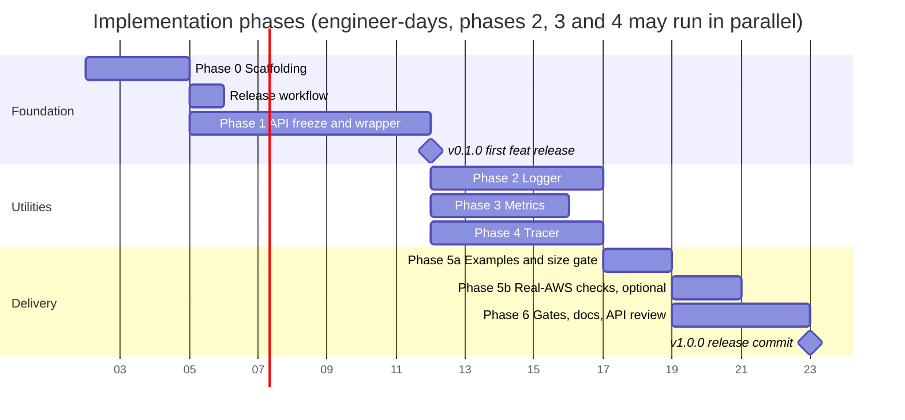
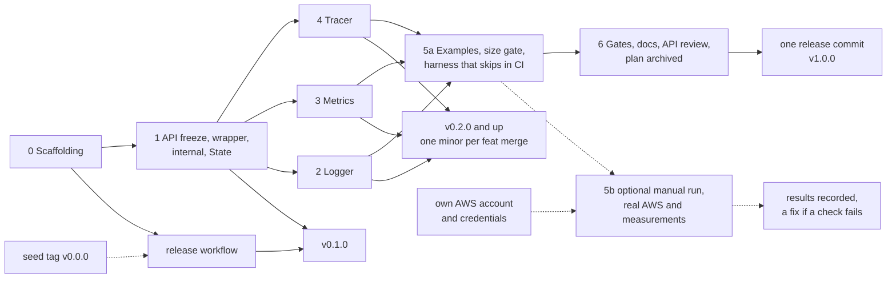

# 07. Roadmap

Estimates are engineer-days for one engineer who knows Go and Lambda, excluding review
turnaround. They are estimates, not commitments: the two phases most likely to grow are
Phase 0 (repository tooling) and Phase 1 (the API freeze and the complete wrapper), and
both are sized for that below. Phases are sequential, except Phases 2, 3 and 4, which run
in parallel after Phase 1; tasks inside a phase can be parallelised where marked (∥).



The start date is a placeholder for the chart; durations and dependencies are the plan.
Phase 3 finishes a day before Phases 2 and 4 when they run in parallel, so Phase 5a waits
on the last of them. Phase 5b is optional and manual: it needs someone with an AWS
account, runs alongside Phase 6 or at any time after it, and the v1.0.0 commit does not
wait for it (decision 41). The release workflow lands right after Phase 0, so every phase
after it releases a v0 version when it merges ([Releases](#releases)).

**Estimate.** About 30 engineer-days for Phases 0 to 6, plus about one day for the
release workflow, which runs alongside Phase 1 and stays off the critical path, and about
two days for the optional Phase 5b when someone runs it. With three engineers on Phases
2, 3 and 4 the critical path is about 21 days (3 + 7 + 5 + 2 + 4).

| Phase | Estimate (engineer-days) | On the critical path |
| --- | --- | --- |
| 0 Scaffolding | 3 | yes |
| Release workflow | 1 | no, alongside Phase 1 |
| 1 API freeze and wrapper | 7 | yes |
| 2 Logger | 5 | yes (parallel with 3 and 4) |
| 3 Metrics | 4 | no, one day of slack |
| 4 Tracer | 5 | yes (parallel with 2 and 3) |
| 5a Examples and size gate | 2 | yes |
| 5b Real-AWS checks (optional, manual) | 2 | no |
| 6 Gates, docs, API review, release | 4 | yes |

## Releases

Releases come from conventional commits (06 §6.1, decisions 27 and 34): a seed tag
`v0.0.0` on `main`, then semantic-release on every push to `main` that changes code.

| Commit type | Release |
| --- | --- |
| `feat` | minor: v0.1.0, v0.2.0, and so on |
| `fix`, `perf`, `refactor`, `revert` | patch: v0.1.1 |
| `BREAKING CHANGE` footer | major: used once, at the end of Phase 6, to cut v1.0.0 |
| `chore`, `ci`, `docs`, `test`, `build`, `style` | no release |

What each phase therefore releases:

| Phase | Typical commit types | Release effect |
| --- | --- | --- |
| 0 Scaffolding, release workflow | `chore`, `ci`, `build`, `docs` | none (the seed tag is created by hand once, before the workflow's first run) |
| 1 API freeze and wrapper | `feat` | v0.1.0, the API-freeze version that later `apidiff` runs compare against |
| 2, 3, 4 utilities | `feat`, `fix` | one minor per `feat` merge, in merge order |
| 5a examples | `chore(examples)`, `test(examples)`, `ci`; `feat` or `fix` only for library changes | none, unless the library changed |
| 5b real-AWS checks (optional) | `docs` for the recorded results; `fix` for a library defect found | none, or a patch for the fix |
| 6 gates, docs, API review | `ci`, `docs`, `test`; `feat` or `fix` for API review changes | a last v0 minor or patch, API-identical to v1.0.0; then the release commit cuts v1.0.0 |

## Phase 0: Scaffolding (3 days)

- [ ] Copy the decision log (09) to `docs/DECISIONS.md` once; from then on new decisions
      go there.
- [ ] One `go.mod` (`go 1.27.0` plus a `toolchain go1.27.N` line) for the library and an
      untagged `examples/go.mod` with a `replace` to the parent and the same `toolchain`
      line; the `deps` CI job enforcing the import rules (06 §4).
- [ ] Repository layout from 01 §2 with a `doc.go` (package comment) in every planned
      package, so `go build`, `go vet` and `go test` succeed in both modules on day one.
      Add `examples/bare`, a minimal `aws-lambda-go` main with no Powertools import: the
      size baseline (05 §6). It is the only example in Phase 0.
- [ ] `LICENSE`, `README.md` skeleton, `CONTRIBUTING.md` (branch names, commit format,
      the release effect of each commit type), `.github/workflows/`, a commit-message hook,
      and a `Makefile` as the single interface for every check (decision 26): `build`,
      `test`, `test-coverage`, `lint`, `vulncheck`, `go-fix`, `align`, `deps-check`,
      `licenses-check`, `doc-check`, `bench`, `bench-compare`, `profile`,
      `build-examples`, `breaking-check`, `install-all-tools` (pinned versions) and
      `checks`. No `CHANGELOG.md` and no `release` target: releases come from commits.
- [ ] If the repository tags its test files (06 §1), set the tag once in the `Makefile`
      defaults and in golangci-lint's `run.build-tags`.
- [ ] Lint configuration (06 §4), the non-Go lint of 06 §4.1 and the doc-coverage rule.
- [ ] `betteralign` pinned in the Makefile (`align` target: apply twice, build, test) and
      wired into the `lint` job in report mode; `.gitattributes` forcing LF.
- [ ] The `changes` job of 06 §5.1, so docs-only pull requests skip the code jobs from
      the first pull request on (decision 45).
- [ ] Coverage gate blocking from the start (it passes with 0 of 0 statements).
- [ ] Release workflow (06 §6): seed tag `v0.0.0`, semantic-release on push to `main`
      (ignoring pushes that touch only Markdown and `docs/`), the breaking-change guard
      with its fixture self-tests. It merges before the first `feat` of Phase 1.

Acceptance: empty packages compile, CI green on an empty test suite, `make checks` gives
the same verdict on a laptop as in CI, a docs-only pull request shows the code jobs as
skipped and stays mergeable.

## Phase 1: API freeze and wrapper (7 days)

Phase 1 is the **API-freeze point**: it writes the final exported signatures of `logger`,
`metrics` and `tracer` that the wrapper uses, as documented no-op stubs, and implements
the wrapper in full against them. After it, Phases 2, 3 and 4 fill in only their own
package bodies ([Delivery guidance](#delivery-guidance), item 1).

- [ ] `internal/lambdaenv`: typed getters read when called (constructors cache the result;
      no init-time snapshot, so tests can `t.Setenv` before constructing), truthy parsing
      (`true/1/yes` style used upstream), precedence helper, `InLambda`, SAM detection,
      `ParseTraceHeader` (zero-alloc; agrees with the SDK on `Root`, `Parent` and
      `Sampled`), function metadata, cold-start rule for `AWS_LAMBDA_INITIALIZATION_TYPE`.
      ∥
- [ ] `internal/bufpool`, `internal/syncwriter` (with the one shared stdout writer used
      when a utility's `Writer` is nil). ∥
- [ ] `internal/jsonenc`: string quoting through `jsontext`, numbers, `slog.Value` of all
      kinds, groups, `any` via `encoding/json/v2`, `jsontext.Value` passthrough. Unit tests
      against `encoding/json/v2` output for equivalence. ∥
- [ ] `internal/jsonpath`: dot path with quoted segments over raw bytes; tests with the
      nine built-in paths. ∥
- [ ] `internal/testsupport`: test helpers, including the one helper that sets the trace
      header key (the single SA1029 suppression). ∥
- [ ] `internal/invocation.State`, complete (the utility phases fill it, they do not
      reshape it), `NewContext`, `FromContext`, key helpers with locking.
- [ ] Final exported signatures of the three utilities as documented no-op stubs, and the
      X-Ray SDK in `go.mod` (the tracer API returns `*xray.Segment`). Every stub package
      gets a small test so the coverage thresholds stay meaningful. Stub doc comments
      carry one fixed sentence (for example "Implemented in Phase N.") that `doc-check`
      greps for, so none survives to v1.0.0.
- [ ] Root package: `Options`, `Wrap[In, Out]`, `WrapHandler` (raw payload and response
      bytes; not for `lambda.NewHandler(fn)`, decision 29), shared `begin`/`end`, cold
      start, panic policy, handler name derivation, `ColdStart(ctx)`, `RequestID(ctx)`,
      `FunctionARN(ctx)`, opt-in `PprofLabels`. Every environment-backed option is a
      tri-state `*bool`, `LogEvent` included (decision 42).
- [ ] Deadline handling (01 §7): `RemainingTime`, `Deadline`, `State.Closed`, opt-in
      `DeadlineMargin` (timer in an unexported struct local to `begin`/`end`); `synctest`
      tests for the arm, stop and `Closed` mechanics. Flush-content tests move to the
      utility phases.
- [ ] Leak test after 1000 wrapped invocations (06 §1, three checks).
- [ ] Lifecycle tests with simulated runtime context; `-race` tests for concurrent first
      invocations.

Acceptance: `go doc` shows every exported signature of the three utilities with its doc
comment; a handler wrapped with all three utilities nil runs with zero behavioural change;
`go test -race ./...` green; `deps` passes with the SDK in `go.mod`; `betteralign ./...`
reports nothing; `begin`/`end` allocation count recorded as baseline; the merge releases
v0.1.0, the tag that `apidiff` compares against in Phase 6.

## Phase 2: Logger (5 days)

- [ ] Six ALC levels (`LevelTrace`, `LevelFatal`) plus the `LevelSilent` threshold, `ParseLevel` with aliases, `LevelName`, package functions `Trace…Fatal(ctx, …)` and `Log` (they build the record themselves so `location` names the caller), ALC precedence and one-time warning.
- [ ] `Handler` on slog's `commonHandler` structure: `Enabled`, `Handle`, `WithAttrs`, `WithGroup`, `ReplaceAttr` (record and `With` attrs only), `AddSource`.
- [ ] Invocation keys API, correlation ID API, `FromContext` (falls back to `slog.Default()`).
- [ ] Error rendering (§7), `KindAny` with the `!ERROR:<err>` fallback, reserved-key handling, dev mode pretty print.
- [ ] Sampling per invocation (requires the wrapper); `LevelSilent` wins over sampling.
- [ ] Buffering (§9) including flush-on-error and flush-on-uncaught-error bodies behind the calls Phase 1 wired.
- [ ] Event logging and correlation-ID extraction bodies; tests in `wrap_logger_test.go`.
- [ ] `slogtest` conformance, golden tests, concurrency tests, `AllocsPerRun`, benchmarks vs `slog.JSONHandler`.
- [ ] Package docs and examples; the 90 % coverage override for `logger`.

Acceptance: `slogtest.Run` passes; golden output matches the TypeScript examples in the
docs for the same inputs (modulo values); logger benchmarks within the ratios in 05 §3.

## Phase 3: Metrics (4 days)

- [ ] `Unit`, validation tables, sentinel errors (the storage resolution is chosen by the method, `Add` or `AddHighResolution`, and needs no exported type, decision 43).
- [ ] `Metrics`, `New` validation, dev/disabled rules, `Options.RaiseOnEmptyMetrics`.
- [ ] `Batch`: add, dimensions, dimension sets, metadata, timestamp, auto-flush, `Flush`, `FlushSnapshot`, `ErrBatchFlushed` after close (no pooling, 01 §7 D4).
- [ ] Serializer with a pooled `jsontext.Encoder` and a merge step before encoding (11 §3 A).
- [ ] `Single` builder; `(*Metrics).EmitColdStart` body; tests in `wrap_metrics_test.go`.
- [ ] Golden and schema tests, limit tests, concurrency test, `AllocsPerRun`, benchmarks.
- [ ] Package docs and examples; the 90 % coverage override for `metrics`.

Acceptance: every golden blob validates against the EMF schema. On real AWS, CloudWatch
extracts metrics from a deployed example; that check belongs to the optional Phase 5b.

## Phase 4: Tracer (5 days)

- [ ] Enable rules, `Options`, `Tracer`, cached activity check against the invocation state.
- [ ] `Start` over `xray.BeginSubsegment` with the never-trigger-context-missing guards; name sanitisation; the late-`Start` guard.
- [ ] `Capture`, `CaptureResult[T]` over `xray.Capture`; `AddResponseMetadata` / `AddErrorMetadata` under a per-invocation metadata budget; `jsontext.Value` checked with `IsValid` before it reaches the SDK, whose v1 marshal re-validates, compacts and HTML-escapes it.
- [ ] Nil-safe helpers `AddAnnotation`, `AddMetadata`, `InstrumentAWS` (because `*xray.Segment` methods are not nil-safe); `FromContext`, `TraceID`, `Header` (always-forward rule), `HTTPClient` honouring `POWERTOOLS_TRACER_CAPTURE_HTTPS_REQUESTS`.
- [ ] `NewXRayLogger` adapter for `xray.SetLogger`; the library never calls the setter.
- [ ] Body of the end-of-handler helper that Phase 1 already calls (annotations, response/error metadata, panic, the open-subsegment warning, 04 §5.1); tests in `wrap_tracer_test.go`.
- [ ] Tests through a per-test UDP listener (06 §1); concurrency tests; `AllocsPerRun` relative to the SDK baseline.
- [ ] Package docs: SDK behaviours consumers must know (global config, init panic on a malformed daemon address, `/tmp/.aws-xray/initialized`, segment methods not nil-safe), and how to use `xray.Client`, `xray.SQLContext` directly.

Acceptance: recorded segments carry `## main.handle`, `ColdStart`, `Service`, the
metadata keys and `fault`/`cause` on error. On real AWS, the X-Ray console shows the same
with nested `aws` and `remote` subsegments; that check belongs to the optional Phase 5b.

## Phase 5: Examples and the real-AWS harness (2 days, plus an optional manual step)

PR 5a, examples and the size gate (2 days):

- [ ] `examples/`: `hello` (logger and metrics without the wrapper, so it never links the
      X-Ray SDK), `full` (all three + DynamoDB + HTTP, wiring `tracer.InstrumentAWS` and
      `tracer.HTTPClient`), `benchmark` (two binaries, plain and wrapped, sharing the same
      work, so the init comparison includes linking and package init). Each has a SAM
      template that deploys the prebuilt
      `GOOS=linux GOARCH=arm64 CGO_ENABLED=0 go build -tags lambda.norpc -trimpath -ldflags='-s -w'`
      binary (no `sam build`), so the deployed binary is the one the size gate measures.
- [ ] A stub-client test in `examples` proves the `aws` subsegment and header injection
      end to end.
- [ ] The blocking `size` job (06 §5.1).
- [ ] The integration harness as Go tests behind `//go:build integration`, plus the
      `make` targets for the manual run and the Lambda-level measurement (06 §5.3); a
      pull-request step proves the harness skips without its variables.
- [ ] `examples/README.md`: how to deploy the stacks with your own AWS credentials, which
      stack outputs to export, how to run and clean up.

PR 5b, real-AWS checks (about 2 days, **optional and manual**): with your own AWS
credentials, deploy the example stacks, run the integration harness with the "required"
variable set, run the Lambda-level measurement at 128 MB and 1024 MB, record the results
in `docs/PERFORMANCE.md` (05 §5) and delete the stacks. No new library code; a defect
found here is a `fix`.

Acceptance: 5a merges on its own once the examples build, the size gate is green and the
harness skips cleanly in CI. 5b, whenever it runs: the harness is green against a real AWS
account, and the recorded overhead is within the targets of 05 §5.

## Phase 6: Gates, docs, API review, release (4 days)

- [ ] Lock the allocation budgets as tests at the values recorded on the CI runner; the non-race step stays required.
- [ ] `bench` becomes blocking (06 §5.2): interleaved A/B, allocation metrics as the hard gate.
- [ ] Profile the three main benchmarks; fix any hot spot above budget.
- [ ] Walk `10-go-127-checklist.md`: every "adopted" row is implemented, `go fix -diff` is empty.
- [ ] Run `make align` over the final hot structs listed in 05 §4, review the diff
      (field order is now a performance decision, so the commit message records the
      bytes saved per struct), confirm `-race` tests and benchmarks still pass.
- [ ] `docs/` pages per utility, `COMPATIBILITY.md`, `README.md` final.
- [ ] API review against 08 §3, with `apidiff` against the Phase 1 freeze tag; rename or
      remove anything that fails, as `feat` or `fix` commits during v0 (08 §4). Keep the
      answers, with evidence, in a review file next to the design.
- [ ] Move `.plan/` to `docs/design/` and 09 to `docs/DECISIONS.md` so the repository never carries a plan that disagrees with the code (11 §3 C).
- [ ] Last: one commit with a `BREAKING CHANGE` footer (06 §6.1 shows its form), merged
      with a merge commit; `make breaking-check` passes on it; the release workflow cuts
      **v1.0.0**.

Acceptance: all CI gates blocking; `pkg.go.dev` (or `go doc -ex`) shows docs with
examples for every package; the `v1.0.0` tag and its release notes exist.

## Dependencies between phases

Phase 1 is a prerequisite for 2, 3 and 4. It freezes the exported API of the three
utilities and implements `begin`/`end` in full against it, so Phases 2, 3 and 4 fill in
only their own package bodies and add wrapper tests in their own files. The only files
they share are `go.mod` and `go.sum`, so they can be developed and merged in parallel by
different engineers. Phase 5a needs 2, 3 and 4. Phase 6 needs 5a. Phase 5b needs 5a and an
AWS account, and nothing waits for it.



## Example: the intended end-to-end `main.go`

An example of the intended API, as Phase 6 should leave it: utilities built once in
`main`, configuration from the `POWERTOOLS_*` environment where options are left empty,
one wrapped typed handler.

```go
package main

import (
	"context"
	"log/slog"
	"os"
	"time"

	"github.com/aws/aws-lambda-go/lambda"
	"github.com/aws/aws-xray-sdk-go/v2/xray"

	powertools "github.com/<owner>/powertools-lambda-go"
	"github.com/<owner>/powertools-lambda-go/logger"
	"github.com/<owner>/powertools-lambda-go/metrics"
	"github.com/<owner>/powertools-lambda-go/tracer"
)

type Order struct {
	ID    string  `json:"id"`
	Total float64 `json:"total"`
}

type Receipt struct {
	OrderID string `json:"orderId"`
}

func handle(ctx context.Context, in Order) (Receipt, error) {
	logger.Info(ctx, "processing order", slog.String("order_id", in.ID))

	// Nil-safe without the wrapper: a nil *Batch is a no-op.
	if err := metrics.FromContext(ctx).Add("Orders", metrics.Count, 1); err != nil {
		return Receipt{}, err
	}

	// A subsegment around the downstream call; runs untraced when not sampled.
	err := tracer.Capture(ctx, "charge", func(ctx context.Context) error {
		return charge(ctx, in)
	})
	if err != nil {
		return Receipt{}, err
	}

	// Nil-safe as well: a no-op when the invocation is not traced.
	_ = tracer.AddAnnotation(ctx, "order_id", in.ID)

	return Receipt{OrderID: in.ID}, nil
}

// charge stands for a downstream call that honours ctx.
func charge(ctx context.Context, _ Order) error { return ctx.Err() }

func main() {
	lg := logger.New(logger.Options{}) // service and level from the environment

	// Route the SDK's own messages through the logger. Process-wide and not
	// goroutine-safe, so it runs here, before lambda.Start; the library never calls it.
	xray.SetLogger(tracer.NewXRayLogger(lg))

	met, err := metrics.New(metrics.Options{}) // namespace from POWERTOOLS_METRICS_NAMESPACE
	if err != nil {
		lg.Error("metrics configuration", slog.Any("error", err))
		os.Exit(1)
	}

	lambda.Start(powertools.Wrap(handle, powertools.Options{
		Logger:                 lg,
		Metrics:                met,
		Tracer:                 tracer.New(tracer.Options{}),
		LogEvent:               new(false), // wins over POWERTOOLS_LOGGER_LOG_EVENT
		CorrelationIDPath:      logger.CorrelationPathAPIGatewayREST,
		CaptureColdStartMetric: true,
		DeadlineMargin:         500 * time.Millisecond, // flush diagnostics before a timeout
	}))
}
```

Built and deployed the way the examples are (`provided.al2023`, `arm64`, no RPC mode):

```sh
GOOS=linux GOARCH=arm64 CGO_ENABLED=0 \
  go build -tags lambda.norpc -trimpath -ldflags='-s -w' -o build/orders/bootstrap .
```

```yaml
# Excerpt of a SAM template that deploys the prebuilt binary (no sam build).
OrdersFunction:
  Type: AWS::Serverless::Function
  Properties:
    CodeUri: build/orders/
    Handler: bootstrap
    Runtime: provided.al2023
    Architectures: [arm64]
    Tracing: Active
    Environment:
      Variables:
        POWERTOOLS_SERVICE_NAME: orders
        POWERTOOLS_METRICS_NAMESPACE: Shop
        POWERTOOLS_LOG_LEVEL: INFO
```

## Delivery guidance

Advice for the team that implements this plan, in the order it matters:

1. **Freeze the exported API first, as documented stubs.** Phase 1 writes every exported
   signature the wrapper calls (for example `(*metrics.Metrics).NewBatch`,
   `(*Batch).Flush`, `(*Batch).FlushSnapshot`, `(*metrics.Metrics).EmitColdStart`,
   `logger.FlushBuffer`, `(*tracer.Tracer).Start` and the end-of-handler helper) with
   complete doc comments and no-op bodies, adds the X-Ray SDK to `go.mod`, writes the
   complete `State`, and implements `begin`/`end` in full. The utility phases then touch
   only their package and one `wrap_<utility>_test.go` file each, so they merge in any
   order without conflicts. `doc-check` greps for the stub sentence so none survives, and
   `apidiff` against the freeze tag shows exactly what differs from it: only the API
   review's own changes and their expected consequences (08 §4).
2. **Review the plan against the SDK sources before Phase 0.** Budget a day to read the
   pinned versions of `aws-lambda-go` and `aws-xray-sdk-go/v2` against 01 and 04, and
   confirm the facts the design depends on: `*xray.Segment` methods are not nil-safe
   (only `Close` is); `lambda.NewHandler(fn)` returns bytes from a pooled buffer, so
   `WrapHandler` cannot accept it; the SDK streams by subsegment count rather than by
   size; its v1 marshal re-escapes an embedded `jsontext.Value`; the trace header context
   key is the plain string `"x-amzn-trace-id"`. Each of these is a decision (09, decisions
   29 to 33); if a newer SDK release changes one, record the change before Phase 1 rather
   than discovering it in Phase 4.
3. **Merge stacked pull requests bottom-up.** When parallel phases are stacked (each
   branch on the previous one), merge the bottom one into `main` first, retarget the next
   to `main`, and repeat. Merging an upper pull request first merges it into its base
   branch, not `main`: nothing releases, and several phases later land as one release
   with the bottom pull request. A stacked pull request's checks also run against its
   base branch, so the A/B bench gate compares against that branch, not `main`.
4. **Choose commit types for their release effect.** Library code is `feat` or `fix`;
   example-only changes are `chore(examples)` or `test(examples)`, because the release
   rules have no scope filter; tooling, docs and tests release nothing. During v0 an API
   change is `feat` or `fix`, never a breaking-change marker, and nothing in a commit body
   starts a line with the breaking-change phrase (06 §6.2). Run `make breaking-check`
   before pushing.
5. **Ship a v0 per phase and one breaking-change commit for v1.0.0.** Every phase ships a
   v0 version that consumers can pin and try. The API review's changes ship during v0, so
   the last v0 release is API-identical to v1.0.0, and the release commit only declares
   stability.
6. **Introduce gates report-only, then block** (06 §5.2): coverage from day one (it
   passes on an empty tree), `size` when the examples exist, `bench` once the budgets
   are locked. A gate that blocks before it has stable inputs trains the team to ignore
   it.
7. **Keep real-AWS checks optional and manual.** The harness lives in the repository,
   proves on every pull request that it skips cleanly, and is run by hand with the
   developer's own credentials when someone wants the CloudWatch, X-Ray and Lambda-level
   evidence. CI holds no AWS credentials, and the release never waits for these runs
   (decisions 41 and 45).
8. **Keep documentation in the same pull request as the code.** Docs-only pull requests
   skip the code jobs, so a documentation fix is cheap on its own; but the package
   `doc.go`, the examples and, when code must differ from the design, a new entry in
   `docs/DECISIONS.md` belong to the pull request that changes the behaviour.

## Risks

| Risk | Impact | Mitigation |
| --- | --- | --- |
| X-Ray SDK global state: `xray.Configure` and `xray.SetLogger` are process-wide and the latter is not goroutine-safe; SDK package init panics on a malformed `AWS_XRAY_DAEMON_ADDRESS`; `*xray.Segment` methods are not nil-safe | surprising failures in tests, at cold start, or on unsampled invocations | the library never calls the global setters (examples call `xray.SetLogger` in `main`); per-test UDP listener with `xray.ContextWithConfig`; `SetLogger` tests never run in parallel with SDK-driving tests; nil-safe tracer helpers and nil checks in `end()`; documented in package docs |
| Single module: the X-Ray SDK and its tree are in every consumer's module graph, even logger-only users | Dependabot and `go.sum` noise for users who never link the SDK | `deps` job guarantees only `tracer` imports it and that `logger`, `metrics` and `internal/...` never reach it, so binaries are unaffected; `govulncheck` reports reachable vulnerabilities only; documented in the README; splitting `tracer` into its own module remains possible at a major version (decision 25) |
| Parallel Phases 2, 3 and 4 conflict in the wrapper or `State` | merge conflicts, rework | Phase 1 freezes the API and implements `begin`/`end` in full; each phase touches only its package and its own `wrap_*_test.go` file |
| Stacked pull requests merged top-down | phases never reach `main` on their own; several land as one release | merge bottom-up, retarget the next pull request to `main` after each merge ([Delivery guidance](#delivery-guidance), item 3) |
| Phase 0 or Phase 1 grows | the critical path moves | both carry the largest estimates (3 and 7 days); the SDK review of Delivery guidance item 2 happens before Phase 0, so surprises surface before the API freeze |
| Multi-concurrency semantics change in `aws-lambda-go` | trace header source breaks | the header comes only from `ctx.Value("x-amzn-trace-id")` and is parsed in `internal/lambdaenv` (decision 30); the manual integration harness can be pointed at Lambda Managed Instances when they are available |
| `WrapHandler(lambda.NewHandler(fn))` under `MaxConcurrency` above 1 | data race on pooled response bytes | `WrapHandler` is documented for hand-written handlers that own their bytes; other shapes use `Wrap` with a one-line closure adapter (decision 29) |
| `encoding/json/v2` API churn after 1.27 | compile breaks on a later toolchain | the package is GA in Go 1.27 and covered by the standard library compatibility promise; all use goes through `internal/jsonenc`, so an adjustment is one package wide (decision 23); the dependency-update pull request that bumps the `toolchain` line runs every gate before the new release is used |
| Budgets too aggressive for CI noise | flaky `bench` job | A/B in one job on one runner, interleaved, `-cpu 1`; `allocs/op` and `B/op`, which are deterministic, are the hard gate; `ns/op` fails only above 25 % at p < 0.05; allocation tests run without `-race`; `bench` stays report-only until the budgets are locked |
| A breaking-change marker during v0, including a body line that only explains the rule | semantic-release cuts v1.0.0 before the API review; a bang header instead drops the commit from versioning silently | the breaking-change guard on every pull request and before every release (06 §6.2); recovery by reverting the commit that carries the marker |
| A breaking-change commit after v1.0.0 | v2.0.0 tagged on a module path without `/v2`, unusable by Go consumers | the guard accepts a note after v1.0.0 only from a commit whose `go.mod` declares the next `/vN` path |
| Nobody runs the optional real-AWS checks | the CloudWatch and X-Ray acceptances are proven only by golden, schema and UDP-emission tests | those tests read the exact documents the SDK and the EMF writer produce; the harness skips cleanly in CI so it always compiles; v1.0.0 does not wait for 5b (decision 41), and any later failure is a `fix` |
| Scope creep toward other Powertools utilities | schedule | non-goals in README; new utilities are new plans |
