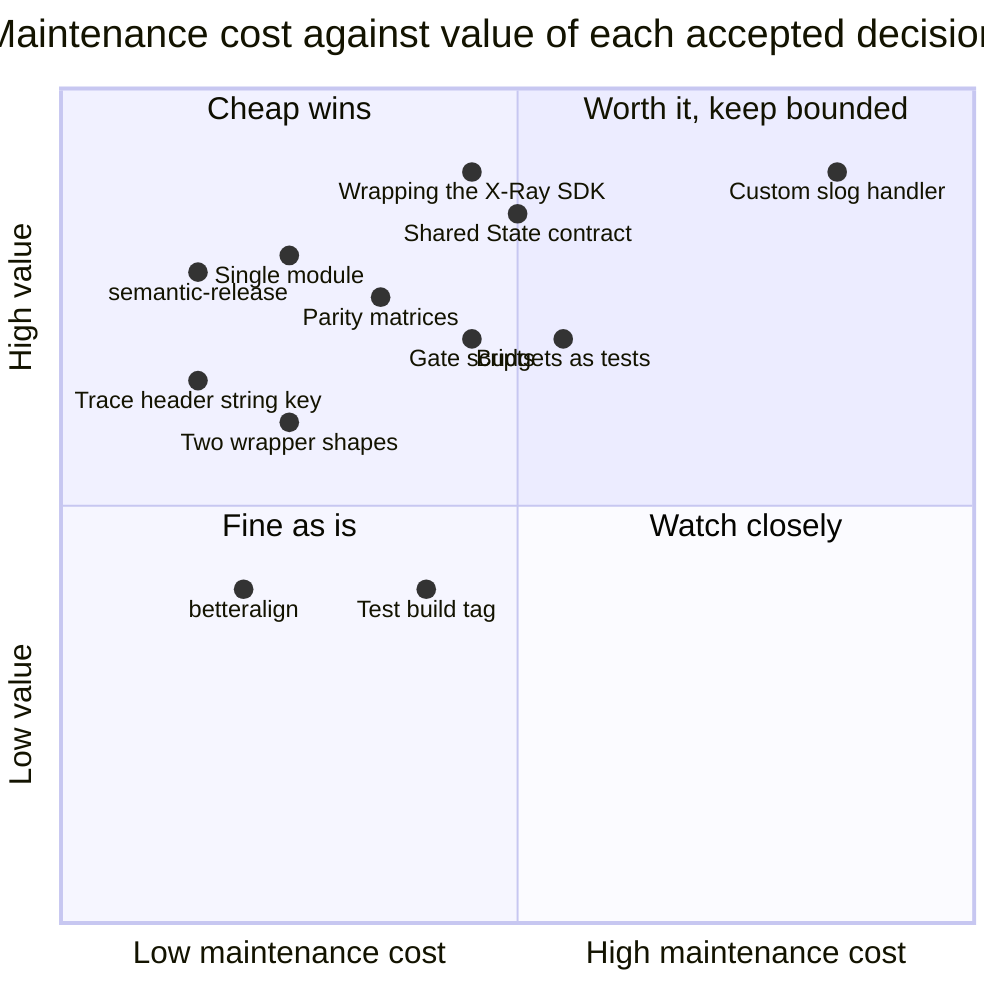

# 11. Maintainability review

A read of the whole plan with one question: what will cost the next maintainer time, and
is that cost bought with something worth it. Each decision below is rated honestly. Three
adjustments came out of this review and are applied in the other files (§3). §2.1 adds
what the costs turned out to be in a reference implementation of the plan.

## 1. What keeps the library maintainable

| Property | Where it comes from |
| --- | --- |
| Small, fixed public surface | No exported interfaces; option structs whose zero value works; one constructor per package; the X-Ray SDK's own types instead of wrappers (04). The exported API is frozen in Phase 1 as documented stubs (07), each phase releases a v0 minor with no compatibility promise, and the API review checklist (08 §3) gates `v1.0.0`. |
| One place per concern | JSON encoding only in `internal/jsonenc`; env reading only in `internal/lambdaenv`; the per-invocation contract only in `internal/invocation`; the lifecycle only in the root wrapper (01 §2). A change to EMF or to a log key touches one file. |
| Standard library as the framework | `log/slog` is the logger API, `encoding/json/v2` the encoder, `testing` the test framework, `context` the carrier. Nothing to relearn, nothing to upgrade except Go itself. |
| Behaviour pinned by tests that read like specifications | `slogtest` conformance, EMF schema validation, golden documents compared semantically (X-Ray documents read back from a per-test UDP listener), limits as table tests, concurrency under `-race`, allocation budgets in their own non-race step, a leak profile plus a `synctest` proof that the margin timer stops (06). |
| Upstream parity made visible | The parity matrices in 02, 03 and 04 list what matches Powertools Python/TypeScript and what deliberately differs, so a future upstream change is a diff against a table, not archaeology. |
| Decisions recorded with reasons | 09 is a decision log, including the decisions taken during implementation (26 onward). Phase 0 copies it to `docs/DECISIONS.md`; in Phase 6, before the release commit, the `.plan/` directory moves to `docs/design/` as history (07 Phase 6). |
| Tooling that is standard | `gofmt`, `go vet`, `go fix`, golangci-lint v2 (`staticcheck`, `forbidigo`, `depguard`, a complexity ratchet), `govulncheck`, a coverage-threshold tool, `go-licenses`, `betteralign`, `benchstat`, `apidiff`, `actionlint`, `zizmor`, semantic-release. No in-house analyzers (adjustment B below); the in-house parts are a few gate scripts with fixture self-tests (§2). |
| Releases come from commits | semantic-release cuts the tag and the release notes from conventional commits on every push to `main`, counting from a seed tag `v0.0.0` (decisions 27 and 34). No changelog to keep in sync, no release script, nothing pushed to `main` by hand. |
| One command per check | Every check is a `make` target, `make checks` runs everything CI runs, and CI calls the same targets, so a laptop and CI give the same verdict. |

## 2. Costs that are deliberately accepted

| Decision | Maintenance cost | Why it is worth it | How the cost is bounded |
| --- | --- | --- | --- |
| Custom `slog.Handler` instead of wrapping `slog.JSONHandler` (02 §5) | The largest single body of code to maintain: group handling, `ReplaceAttr` semantics, pre-rendered attrs, buffering. Roughly 800 lines plus tests. | It is the only way to get Powertools key order, invocation keys read from `ctx`, sampling and buffering without a second pass over every record, and the zero-allocation record path (05). | It follows `slog`'s own `commonHandler` structure (top-level attrs, grouped prefix, trailing groups opened only when a record attr renders, decision 33), so it reads like the standard handlers; `ReplaceAttr` sees only record and `With` attrs, so the per-invocation render caches stay handler-independent; all escaping and value encoding is `jsontext`, never hand-written; `slogtest.Run` catches contract regressions. |
| One module, one version (01 §2, decision 25) | The X-Ray SDK and its dependency tree sit in every consumer's module graph, so logger-only users see `go.sum` entries and Dependabot alerts for code they never link. | One `go.mod`, one tag, no release script, no cross-module contract, nothing unusual for a newcomer; consumers see one toolkit version, as with Powertools Python. | The `deps` job fails when any production package except `tracer` imports the SDK, or when `logger`, `metrics` or `internal/...` reach it transitively; binaries without the tracer are unaffected; `govulncheck` reports reachable vulnerabilities only; splitting `tracer` into its own module at a major version remains possible. |
| Shared `invocation.State` with exported fields and two `any` slots (01 §4.1) | A cross-package contract: renaming or removing a field touches three packages at once. The `any` slots are type-asserted by their owners. | One context lookup per utility and a single lifecycle. The alternative (one context key per utility) costs an extra lookup per log call and spreads the lifecycle over four places. | **Append-only rule**: within a major version, fields are only ever added (01 §4.1, 07 risks). The complete struct is written in Phase 1, so the utility phases fill it rather than reshape it. It holds only shared data: no handler segment (a local variable of the wrapper), no open-segment counter, no margin timer. A single module version makes mixed versions impossible. |
| Wrapping the X-Ray SDK (04 §1) | Its dependency tree (grpc, protobuf, fasthttp) brings Dependabot churn and CVE noise, including vulnerable indirect versions that need an explicit floor in `go.mod` (06 §4.2); its global configuration and init-time behaviour are documented surprises. Its `*xray.Segment` methods are not nil-safe, and it streams by subsegment count, not bytes, so an oversized document is dropped whole. | AWS maintains it; the Lambda facade, emission, streaming, HTTP and SDK v2 instrumentation and SQL tracing come for free. | Imported only by the `tracer` package; nil-safe helpers (`AddAnnotation`, `AddMetadata`, `InstrumentAWS`) and nil checks in `end()`; a per-invocation metadata budget keeps documents emittable; `govulncheck` reports only reachable vulnerabilities; the wrapper never touches SDK globals; tests read the real documents from a per-test UDP listener, so SDK upgrades are checked end to end. |
| Performance budgets as tests (05 §6) | Budgets drift with toolchain changes; a noisy CI box produces false failures that someone must triage. | The whole point of the library is to be cheap per invocation; without gates, regressions are silent. | Allocation budgets run without `-race` in their own step (`sync.Pool` is not deterministic under the race detector). The bench gate compares the merge base and the head in one job on one runner, interleaved, `-count 10 -cpu 1`: `allocs/op` and `B/op` are the hard gate, `ns/op` fails only above 25 % at p < 0.05. No committed baseline: a baseline from another machine is noise. A reviewed accept-list covers a justified regression, such as one more allocation inside an SDK upgrade. |
| `betteralign` ordering hot structs (05 §4) | Field order no longer tells a story; a reviewer must run `make align` after editing a struct. | Fewer padding bytes and less pointer scanning on the two long-lived per-invocation objects. | Applied only to the listed hot structs; exported `Options` are excluded; CI reports, never rewrites; `make align` exits non-zero on the run that changes something, so it is run twice. |
| Opt-in `DeadlineMargin` timer (01 §7 D6) | The one goroutine the library can create; a timer per invocation to arm and stop; `preTimeout` must be safe against a concurrently running handler. | Diagnostics written before a timeout are the only ones that survive the runtime reset. | Off by default; held in an unexported struct local to `begin`/`end`, not in `State`; not armed when less than the margin remains; bounded by `end()`; `FlushSnapshot` and the log buffer flush reuse the mutex-protected paths; tested under `synctest` with a fake clock, including the proof that a stopped timer never fires. |
| Two wrapper shapes (01 §4.2) | Two entry points to document and test. `WrapHandler` carries a restriction its doc must state: only hand-written `lambda.Handler` implementations that own the bytes they return, never `lambda.NewHandler(fn)` (decision 29). | Typed handlers get a reflection-free path; hand-written handlers and middleware chains keep working on raw bytes; every other handler shape is a one-line closure passed to `Wrap`. | Both call the same `begin`/`end`; tests run the lifecycle suite against both, including a `-race` test of concurrent `WrapHandler` invocations. |
| Parity with Powertools Python/TypeScript | Upstream adds keys and options; keeping up is ongoing work. | Dashboards, queries and alarms written for other runtimes work unchanged. | Parity matrices per utility; references pinned to Python v3.36.0 and TypeScript 2.x; divergences are listed, not implied. |
| Reading the trace header from the plain string context key `"x-amzn-trace-id"` (01 R2) | `aws-lambda-go` exports no constant for it; a rename there would silently disable tracing and `xray_trace_id`. | It is the only per-invocation source under multi-concurrency. | One constant in `internal/lambdaenv`; no environment fallback, so a missing value means "no trace" for logger and tracer alike (decision 30). Staticcheck flags string keys (SA1029), so tests set the key through one helper, the only place with the suppression. The optional real-AWS integration test exercises the real runtime path. |
| Releases from conventional commits (decisions 27, 34, 40) | The version is only as good as the commit types: a `feat` mislabelled `fix` cuts the wrong version, an example-only `fix` cuts a library patch, and a body line that starts with the breaking-change phrase cuts a major. | No changelog or release script; every phase ships a version that can be tried; release notes come for free. | A commit-message hook and a CI check of the format; `chore(examples)` for example-only changes; the breaking-change guard on every pull request and before every release (06 §6.2). |
| Build tag on test files (optional convention, 06 §1) | A tool run without the tag silently skips every test, and two kinds of files are exceptions (examples untagged, the real-AWS harness with its own tag). | `go build` never compiles test helpers; the convention may already be a house rule. | The tag set once in the Makefile defaults and in golangci-lint's `run.build-tags`; `doc-check` proves the untagged examples compile alone; a CI step proves the harness skips. Without such a house rule, the plan works the same untagged. |
| In-house gate scripts | Four small shell scripts (import rules, bench gate over benchstat CSV, size gate, breaking-change guard), each with fixture-based self-tests, are code to maintain. | Each encodes a rule no standard tool checks: benchstat sets no exit code, the angular parser's blind spots, the per-binary size budget, transitive import rules. | Kept small (under 300 lines each in the reference implementation), run by `make` targets so CI and a laptop agree, and self-tested in `make checks`. |

### 2.1 What the costs turned out to be

Figures from a reference implementation of this plan at `v1.0.0`, to calibrate the
estimates above. They are one data point, not a target.

| Cost | Planned | Observed |
| --- | --- | --- |
| Custom `slog.Handler` | about 800 lines plus tests | the handler and its renderer are about 500 lines; the whole `logger` package, with configuration, buffering, context helpers and a long package doc, about 1,800 |
| Library size | not estimated | about 7,800 lines of non-test Go across the root, the three utilities and `internal/`; about 26,000 lines of tests, roughly three lines of test per line of code, most of it table rows, golden documents and wrapper lifecycle cases |
| Gate scripts | none planned (adjustment B dropped the in-house analyzer) | about 900 lines of shell across six scripts, a third of it the breaking-change guard and the self-test runner |
| Decisions | 25 at the start | 44 at `v1.0.0`: about a third of the later ones came from a pre-implementation check of the plan against the SDK sources, the rest from implementation and the API review (09) |
| API changes after the freeze | none expected | three exported changes, all from the API review (one option became `*bool`, one unusable type and its two constants were unexported), plus the expected "no longer comparable" `apidiff` lines once the stubs got real fields (08 §4) |
| Binary size | `hello` (logger and metrics, no wrapper) under 1 MiB over a bare `aws-lambda-go` binary | 128 KiB over bare, with no X-Ray SDK linked; the full example with the wrapper, the tracer and the AWS SDK for Go v2 is about 10 MiB over bare, recorded, not gated |

## 3. Adjustments made by this review

**A. EMF and metadata serialisation use `jsontext.Encoder` tokens, not raw byte appends.**
Only the logger record path is hot enough to justify append-style writing. The EMF blob
is built once per invocation and arbitrary metadata is cold, so they now go through a
pooled `jsontext.Encoder` (`WriteToken`, `WriteValue`), which enforces balanced objects
and valid strings at the encoder level. Less code, structural bugs become impossible,
and the cost is one pooled encoder reset per flush (03 §5, 01 §2 package table). The
encoder also rejects duplicate member names, so a merge step runs first: dimensions, then
metadata, then metric values, last one wins, as in Powertools Python (decision 32).
Metadata values are marshalled with `json.Marshal` and written with `WriteValue`; a value
that fails is dropped with one WARN per batch and `Flush` still succeeds. The encoder
writes the trailing newline itself.

**B. No in-house static analyzer.** The optional `hotpathcheck` tool and the
`// powertools:hotpath` marker are dropped. The same rule (no `fmt`, `reflect`, `regexp`
in hot-path packages) is expressed with `golangci-lint`'s `forbidigo` and `depguard`,
scoped by package path, with `//nolint:forbidigo` on the few documented cold-path
functions (05 §6, 06 §4). Standard tooling, nothing to maintain.

**C. Archive the plan once it is implemented.** Phase 0 copies 09 to `docs/DECISIONS.md`.
In Phase 6, before the release commit cuts `v1.0.0`, `.plan/` moves to `docs/design/`
with 09 replaced by a pointer to `docs/DECISIONS.md`, so the repository never carries a
plan or a decision log that disagrees with the code (07 Phase 6).

## 4. Verdict

Nothing in the plan is a one-way door for maintainability. The one decision that trades
maintainability for performance is the custom `slog.Handler`; it is bounded by
`jsontext` and `slogtest`, and if a future maintainer prefers simplicity, the handler can
be replaced by a `slog.JSONHandler` wrapper behind the same `logger.New` without
touching consumers. The one real one-way door is `v1.0.0`: the v0 releases cut per phase
carry no compatibility promise, but once the release commit cuts `v1.0.0` an incompatible
change needs a `/v2` module path, so the API review (08 §3) is the last cheap moment to
change an exported name. Everything else is standard Go practice.
