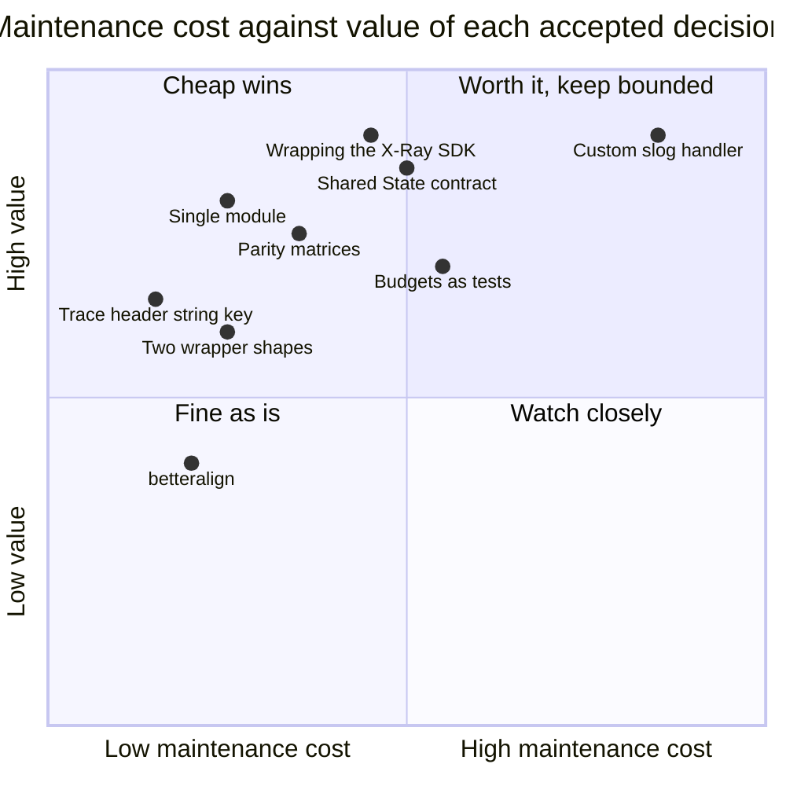

# 11. Maintainability review

A read of the whole plan with one question: what will cost the next maintainer time, and
is that cost bought with something worth it. Each decision below is rated honestly. Two
adjustments came out of this review and are applied in the other files.

## 1. What keeps the library maintainable

| Property | Where it comes from |
| --- | --- |
| Small, fixed public surface | No exported interfaces; option structs whose zero value works; one constructor per package; the X-Ray SDK's own types instead of wrappers (04). The API review checklist (08 §3) gates `v1.0.0`. |
| One place per concern | JSON encoding only in `internal/jsonenc`; env reading only in `internal/lambdaenv`; the per-invocation contract only in `internal/invocation`; the lifecycle only in the root wrapper (01 §2). A change to EMF or to a log key touches one file. |
| Standard library as the framework | `log/slog` is the logger API, `encoding/json/v2` the encoder, `testing` the test framework, `context` the carrier. Nothing to relearn, nothing to upgrade except Go itself. |
| Behaviour pinned by tests that read like specifications | `slogtest` conformance, EMF schema validation, golden documents compared semantically, limits as table tests, concurrency under `-race`, leak profile (06). |
| Upstream parity made visible | The parity matrices in 02, 03 and 04 list what matches Powertools Python/TypeScript and what deliberately differs, so a future upstream change is a diff against a table, not archaeology. |
| Decisions recorded with reasons | 09 is a decision log; Phase 0 copies it to `docs/DECISIONS.md`, and after `v0.1.0` the `.plan/` directory moves to `docs/design/` as history (07 Phase 6). |
| Tooling that is standard | `gofmt`, `go vet`, `go fix`, `staticcheck`, `golangci-lint`, `govulncheck`, `betteralign`, `benchstat`. No in-house analyzers (adjustment B below). |

## 2. Costs that are deliberately accepted

| Decision | Maintenance cost | Why it is worth it | How the cost is bounded |
| --- | --- | --- | --- |
| Custom `slog.Handler` instead of wrapping `slog.JSONHandler` (02 §5) | The largest single body of code to maintain: group handling, `ReplaceAttr` semantics, pre-rendered attrs, buffering. Roughly 800 lines plus tests. | It is the only way to get Powertools key order, invocation keys read from `ctx`, sampling and buffering without a second pass over every record, and the zero-allocation record path (05). | All escaping and value encoding is `jsontext`, never hand-written; `slogtest.Run` catches contract regressions; the handler guide structure is followed so the code looks like the standard handlers. |
| One module, one version (01 §2, decision 25) | The X-Ray SDK and its dependency tree sit in every consumer's module graph, so logger-only users see `go.sum` entries and Dependabot alerts for code they never link. | One `go.mod`, one tag, no release script, no cross-module contract, nothing unusual for a newcomer; consumers see one toolkit version, as with Powertools Python. | Only `tracer` imports the SDK (the `deps` job fails otherwise), so binaries are unaffected; `govulncheck` reports reachable vulnerabilities only; splitting `tracer` into its own module at a major version remains possible. |
| Shared `invocation.State` with exported fields and two `any` slots (01 §4.1) | A cross-package contract: renaming or removing a field touches three packages at once. The `any` slots are type-asserted by their owners. | One context lookup per utility and a single lifecycle. The alternative (one context key per utility) costs an extra lookup per log call and spreads the lifecycle over four places. | **Append-only rule**: within a major version, fields are only ever added (01 §4.1, 07 risks). A single module version makes mixed versions impossible. |
| Wrapping the X-Ray SDK (04 §1) | Its dependency tree (grpc, protobuf, fasthttp) brings Dependabot churn and CVE noise; its global configuration and init-time behaviour are documented surprises. | AWS maintains it; the Lambda facade, emission, streaming, HTTP and SDK v2 instrumentation and SQL tracing come for free. | Imported only by the `tracer` package; `govulncheck` reports only reachable vulnerabilities; the wrapper never touches SDK globals, so SDK upgrades are mechanical. |
| Performance budgets as tests (05 §6) | Budgets drift with toolchain changes; a noisy CI box produces false failures that someone must triage. | The whole point of the library is to be cheap per invocation; without gates, regressions are silent. | Exact budgets only for zero-allocation paths; `benchstat` significance for timing; `-cpu 1`, one automatic re-run; the baseline file records the toolchain version. |
| `betteralign` ordering hot structs (05 §4) | Field order no longer tells a story; a reviewer must run `make align` after editing a struct. | Fewer padding bytes and less pointer scanning on the two long-lived per-invocation objects. | Applied only to the listed hot structs; exported `Options` are excluded; CI reports, never rewrites. |
| Opt-in `DeadlineMargin` timer (01 §7 D6) | The one goroutine the library can create; a timer per invocation to arm and stop; `preTimeout` must be safe against a concurrently running handler. | Diagnostics written before a timeout are the only ones that survive the runtime reset. | Off by default; bounded by `end()`; `FlushSnapshot` and the log buffer flush reuse the mutex-protected paths; tested under `synctest` with a fake clock. |
| Two wrapper shapes (01 §4.2) | Two entry points to document and test. | Typed handlers get a reflection-free path; the other eight handler shapes and middleware chains still work. | Both call the same `begin`/`end`; tests run the lifecycle suite against both. |
| Parity with Powertools Python/TypeScript | Upstream adds keys and options; keeping up is ongoing work. | Dashboards, queries and alarms written for other runtimes work unchanged. | Parity matrices per utility; references pinned to Python v3.36.0 and TypeScript 2.x; divergences are listed, not implied. |
| Reading the trace header from the plain string context key `"x-amzn-trace-id"` (01 R2) | `aws-lambda-go` exports no constant for it; a rename there would silently disable tracing and `xray_trace_id`. | It is the only per-invocation source under multi-concurrency. | Isolated in `internal/lambdaenv` with the `_X_AMZN_TRACE_ID` fallback; the `examples` integration test exercises the real runtime path nightly. |

## 3. Adjustments made by this review

**A. EMF and metadata serialisation use `jsontext.Encoder` tokens, not raw byte appends.**
Only the logger record path is hot enough to justify append-style writing. The EMF blob
is built once per invocation and arbitrary metadata is cold, so they now go through a
pooled `jsontext.Encoder` (`WriteToken`, `WriteValue`), which enforces balanced objects
and valid strings at the encoder level. Less code, structural bugs become impossible,
and the cost is one pooled encoder reset per flush (03 §5, 01 §2 package table).

**B. No in-house static analyzer.** The optional `hotpathcheck` tool and the
`// powertools:hotpath` marker are dropped. The same rule (no `fmt`, `reflect`, `regexp`
in hot-path packages) is expressed with `golangci-lint`'s `forbidigo` and `depguard`,
scoped by package path, with `//nolint:forbidigo` on the few documented cold-path
functions (05 §6, 06 §4). Standard tooling, nothing to maintain.

**C. Archive the plan once it is implemented.** After `v0.1.0`, `.plan/` moves to
`docs/design/` and 09 becomes `docs/DECISIONS.md`, so the repository never carries a
plan that disagrees with the code (07 Phase 6).

## 4. Verdict

Nothing in the plan is a one-way door for maintainability. The one decision that trades
maintainability for performance is the custom `slog.Handler`; it is bounded by
`jsontext` and `slogtest`, and if a future maintainer prefers simplicity, the handler can
be replaced by a `slog.JSONHandler` wrapper behind the same `logger.New` without
touching consumers. Everything else is standard Go practice.
