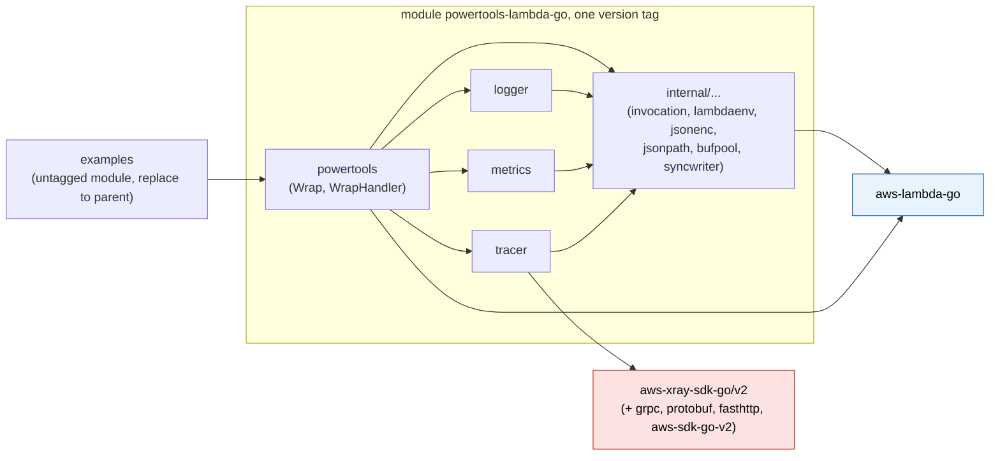
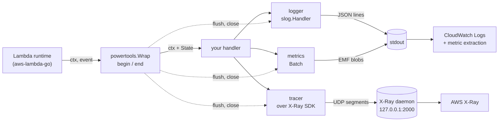

# Implementation plan: powertools-lambda-go

> Public snapshot of an internal planning document, shared in
> [aws-powertools/powertools-lambda#82](https://github.com/aws-powertools/powertools-lambda/issues/82).
> It was written with Claude (Claude Code) and reviewed by humans against the Powertools
> Python and TypeScript documentation and source, the CloudWatch EMF specification, the
> X-Ray documentation, `aws-lambda-go` and `aws-xray-sdk-go`. It is not an official
> Powertools project and it is a plan, not code. Take what is useful.
>
> License: [CC BY 4.0](LICENSE).

Status: **plan, validated by a reference implementation** (2026-10-19). The plan was
implemented end to end and the implementation was released as v1.0.0 (not public). The
files below remain a plan: they say what the library does and why, and every Go snippet
is an illustrative example of the intended API, not code to copy. Where the
implementation proved the original text wrong or incomplete, the text was corrected and
a **Changed after implementation** note gives the reason; where it confirmed a risky
choice, a **Validated in implementation** note says so. See
[What changed after implementation](#what-changed-after-implementation).

`powertools-lambda-go` is a Go port of the three core utilities of Powertools for AWS
Lambda (Python / TypeScript): **Logger**, **Metrics** and **Tracer**, plus the handler
wrapper that ties them to one Lambda invocation. It targets Go Lambda functions built
with `github.com/aws/aws-lambda-go` on the `provided.al2023` runtime.

## How to read this plan

| File | What it decides |
| --- | --- |
| [01-architecture.md](01-architecture.md) | Runtime facts that constrain the design, module and package layout, dependency policy, configuration model, the per-invocation state that is propagated through `context.Context`, concurrency model, error and panic policy, and §7: deadlines, cancellation, freeze and shutdown. |
| [02-logger.md](02-logger.md) | A `log/slog` handler that emits Powertools-shaped JSON; levels, sampling, buffering, correlation IDs, invocation keys. |
| [03-metrics.md](03-metrics.md) | CloudWatch Embedded Metric Format (EMF) emitter: batching, validation, dimensions, cold-start metric, single metrics. |
| [04-tracer.md](04-tracer.md) | X-Ray tracer for the Lambda facade-segment case, with outbound propagation to `net/http` and the AWS SDK for Go v2. |
| [05-performance.md](05-performance.md) | Hot-path inventory, allocation and latency budgets, measurement protocol, CI gates. |
| [06-testing-and-ci.md](06-testing-and-ci.md) | Test layers, conformance suites, lint, CI pipeline, release process. |
| [07-roadmap.md](07-roadmap.md) | Phases, task checklists, acceptance criteria, estimates, risks. |
| [08-style-and-solid.md](08-style-and-solid.md) | How the Google Go style guide and SOLID are applied, with concrete rules and an API review checklist. |
| [09-open-questions.md](09-open-questions.md) | Decision log: the 25 reviewer decisions of the original plan, plus the decisions taken while implementing it (26 onwards). |
| [11-maintainability.md](11-maintainability.md) | Maintainability review: what keeps the library maintainable, the costs deliberately accepted and how each is bounded, and the three adjustments that came out of the review. |
| [10-go-127-checklist.md](10-go-127-checklist.md) | Every Go 1.26 and 1.27 change checked against the plan: adopted, allowed, or not applicable, with the section that uses it. |

## What changed after implementation

The overall shape held: one module, option structs, one per-invocation `State` in
`ctx`, a `slog` handler, an EMF emitter, a thin layer over the X-Ray SDK, synchronous
flushing at the end of the handler. What changed were details that only show up when the
code meets the SDKs, the race detector and CI. The headlines, with the file that carries
each change:

| File | Main changes |
| --- | --- |
| [01-architecture.md](01-architecture.md) | No init-time environment snapshot: constructors read the environment, so tests use `t.Setenv`. The trace header comes only from `ctx` (no `_X_AMZN_TRACE_ID` fallback), parsed like the SDK for `Root`/`Parent`/`Sampled`, with one documented divergence for extra fields. `WrapHandler` takes only hand-written handlers that own their response bytes (`lambda.NewHandler` returns pooled bytes). `Options.LogEvent` is a `*bool`; `ResetKeys` and `RaiseOnEmptyMetrics` left the wrapper. `*xray.Segment` methods are not nil-safe, so the plan adds nil-safe helpers. `RemainingTime` without a deadline means "no limit". Any `Flush` error becomes the invocation error only when the handler succeeded. Dependency pitfalls (`smithy-go`, `golang.org/x/net` and `govulncheck`), build tags and test layout, measured binary sizes and wrapper overhead. |
| [02-logger.md](02-logger.md) | The handler mirrors the structure of slog's own JSON handler so it passes `testing/slogtest`; `ReplaceAttr` never sees built-in, Lambda or invocation keys; default-true options are `*bool`; sampling requires the wrapper; one shared stdout writer for logger and metrics. |
| [03-metrics.md](03-metrics.md) | Storage resolution is chosen by method (`Add`, `AddHighResolution`, `Single.HighResolution`), with no exported resolution type; `EmitColdStart` is exported; `RaiseOnEmptyMetrics` lives in `metrics.Options`; `service` is the first dimension of every blob and defaults to `service_undefined`; `Flush` returns only sentinels; an invalid namespace, service or default dimension fails at `metrics.New` instead of at every flush. |
| [04-tracer.md](04-tracer.md) | Nil-safe `AddAnnotation`/`AddMetadata` helpers; `InstrumentAWS` next to `HTTPClient`; a per-invocation metadata budget counted in escaped bytes replaces the per-value guard; the open-subsegment warning reads the SDK's own `Emitted` flag. |
| [05-performance.md](05-performance.md) | Allocation budgets locked at the measured values; an A/B benchmark gate that runs base and head in the same job instead of a committed baseline. |
| [06-testing-and-ci.md](06-testing-and-ci.md) | Build-tag rules (and the two exceptions that `go doc -ex` forces), coverage-tool regex pitfalls, a guard against commits that would cut an unintended major release, import checks split into direct and transitive rules. |
| [07-roadmap.md](07-roadmap.md) | An API-freeze phase with documented stubs, then logger, metrics and tracer in parallel; v0 minor releases per phase and v1.0.0 after an API review; live AWS acceptance checks do not block the release. |
| [08-style-and-solid.md](08-style-and-solid.md) | The API review checklist, run against the code before v1.0.0, and what it changed. |
| [09-open-questions.md](09-open-questions.md) | Decisions 26 onwards, each with the reason and where it applies. |

## Goals

1. **Parity where it matters.** Same environment variables, same JSON keys, same EMF
   shape, same X-Ray annotations and metadata keys as Powertools Python and TypeScript,
   so dashboards, log insights queries and alarms built for other runtimes work unchanged.
2. **Idiomatic Go.** Standard library first (`log/slog`, `context`, `encoding/json/v2`),
   option structs, `context.Context` as the only carrier of per-invocation state, no
   exported interfaces, no hidden global state (the few package-level variables are
   listed in 01 §5), errors returned not panicked.
3. **Lambda-correct.** Works on `provided.al2023`, with Lambda Advanced Logging Controls,
   with provisioned concurrency, and under Lambda Managed Instances multi-concurrency
   where several invocations share one process.
4. **Fast.** No reflection, no `fmt`, no regular expressions on the per-log, per-metric
   or per-segment path. Allocation budgets are tests, not aspirations.
5. **Context propagation end to end.** One struct per invocation carried by `ctx`;
   goroutines spawned by the handler inherit it; the X-Ray trace header flows out to
   HTTP and AWS SDK calls; the trace ID and request ID flow into every log line.

> **Validated in implementation.** The allocation and propagation goals were measured
> directly; the deployed acceptance checks ran after the release. A reference implementation
> measured 0 allocations for a `LogAttrs` call with up to five scalar attributes
> (enabled or disabled), 0 for `Batch.Add` on an existing metric name, 0 for a disabled
> or unsampled `tracer.Start`, and 3 to 4 allocations for the whole wrapper per
> invocation with all three utilities configured (05 §3).

## Non-goals for v1

- OpenTelemetry export (X-Ray only, matching upstream Powertools).
- Event-source data classes, parser, idempotency, batch, parameters (later utilities).
- Lambda response streaming handlers.
- A global default logger / metrics / tracer instance.
- `WrapHandler` over `lambda.NewHandler(fn)`, and adapter APIs for the other handler
  shapes: `WrapHandler` takes only hand-written handlers that own their returned bytes,
  and every other shape is a one-line closure passed to `Wrap` (01 R8, §4.2).

## Guiding principles

- **Immutable after construction, mutable per invocation.** `logger.Handler`,
  `*metrics.Metrics` and `*tracer.Tracer` are built once in `main` and never mutated.
  Everything that changes per request lives in the invocation state in `ctx`.
- **Consumers define interfaces.** The library exports concrete types and functions and
  accepts only standard-library interfaces (`io.Writer`, `slog.Handler`, `context.Context`).
- **One write per record.** Every log line and every EMF blob is assembled in a pooled
  buffer and written with exactly one `Write` call through a mutex-guarded writer, so
  lines never interleave under multi-concurrency. By default logger and metrics share one
  process-wide stdout writer; a writer supplied by the consumer is not shared between
  utilities.
- **Deadline-aware, never pending.** Everything is flushed synchronously when the handler
  returns, so nothing is lost at freeze or shutdown; late goroutines can only touch their
  own invocation; an opt-in margin flushes diagnostics before a timeout (01 §7).
- **Degrade, never fail.** Observability must not break the business handler: emitter
  errors are logged at debug level and swallowed; disabled or unsampled paths are no-ops
  that allocate nothing.
- **Least mechanism, one module, one version.** The repository publishes a single Go
  module with a single version tag (decision 25). `internal`, `logger` and `metrics`
  import only the standard library and `aws-lambda-go`; the X-Ray SDK is imported only
  by `tracer`, and the root wrapper reaches it only through exported `tracer` helpers.
  Go therefore links the SDK only into binaries that import `tracer` **or the wrapper**
  (even with tracing off); a binary that must stay small uses `logger` and `metrics`
  without the wrapper.

> **Changed after implementation.** The original principle said the SDK is linked "only
> into binaries that use tracing". The wrapper imports `tracer`, so any binary that uses
> `Wrap` links the SDK. A reference implementation measured it on `linux/arm64`
> (stripped): a bare `lambda.Start` binary about 6.0 MiB, plus `logger` and `metrics`
> without the wrapper about +128 KiB, with `Wrap` and all three utilities about
> +5.4 MiB (01 §2).

## Module and package layout

One Go module, one `go.mod`, one version for every package (decision 25).

```text
github.com/<owner>/powertools-lambda-go   module, tagged vX.Y.Z as a whole (v0.x while the API settles, then v1.0.0)
├── go.mod                   go 1.27.0 and a toolchain line; requires aws-lambda-go, aws-xray-sdk-go/v2, smithy-go
├── powertools.go, …         package powertools: Wrap, WrapHandler, Options, ctx accessors
├── internal/                shared internals; not importable by consumers (Go internal rule)
│   ├── invocation/          per-invocation State, context key, LogBuffer
│   ├── lambdaenv/           the only reader of the environment; in-Lambda detection, trace header from ctx
│   ├── jsonenc/             append-style JSON helpers shared by logger and metrics (json/v2, jsontext)
│   ├── jsonpath/            correlation-ID paths evaluated over the raw event
│   ├── bufpool/             pooled []byte
│   ├── syncwriter/          mutex writer, one Write per record; Stdout is the shared default
│   ├── benchutil/           benchmark fixtures; never imports the X-Ray SDK
│   └── testsupport/         test helpers, including the single SA1029 trace-header helper
├── logger/                  package logger: slog.Handler, six ALC levels, Trace…Fatal(ctx, …), invocation keys, buffer
├── metrics/                 package metrics: EMF Metrics, Batch, Single, Unit
├── tracer/                  package tracer: Powertools semantics over aws-xray-sdk-go/v2
├── examples/                deployable samples (SAM); its own UNTAGGED go.mod with a replace to the parent,
│   ├── go.mod               so SAM and AWS service clients never enter the library's go.mod
│   ├── bare/                size baseline: lambda.Start only, no Powertools import
│   ├── hello/               logger and metrics without the wrapper (size-gated)
│   ├── full/                Wrap with all three utilities, an AWS SDK v2 client and HTTP
│   ├── benchmark/           plain and wrapped binaries for the Lambda-level measurement
│   └── integration/         Go harness behind //go:build integration, against a deployed stack
└── .plan/                   this directory
```

> **Changed after implementation.** `metrics.Resolution` is no longer exported
> (decision 43); `internal/jsonpath`, `internal/benchutil` and `internal/testsupport`
> were added and `internal/env` was folded into `internal/lambdaenv` (decision 33);
> `smithy-go` is a direct requirement because `tracer.InstrumentAWS` takes the AWS SDK's
> middleware type (decision 35). The examples were split so that the size of a
> logger-only binary can be gated against a bare baseline built in the same CI run.

### Package dependency graph



Arrows mean "imports". Go links only the packages a binary imports: a logger-only
consumer links `logger`, `internal` and `aws-lambda-go`; the X-Ray SDK is linked only
when `tracer` is imported, which the wrapper does. It does appear in every consumer's
module graph (`go.sum`), which is the accepted cost of a single version (01 §2). The
test-only `internal/benchutil` and `internal/testsupport` are left out of the graph.

### Where the data goes



## Public API at a glance

An example of the intended API; the library calls match the signatures the reference
implementation shipped.

```go
func main() {
    lg := logger.New(logger.Options{Service: "payment"})
    met, err := metrics.New(metrics.Options{Namespace: "ServerlessAirline", Service: "payment"})
    if err != nil {
        log.Fatal(err) // invalid namespace, service or default dimension
    }
    trc := tracer.New(tracer.Options{Service: "payment"})
    xray.SetLogger(tracer.NewXRayLogger(lg))    // SDK diagnostics as JSON; the library never sets SDK globals

    lambda.Start(powertools.Wrap(handle, powertools.Options{
        Logger:                 lg,
        Metrics:                met,
        Tracer:                 trc,
        LogEvent:               new(true),       // *bool: nil means POWERTOOLS_LOGGER_LOG_EVENT
        CaptureColdStartMetric: true,
    }))
}

func handle(ctx context.Context, in Order) (Receipt, error) {
    lg := logger.FromContext(ctx)               // *slog.Logger bound to this invocation
    logger.AppendKeys(ctx, slog.String("order_id", in.ID))
    lg.Info("collecting payment")               // {"level":"INFO","message":...,"order_id":...}
    logger.Trace(ctx, "event received", "size", len(in.Items))   // TRACE level, logger resolved from ctx
    _ = tracer.AddAnnotation(ctx, "order_id", in.ID)  // nil-safe: no-op when the invocation is not traced

    if err := metrics.FromContext(ctx).Add("SuccessfulBooking", metrics.Count, 1); err != nil {
        lg.Warn("metric rejected", "error", err)
    }

    ctx, cancel := context.WithTimeout(ctx, powertools.RemainingTime(ctx)-200*time.Millisecond)
    defer cancel()                               // leave room for end() before the Lambda deadline
    return tracer.CaptureResult(ctx, "charge", func(ctx context.Context) (Receipt, error) {
        return charge(ctx, in)                   // HTTPClient / InstrumentAWS calls inside inherit the segment
    })
}
```

> **Changed after implementation.** `LogEvent` is a `*bool` (decision 42); the quick
> start sets the SDK's logger explicitly, because the library never mutates SDK globals
> and the SDK's default logger writes plain text that Lambda's log-level filtering
> treats as INFO; `tracer.AddAnnotation(ctx, …)` replaces
> `tracer.FromContext(ctx).AddAnnotation(…)`, which panics when the invocation is not
> traced (decision 31).

## Usage examples (intended API)

Short, realistic examples of how callers use each utility. They are illustrative:
imports and error handling are trimmed, and the per-utility files have the full rules.

**Logger without the wrapper** (a CLI, a container, a test). Every package-level helper
takes `ctx`; without the wrapper there are no Lambda keys and no sampling.

```go
lg := logger.New(logger.Options{
    Service:         "payment",
    Level:           logger.LevelTrace,                     // ignored when AWS_LAMBDA_LOG_LEVEL is set
    PersistentAttrs: []slog.Attr{slog.String("region", "eu-west-1")},
})
lg.LogAttrs(ctx, slog.LevelInfo, "started", slog.Int("workers", 4)) // 0 allocations up to 5 attrs
slog.SetDefault(lg)                                                  // optional: logger.FromContext falls back to it
```

**Buffering debug lines until something goes wrong** (needs the wrapper, which owns the
per-invocation buffer):

```go
lg := logger.New(logger.Options{
    Level:  slog.LevelDebug,                     // records must pass the level to be buffered
    Buffer: logger.BufferOptions{Enabled: true}, // DEBUG and below buffered; flushed on the first ERROR
})
opts := powertools.Options{Logger: lg, FlushBufferOnUncaughtError: true}

// inside the handler
logger.Debug(ctx, "cache miss", "key", k)      // buffered, written only if the invocation fails
                                               // (the cold-start invocation is never buffered)
logger.SetCorrelationID(ctx, in.OrderID)       // or Options.CorrelationIDPath / CorrelationIDFunc
```

**Metrics: one batch per invocation, plus single metrics.**

```go
b := metrics.FromContext(ctx)                  // the wrapper's batch; nil-safe without the wrapper
_ = b.AddDimension("operation", "book")        // joins the batch's first dimension set (after the defaults)
_ = b.Add("Bookings", metrics.Count, 1)
_ = b.AddHighResolution("Latency", metrics.Milliseconds, 12.5) // StorageResolution 1, chosen by method
b.AddMetadata("booking_id", in.ID)             // not a dimension; no error, bad values are dropped with a WARN

// A metric with its own dimensions, written immediately in its own EMF blob:
err := met.Single("PaymentDeclined", metrics.Count, 1).
    AddDimension("provider", "acme").
    Emit()                                      // builder keeps the first error and returns it here

// Without the wrapper, the caller owns the batch and the flush:
b := met.NewBatch()
_ = b.Add("Jobs", metrics.Count, 1)
if err := b.Flush(); errors.Is(err, metrics.ErrNamespaceMissing) { /* configuration bug */ }
```

**Tracer: subsegments, annotations and outbound calls.**

```go
// At init: instrument clients once and reuse them.
tracer.InstrumentAWS(&awsCfg.APIOptions)       // "aws" subsegments; no-op when tracing is disabled
httpClient := tracer.HTTPClient(&http.Client{Timeout: 5 * time.Second}) // "remote" subsegments

// In the handler:
err := tracer.Capture(ctx, "reserve", func(ctx context.Context) error {
    _ = tracer.AddAnnotation(ctx, "sku", in.SKU) // searchable; nil-safe
    _ = tracer.AddMetadata(ctx, "request", in)   // counted against the per-invocation metadata budget
    return reserve(ctx, httpClient, in)
})

ctx, seg := tracer.Start(ctx, "parse")          // manual form; seg is nil when not traced
items, err := parse(ctx, in)
if seg != nil {                                 // Close is nil-safe but not free; hot paths check
    seg.Close(err)
}

req.Header.Set("X-Amzn-Trace-Id", tracer.Header(ctx)) // any other client; forwards Sampled=0 too
```

**Other handler shapes and hand-written handlers** (01 §4.2):

```go
// func(context.Context, Event) error: a one-line closure for Wrap
lambda.Start(powertools.Wrap(func(ctx context.Context, e Event) (any, error) {
    return nil, process(ctx, e)
}, opts))

// A hand-written lambda.Handler that owns its response bytes (never lambda.NewHandler(fn))
lambda.Start(powertools.WrapHandler(&router{}, opts))
```

**Testing handler code.** The handler runs unchanged without the wrapper: the logger
falls back to `slog.Default()`, `metrics.FromContext` returns a nil batch whose methods
are no-ops, the nil-safe tracer helpers do nothing, and `RemainingTime` returns the
maximum duration, so `context.WithTimeout(ctx, RemainingTime(ctx)-margin)` does not
expire at once. Tests that need the wrapper's behaviour call the wrapped function
directly with a `lambdacontext.NewContext` and, for tracing, a trace header in `ctx`;
environment variables are set with `t.Setenv` **before** calling the constructors,
because constructors read the environment once (01 §3).

```go
func TestHandle(t *testing.T) {
    t.Setenv("POWERTOOLS_METRICS_NAMESPACE", "Test")
    var out bytes.Buffer
    met, err := metrics.New(metrics.Options{Writer: &out})
    if err != nil {
        t.Fatal(err)
    }
    h := powertools.Wrap(handle, powertools.Options{Metrics: met})
    ctx := lambdacontext.NewContext(t.Context(), &lambdacontext.LambdaContext{AwsRequestID: "req-1"})
    if _, err := h(ctx, Order{ID: "o-1"}); err != nil {
        t.Fatalf("handle() error = %v", err)
    }
    // decode out (one EMF blob per line) and compare with cmp.Diff
}
```

## Milestones

| # | Milestone | Outcome |
| --- | --- | --- |
| M0 | Scaffolding | Repo layout, CI, lint, Makefile, decision log copied to `docs/DECISIONS.md`, release tool on top of a seed tag `v0.0.0` |
| M1 | Foundation and API freeze | `internal/*`, root wrapper, invocation state, cold start, env precedence; the final exported signatures of logger, metrics and tracer as documented no-op stubs, so the wrapper's `begin`/`end` is complete against a frozen API |
| M2 | Logger | slog handler passes `testing/slogtest`, parity output, buffering, sampling |
| M3 | Metrics | EMF output validated against the AWS schema, limits, cold-start metric |
| M4 | Tracer | Wrapper over the X-Ray SDK: handler segment, capture helpers, nil-safe helpers, tests against a per-test UDP listener |
| M5 | Examples and integration | Examples with SDK v2 and HTTP instrumentation, size job, integration harness; deployed smoke test and Lambda-level init measurements |
| M6 | Performance and release | Budgets locked as tests, A/B benchmark gate, docs, API review, `v1.0.0` |

> **Changed after implementation.** M2, M3 and M4 ran in parallel once M1 had frozen
> the exported API: each phase filled in only its own package and its own wrapper test
> file. Every phase that merged features released a v0 minor version, and one release
> commit after the API review cut v1.0.0. The deployed smoke test and Lambda-level
> measurements of M5 need a sandbox AWS account; they were made post-release checks
> instead of release blockers, since cutting the release needs no AWS (07).

Estimates and task breakdown are in [07-roadmap.md](07-roadmap.md).

## Prior art

- Powertools for AWS Lambda (Python v3.36.0, TypeScript v2.x): the behavioural reference.
- The Go proposal issue aws-powertools/powertools-lambda#82 (open, labelled
  `need-customer-influence`): suggests `NewLambdaHandler`, `powertoolslog`,
  `powertoolsmetrics`, `powertoolstracing`, X-Ray SDK, and one comment asks for `slog`
  instead of third-party loggers. This plan follows the `slog` comment and the
  per-utility package split, but uses one handler wrapper and option structs.
- `rambow-cloud/powertools-lambda-go` (community, MIT): an existing Go port of the
  TypeScript edition with OpenTelemetry-based tracing. We kept the behavioural contracts
  of this plan tied to the official Python and TypeScript editions and the AWS SDKs, so
  it was not used as a reference (decision 9).

## Sources consulted

- Powertools TypeScript docs: Logger, Metrics, Tracer feature pages; `Tracer.ts` source.
- Powertools Python docs and source: `logging/formatter.py`, `tracing/tracer.py`,
  `metrics/provider/cloudwatch_emf/cloudwatch.py`, `shared/constants.py`.
- CloudWatch EMF specification (structure, limits, JSON schema, unit list).
- X-Ray segment documents and "Sending trace data" (daemon UDP protocol, trace ID format).
- Lambda docs: Go handler signatures, reserved environment variables, log-level filtering.
- `aws-lambda-go` v1.55.1 source: `lambda/handler.go`, `lambda/entry.go`,
  `lambda/invoke_loop.go`, `lambdacontext/context.go`, `lambda/handlertrace/trace.go`.
- `aws-xray-sdk-go` v2.0.4 source: `xray/segment.go`, `xray/segment_model.go`,
  `xray/lambda.go`, `xray/context.go`, `xray/capture.go`, `xray/config.go`,
  `xray/client.go`, `xray/default_emitter.go`, `xray/default_streaming_strategy.go`,
  `header/header.go`, `instrumentation/awsv2/awsv2.go`, `go.mod`.
- Go 1.26 and Go 1.27 release notes; the Go blog post "Go 1.27 is released"; the
  VictoriaMetrics "Go 1.27" feature write-up; `log/slog` and `testing/slogtest` package
  docs.
- `dkorunic/betteralign` README (struct field alignment tool used for hot structs).
- Google Go style guide, decisions and best practices.
- A reference implementation of this plan (released as v1.0.0, not public): its decision
  log, tests, benchmarks and binary-size measurements are the source of every
  "Changed after implementation" and "Validated in implementation" note.
