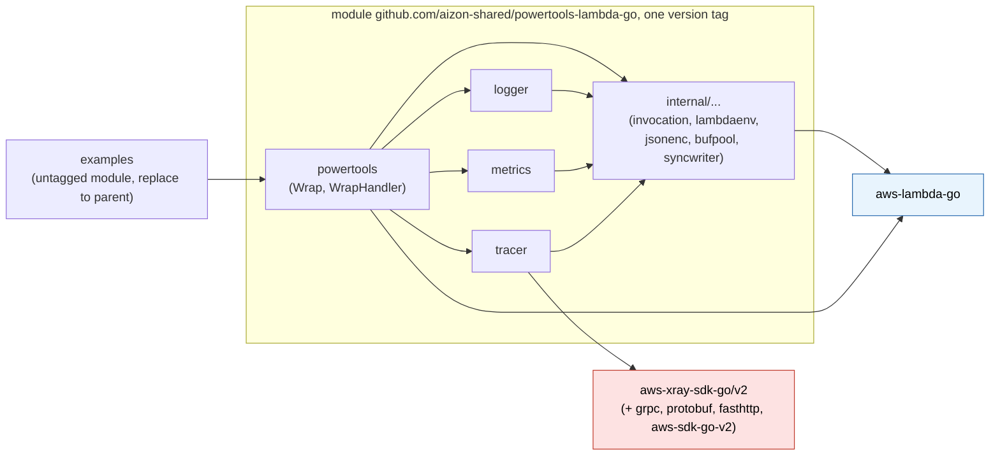
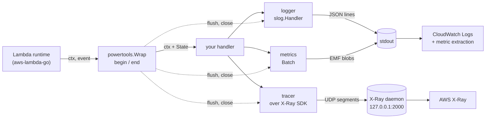

# Implementation plan: powertools-lambda-go

> Public snapshot of an internal planning document, shared in
> [aws-powertools/powertools-lambda#82](https://github.com/aws-powertools/powertools-lambda/issues/82).
> It was written with Claude (Claude Code) and reviewed by humans against the Powertools
> Python and TypeScript documentation and source, the CloudWatch EMF specification, the
> X-Ray documentation, `aws-lambda-go` and `aws-xray-sdk-go`. It is not an official
> Powertools project and it is a plan, not code. Take what is useful.
>
> License: [CC BY 4.0](LICENSE).

Status: **draft for review** (2026-10-15). Nothing in this directory is code; every Go
snippet is an illustrative signature, not a final API.

`powertools-lambda-go` is a Go port of the three core utilities of Powertools for AWS
Lambda (Python / TypeScript): **Logger**, **Metrics** and **Tracer**, plus the handler
wrapper that ties them to one Lambda invocation. It targets Go Lambda functions built
with `github.com/aws/aws-lambda-go` on the `provided.al2023` runtime.

## How to read this plan

| File | What it decides |
| --- | --- |
| [01-architecture.md](01-architecture.md) | Runtime facts that constrain the design, module and package layout, dependency policy, configuration model, the per-invocation state that is propagated through `context.Context`, concurrency model, error and panic policy, and §7: deadlines, cancellation, freeze and shutdown. |
| [02-logger.md](02-logger.md) | A `log/slog` handler that emits Powertools-shaped JSON; levels, sampling, buffering, correlation IDs, invocation keys. |
| [03-metrics.md](03-metrics.md) | CloudWatch Embedded Metric Format (EMF) emitter: batching, validation, dimensions, cold-start metric, single metrics. |
| [04-tracer.md](04-tracer.md) | X-Ray tracer for the Lambda facade-segment case, with outbound propagation to `net/http` and the AWS SDK for Go v2. |
| [05-performance.md](05-performance.md) | Hot-path inventory, allocation and latency budgets, measurement protocol, CI gates. |
| [06-testing-and-ci.md](06-testing-and-ci.md) | Test layers, conformance suites, lint, CI pipeline, release process. |
| [07-roadmap.md](07-roadmap.md) | Phases, task checklists, acceptance criteria, estimates, risks. |
| [08-style-and-solid.md](08-style-and-solid.md) | How the Google Go style guide and SOLID are applied, with concrete rules and an API review checklist. |
| [09-open-questions.md](09-open-questions.md) | Decision log: all reviewer decisions (25, three of them superseded) with where each is applied. |
| [11-maintainability.md](11-maintainability.md) | Maintainability review: what keeps the library maintainable, the costs deliberately accepted and how each is bounded, and the three adjustments that came out of the review. |
| [10-go-127-checklist.md](10-go-127-checklist.md) | Every Go 1.26 and 1.27 change checked against the plan: adopted, allowed, or not applicable, with the section that uses it. |

## Goals

1. **Parity where it matters.** Same environment variables, same JSON keys, same EMF
   shape, same X-Ray annotations and metadata keys as Powertools Python and TypeScript,
   so dashboards, log insights queries and alarms built for other runtimes work unchanged.
2. **Idiomatic Go.** Standard library first (`log/slog`, `context`, `encoding/json/v2`),
   option structs, `context.Context` as the only carrier of per-invocation state, no
   exported interfaces, no global mutable state, errors returned not panicked.
3. **Lambda-correct.** Works on `provided.al2023`, with Lambda Advanced Logging Controls,
   with provisioned concurrency, and under Lambda Managed Instances multi-concurrency
   where several invocations share one process.
4. **Fast.** No reflection, no `fmt`, no regular expressions on the per-log, per-metric
   or per-segment path. Allocation budgets are tests, not aspirations.
5. **Context propagation end to end.** One struct per invocation carried by `ctx`;
   goroutines spawned by the handler inherit it; the X-Ray trace header flows out to
   HTTP and AWS SDK calls; the trace ID and request ID flow into every log line.

## Non-goals for v1

- OpenTelemetry export (X-Ray only, matching upstream Powertools).
- Event-source data classes, parser, idempotency, batch, parameters (later utilities).
- Lambda response streaming handlers.
- A global default logger / metrics / tracer instance.

## Guiding principles

- **Immutable after construction, mutable per invocation.** `logger.Handler`,
  `*metrics.Metrics` and `*tracer.Tracer` are built once in `main` and never mutated.
  Everything that changes per request lives in the invocation state in `ctx`.
- **Consumers define interfaces.** The library exports concrete types and functions and
  accepts only standard-library interfaces (`io.Writer`, `slog.Handler`, `context.Context`).
- **One write per record.** Every log line and every EMF blob is assembled in a pooled
  buffer and written with exactly one `Write` call through a mutex-guarded writer, so
  lines never interleave under multi-concurrency.
- **Deadline-aware, never pending.** Everything is flushed synchronously when the handler
  returns, so nothing is lost at freeze or shutdown; late goroutines can only touch their
  own invocation; an opt-in margin flushes diagnostics before a timeout (01 §7).
- **Degrade, never fail.** Observability must not break the business handler: emitter
  errors are logged at debug level and swallowed; disabled or unsampled paths are no-ops
  that allocate nothing.
- **Least mechanism, one module, one version.** The repository publishes a single Go
  module with a single version tag (decision 25). `internal`, `logger` and `metrics`
  import only the standard library and `aws-lambda-go`; the X-Ray SDK is imported only
  by `tracer`, so Go links it only into binaries that use tracing.

## Module and package layout

One Go module, one `go.mod`, one version for every package (decision 25).

```
github.com/aizon-shared/powertools-lambda-go      module, tagged vX.Y.Z as a whole
├── go.mod                   go 1.27.0; requires aws-lambda-go and aws-xray-sdk-go/v2
├── powertools.go, invocation.go   package powertools: Wrap, WrapHandler, Options, ctx accessors
├── internal/                shared internals; not importable by consumers (Go internal rule)
│   ├── invocation/          per-invocation State, context key, LogBuffer
│   ├── lambdaenv/           in-Lambda detection, trace-header parsing, function metadata, env parsing
│   ├── jsonenc/             append-style JSON helpers shared by logger and metrics (json/v2, jsontext)
│   ├── bufpool/             pooled []byte
│   └── syncwriter/          mutex writer, one Write per record
├── logger/                  package logger: slog.Handler, six ALC levels, Trace…Fatal(ctx, …), invocation keys, buffer
├── metrics/                 package metrics: EMF Metrics, Batch, Single, Unit, Resolution
├── tracer/                  package tracer: Powertools semantics over aws-xray-sdk-go/v2
├── examples/                deployable samples (SAM); its own UNTAGGED go.mod with a replace to the parent,
│   └── go.mod               so SAM and AWS service clients never enter the library's go.mod
└── .plan/                   this directory
```

### Package dependency graph



Arrows mean "imports". Go links only the packages a binary imports: a logger-only
consumer links `logger`, `internal` and `aws-lambda-go`; the X-Ray SDK is linked only
when `tracer` is imported. It does appear in every consumer's module graph (`go.sum`),
which is the accepted cost of a single version (01 §2).

### Where the data goes



## Public API at a glance

```go
func main() {
    lg := logger.New(logger.Options{Service: "payment"})
    met, err := metrics.New(metrics.Options{Namespace: "ServerlessAirline", Service: "payment"})
    // handle err
    trc := tracer.New(tracer.Options{Service: "payment"})

    lambda.Start(powertools.Wrap(handle, powertools.Options{
        Logger:  lg,
        Metrics: met,
        Tracer:  trc,
        LogEvent: true,
        CaptureColdStartMetric: true,
    }))
}

func handle(ctx context.Context, in Order) (Receipt, error) {
    lg := logger.FromContext(ctx)               // *slog.Logger bound to this invocation
    logger.AppendKeys(ctx, slog.String("order_id", in.ID))
    lg.Info("collecting payment")               // {"level":"INFO","message":...,"order_id":...}
    logger.Trace(ctx, "event received", "size", len(in.Items))   // TRACE level, logger resolved from ctx

    if err := metrics.FromContext(ctx).Add("SuccessfulBooking", metrics.Count, 1); err != nil {
        lg.Warn("metric rejected", "error", err)
    }

    ctx, cancel := context.WithTimeout(ctx, powertools.RemainingTime(ctx)-200*time.Millisecond)
    defer cancel()                               // leave room for end() before the Lambda deadline
    return tracer.CaptureResult(ctx, "charge", func(ctx context.Context) (Receipt, error) {
        return charge(ctx, in)                   // xray.Client / awsv2-instrumented calls inside inherit the segment
    })
}
```

## Milestones

| # | Milestone | Outcome |
| --- | --- | --- |
| M0 | Scaffolding | Repo layout, CI, lint, Makefile, decision log copied to `docs/DECISIONS.md` |
| M1 | Foundation | `internal/*`, root wrapper, invocation state, cold start, env precedence |
| M2 | Logger | slog handler passes `testing/slogtest`, parity output, buffering, sampling |
| M3 | Metrics | EMF output validated against the AWS schema, limits, cold-start metric |
| M4 | Tracer | Wrapper over the X-Ray SDK: handler segment, capture helpers, recording-emitter tests, traces visible in X-Ray |
| M5 | Examples and integration | Examples with SDK v2 and HTTP instrumentation, deployed smoke test, size and init measurements for a logger-only and a full binary |
| M6 | Performance and release | Baselines, budgets as tests, benchstat gate, docs, `v0.1.0` |

Estimates and task breakdown are in [07-roadmap.md](07-roadmap.md).

## Prior art

- Powertools for AWS Lambda (Python v3.36.0, TypeScript v2.x): the behavioural reference.
- The Go proposal issue aws-powertools/powertools-lambda#82 (open, labelled
  `need-customer-influence`): suggests `NewLambdaHandler`, `powertoolslog`,
  `powertoolsmetrics`, `powertoolstracing`, X-Ray SDK, and one comment asks for `slog`
  instead of third-party loggers. This plan follows the `slog` comment and the
  per-utility package split, but uses one handler wrapper and option structs.
- `rambow-cloud/powertools-lambda-go` (community, MIT): an existing Go port of the
  TypeScript edition with OpenTelemetry-based tracing. We kept the behavioural contracts
  of this plan tied to the official Python and TypeScript editions and the AWS SDKs, so
  it was not used as a reference (decision 9).

## Sources consulted

- Powertools TypeScript docs: Logger, Metrics, Tracer feature pages; `Tracer.ts` source.
- Powertools Python docs and source: `logging/formatter.py`, `tracing/tracer.py`,
  `metrics/provider/cloudwatch_emf/cloudwatch.py`, `shared/constants.py`.
- CloudWatch EMF specification (structure, limits, JSON schema, unit list).
- X-Ray segment documents and "Sending trace data" (daemon UDP protocol, trace ID format).
- Lambda docs: Go handler signatures, reserved environment variables, log-level filtering.
- `aws-lambda-go` v1.55.1 source: `lambda/handler.go`, `lambda/invoke_loop.go`,
  `lambdacontext/context.go`, `lambda/handlertrace/trace.go`.
- `aws-xray-sdk-go` v2.0.4 source: `xray/segment.go`, `xray/segment_model.go`,
  `xray/lambda.go`, `xray/context.go`, `xray/capture.go`, `xray/config.go`,
  `xray/client.go`, `xray/default_emitter.go`, `instrumentation/awsv2/awsv2.go`, `go.mod`.
- Go 1.26 and Go 1.27 release notes; the Go blog post "Go 1.27 is released"; the
  VictoriaMetrics "Go 1.27" feature write-up; `log/slog` package docs.
- `dkorunic/betteralign` README (struct field alignment tool used for hot structs).
- Google Go style guide, decisions and best practices.
