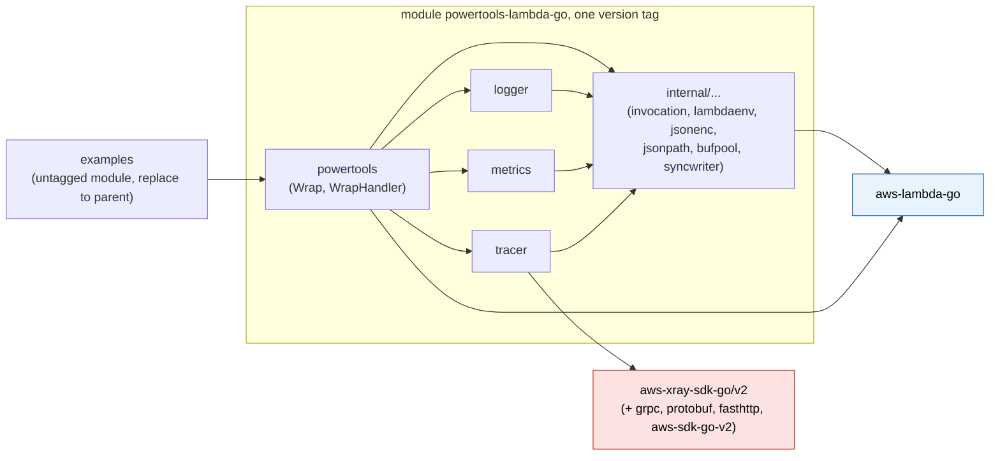
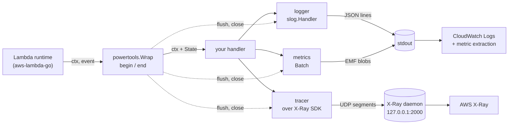

# Implementation plan: powertools-lambda-go

> Public snapshot of an internal planning document, shared in
> [aws-powertools/powertools-lambda#82](https://github.com/aws-powertools/powertools-lambda/issues/82).
> It was written with Claude (Claude Code) and reviewed by humans against the Powertools
> Python and TypeScript documentation and source, the CloudWatch EMF specification, the
> X-Ray documentation, `aws-lambda-go` and `aws-xray-sdk-go`. It is not an official
> Powertools project and it is a plan, not code. Take what is useful.
>
> License: [CC BY 4.0](LICENSE).

Status: **plan**. The files below say what the library does, why, in which order to
build it and how to prove each part correct. Every Go snippet is an illustrative example
of the intended API, not code to copy.

`powertools-lambda-go` is a Go port of the three core utilities of Powertools for AWS
Lambda (Python / TypeScript): **Logger**, **Metrics** and **Tracer**, plus the handler
wrapper that ties them to one Lambda invocation. It targets Go Lambda functions built
with `github.com/aws/aws-lambda-go` on the `provided.al2023` runtime.

## How to read this plan

| File | What it decides | Read it when |
| --- | --- | --- |
| [01-architecture.md](01-architecture.md) | Runtime facts that constrain the design, module and package layout, dependency policy, configuration model, the per-invocation state propagated through `context.Context`, the wrapper lifecycle, concurrency model, error and panic policy, and §7: deadlines, cancellation, freeze and shutdown. | Always, first. Every other file builds on its rules R1 to R11 and D1 to D7. |
| [02-logger.md](02-logger.md) | A `log/slog` handler that emits Powertools-shaped JSON; levels, sampling, buffering, correlation IDs, invocation keys. | You build or review `logger`. |
| [03-metrics.md](03-metrics.md) | CloudWatch Embedded Metric Format (EMF) emitter: batching, validation, dimensions, cold-start metric, single metrics. | You build or review `metrics`. |
| [04-tracer.md](04-tracer.md) | X-Ray tracer for the Lambda facade-segment case, with outbound propagation to `net/http` and the AWS SDK for Go v2. | You build or review `tracer`. |
| [05-performance.md](05-performance.md) | Hot-path inventory, allocation and latency budgets, benchmark protocol, CI gates. | You touch a hot path or a budget. |
| [06-testing-and-ci.md](06-testing-and-ci.md) | Test layers, conformance suites, build tags, lint, CI pipeline, release process. | You set up the repository or add a test layer. |
| [07-roadmap.md](07-roadmap.md) | Phases, task checklists, acceptance criteria, estimates, risks. | You plan or track the delivery. |
| [08-style-and-solid.md](08-style-and-solid.md) | How the Google Go style guide and SOLID are applied, with concrete rules and an API review checklist. | You review an exported API. |
| [09-open-questions.md](09-open-questions.md) | Decision log: decisions 1 to 45, each with its rationale and the section where it applies. | You wonder why something is the way it is. |
| [10-go-127-checklist.md](10-go-127-checklist.md) | Every Go 1.26 and 1.27 change checked against the plan: adopted, allowed, or not applicable, with the section that uses it. | You pick a language or standard library feature. |
| [11-maintainability.md](11-maintainability.md) | What keeps the library maintainable, the costs deliberately accepted and how each is bounded. | You weigh a new feature or dependency. |

Suggested paths through the plan:

- **Implementers (people or LLM agents):** 01 in full, then the file of the package you
  build, then 05 §3 for its budgets and 06 for its tests. The roadmap (07) gives the
  order; the decision log (09) settles any doubt. Treat every "must" and every table of
  rules as a requirement with a test.
- **Architects and reviewers:** this README, 01 §1 to §5 and §7, then 11 and 09.
- **API reviewers:** "Public API at a glance" below, 08 §3, and the Options structs in
  01 §3 and §4.2.

## Goals

1. **Parity where it matters.** Same environment variables, same JSON keys, same EMF
   shape, same X-Ray annotations and metadata keys as Powertools Python and TypeScript,
   so dashboards, log insights queries and alarms built for other runtimes work unchanged.
2. **Idiomatic Go.** Standard library first (`log/slog`, `context`, `encoding/json/v2`),
   option structs, `context.Context` as the only carrier of per-invocation state, no
   exported interfaces, no hidden global state (the few package-level variables are
   listed in 01 §5), errors returned not panicked.
3. **Lambda-correct.** Works on `provided.al2023`, with Lambda Advanced Logging Controls,
   with provisioned concurrency, and under Lambda Managed Instances multi-concurrency
   where several invocations share one process.
4. **Fast.** No reflection, no `fmt`, no regular expressions on the per-log, per-metric
   or per-segment path. Allocation budgets are tests, not aspirations (05 §3): 0
   allocations for a `LogAttrs` call with up to five scalar attributes (enabled or
   disabled), 0 for `Batch.Add` on an existing metric name, 0 for a disabled or
   unsampled `tracer.Start`, and at most 12 for the whole wrapper per invocation with
   all three utilities configured (a design that follows 01 §4 needs only 3 or 4).
5. **Context propagation end to end.** One struct per invocation carried by `ctx`;
   goroutines spawned by the handler inherit it; the X-Ray trace header flows out to
   HTTP and AWS SDK calls; the trace ID and request ID flow into every log line.

## Non-goals for v1

- OpenTelemetry export (X-Ray only, matching upstream Powertools).
- Event-source data classes, parser, idempotency, batch, parameters (later utilities).
- Lambda response streaming handlers (decision 17; 01 §7.4 says what happens to
  telemetry written while a streamed body is produced).
- A global default logger / metrics / tracer instance (decision 7).
- `WrapHandler` over `lambda.NewHandler(fn)`, and adapter APIs for the other handler
  shapes: `WrapHandler` takes only hand-written handlers that own their returned bytes,
  and every other shape is a one-line closure passed to `Wrap` (01 R8, §4.2,
  decision 29).

## Guiding principles

- **Immutable after construction, mutable per invocation.** `logger.Handler`,
  `*metrics.Metrics` and `*tracer.Tracer` are built once in `main` and never mutated.
  Everything that changes per request lives in the invocation state in `ctx`.
- **Consumers define interfaces.** The library exports concrete types and functions and
  accepts only standard-library interfaces (`io.Writer`, `slog.Handler`, `slog.Leveler`,
  `context.Context`).
- **Zero values are usable.** Every constructor takes an option struct; a `bool` whose
  default is true, and every option backed by an environment variable, is a `*bool` set
  with `new(false)` or `new(true)` (01 §3).
- **One write per record.** Every log line and every EMF blob is assembled in a pooled
  buffer and written with exactly one `Write` call through a mutex-guarded writer, so
  lines never interleave under multi-concurrency. By default logger and metrics share one
  process-wide stdout writer; a writer supplied by the consumer is not shared between
  utilities.
- **Deadline-aware, never pending.** Everything is flushed synchronously when the handler
  returns, so nothing is lost at freeze or shutdown; late goroutines can only touch their
  own invocation; an opt-in margin flushes diagnostics before a timeout (01 §7).
- **Degrade, never fail.** Observability must not break the business handler: emitter
  errors are logged and swallowed, a value that cannot be encoded never fails a call,
  and disabled or unsampled paths are no-ops that allocate nothing. Handler code runs
  unchanged, and safely, without the wrapper.
- **Least mechanism, one module, one version.** The repository publishes a single Go
  module with a single version tag (decision 25). `internal`, `logger` and `metrics`
  import only the standard library and `aws-lambda-go`; the X-Ray SDK is imported only
  by `tracer`, and the root wrapper reaches it only through exported `tracer` helpers.
  Go therefore links the SDK only into binaries that import `tracer` **or the wrapper**
  (even with tracing off). Expect `logger` and `metrics` to add on the order of a hundred KiB
  to a bare `aws-lambda-go` binary, while the wrapper, through the X-Ray SDK and its
  dependency tree, adds several MiB; a function that must stay small uses `logger` and
  `metrics` without the wrapper (01 §2).

## Module and package layout

One Go module, one `go.mod`, one version for every package (decision 25).

```text
github.com/<owner>/powertools-lambda-go   module, tagged vX.Y.Z as a whole (v0.x while the API settles, then v1)
├── go.mod                   go 1.27.0 and a toolchain line; requires aws-lambda-go, aws-xray-sdk-go/v2, smithy-go
├── powertools.go, …         package powertools: Wrap, WrapHandler, Options, ctx accessors
├── internal/                shared internals; not importable by consumers (Go internal rule)
│   ├── invocation/          per-invocation State, context key, LogBuffer
│   ├── lambdaenv/           the only reader of the environment; in-Lambda detection, trace header from ctx
│   ├── jsonenc/             append-style JSON helpers shared by logger and metrics (json/v2, jsontext)
│   ├── jsonpath/            correlation-ID paths evaluated over the raw event
│   ├── bufpool/             pooled []byte
│   ├── syncwriter/          mutex writer, one Write per record; Stdout is the shared default
│   ├── benchutil/           benchmark fixtures; never imports the X-Ray SDK
│   └── testsupport/         test helpers, including the single SA1029 trace-header helper
├── logger/                  package logger: slog.Handler, six ALC levels, Trace…Fatal(ctx, …), invocation keys, buffer
├── metrics/                 package metrics: EMF Metrics, Batch, Single, Unit
├── tracer/                  package tracer: Powertools semantics over aws-xray-sdk-go/v2
└── examples/                deployable samples (SAM); its own UNTAGGED go.mod with a replace to the parent,
    ├── go.mod               so SAM and AWS service clients never enter the library's go.mod
    ├── bare/                size baseline: lambda.Start only, no Powertools import
    ├── hello/               logger and metrics without the wrapper (size-gated against bare)
    ├── full/                Wrap with all three utilities, an AWS SDK v2 client and HTTP
    ├── benchmark/           plain and wrapped binaries for the Lambda-level measurement
    └── integration/         Go harness behind //go:build integration, against a deployed stack
```

Layout rules worth knowing before the first commit:

- `smithy-go` is a **direct** requirement: `tracer.InstrumentAWS` takes the type of
  `aws.Config.APIOptions`, which comes from `smithy-go/middleware` (decision 35).
- Storage resolution is chosen by method (`Add`, `AddHighResolution`,
  `Single.HighResolution`); `metrics` exports no resolution type (decision 43).
- Exactly one package, `internal/lambdaenv`, reads the environment (decision 33).
- `examples/bare` and `examples/hello` exist so that the size of a binary using `logger`
  and `metrics` without the wrapper can be gated against a bare baseline built in the
  same CI run (01 §2, decision 37).

### Package dependency graph



Arrows mean "imports". Go links only the packages a binary imports: a logger-only
consumer links `logger`, `internal` and `aws-lambda-go`; the X-Ray SDK is linked only
when `tracer` is imported, which the wrapper does. It does appear in every consumer's
module graph (`go.sum`), which is the accepted cost of a single version (01 §2). The
test-only `internal/benchutil` and `internal/testsupport` are left out of the graph.

### Where the data goes



## Public API at a glance

| Package | Constructors and entry points | Per-invocation helpers (all take `ctx`) |
| --- | --- | --- |
| `powertools` | `Wrap[In, Out](fn, Options)`, `WrapHandler(h, Options)`, `Options` | `ColdStart`, `RequestID`, `FunctionARN`, `RemainingTime`, `Deadline` |
| `logger` | `New(Options) *slog.Logger`, `NewHandler(Options) *Handler`, `Options`, `BufferOptions`, `ParseLevel`, `LevelTrace`…`LevelFatal`, `LevelSilent`, `CorrelationPath…` constants | `FromContext`, `Trace`, `Debug`, `Info`, `Warn`, `Error`, `Fatal`, `Log`, `AppendKeys`, `RemoveKeys`, `ResetKeys`, `Keys`, `SetCorrelationID`, `CorrelationID`, `FlushBuffer`, `ClearBuffer` |
| `metrics` | `New(Options) (*Metrics, error)`, `(*Metrics).NewBatch`, `(*Metrics).Single`, `(*Metrics).EmitColdStart`, `Unit` constants, sentinel errors | `FromContext` returns the invocation's `*Batch`: `Add`, `AddHighResolution`, `AddDimension(s)`, `AddMetadata`, `SetTimestamp`, `Flush`, `FlushSnapshot` |
| `tracer` | `New(Options) *Tracer`, `HTTPClient`, `InstrumentAWS`, `NewXRayLogger`, `(*Tracer).Start`, `(*Tracer).Capture`, `(*Tracer).CaptureResult` | `Start`, `Capture`, `CaptureResult`, `AddAnnotation`, `AddMetadata`, `AddResponseMetadata`, `AddErrorMetadata`, `Header`, `TraceID`, `FromContext` |

The wrapper-plumbing type `tracer.HandlerEnd` and the method `(*Tracer).EndHandler` are
exported only because `internal/...` must never reach the X-Ray SDK; consumers of `Wrap`
never call them (01 §4.2, decision 44).

A function end to end, with its dependencies held in a small struct so tests can build
the same thing (`Order`, `Receipt` and `charge` are omitted):

```go
package main

import (
    "context"
    "log"
    "log/slog"
    "net/http"
    "time"

    "github.com/aws/aws-lambda-go/lambda"
    "github.com/aws/aws-xray-sdk-go/v2/xray"

    "github.com/<owner>/powertools-lambda-go"
    "github.com/<owner>/powertools-lambda-go/logger"
    "github.com/<owner>/powertools-lambda-go/metrics"
    "github.com/<owner>/powertools-lambda-go/tracer"
)

type app struct {
    met      *metrics.Metrics // for single metrics; the per-invocation batch comes from ctx
    payments *http.Client     // instrumented once at init, reused by every invocation
}

func main() {
    lg := logger.New(logger.Options{Service: "payment"})
    met, err := metrics.New(metrics.Options{Namespace: "ServerlessAirline", Service: "payment"})
    if err != nil {
        log.Fatal(err) // invalid namespace, service or default dimension: a configuration bug
    }
    trc := tracer.New(tracer.Options{Service: "payment"})

    // SDK diagnostics as JSON lines. The library never sets SDK globals, and the SDK's
    // default logger writes plain text that Lambda's log-level filtering reads as INFO.
    xray.SetLogger(tracer.NewXRayLogger(lg))

    a := &app{met: met, payments: tracer.HTTPClient(&http.Client{Timeout: 5 * time.Second})}
    lambda.Start(powertools.Wrap(a.handle, wrapOptions(lg, met, trc)))
}

// wrapOptions is shared by main and the tests, so the tests run the deployed options.
func wrapOptions(lg *slog.Logger, met *metrics.Metrics, trc *tracer.Tracer) powertools.Options {
    return powertools.Options{
        Logger:                 lg,
        Metrics:                met,
        Tracer:                 trc,
        HandlerName:            "main.handle", // a method value would derive "main.(*app).handle-fm"
        LogEvent:               new(true),     // *bool: nil means POWERTOOLS_LOGGER_LOG_EVENT
        CorrelationIDPath:      "id",          // the order id becomes correlation_id on every line
        CaptureColdStartMetric: true,
        DeadlineMargin:         500 * time.Millisecond, // flush logs and metrics before a timeout
    }
}

func (a *app) handle(ctx context.Context, in Order) (Receipt, error) {
    lg := logger.FromContext(ctx)                    // *slog.Logger bound to this invocation
    logger.AppendKeys(ctx, slog.String("order_id", in.ID)) // on every later line of this invocation
    lg.InfoContext(ctx, "collecting payment")        // {"level":"INFO","message":...,"order_id":...}
                                                     // pass ctx: lg.Info alone would lose the invocation keys
    logger.Trace(ctx, "order received", "items", len(in.Items)) // TRACE level, logger resolved from ctx

    // Nil-safe: returns nil when the invocation is not traced. Never call
    // tracer.FromContext(ctx).AddAnnotation: the SDK segment is nil then, and it panics.
    _ = tracer.AddAnnotation(ctx, "order_id", in.ID)

    if err := metrics.FromContext(ctx).Add("SuccessfulBooking", metrics.Count, 1); err != nil {
        lg.WarnContext(ctx, "metric rejected", "error", err) // invalid name, unit or value; never fatal
    }

    // Leave room for the wrapper's end-of-invocation flush before the Lambda deadline.
    // Without a deadline (tests, local runs) RemainingTime means "no limit".
    ctx, cancel := context.WithTimeout(ctx, powertools.RemainingTime(ctx)-200*time.Millisecond)
    defer cancel()

    return tracer.CaptureResult(ctx, "charge", func(ctx context.Context) (Receipt, error) {
        return a.charge(ctx, in) // calls through a.payments become "remote" subsegments
    })
}
```

## Usage examples (intended API)

Short, realistic examples of how callers use each utility. They are illustrative:
imports and some error handling are trimmed, and the per-utility files have the full
rules.

**Logger without the wrapper** (a CLI, a container, a test). Every package-level helper
takes `ctx`; without the wrapper there are no Lambda keys and no sampling.

```go
lg := logger.New(logger.Options{
    Service:         "payment",
    Level:           logger.LevelTrace, // ignored when AWS_LAMBDA_LOG_LEVEL is set
    PersistentAttrs: []slog.Attr{slog.String("region", "eu-west-1")},
})
lg.LogAttrs(ctx, slog.LevelInfo, "started", slog.Int("workers", 4)) // budget: 0 allocations up to 5 scalar attrs
slog.SetDefault(lg)                                                  // optional: logger.FromContext falls back to it
```

**Buffering debug lines until something goes wrong** (needs the wrapper, which owns the
per-invocation buffer):

```go
lg := logger.New(logger.Options{
    Level:  slog.LevelDebug,                     // records must pass the level to be buffered
    Buffer: logger.BufferOptions{Enabled: true}, // DEBUG and below buffered; flushed on the first ERROR
})
opts := powertools.Options{Logger: lg, FlushBufferOnUncaughtError: true}

// inside the handler
logger.Debug(ctx, "cache miss", "key", k)  // buffered, written only if the invocation fails
                                           // (the cold-start invocation is never buffered)
logger.SetCorrelationID(ctx, in.OrderID)   // or Options.CorrelationIDPath / CorrelationIDFunc
```

**Metrics: one batch per invocation, plus single metrics.**

```go
func (a *app) book(ctx context.Context, in Booking) (Receipt, error) {
    b := metrics.FromContext(ctx)              // the wrapper's batch; a nil *Batch (no-op) without the wrapper
    _ = b.AddDimension("operation", "book")    // joins the batch's dimension set, after the defaults
    _ = b.Add("Bookings", metrics.Count, 1)
    _ = b.AddHighResolution("Latency", metrics.Milliseconds, 12.5) // StorageResolution 1, chosen by method
    b.AddMetadata("booking_id", in.ID)         // not a dimension; a bad value is dropped with one WARN

    // A metric with its own dimensions, written immediately in its own EMF blob.
    if err := a.met.Single("PaymentDeclined", metrics.Count, 1).
        AddDimension("provider", "acme").
        Emit(); err != nil {                   // the builder keeps the first error and returns it here
        logger.Warn(ctx, "single metric rejected", "error", err)
    }

    return Receipt{OrderID: in.ID}, nil        // the wrapper flushes b after the handler returns
}

// Without the wrapper, the caller owns the batch and the flush.
func runJob(ctx context.Context, met *metrics.Metrics) error {
    b := met.NewBatch()
    _ = b.Add("Jobs", metrics.Count, 1)
    if err := b.Flush(); errors.Is(err, metrics.ErrNamespaceMissing) {
        return err                             // configuration bug: no namespace anywhere
    }

    return nil
}
```

**Tracer: subsegments, annotations and outbound calls.**

```go
// At init: instrument clients once and reuse them. Both are no-ops when tracing is off.
tracer.InstrumentAWS(&awsCfg.APIOptions)                                // "aws" subsegments; before building clients
httpClient := tracer.HTTPClient(&http.Client{Timeout: 5 * time.Second}) // "remote" subsegments

// In the handler:
err := tracer.Capture(ctx, "reserve", func(ctx context.Context) error {
    _ = tracer.AddAnnotation(ctx, "sku", in.SKU) // searchable; nil-safe
    _ = tracer.AddMetadata(ctx, "request", in)   // counted against the per-invocation metadata budget
    return reserve(ctx, httpClient, in)
})

ctx, seg := tracer.Start(ctx, "parse") // manual form; seg is nil when not traced
items, err := parse(ctx, in)
if seg != nil {                        // Close is nil-safe but not free; hot paths check
    seg.Close(err)
}

req.Header.Set("X-Amzn-Trace-Id", tracer.Header(ctx)) // any other client; forwards Sampled=0 too
```

**Other handler shapes and hand-written handlers** (01 §4.2):

```go
// func(context.Context, Event) error: a one-line closure for Wrap
lambda.Start(powertools.Wrap(func(ctx context.Context, e Event) (any, error) {
    return nil, process(ctx, e)
}, opts))

// A hand-written lambda.Handler that owns its response bytes (never lambda.NewHandler(fn))
lambda.Start(powertools.WrapHandler(&router{}, opts))

// Graceful shutdown of the consumer's own resources composes with the wrapper (01 §7.7)
lambda.StartWithOptions(powertools.Wrap(a.handle, opts), lambda.WithEnableSIGTERM(func() { db.Close() }))
```

**Testing handler code.** The handler runs unchanged without the wrapper: the logger
falls back to `slog.Default()`, `metrics.FromContext` returns a nil batch whose methods
are no-ops, the nil-safe tracer helpers do nothing, and `RemainingTime` returns the
maximum duration, so `context.WithTimeout(ctx, RemainingTime(ctx)-margin)` does not
expire at once. Tests that need the wrapper's behaviour call the wrapped function
directly with a `lambdacontext.NewContext` and, for tracing, a trace header in `ctx`
(through the one test helper of 01 R2). Environment variables are set with `t.Setenv`
**before** calling the constructors, because constructors read the environment once
(01 §3).

```go
func TestHandle(t *testing.T) {
    t.Setenv("POWERTOOLS_METRICS_NAMESPACE", "Test")
    var logs, emf bytes.Buffer
    lg := logger.New(logger.Options{Writer: &logs})
    met, err := metrics.New(metrics.Options{Writer: &emf})
    if err != nil {
        t.Fatal(err)
    }
    a := &app{met: met, payments: fakePayments(t)} // an httptest server's client
    h := powertools.Wrap(a.handle, wrapOptions(lg, met, nil)) // the deployed options, no tracer
    ctx := lambdacontext.NewContext(t.Context(), &lambdacontext.LambdaContext{AwsRequestID: "req-1"})

    if _, err := h(ctx, Order{ID: "o-1"}); err != nil {
        t.Fatalf("handle() error = %v", err)
    }
    // Decode logs and emf (one JSON document per line) with encoding/json/v2 and compare
    // with cmp.Diff: every line carries function_request_id "req-1" and correlation_id
    // "o-1"; the first invocation of the process writes a ColdStart blob, then the batch
    // blob holds SuccessfulBooking.
}
```

## Milestones

| # | Milestone | Outcome |
| --- | --- | --- |
| M0 | Scaffolding | Repo layout, CI, lint, Makefile, decision log copied into the repository, release tool on top of a seed tag `v0.0.0` |
| M1 | Foundation and API freeze | `internal/*`, root wrapper, invocation state, cold start, env precedence; the final exported signatures of logger, metrics and tracer as documented no-op stubs, so the wrapper's `begin`/`end` is complete against a frozen API |
| M2 | Logger | slog handler passes `testing/slogtest`, parity output, buffering, sampling |
| M3 | Metrics | EMF output validated against the AWS schema, limits, cold-start metric |
| M4 | Tracer | Layer over the X-Ray SDK: handler segment, capture helpers, nil-safe helpers, tests against a per-test UDP listener |
| M5 | Examples and integration | Examples with SDK v2 and HTTP instrumentation, size job, integration harness |
| M6 | Performance and first stable release | Budgets locked as tests, A/B benchmark gate, docs, API review (08 §3), v1 |

M2, M3 and M4 run in parallel once M1 has frozen the exported API: each fills in only its
own package and its own wrapper test file, so the three never edit the same file. Every
milestone that merges features releases a v0 minor version, cut by the release tool from
conventional commits; the first stable release follows the API review (decisions 27, 28,
34). The deployed smoke test and the Lambda-level init and overhead checks of M5 need an
AWS account; they are acceptance checks run against the release, not release blockers,
because cutting a release needs no AWS (decision 41, 07).

Estimates and task breakdown are in [07-roadmap.md](07-roadmap.md).

## Prior art

- Powertools for AWS Lambda (Python v3.36.0, TypeScript v2.x): the behavioural reference.
- The Go proposal issue aws-powertools/powertools-lambda#82 (open, labelled
  `need-customer-influence`): suggests `NewLambdaHandler`, `powertoolslog`,
  `powertoolsmetrics`, `powertoolstracing`, X-Ray SDK, and one comment asks for `slog`
  instead of third-party loggers. This plan follows the `slog` comment and the
  per-utility package split, but uses one handler wrapper and option structs.
- `rambow-cloud/powertools-lambda-go` (community, MIT): an existing Go port of the
  TypeScript edition with OpenTelemetry-based tracing. The behavioural contracts of this
  plan are tied to the official Python and TypeScript editions and the AWS SDKs, so it
  is not used as a reference (decision 9).

## Sources consulted

- Powertools TypeScript docs: Logger, Metrics, Tracer feature pages; `Tracer.ts` source.
- Powertools Python docs and source: `logging/formatter.py`, `tracing/tracer.py`,
  `metrics/provider/cloudwatch_emf/cloudwatch.py`, `shared/constants.py`.
- CloudWatch EMF specification (structure, limits, JSON schema, unit list).
- X-Ray segment documents and "Sending trace data" (daemon UDP protocol, trace ID format).
- Lambda docs: Go handler signatures, reserved environment variables, log-level
  filtering, execution environment lifecycle.
- `aws-lambda-go` v1.55.1 source: `lambda/handler.go`, `lambda/entry.go`,
  `lambda/invoke_loop.go`, `lambdacontext/context.go`, `lambda/handlertrace/trace.go`.
- `aws-xray-sdk-go` v2.0.4 source: `xray/segment.go`, `xray/segment_model.go`,
  `xray/lambda.go`, `xray/context.go`, `xray/capture.go`, `xray/config.go`,
  `xray/client.go`, `xray/default_emitter.go`, `xray/default_streaming_strategy.go`,
  `header/header.go`, `instrumentation/awsv2/awsv2.go`, `go.mod`.
- Go 1.26 and Go 1.27 release notes; the Go blog post "Go 1.27 is released"; the
  VictoriaMetrics "Go 1.27" feature write-up; `log/slog`, `testing/slogtest`,
  `testing/synctest` and `runtime/pprof` package docs.
- `dkorunic/betteralign` README (struct field alignment tool used for hot structs).
- Google Go style guide, decisions and best practices.
